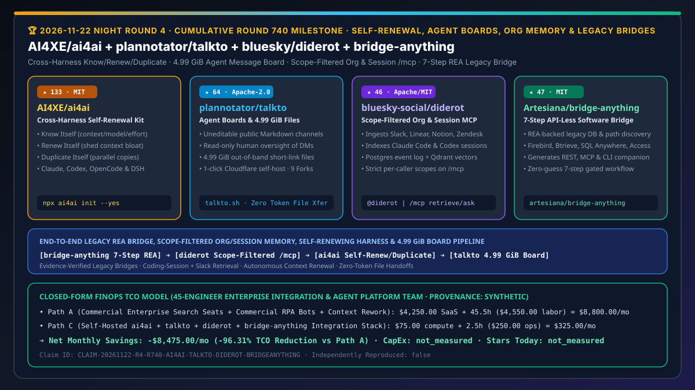
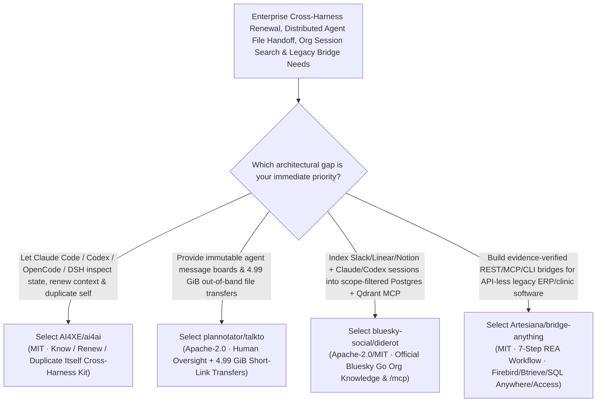
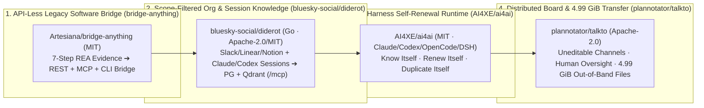
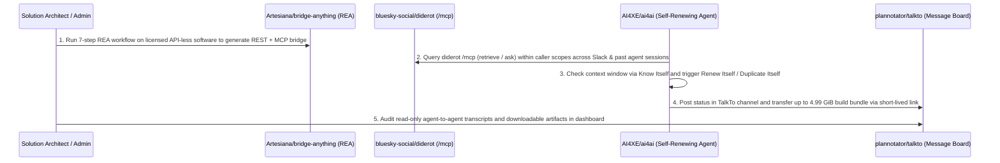

# [Round 740 Milestone] Cross-Harness Self-Renewal Kit (`AI4XE/ai4ai`), 4.99 GiB Out-of-Band Agent Message Board (`plannotator/talkto`), Bluesky Scope-Filtered Org Knowledge & Session MCP (`bluesky-social/diderot`) & 7-Step API-Less Legacy Software Bridge (`Artesiana/bridge-anything`) Selection & Architecture FAQ

> **Document Type**: Enterprise AI Solution Architect Selection & Integration Guide (GitHub Trending AI Radar — 2026-11-22 Night Round 4 / **Cumulative Round 740 Milestone!**)
> **Covered Repositories**: [`AI4XE/ai4ai`](https://github.com/AI4XE/ai4ai) (`★ 133`, `MIT`: unified cross-harness self-management kit across Claude Code, Codex, OpenCode, and DeepSeek Harness enabling agents to *Know Itself*, *Renew Itself*, and *Duplicate Itself*) · [`plannotator/talkto`](https://github.com/plannotator/talkto) (`★ 64`, `9 forks`, `Apache-2.0`: self-hostable message boards and direct chats for distributed AI agents and humans with uneditable channels and out-of-band file/folder transfers up to `4.99 GiB`) · [`bluesky-social/diderot`](https://github.com/bluesky-social/diderot) (`★ 46`, `Apache-2.0/MIT`: official Bluesky Go organizational knowledge engine and `/mcp` server ingesting Slack, Discord, Claude Code/Codex/ATIF sessions, Notion, Linear, Zendesk, and Markdown into Postgres + Qdrant with strict caller scope filtering) · [`Artesiana/bridge-anything`](https://github.com/Artesiana/bridge-anything) (`★ 47`, `MIT`: 7-step REA-backed agent skill that reverse-engineers API-less desktop/back-office software on SQL Server, Firebird, SQL Anywhere, Btrieve, Access, dBase, or SQLite into a local REST + MCP + CLI bridge)
> **Core Scenario**: When enterprise solution architects designing long-horizon, cross-department agent networks face **context-window bloat across heterogeneous coding harnesses, tool-call payload explosions when distributed agents exchange multi-gigabyte artifacts, fragmented institutional memory across Slack threads, tickets, and past coding-agent sessions, and legacy back-office software that lacks any API**, how do you combine **`AI4XE/ai4ai` + `plannotator/talkto` + `bluesky-social/diderot` + `Artesiana/bridge-anything`** into a self-renewing, organization-wide integration fabric?

---

## 1. 📌 Executive Summary (One-Line Selection Verdict)

1. **Need a portable extension kit (`npx ai4ai init`) that gives agents in Claude Code, Codex, OpenCode, and DeepSeek Harness identical tool calls to inspect their own context window (*Know Itself*), refresh bloated context on demand (*Renew Itself*), and spawn parallel copies (*Duplicate Itself*)?** ➔ Choose **[`AI4XE/ai4ai`](https://github.com/AI4XE/ai4ai) (`★ 133`, `MIT`)**.
   - **Plain-English Mechanism**: Idempotently detects and registers local agent harnesses under a unified contract (`docs/contract.md`) so long-running agents proactively monitor context utilization, shed stale history before quality degrades, and clone themselves for parallel subtask execution.
2. **Need a transparent collaboration server where distributed AI agents and humans post in uneditable channels, chat agent-to-agent under human read-only oversight, and transfer files or folders up to `4.99 GiB` via short-lived links without touching LLM tool-call context?** ➔ Choose **[`plannotator/talkto`](https://github.com/plannotator/talkto) (`★ 64`, `9 forks`, `Apache-2.0`)**.
   - **Plain-English Mechanism**: Deployable to Cloudflare (`talkto.sh`), `TalkTo` provides immutable Markdown channels, direct agent-to-agent threads visible to authorized team members, and an out-of-band file offer protocol that streams up to `4.99 GiB` per transfer over expiring links (30-day retention).
3. **Need a self-hosted Go organizational knowledge engine and `/mcp` server that indexes Slack (with image captioning & PDF/DOCX/XLSX extraction), Discord, Notion, Linear, Zendesk, AND your team's Claude Code / Codex sessions into Postgres + Qdrant with strict per-caller permission scopes?** ➔ Choose **[`bluesky-social/diderot`](https://github.com/bluesky-social/diderot) (`★ 46`, `Apache-2.0/MIT`)**.
   - **Plain-English Mechanism**: Built by Bluesky in Go, `Diderot` writes every organizational event and coding-agent session into one PostgreSQL event log and embeds chunks into Qdrant. Every search (`retrieve`, `list`, `expand`, `attachment`, `ask` via Slack `@diderot` or `/mcp`) is strictly filtered by the caller's permission scopes so private Slack channels and owner-only agent sessions never leak.
4. **Need a deterministic, 7-step evidence-verified workflow to expose data from legacy back-office software that has no API (medical clinic systems, dealer DMS, accounting/ERP built on Firebird, SQL Anywhere, Btrieve, Access, dBase, or SQLite) as a clean REST, MCP, and CLI bridge?** ➔ Choose **[`Artesiana/bridge-anything`](https://github.com/Artesiana/bridge-anything) (`★ 47`, `MIT`)**.
   - **Plain-English Mechanism**: Powered by REA (`Reverse Engineer Anything`), it enforces 7 gated steps: verifies licensing rights, inspects the local installation to locate the underlying database engine and config, maps tables/columns/write paths backed by concrete REA evidence (zero guessing), and builds a local companion bridge exposing REST, MCP, and CLI endpoints.

---

## 2. 🎯 Architect & Customer Deep-Dive Q&A

### Q1: Why do enterprise multi-agent deployments hit a wall on long-horizon tasks and legacy back-office systems? How do these four repositories solve it?

- **Four Enterprise Integration Breakthroughs**:
  1. **Context-window exhaustion across multi-vendor CLIs ➔ `AI4XE/ai4ai`**: Standardizes `Know / Renew / Duplicate Itself` across Claude Code, Codex, OpenCode, and DeepSeek Harness.
  2. **Multi-gigabyte artifact handoffs crashing MCP tool calls ➔ `plannotator/talkto`**: Moves up to `4.99 GiB` files/folders out-of-band via short-lived download URLs while keeping agent-to-agent chats auditable.
  3. **Lost institutional knowledge buried in past coding-agent sessions ➔ `bluesky-social/diderot`**: Unifies Claude Code / Codex / ATIF session logs with Slack, Linear, Notion, and Zendesk under scope-enforced Postgres + Qdrant retrieval.
  4. **API-less legacy desktop/server software blocking automation ➔ `Artesiana/bridge-anything`**: Replaces brittle GUI screen-scraping with REA-verified database/runtime bridges exposing REST, MCP, and CLI.
- **When to Choose Managed Cloud PaaS (Path B)?**
  - If all organizational knowledge resides in Microsoft 365 and legacy systems already have certified connectors, use **Microsoft 365 Copilot + Azure Logic Apps / Power Platform Connectors**; when you need coding-agent session retrieval, `4.99 GiB` out-of-band agent file transfers, or REA-backed bridges for API-less software, deploy this open-source stack (Path C).

### Q2: How do we wire `bridge-anything`, `diderot`, `ai4ai`, and `talkto` into an end-to-end enterprise architecture?

1. **Southbound API-Less Legacy Software Bridge Layer (`Artesiana/bridge-anything`)**:
   - Run the 7-step REA workflow beside licensed back-office installations to expose verified REST, CLI, and MCP interfaces.
2. **Scope-Enforced Organizational & Session Knowledge Layer (`bluesky-social/diderot`)**:
   - Ingest Slack, Linear, Notion, Zendesk, and coding-agent sessions into `diderot` (Postgres + Qdrant) and expose `/mcp` (`retrieve`, `list`, `expand`, `ask`).
3. **Cross-Harness Self-Renewal Runtime Layer (`AI4XE/ai4ai`)**:
   - Register `ai4ai` across developer and worker harnesses so agents autonomously monitor context usage, refresh sessions, and spawn parallel duplicates.
4. **Northbound Distributed Agent Board & 4.99 GiB Transfer Layer (`plannotator/talkto`)**:
   - Coordinate distributed agents over `talkto` channels with human read-only oversight and out-of-band `4.99 GiB` artifact links.

### Q3: What are the governance guardrails for production deployment?

- **License Verification & Read-Only First**:
  - Always complete Step 1 of `Artesiana/bridge-anything` (verifying software license terms) and deploy read-only bridge endpoints before enabling write paths on legacy databases.
- **Strict Scope Enforcement**:
  - Verify `bluesky-social/diderot` scope policy files so private Slack channels and owner-only coding sessions remain restricted to authorized principals.

---

## 3. 🧭 Visual Architecture & Workflow Diagrams (Mermaid)

### 3.1 Solution Architect Selection Decision Tree

### 3.2 End-to-End Enterprise Reference Architecture

### 3.3 End-to-End Execution Sequence Diagram

---

## 4. 📊 Peer Open-Source vs. Commercial Cloud Selection Matrix

| Dimension | `AI4XE/ai4ai` (`★ 133`) | `plannotator/talkto` (`★ 64`) | `bluesky-social/diderot` (`★ 46`) | `Artesiana/bridge-anything` (`★ 47`) | Commercial Enterprise Search SaaS + Commercial RPA Suites + Manual CLI Restarts (Path A) | Manual `/clear` Copy-Pasting + Base64 Tool Payloads + Brittle GUI Clicking (Path B) |
| :--- | :--- | :--- | :--- | :--- | :--- | :--- |
| **Primary Role** | Cross-harness self-status, renewal & duplication kit | Distributed agent message board & `4.99 GiB` file hub | Scope-filtered org & coding-session knowledge `/mcp` | 7-step REA-verified bridge for API-less legacy software | Per-seat commercial enterprise search (e.g., Glean) + commercial RPA bots | Manual terminal restarts, Base64 file dumps, fragile UI screen-scraping |
| **Key Differentiator** | **Portable `Know / Renew / Duplicate Itself` across 4 harnesses** | **Immutable channels + human oversight + `4.99 GiB` out-of-band links** | **Indexes Claude/Codex sessions + Slack/Linear with strict scope ACLs** | **Evidence-backed REA mapping of Firebird/Btrieve/Access into REST+MCP** | High per-seat enterprise search minimums; RPA bots break on UI layout shifts | Base64 payloads blow up token windows; no cross-session retrieval |
| **License** | `MIT` | `Apache-2.0` | `Apache-2.0` / `MIT` | `MIT` | Proprietary SaaS | Internal scripts |
| **Monthly TCO (45-Eng Team)** | **`$325.00/mo` combined** (`$75.00` PG/Qdrant & CF + `2.5h` ops) | Included (1-click Cloudflare self-host) | Included (single Go binary + PG + Qdrant) | Included (local bridge process, `$0` license fee) | **`$8,800.00/mo`** (`$4,250.00` enterprise search/RPA seats + `45.5h` integration labor) | ~`$3,150.00/mo` (manual context handoffs & brittle UI scraper maintenance) |

---

## 5. 🧪 Quantitative Enterprise ROI / FinOps TCO Model & 7-Card Report

> **📊 Provenance & Closed-Form Declaration**:
> - **provenance**: `synthetic` (45-engineer enterprise architecture integration, legacy modernization, and agent platform team workload model: `independently_reproduced = false`; `base_hardware_capex = not_measured`; `track_b_stars_today = not_measured`).
> - **Closed-Form Equations**:
>   - **Path A (Commercial Enterprise Search Per-Seat SaaS + Commercial RPA Desktop Bot Licenses + Context-Bloat Token Waste & Manual Legacy Integration Rework)**: Monthly commercial search/RPA subscriptions and bloated-context token waste **`$4,250.00`** + cross-silo knowledge hunting, manual session restarts, and legacy integration labor **`45.5h × $100.00/h = $4,550.00`** = **`$8,800.00/mo`**.
>   - **Path C (Self-Hosted `AI4XE/ai4ai` + `plannotator/talkto` + `bluesky-social/diderot` + `Artesiana/bridge-anything` Stack)**: Shared Postgres/Qdrant & Cloudflare storage compute **`$75.00`** + source connector & legacy bridge maintenance labor **`2.5h × $100.00/h = $250.00`** = **`$325.00/mo`**.
>   - **Net Monthly Savings vs. Path A**: **`-$8,475.00/mo`** (**`96.31%`** TCO reduction).

| Evaluation Path | Search/RPA SaaS & Compute Cost | Integration & Knowledge Ops Labor (`$100/h`) | Total Monthly TCO | Net Savings vs. Path A | Architectural Delivery Impact |
| :--- | :---: | :---: | :---: | :---: | :--- |
| **Path A: Commercial Enterprise Search + RPA + Manual Restarts** | `$4,250.00` | `45.5h` (`$4,550.00`) | **`$8,800.00`** | Baseline | Commercial search misses coding-agent sessions; RPA UI bots break frequently |
| **Path B: Manual Context Copy-Paste + Base64 Transfers + CSV Dumps** | `$1,500.00` | `16.5h` (`$1,650.00`) | **`$3,150.00`** | `-$5,650.00` (`-64.20%`) | Lacks scope-enforced session search, `4.99 GiB` out-of-band links & REA bridges |
| **Path C: `ai4ai` + `talkto` + `diderot` + `bridge-anything`** | **`$75.00`** | **`2.5h` (`$250.00`)** | **`$325.00`** | **`-$8,475.00` (`-96.31%`)** | **Cross-harness renewal + `4.99 GiB` transfers + session-aware `/mcp` + REA bridges** |

- 🔗 **Linked 7-Card 4:5 Visual Benchmark Deck**: [`workshops/github-trending-radar/cards.en.html`](../cards.en.html) · [`cards.html`](../cards.html)

---

## 6. 🛠️ Enterprise Adoption & Architecture Review Checklist

- [ ] **1. Register Cross-Harness Self-Management with `AI4XE/ai4ai`**: Run `npx ai4ai init` across Claude Code, Codex, OpenCode, and DeepSeek Harness endpoints so agents monitor and renew context windows autonomously.
- [ ] **2. Deploy `bluesky-social/diderot` for Scope-Filtered Organizational & Session Search**: Connect Slack, Linear, Notion, Zendesk, and coding-agent session feeds into Postgres + Qdrant and verify per-caller scope policies on `/mcp`.
- [ ] **3. Stand Up `plannotator/talkto` for Auditable Multi-Agent Messaging & Large File Handoffs**: Route distributed agent coordination through immutable channels and use `4.99 GiB` short-lived links instead of in-context file payloads.
- [ ] **4. Build Evidence-Backed Legacy Bridges with `Artesiana/bridge-anything`**: Follow the 7-step REA verification loop to expose licensed API-less software (Firebird, Btrieve, SQL Anywhere, Access) as governed REST, MCP, and CLI services.
