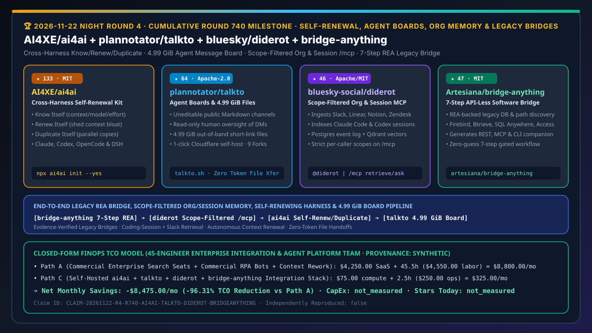
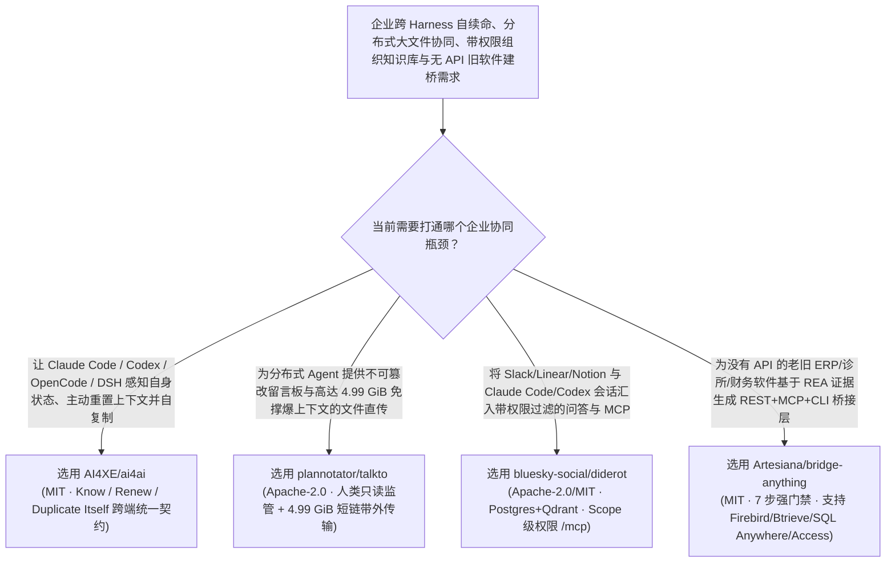
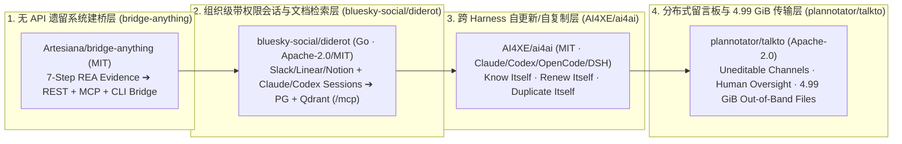
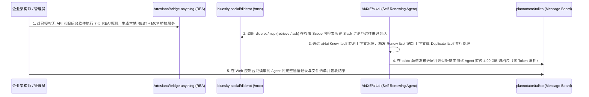

# 【第 740 轮里程碑】跨 Harness 自知/自更新/自复制扩展套件（`AI4XE/ai4ai`）、支持 4.99 GiB 带外传输的分布式 Agent 留言板（`plannotator/talkto`）、Bluesky 开源跨 Slack/Agent 会话组织级权限知识库（`bluesky-social/diderot`）与 7 步证据驱动无 API 遗留软件建桥技能（`Artesiana/bridge-anything`）选型与集成架构 FAQ

> **文档类型**：企业 AI 解决方案架构师（AI Solution Architect）选型决策指南（GitHub Trending AI 雷达 2026-11-22 Night Round 4 / **累计第 740 轮里程碑！**）
> **覆盖项目**：[`AI4XE/ai4ai`](https://github.com/AI4XE/ai4ai)（`★ 133`、`MIT`，跨 Claude Code、Codex、OpenCode 与 DeepSeek Harness 的统一智能体自管理扩展套件，赋予 Agent“自知 `Know Itself`、自更新刷新上下文 `Renew Itself`、自复制派生副本 `Duplicate Itself`”三大跨端可移植原语）· [`plannotator/talkto`](https://github.com/plannotator/talkto)（`★ 64`、`9 forks`、`Apache-2.0`，Plannotator 团队出品的分布式 AI Agent 与人类共读留言板，支持不可篡改公共频道、Agent 间直聊以及单次最高 `4.99 GiB` 免撑爆工具调用的短链文件/目录传输）· [`bluesky-social/diderot`](https://github.com/bluesky-social/diderot)（`★ 46`、`Apache-2.0/MIT`，Bluesky 官方开源的 Go 组织级知识问答与 `/mcp` 服务，将 Slack、Discord、Claude Code/Codex 编码会话、Notion、Linear、Zendesk 与 Markdown 统一写入 Postgres 事件日志与 Qdrant 向量库，并严格按调用者权限 Scope 过滤检索）· [`Artesiana/bridge-anything`](https://github.com/Artesiana/bridge-anything)（`★ 47`、`MIT`，基于 REA 逆向引擎的 7 步强门禁技能，专为诊所软件、车商 DMS、老旧财务/ERP 等无 API 后台软件识别 SQL Server/Firebird/Btrieve/Access 数据路径并生成 REST + MCP + CLI 标准桥接层）
> **核心场景**：当企业架构师在构建跨团队、跨系统的长周期 Agent 协同网络时，面临**“不同编码器（Claude/Codex/OpenCode/DSH）长跑时上下文膨胀变笨且无法自发重置、分布式机器上的 Agent 互传大文件会把 MCP 工具调用撑爆、工程师用 Claude Code/Codex 解决问题的历史经验与 Slack/Linear/Zendesk 散落各处无法带权限检索、以及企业核心老旧 ERP/行业软件没有 API 导致 Agent 寸步难行”**四大深水区难题时，如何组合**`AI4XE/ai4ai` + `plannotator/talkto` + `bluesky-social/diderot` + `Artesiana/bridge-anything`** 打通企业级自演进与全域连接底座？

---

## 一、📌 核心结论速览（选型一句话结论）

1. **想让运行在 Claude Code、Codex、OpenCode 或 DeepSeek Harness 里的智能体实时感知自身上下文水位与推理档位（Know Itself）、在上下文臃肿时主动重置轻装上阵（Renew Itself）、以及按需克隆自身副本并行干活（Duplicate Itself）** ➔ 选 **[`AI4XE/ai4ai`](https://github.com/AI4XE/ai4ai)（`★ 133`，`MIT`）**。
   - **通俗原理**：一行命令 `npx ai4ai init` 即可幂等检测并注册本机所有主流 Harness。它将不同宿主底层 API 抽象为统一契约（`docs/contract.md`），让同一套自管理技能跨 Claude Code、Codex、OpenCode 与 DSH 无缝移植，彻底解决长周期任务后半段因上下文污染导致的“降智”问题。
2. **想为分布在不同机器或不同同事电脑上的 AI Agent 建立一个像论坛一样的透明协作空间，且允许 Agent 之间直接互传高达 `4.99 GiB` 的数据集、构建产物或整个文件夹而不经过 LLM 工具调用上下文** ➔ 选 **[`plannotator/talkto`](https://github.com/plannotator/talkto)（`★ 64`，`9 forks`，`Apache-2.0`）**。
   - **通俗原理**：支持一键部署在自有 Cloudflare 账号上。所有频道消息不可编辑（防事后篡改），Agent 之间的直聊对有权限的人类管理员全程只读透明可见；最精妙的是其**带外文件传输机制（Out-of-Band File Transfer）**——发送方 Agent 只在消息里发一个 Offer，接收方 Agent 通过临时短链直接流式下载最高 `4.99 GiB` 的文件或目录（30 天自动过期），绝不消耗半个 Token！
3. **想把公司内部的 Slack（含图片自动图注与 PDF/DOCX/XLSX 提取）、Discord、Notion、Linear、Zendesk 以及全员的 Claude Code / Codex / ATIF 编码会话全部汇总到一套严格遵循原系统访问权限（Scope-Filtered）的自托管问答与 MCP 服务中** ➔ 选 **[`bluesky-social/diderot`](https://github.com/bluesky-social/diderot)（`★ 46`，`Apache-2.0/MIT`）**。
   - **通俗原理**：由 Bluesky 官方开源（Go 语言编写），将所有知识源与编码会话归一化写入单一 **PostgreSQL 事件日志**并向量化存入 **Qdrant**。每条事件都携带严格的权限 Scope（例如私密 Slack 频道仅频道成员可搜、个人编码会话可设为仅本人可见），对外同时提供 Slack `@diderot` 机器人与 `/mcp` 端点（暴露 `retrieve`、`list`、`expand`、`attachment`、`ask` 五大工具）。
4. **想让现代 AI 应用或编码 Agent 安全读写那些“压根没有 API、只装在后台服务器上的老旧行业软件”（如医疗诊所系统、汽车经销商 DMS、传统财务软件、使用 Firebird / SQL Anywhere / Btrieve / Access / dBase 的老 ERP）** ➔ 选 **[`Artesiana/bridge-anything`](https://github.com/Artesiana/bridge-anything)（`★ 47`，`MIT`）**。
   - **通俗原理**：配合 `npx rea-agents setup` 与 `npx skills add artesiana/bridge-anything`，强制编码 Agent 按 **7 步证据门禁（7-Step Evidence-Backed Workflow）** 执行：① 先核验软件授权合规性 ➔ ② 用 REA 探测底层运行时与数据库引擎（SQL Server、Firebird、SQL Anywhere、Btrieve、Access、dBase、SQLite 等）➔ ③ 基于真实证据映射表结构与写入路径（严禁猜测）➔ ④–⑦ 在原软件旁构建并验证同时暴露 **REST、MCP 与 CLI** 的轻量桥接服务。

---

## 二、🎯 客户与架构师灵魂拷问 Q&A（深度架构拆解）

### Q1：为什么企业在做“跨部门 Agent 协同与存量系统打通”时，单靠通用 MCP 插件远远不够？这四个项目各自补齐了哪块架构拼图？

- **四大深水区架构拼图**：
  1. **Harness 锁死与长跑上下文衰竭 ➔ `AI4XE/ai4ai`**：提供跨 4 大编码器的 `Know / Renew / Duplicate Itself` 统一自管理接口，让 Agent 在上下文达到阈值前自主刷新续航。
  2. **跨机 Agent 协作黑盒与大文件传输崩溃 ➔ `plannotator/talkto`**：用不可篡改频道 + 人类只读旁路监管 + `4.99 GiB` 短链带外文件传输替代脆弱的临时 Socket。
  3. **“前人用 Claude Code 踩过的坑，后人还在重复问” ➔ `bluesky-social/diderot`**：唯一把 **Coding-Agent Sessions（Claude Code / Codex / ATIF）** 与 Slack、Linear、Notion、Zendesk 放进同一个带权限 Scope 过滤的 Postgres+Qdrant 知识库并暴露为 `/mcp` 的官方级方案。
  4. **无 API 遗留行业软件成为数据孤岛 ➔ `Artesiana/bridge-anything`**：不走脆弱的 GUI 鼠标点击，而是用 REA 证据逆向直接为 Firebird/Btrieve/SQL Anywhere 等底层存储生成 REST/MCP/CLI 三合一桥接器。
- **何时直接用云厂商托管方案（Path B）？**
  - 若企业所有文档均在 Microsoft 365 云端且仅需接入 SAP/Salesforce 等带标准连接器的系统，优先使用 **Microsoft 365 Copilot + Azure Logic Apps / Power Platform Connectors**；若需检索 Claude Code/Codex 会话历史、跨机传输 `4.99 GiB` 产物或打通无 API 老旧桌面/服务器软件，则采用本轮开源栈（Path C）。

### Q2：典型企业级“无 API 遗留系统建桥 (`bridge-anything`) + 组织级会话知识库 (`diderot`) + 跨 Harness 自续命 (`ai4ai`) + 分布式大文件协同板 (`talkto`)”生产架构怎么搭？

1. **南向无 API 存量软件桥接层（`Artesiana/bridge-anything`）**：
   - 在已获合法授权的后台服务器旁运行 7 步建桥流程，将老旧 ERP / 行业软件数据封装为受控的本地 REST、CLI 与 MCP 服务。
2. **中枢组织记忆与编码会话检索层（`bluesky-social/diderot`）**：
   - 通过 Docker Compose 拉起 `diderot`（Postgres + Qdrant），实时同步 Slack、Linear、Notion、Zendesk 与研发团队的 Claude Code / Codex 会话流，在 `/mcp` 暴露带权限过滤的 `ask` 与 `retrieve` 工具。
3. **跨 Harness 智能体自管理运行时层（`AI4XE/ai4ai`）**：
   - 在各研发节点执行 `npx ai4ai init`，让 Agent 具备实时监控上下文水位、自主触发 `Renew Itself` 刷新会话与 `Duplicate Itself` 并行拆解子任务的能力。
4. **北向分布式 Agent 留言板与大文件交换层（`plannotator/talkto`）**：
   - 多机 Agent 在 `talkto` 频道内同步进度、通过 `4.99 GiB` 短链交换大型构建包或评测集，人类架构师在 Web 面板只读审计全部 Agent 间对话并随时插话指导。

### Q3：在企业生产环境落地这套架构有哪些安全与合规铁律？

- **合法授权与只读先行铁律**：
  - `Artesiana/bridge-anything` 的第 1 步强制核验软件使用许可（Establish the right to do this），在未100% 摸清旧系统事务完整性约束前，建议先仅开启桥接器的只读查询接口（GET / Read-Only MCP Tools）。
- **权限 Scope 隔离铁律**：
  - 在部署 `bluesky-social/diderot` 时，务必校验其权限策略文件，确保私密 Slack 频道与个人敏感编码会话严格按调用者 Bearer Token 的 Scope 进行过滤。

---

## 三、🧭 直观可视化图解（Mermaid 决策树 + 集成架构 + 时序图）

### 3.1 架构师选型决策树

### 3.2 企业端到端生产集成参考架构图

### 3.3 遗留软件建桥、组织级会话检索、跨 Harness 上下文自更新与 4.99 GiB 产物协同交付时序图

---

## 四、📊 同类开源与商业云服务横向选型决策矩阵

| 对比维度 | `AI4XE/ai4ai` (`★ 133`) | `plannotator/talkto` (`★ 64`) | `bluesky-social/diderot` (`★ 46`) | `Artesiana/bridge-anything` (`★ 47`) | 商业企业搜索 SaaS + 商业 RPA/iPaaS 连接器 + 人工会话重启 (Path A) | 手工重启 CLI 复制总结 + Base64 塞工具调用 + 脆弱 GUI 点击脚本 (Path B) |
| :--- | :--- | :--- | :--- | :--- | :--- | :--- |
| **核心能力定位** | 跨 4 大 Harness 自知/自更新/自复制套件 | 分布式 Agent 留言板与 `4.99 GiB` 带外文件传输 | Bluesky 开源带权限组织级会话/文档问答 MCP | 7 步证据驱动无 API 遗留软件建桥技能 | 按员工席位计费的商业企业搜索（如 Glean）与高价商业 RPA | 人工盯终端手动 `/clear`、临时网盘传文件与 UI 模拟点击 |
| **核心技术突破** | **统一抽象 `Know / Renew / Duplicate Itself` 跨端接口** | **不可篡改频道 + 人类只读监管 + `4.99 GiB` 零 Token 直传** | **同时纳管 Slack/工单与 Claude/Codex 编码会话且严格按 Scope 鉴权** | **基于 REA 实证定位 Firebird/Btrieve 等底层表结构生成 MCP** | 商业企业搜索按全员席位年付极贵；商业 RPA 对老旧软件易断连 | Base64 传文件瞬间撑爆上下文；GUI 点击稍微弹窗即崩溃 |
| **开源协议** | `MIT` | `Apache-2.0` | `Apache-2.0` / `MIT` | `MIT` | 闭源商业 SaaS / 企业软件 | 内部零散脚本 |
| **月度 TCO（45 人团队）** | **组合仅 `$325.00/月`**（`$75.00` PG/Qdrant 与 Cloudflare 资源 + `2.5h` 维护） | 同左（支持一键自托管至 Cloudflare） | 同左（单 Go 服务 + Postgres + Qdrant） | 同左（生成本地轻量桥接进程零订阅费） | **`$8,800.00/月`**（`$4,250.00` 商业企业搜索/RPA 席位 + `45.5h` 旧系统对接与排障） | 约 `$3,150.00/月`（大量重复排查旧问题与维护脆弱 RPA 脚本工时） |

---

## 五、🧪 应用落地定量收益/TCO 对比与 7-Card 报告

> **📊 数据来源与闭式核算声明（Provenance & Closed-Form Schema）**：
> - **provenance**: `synthetic`（基于 45 人企业架构集成、遗留系统现代化与智能体平台工程团队月度工作负载模型：`independently_reproduced = false`；硬件采购基线 `base_hardware_capex = not_measured`；Track B 单日增量 `track_b_stars_today = not_measured`）。
> - **核算公式**：
>   - **Path A（采购按全员计费的商业企业级跨源搜索 SaaS + 商业 RPA 桌面连接器席位 + 工程师因长会话上下文膨胀反复重试、手工翻找历史 Slack/编码记录以及手工为无 API 老软件编写导出脚本）**：月度商业搜索与 RPA 订阅及上下文膨胀浪费 **`$4,250.00`** + 跨系统找资料、长会话重跑与旧软件接口开发人工 **`45.5h × $100.00/h = $4,550.00`** = **`$8,800.00/月`**。
>   - **Path C（自建 `AI4XE/ai4ai` + `plannotator/talkto` + `bluesky-social/diderot` + `Artesiana/bridge-anything` 开源全域协同与建桥栈）**：自托管 `diderot`（Postgres+Qdrant）与 `talkto` 存储算力开销 **`$75.00`** + 数据源连接器与桥接服务巡检人工 **`2.5h × $100.00/h = $250.00`** = **`$325.00/月`**。
>   - **净节省（Net Savings vs Path A）**：**`-$8,475.00/月`**（成本降低 **`96.31%`**）。

| 评估方案 | 搜索/RPA 订阅与算力成本 | 历史检索与旧系统集成人工（`$100/h`） | 月度总 TCO | 相对 Path A 净节省 | 关键架构交付指标 |
| :--- | :---: | :---: | :---: | :---: | :--- |
| **Path A：商业企业搜索 SaaS + 商业 RPA + 人工维护长会话** | `$4,250.00` | `45.5h` (`$4,550.00`) | **`$8,800.00`** | Baseline | 商业搜索不包含编码会话轨迹；RPA 模拟点击维护脆弱且昂贵 |
| **Path B：手工复制上下文 + 零散脚本同步文档 + 人工导 CSV** | `$1,500.00` | `16.5h` (`$1,650.00`) | **`$3,150.00`** | `-$5,650.00` (`-64.20%`) | 缺少 Scope 级权限过滤、`4.99 GiB` 带外文件直传与 7 步证据建桥 |
| **Path C：`ai4ai` + `talkto` + `diderot` + `bridge-anything`** | **`$75.00`** | **`2.5h` (`$250.00`)** | **`$325.00`** | **`-$8,475.00` (`-96.31%`)** | **跨端自续命 + `4.99 GiB` 带外传输 + 编码会话级知识库 + 无 API 建桥** |

- 🔗 **关联 7-Card 4:5 视觉评测报告**：[`workshops/github-trending-radar/cards.html`](../cards.html) · [`cards.en.html`](../cards.en.html)

---

## 六、🛠️ 企业引入与架构评审 Checklist

- [ ] **1. 在研发终端统一执行 `npx ai4ai init`（`AI4XE/ai4ai`）**：为 Claude Code、Codex、OpenCode 与 DeepSeek Harness 注入统一的 `Know / Renew / Duplicate Itself` 自管理能力。
- [ ] **2. 部署 `bluesky-social/diderot` 打通带权限过滤的组织知识与编码会话库**：接入 Slack、Linear、Notion、Zendesk 与研发团队的编码 Agent 会话流，并校验 `/mcp` 的 Scope 权限隔离。
- [ ] **3. 部署 `plannotator/talkto` 承载跨机 Agent 通信与大体积构建产物交换**：启用不可篡改公共频道与人类只读审计视图，强制所有大文件走 `4.99 GiB` 短链带外下载而非工具调用返回。
- [ ] **4. 使用 `Artesiana/bridge-anything` 改造无 API 存量后台软件**：严格遵循 7 步 REA 证据核验流程，在合法授权范围内为 Firebird/Btrieve/SQL Anywhere/Access 等老旧系统生成标准 REST + MCP + CLI 桥接器。
