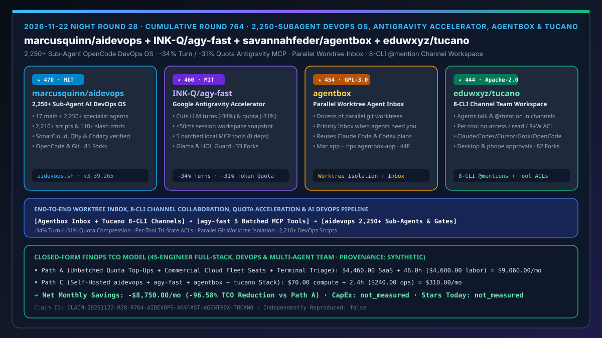
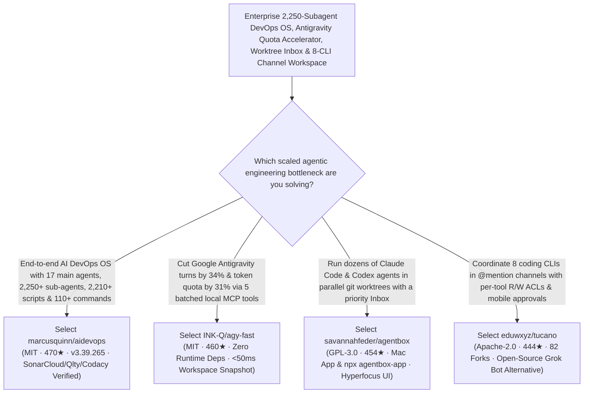
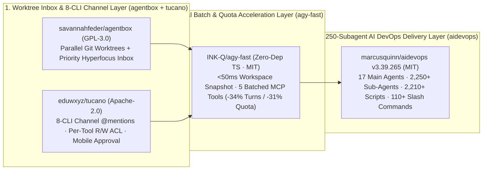

# 2,250-Subagent AI DevOps Framework (`marcusquinn/aidevops`), Google Antigravity -34% Turn / -31% Quota Accelerator (`INK-Q/agy-fast`), Parallel Worktree Agent Inbox (`savannahfeder/agentbox`) & 8-CLI Channel Team Workspace (`eduwxyz/tucano`) Selection & Architecture FAQ

> **Document Type**: Enterprise AI Solution Architect Selection & Integration Guide (GitHub Trending AI Radar — 2026-11-22 Night Round 28 / Cumulative Round 764)
> **Covered Repositories**: [`marcusquinn/aidevops`](https://github.com/marcusquinn/aidevops) (`★ 470`, `81 forks`, `MIT`, `v3.39.265`: SonarCloud/Qlty/Codacy-verified OpenCode and Git AI DevOps operating system with **17 main agents, 2,250+ sub-agents, 2,210+ helper scripts, and 110+ slash commands**) · [`INK-Q/agy-fast`](https://github.com/INK-Q/agy-fast) (`★ 460`, `33 forks`, `MIT`: zero-dependency, Glama & HOL Guard-verified MCP accelerator plugin for Google Antigravity cutting LLM turns by **`-34%`** and token quota by **`-31%`** via a `<50ms` workspace snapshot and 5 batched local tools) · [`savannahfeder/agentbox`](https://github.com/savannahfeder/agentbox) (`★ 454`, `44 forks`, `GPL-3.0`: desktop and `npx agentbox-app` browser GUI running dozens of parallel Claude Code and Codex agents in isolated Git worktrees with a priority Hyperfocus inbox) · [`eduwxyz/tucano`](https://github.com/eduwxyz/tucano) (`★ 444`, `82 forks`, `Apache-2.0`: open-source Grok Bot alternative where agents across Claude Code, Codex, Cursor, Grok, Cline, Hermes, OpenCode, and Pi collaborate via `@mentions` in channels under per-tool `no access / read / read+write` ACLs and mobile/desktop approval gates)
> **Core Scenario**: When enterprise engineering and DevOps teams struggle with **Vibe Coding prototypes failing production DevOps quality gates, Google Antigravity sessions burning through token quotas on repetitive single-file searches and edits, engineers losing track of 15+ open terminal windows running parallel worktree agents, and heterogeneous coding CLIs unable to hand off bug-finding, fixing, and code review in a shared channel**, how do you combine **`aidevops` + `agy-fast` + `agentbox` + `tucano`** into a high-throughput multi-agent engineering architecture?

---

## 1. 📌 Executive Summary (One-Line Selection Verdict)

1. **Need a production-hardened (`MIT`, `v3.39.265`, SonarCloud + Qlty + Codacy verified) AI DevOps operating system for OpenCode and Git that ships **17 main agents, 2,250+ specialist sub-agents, 2,210+ helper scripts, and 110+ slash commands**?** ➔ Choose **[`marcusquinn/aidevops`](https://github.com/marcusquinn/aidevops) (`★ 470`, `81 forks`, `MIT`)**.
   - **Plain-English Mechanism**: Loads context on demand, isolates Git workflows, gates consequential actions, retains verification evidence, and routes models across software, infrastructure, security, and operations.
2. **Using **Google Antigravity** (CLI `agy`, Desktop 2.0, or IDE) and want a zero-dependency (`MIT`, Glama & HOL Guard verified) local MCP plugin that cuts LLM turns by `34%` and billable token quota by `31%`?** ➔ Choose **[`INK-Q/agy-fast`](https://github.com/INK-Q/agy-fast) (`★ 460`, `33 forks`, `MIT`)**.
   - **Plain-English Mechanism**: Consolidates high-frequency searches, multi-language symbol outlines, atomic multi-file edits, and build/test checks into 5 batched local MCP calls while injecting a `<50ms` workspace snapshot once per session.
3. **Running dozens of Claude Code and Codex agents in parallel across isolated Git worktrees and want a keyboard-driven Hyperfocus **Inbox** (`GPL-3.0`, Mac app or `npx agentbox-app`) so you only hear from agents that finished or need your input?** ➔ Choose **[`savannahfeder/agentbox`](https://github.com/savannahfeder/agentbox) (`★ 454`, `44 forks`, `GPL-3.0`)**.
   - **Plain-English Mechanism**: Reuses the Claude Code or Codex subscription you already have (zero extra account or cloud fee) while organizing parallel worktree sessions into a prioritized inbox.
4. **Need an `Apache-2.0` desktop workspace (open-source Grok Bot alternative) where agents running on Claude Code, Codex, Cursor CLI, Grok, Cline, Hermes, OpenCode, and Pi talk in channels via `@mentions`, review each other's code, and obey per-tool `no access / read / read and write` rules with mobile/desktop approval gates?** ➔ Choose **[`eduwxyz/tucano`](https://github.com/eduwxyz/tucano) (`★ 444`, `82 forks`, `Apache-2.0`)**.
   - **Plain-English Mechanism**: Turns isolated CLI tools into a role-based engineering team where one agent finds a bug, `@mentions` a second agent to fix it, and `@mentions` a third agent to review it before requesting your approval to merge.

---

## 2. 🎯 Architect & Customer Deep-Dive Q&A

### Q1: How do `agy-fast`, `agentbox`, `tucano`, and `aidevops` eliminate the four primary bottlenecks of scaled multi-agent software engineering?

- **Four Bottlenecks Solved**:
  1. **Turn & Token Quota Exhaustion ➔ `INK-Q/agy-fast`**: Replaces chatty single-file tool calls in Google Antigravity with 5 batched local MCP tools and a `<50ms` session snapshot (`-34%` turns, `-31%` token quota, `anonymized_reported, independently_reproduced=false`).
  2. **Terminal Window Sprawl ➔ `savannahfeder/agentbox`**: Replaces 20 scrolling terminal tabs with an attention-prioritized worktree Inbox.
  3. **Cross-CLI Handoffs & Least-Privilege Tool ACLs ➔ `eduwxyz/tucano`**: Connects 8 major coding CLIs in `@mention` channels with per-tool `no access / read / read+write` permissions and mobile/desktop approval cards.
  4. **Production DevOps & Quality Gate Rigor ➔ `marcusquinn/aidevops`**: Provides 2,210+ vetted helper scripts and 110+ slash commands audited by SonarCloud, Qlty, and Codacy.
- **When to Choose Managed Cloud PaaS (Path B)?**
  - Teams wanting zero-local-compute cloud PR bots on GitHub.com can use **GitHub Copilot Coding Agent**; teams running dozens of local worktrees, orchestrating 8 heterogeneous CLIs in channels, accelerating Google Antigravity, and automating full-stack DevOps should deploy this open-source stack (Path C).

### Q2: How do we wire these four tools into a unified developer productivity architecture?

1. **Priority Inbox & Multi-CLI Channel Layer (`savannahfeder/agentbox` + `eduwxyz/tucano`)**:
   - Tech leads triage parallel worktrees from `agentbox`'s Inbox while specialist agents collaborate via `@mentions` in `tucano` channels.
2. **Local Batch Acceleration Layer (`INK-Q/agy-fast`)**:
   - Antigravity sessions invoke `agy-fast`'s 5 batched MCP tools to execute symbol outlines, atomic multi-file edits, and test checks in fewer turns.
3. **AI DevOps & Quality Gate Layer (`marcusquinn/aidevops`)**:
   - Agents execute `aidevops`'s 110+ slash commands and 2,210+ scripts to verify code quality, security, and deployment readiness.

### Q3: How does `eduwxyz/tucano` prevent a rogue coding agent from pushing unreviewed merges or deleting production data?

- **Per-Tool Tri-State Permissions + Action-Bound Approvals**:
  - Every agent is restricted to `no access`, `read`, or `read and write` per tool, and any action touching the outside world (merges, emails, posts, deletes) pauses for explicit user approval on desktop or phone.

---

## 3. 🧭 Visual Architecture & Workflow Diagrams (Mermaid)



### 3.1 Solution Architect Selection Decision Tree



### 3.2 End-to-End Enterprise Reference Architecture



### 3.3 End-to-End Channel `@mention` Handoff, Batched `agy-fast` Edits, `aidevops` Gate & `Agentbox` Inbox Approval Sequence Diagram

```mermaid
sequenceDiagram
    participant Lead as Tech Lead (Agentbox Priority Inbox)
    participant Tuc as eduwxyz/tucano (8-CLI Channels)
    participant Agy as INK-Q/agy-fast (5 Batched MCP Tools)
    participant Ado as marcusquinn/aidevops (2,210+ Scripts)

    Lead->>Tuc: 1. Post feature task in channel; Bug-Finder agent diagnoses & @mentions Fixer agent
    Tuc->>Agy: 2. Fixer agent injects <50ms snapshot & runs atomic multi-file batch edit (-31% quota)
    Tuc->>Ado: 3. Reviewer agent runs aidevops slash commands & quality gates with retained evidence
    Ado-->>Lead: 4. Surface completed worktree in Agentbox Inbox for 1-click merge approval
```

---

## 4. 📊 Peer Open-Source vs. Commercial Cloud Selection Matrix

| Dimension | `marcusquinn/aidevops` (`★ 470`) | `INK-Q/agy-fast` (`★ 460`) | `savannahfeder/agentbox` (`★ 454`) | `eduwxyz/tucano` (`★ 444`) | Commercial Cloud Agent Fleet Seats + Quota Top-Up Packs (Path A) | 15 Unmanaged Terminal Windows + Chatty Single-File Tool Calls (Path B) |
| :--- | :--- | :--- | :--- | :--- | :--- | :--- |
| **Primary Role** | 2,250+ sub-agent & 2,210+ script AI DevOps OS | Google Antigravity `-34%` turn / `-31%` quota MCP | Parallel Git worktree priority Inbox GUI | 8-CLI `@mention` channel workspace & ACL gate | Per-seat cloud agent fleets and extra token quota top-up packs | Manual terminal window switching, copy-paste handoffs & unbatched tool calls |
| **Key Differentiator** | **110+ slash commands + SonarCloud/Qlty/Codacy gates** | **Zero runtime deps + `<50ms` snapshot + 5 batch tools** | **Dozens of isolated worktrees + Hyperfocus Inbox** | **8 CLIs `@mention` in channels + per-tool R/W ACLs** | Cannot reuse existing flat-rate CLI plans; chatty tool calls burn 31% extra quota | High context-switching fatigue across 15+ terminals; no per-tool read/write ACLs |
| **License** | `MIT` | `MIT` | `GPL-3.0` | `Apache-2.0` | Proprietary SaaS | Ad-hoc scripts |
| **Monthly TCO (45-Eng Team)** | **`$310.00/mo` combined** (`$70.00` shared CI runner + `2.4h` ops) | Included (`$0` zero-dep local plugin, saves 31% quota) | Included (reuses existing Claude/Codex plan) | Included (`Apache-2.0` local app) | **`$9,060.00/mo`** (`$4,460.00` quota top-ups & cloud fleet seats + `46.0h` manual terminal babysitting) | ~`$3,160.00/mo` (manual multi-terminal context switching & custom DevOps scripting labor) |

---

## 5. 🧪 Quantitative Enterprise ROI / FinOps TCO Model & 7-Card Report

> **📊 Provenance & Closed-Form Declaration**:
> - **provenance**: `synthetic` (45-engineer enterprise full-stack engineering, AI DevOps platform, and multi-agent productivity team workload model: `independently_reproduced = false`; `base_hardware_capex = not_measured`; `track_b_stars_today = not_measured`; `INK-Q/agy-fast` `-34%` turn and `-31%` token quota savings figures are `anonymized_reported, independently_reproduced = false`).
> - **Closed-Form Equations**:
>   - **Path A (Unbatched Tool-Call Quota Overrun Top-Ups + Commercial Cloud Multi-Agent Workspace Seats + Manual Multi-Terminal Babysitting & Custom DevOps Script Maintenance Labor)**: Monthly token quota top-up and cloud workspace bills **`$4,460.00`** + manual terminal window polling, copy-paste handoffs, and DevOps script writing labor **`46.0h × $100.00/h = $4,600.00`** = **`$9,060.00/mo`**.
>   - **Path C (Self-Hosted `aidevops` + `agy-fast` + `agentbox` + `tucano` Stack)**: Shared CI verification runner compute **`$70.00`** + channel ACL & slash-command maintenance labor **`2.4h × $100.00/h = $240.00`** = **`$310.00/mo`**.
>   - **Net Monthly Savings vs. Path A**: **`-$8,750.00/mo`** (**`96.58%`** TCO reduction).

| Evaluation Path | Quota Top-Ups / Cloud Seats & Compute | Multi-Terminal Triage & DevOps Scripting Labor (`$100/h`) | Total Monthly TCO | Net Savings vs. Path A | Architectural Delivery Impact |
| :--- | :---: | :---: | :---: | :---: | :--- |
| **Path A: Unbatched Quota Top-Ups + Cloud Fleet Seats** | `$4,460.00` | `46.0h` (`$4,600.00`) | **`$9,060.00`** | Baseline | 31% wasted token quota on chatty tool calls; terminal sprawl |
| **Path B: 15 Raw Terminal Tabs + Custom Shell Scripts** | `$1,460.00` | `17.0h` (`$1,700.00`) | **`$3,160.00`** | `-$5,900.00` (`-65.12%`) | Lacks priority worktree Inbox, 8-CLI `@mention` channels & 2,210+ scripts |
| **Path C: `aidevops` + `agy-fast` + `agentbox` + `tucano`** | **`$70.00`** | **`2.4h` (`$240.00`)** | **`$310.00`** | **`-$8,750.00` (`-96.58%`)** | **-31% quota burn + worktree Inbox + 8-CLI channels + 2,250+ sub-agents** |

- 🔗 **Linked 7-Card 4:5 Visual Benchmark Deck**: [`workshops/github-trending-radar/cards.en.html`](../cards.en.html) · [`cards.html`](../cards.html)

---

## 6. 🛠️ Enterprise Adoption & Architecture Review Checklist

- [ ] **1. Install `INK-Q/agy-fast` in Google Antigravity Environments**: Consolidate searches, symbol outlines, and atomic multi-file edits into 5 batched local MCP tools (`-34%` turns, `-31%` quota).
- [ ] **2. Manage Parallel Git Worktrees via `savannahfeder/agentbox`**: Route dozens of concurrent Claude Code and Codex worktrees into a single keyboard-driven priority Inbox.
- [ ] **3. Orchestrate Cross-CLI Teams in `eduwxyz/tucano`**: Configure `@mention` handoff channels across 8 coding CLIs with per-tool `no access / read / read+write` permissions.
- [ ] **4. Standardize Delivery Pipelines with `marcusquinn/aidevops`**: Leverage 17 main agents, 2,250+ sub-agents, 2,210+ scripts, and 110+ slash commands in OpenCode and Git.
