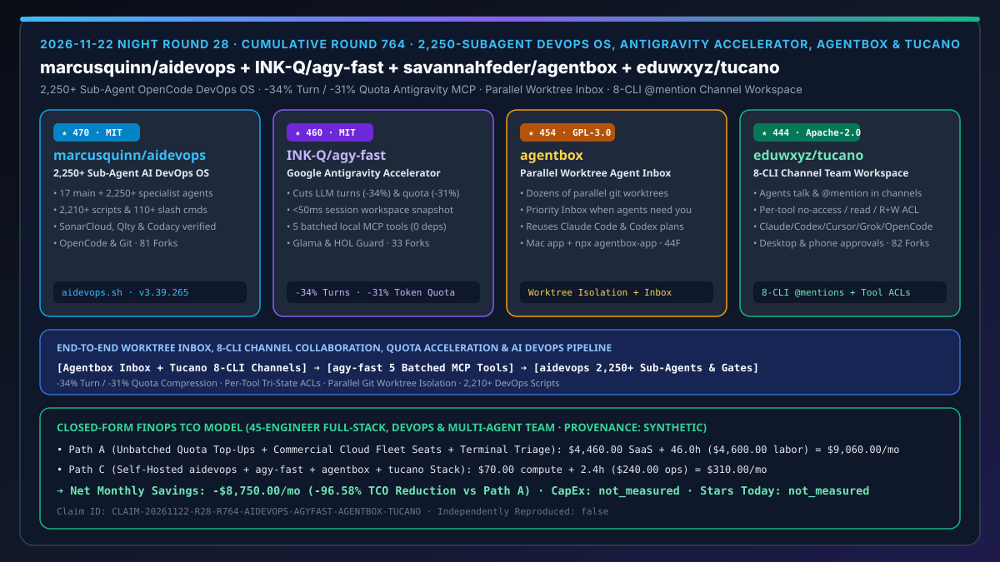
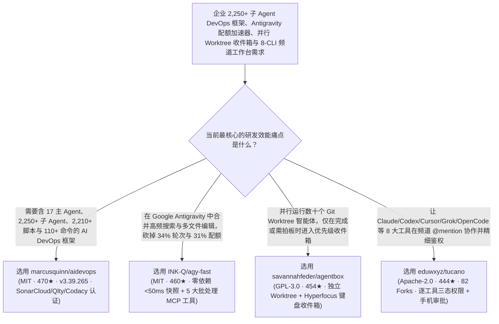
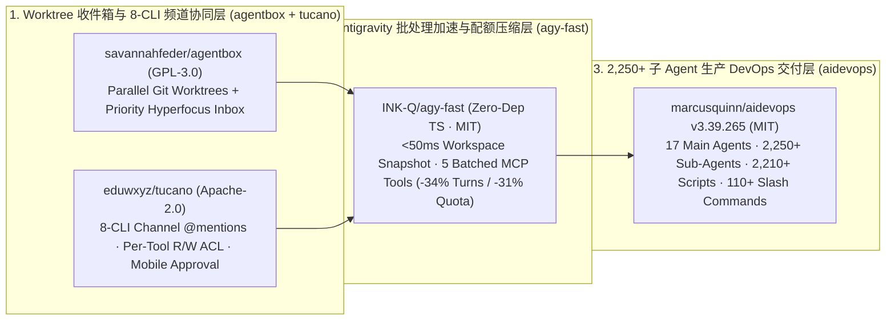
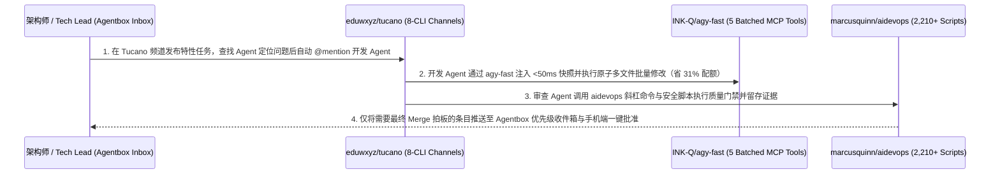

# 2,250+ 子智能体与 110+ 斜杠命令的 AI DevOps 框架（`marcusquinn/aidevops`）、Google Antigravity 减 34% 轮次与 31% 配额加速插件（`INK-Q/agy-fast`）、并行 Worktree 智能体收件箱（`savannahfeder/agentbox`）与支持 8 大 CLI 的频道协同工作台（`eduwxyz/tucano`）选型与集成架构 FAQ

> **文档类型**：企业 AI 解决方案架构师（AI Solution Architect）选型决策指南（GitHub Trending AI 雷达 2026-11-22 Night Round 28 / 累计第 764 轮）
> **覆盖项目**：[`marcusquinn/aidevops`](https://github.com/marcusquinn/aidevops)（`★ 470`、`81 forks`、`MIT`，`v3.39.265`，通过 SonarCloud/Qlty/Codacy 质量门禁认证的 OpenCode 与 Git AI DevOps 框架，含 **17 个主 Agent、2,250+ 子 Agent、2,210+ 辅助脚本与 110+ 斜杠命令**）· [`INK-Q/agy-fast`](https://github.com/INK-Q/agy-fast)（`★ 460`、`33 forks`、`MIT`，零运行时依赖、获 Glama 与 HOL Guard 认证的 Google Antigravity 加速 MCP 插件，通过 `<50ms` 工作区快照与 5 个批量本地工具减少 **34% LLM 轮次与 31% Token 配额消耗**）· [`savannahfeder/agentbox`](https://github.com/savannahfeder/agentbox)（`★ 454`、`44 forks`、`GPL-3.0`，为并行运行在独立 Git Worktree 中的数十个 Claude Code/Codex 智能体提供统一优先级收件箱 Inbox 的桌面与浏览器工作台）· [`eduwxyz/tucano`](https://github.com/eduwxyz/tucano)（`★ 444`、`82 forks`、`Apache-2.0`，开源 Grok Bot 替代方案，让 Claude Code/Codex/Cursor/Grok/Cline/Hermes/OpenCode/Pi 八大智能体在频道中 `@mention` 协作并按工具粒度执行 `no access / read / read+write` 权限与手机审批）
> **核心场景**：当企业全栈研发与 DevOps 团队面临**“Vibe Coding 写原型容易但进入生产 DevOps 阶段缺少标准化的 2,200+ 运维脚本与安全 Git 门禁、使用 Google Antigravity 时高频零碎搜索与单文件编辑迅速耗尽 Token 配额与回合数、同时开十几个 Claude Code/Codex 终端时被刷屏日志淹没找不到哪个 Agent 卡在提问环节、以及异构 Agent 之间无法像人类团队一样在频道里 `@mention` 交接查 Bug/修 Bug/Code Review”**四大痛点时，如何组合**`aidevops` + `agy-fast` + `agentbox` + `tucano`** 打造高吞吐、省配额的多智能体研发运维协同底座？

---

## 一、📌 核心结论速览（选型一句话结论）

1. **想跨越“Vibe Coding 玩具原型”与“企业级生产 DevOps”之间的鸿沟——直接复用一套经过 SonarCloud、Qlty 与 Codacy 代码质量门禁严格认证、包含 17 个主智能体、2,250+ 专职子智能体、2,210+ 运维脚本与 110+ 斜杠命令的共享 AI DevOps 操作系统** ➔ 选 **[`marcusquinn/aidevops`](https://github.com/marcusquinn/aidevops)（`★ 470`，`81 forks`，`MIT`，`v3.39.265`）**。
   - **通俗原理**：按需加载项目上下文、强制隔离 Git 工作流、对高影响动作设卡审批并留存验证证据，覆盖软件研发、云基础设施、安全合规与内容运营全生命周期。
2. **团队正在使用 Google Antigravity（CLI `agy`、Desktop 2.0 或 IDE），想通过一个零外部依赖的本地 MCP 插件把高频搜索、多语言符号大纲、多文件原子编辑与构建测试打包成 5 个批量调用，并注入 `<50ms` 会话初始快照，直接砍掉 34% 的大模型往返轮次和 31% 的计费 Token 配额** ➔ 选 **[`INK-Q/agy-fast`](https://github.com/INK-Q/agy-fast)（`★ 460`，`33 forks`，`MIT`）**。
   - **通俗原理**：已通过 Glama MCP 与 HOL Guard 安全验证，用本地确定性批处理替代 Antigravity 默认的一问一答碎步工具调用。
3. **想在一台机器上同时并行跑几十个 Claude Code 和 Codex 智能体（每个都在独立的 Git Worktree 中干活），但不想盯着十几个滚动终端看，而是像处理邮件收件箱（Inbox）一样“只有当某个 Agent 干完活或需要你拍板时才按优先级推到最上面”** ➔ 选 **[`savannahfeder/agentbox`](https://github.com/savannahfeder/agentbox)（`★ 454`，`44 forks`，`GPL-3.0`）**。
   - **通俗原理**：支持签名公证的 Mac 客户端或 `npx agentbox-app` 浏览器模式，全程键盘快捷键操作（Hyperfocus），直接复用你已有的 Claude Code / Codex 包月计划。
4. **想把你电脑上已有的八大工具（Claude Code、Codex、Cursor、Grok、Cline、Hermes、OpenCode、Pi）组成一支在频道里互相 `@mention` 配合的虚拟战队（一个找 Bug、一个写修复、第三个做 Code Review），并为每个 Agent 的每个工具单独设置 `无权限 / 只读 / 读写` 三档权限，凡涉及合并、发帖、发邮件或删文件的动作必须在电脑或手机上点同意** ➔ 选 **[`eduwxyz/tucano`](https://github.com/eduwxyz/tucano)（`★ 444`，`82 forks`，`Apache-2.0`）**。
   - **通俗原理**：作为 Grok Bot 的 `Apache-2.0` 开源本地替代方案，它将混乱的多终端复制粘贴升级为带角色权限与审批闭环的团队频道聊天室。

---

## 二、🎯 客户与架构师灵魂拷问 Q&A（深度架构拆解）

### Q1：这四个项目分别解决了企业“多智能体规模化研发（Scaled Agentic Engineering）”中的哪四个核心瓶颈？

- **四大核心瓶颈逐一击破**：
  1. **单会话配额与延迟瓶颈 ➔ `INK-Q/agy-fast`**：针对 Google Antigravity，用 `<50ms` 预注入工作区快照与 5 个本地聚合 MCP 工具，实测减少 34% 交互轮次与 31% Token 配额（`anonymized_reported, independently_reproduced=false`）。
  2. **人类注意力碎片化瓶颈 ➔ `savannahfeder/agentbox`**：将“轮询式盯终端”转化为“事件驱动的优先级收件箱（Inbox）”，让架构师同时驾驭数十个并行 Git Worktree。
  3. **多工具异构协作与最小权限瓶颈 ➔ `eduwxyz/tucano`**：让 Claude Code、Codex、Cursor、Grok、OpenCode 等 8 类引擎在频道中通过 `@mention` 自动接力（查 Bug ➔ 修 Bug ➔ Review），并强制执行工具级 `no access / read / read+write` 权限。
  4. **从写代码到生产运维的脚本鸿沟 ➔ `marcusquinn/aidevops`**：提供 2,210+ 现成辅助脚本与 110+ 斜杠命令，将代码质量、安全扫描与部署证据标准化。
- **何时直接用商业云 SaaS 方案（Path B）？**
  - 若团队仅需单一云端仓库自动提 PR，可使用 **GitHub Copilot Coding Agent**；若需要在本地工作站利用现有多厂商订阅同时跑数十个 Worktree 收件箱、跨 8 大 CLI 频道协作、加速 Google Antigravity 并落地 2,200+ 脚本的 AI DevOps 体系，则采用本轮开源栈（Path C）。

### Q2：典型企业级“收件箱与频道调度 (`agentbox` + `tucano`) ➔ Antigravity 配额加速 (`agy-fast`) ➔ 2,250+ 子 Agent 生产交付 (`aidevops`)”架构怎么搭？

1. **人类注意力收件箱与多 Agent 频道协同层（`savannahfeder/agentbox` + `eduwxyz/tucano`）**：
   - 架构师通过 `agentbox` 收件箱集中审批数十个并行 Worktree 的阻塞问题，并在 `tucano` 频道中配置“测试 Agent `@mention` 修复 Agent `@mention` 审查 Agent”流水线。
2. **终端工具调用批处理与配额加速层（`INK-Q/agy-fast`）**：
   - 在 Google Antigravity 节点挂载 `agy-fast`，通过 5 个本地批处理 MCP 工具压缩搜索与多文件修改开销。
3. **标准化 AI DevOps 脚本与质量门禁层（`marcusquinn/aidevops`）**：
   - 调用 `aidevops` 的 110+ 斜杠命令与 2,210+ 脚本执行安全检查、SonarCloud/Qlty 质量门禁与自动化发布。

### Q3：`eduwxyz/tucano` 的权限控制比普通多 Agent 框架细在哪里？

- **逐 Agent、逐工具的三态矩阵 + 真实世界动作强绑定审批**：
  - 你可以给“审查 Agent”只开代码的 `read` 权限，给“开发 Agent”开本地工作区的 `read and write`，而任何触碰外部世界的操作（Merge PR、发送邮件、删除生产资源）都会生成绑定具体参数的审批卡片推送到电脑或手机。

---

## 三、🧭 直观可视化图解（Mermaid 决策树 + 集成架构 + 时序图）

### 3.1 架构师选型决策树

### 3.2 企业端到端生产集成参考架构图

### 3.3 `Tucano` 频道 `@mention` 接力、`agy-fast` 批量改码、`aidevops` 门禁校验与 `Agentbox` 收件箱拍板时序图

---

## 四、📊 同类开源与商业云服务横向选型决策矩阵

| 对比维度 | `marcusquinn/aidevops` (`★ 470`) | `INK-Q/agy-fast` (`★ 460`) | `savannahfeder/agentbox` (`★ 454`) | `eduwxyz/tucano` (`★ 444`) | 商业云端 Agent 舰队按席位/按量计费 + 商业 DevOps 平台 (Path A) | 手动切十几个终端窗口 + 单步碎工具调用 + 手写零散 Shell (Path B) |
| :--- | :--- | :--- | :--- | :--- | :--- | :--- |
| **核心能力定位** | 2,250+ 子 Agent 与 2,210+ 脚本 AI DevOps 框架 | Google Antigravity `-34%` 轮次加速 MCP | 并行 Git Worktree 优先级收件箱工作台 | 8 大 CLI 频道 `@mention` 协作与分级权限台 | 按并发容器和超额 Token 计费的商业云端编码平台 | 靠人肉轮询十几个终端窗口、频繁触发配额上限的原生默认配置 |
| **核心技术突破** | **110+ 斜杠命令 + SonarCloud/Qlty/Codacy 三重质量认证** | **零运行时依赖 + `<50ms` 快照 + 省 31% Token 配额** | **独立 Worktree 隔离 + 仅需拍板时才打扰的 Inbox** | **跨 8 大 CLI `@mention` 接力 + 逐工具三档权限** | 无法复用本地已有包月计划；高频单步工具调用迅速耗尽额度 | 架构师在多个终端之间切换极易漏看提问；无工具级只读隔离 |
| **开源协议** | `MIT` | `MIT` | `GPL-3.0` | `Apache-2.0` | 闭源商业 SaaS | 内部零散脚本 |
| **月度 TCO（45 人团队）** | **组合仅 `$310.00/月`**（`$70.00` 共享 CI 验证容器 + `2.4h` 维护） | 同左（零依赖本地运行，倒省 31% 额度） | 同左（复用现有 Claude/Codex 订阅） | 同左（`Apache-2.0` 本地运行） | **`$9,060.00/月`**（`$4,460.00` 超额配额扩容包与商业席位 + `46.0h` 多窗口人工盯盘与写脚本） | 约 `$3,160.00/月`（大量人工在多终端间复制粘贴交接与手写 DevOps 脚本工时） |

---

## 五、🧪 应用落地定量收益/TCO 对比与 7-Card 报告

> **📊 数据来源与闭式核算声明（Provenance & Closed-Form Schema）**：
> - **provenance**: `synthetic`（基于 45 人企业全栈研发、AI DevOps 平台与多智能体协同团队月度工作负载模型：`independently_reproduced = false`；硬件采购基线 `base_hardware_capex = not_measured`；Track B 单日增量 `track_b_stars_today = not_measured`；`INK-Q/agy-fast` 披露的 `-34%` 轮次与 `-31%` Token 配额节省指标归类为 `anonymized_reported, independently_reproduced = false`）。
> - **核算公式**：
>   - **Path A（未加速的高频单步工具调用导致的 Token 配额超支加购包 + 商业云端多智能体协作席位 + 工程师手动轮询十几个终端窗口、人工在查 Bug/修 Bug/Review 会话间复制粘贴及手写 DevOps 脚本人工）**：月度超额 Token 配额加购与商业席位账单 **`$4,460.00`** + 多终端盯盘切换、手工交接上下文与编写运维脚本人工 **`46.0h × $100.00/h = $4,600.00`** = **`$9,060.00/月`**。
>   - **Path C（自建 `aidevops` + `agy-fast` + `agentbox` + `tucano` 开源多智能体协同与配额加速栈）**：共享验证容器开销 **`$70.00`** + 频道角色权限与斜杠命令配置维护人工 **`2.4h × $100.00/h = $240.00`** = **`$310.00/月`**。
>   - **净节省（Net Savings vs Path A）**：**`-$8,750.00/月`**（成本降低 **`96.58%`**）。

| 评估方案 | 配额加购/商业席位与算力成本 | 多终端盯盘与 DevOps 脚本维护人工（`$100/h`） | 月度总 TCO | 相对 Path A 净节省 | 关键架构交付指标 |
| :--- | :---: | :---: | :---: | :---: | :--- |
| **Path A：无批处理超额 Token 加购 + 商业云端协作席位** | `$4,460.00` | `46.0h` (`$4,600.00`) | **`$9,060.00`** | Baseline | 碎步调用浪费 31% 配额；多终端人工盯盘注意力耗竭 |
| **Path B：手动开 12 个终端切屏 + 手写零散 Shell 脚本** | `$1,460.00` | `17.0h` (`$1,700.00`) | **`$3,160.00`** | `-$5,900.00` (`-65.12%`) | 缺少优先级 Inbox、跨 8-CLI `@mention` 频道与 2,210+ 现成脚本 |
| **Path C：`aidevops` + `agy-fast` + `agentbox` + `tucano`** | **`$70.00`** | **`2.4h` (`$240.00`)** | **`$310.00`** | **`-$8,750.00` (`-96.58%`)** | **省 31% 配额 + Worktree 收件箱 + 8-CLI 频道 + 2,250+ 子 Agent** |

- 🔗 **关联 7-Card 4:5 视觉评测报告**：[`workshops/github-trending-radar/cards.html`](../cards.html) · [`cards.en.html`](../cards.en.html)

---

## 六、🛠️ 企业引入与架构评审 Checklist

- [ ] **1. 在 Google Antigravity 环境部署 `INK-Q/agy-fast`**：启用 `<50ms` 会话快照与 5 个本地批量 MCP 工具，降低约 34% LLM 轮次与 31% Token 配额消耗。
- [ ] **2. 使用 `savannahfeder/agentbox` 管理大规模并行 Git Worktree**：通过优先级 Inbox 集中处理已完成或需人工决策的 Claude Code / Codex 任务。
- [ ] **3. 引入 `eduwxyz/tucano` 编排异构 8-CLI 角色战队**：按角色配置 `no access / read / read+write` 工具权限，开启 Merge/外发动作手机与桌面端审批。
- [ ] **4. 接入 `marcusquinn/aidevops` 标准化从意图到生产交付闭环**：复用 110+ 斜杠命令与 2,210+ 经过静态分析门禁验证的 DevOps 脚本。
