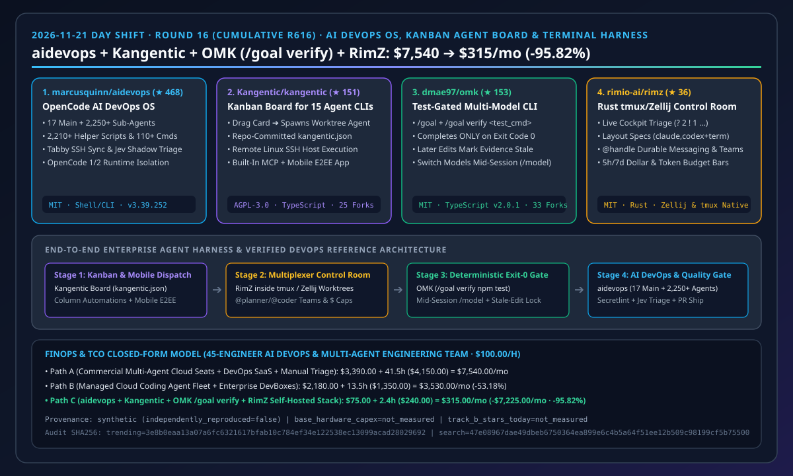
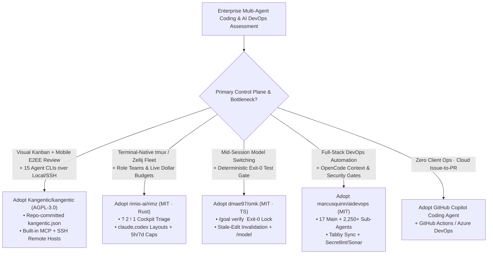
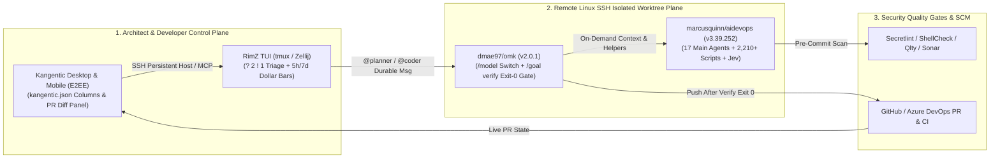
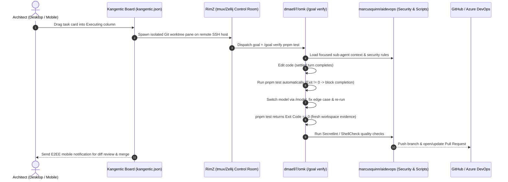

# AI DevOps Operating System (`marcusquinn/aidevops`), 15-CLI Agentic Kanban IDE (`Kangentic/kangentic`), Test-Gated Multi-Model Terminal CLI (`dmae97/omk`) & Rust tmux/Zellij Control Room (`rimio-ai/rimz`) Architecture Selection & Adoption FAQ

> **Document Metadata (2026-11-21 Day Shift Round 16 · Cumulative Round 616 Deep-Dive)**  
> - **Target Audience**: Enterprise AI Solution Architects, Developer Productivity Leads, and Platform / DevOps Engineers  
> - **Evaluated Repositories**:  
>   1. [`marcusquinn/aidevops`](https://github.com/marcusquinn/aidevops) (`★ 468` · `81 forks` · Shell · MIT · Full-stack AI DevOps framework for OpenCode and developer CLIs with 17 main agents, 2,250+ sub-agents, 2,210+ helper scripts, and 110+ slash commands)  
>   2. [`Kangentic/kangentic`](https://github.com/Kangentic/kangentic) (`★ 151` · `25 forks` · TypeScript · AGPL-3.0 · "Drag a card. An agent starts." Agentic Kanban board supporting 15 coding agent CLIs across git worktrees and SSH remote hosts, repo-committed `kangentic.json` automations, and E2EE mobile review)  
>   3. [`dmae97/omk`](https://github.com/dmae97/omk) (`★ 153` · `33 forks` · TypeScript · MIT · Open Multi-Agent Kit `v2.0.1` terminal coding CLI that switches models mid-session via `/model` and completes `/goal` only when `/goal verify <cmd>` exits `0`)  
>   4. [`rimio-ai/rimz`](https://github.com/rimio-ai/rimz) (`★ 36` · `2 forks` · Rust · MIT · Realtime fleet dashboard and control room inside `Zellij` and `tmux` with `? 2 ! 1` cockpit triage, `@handle` durable messaging, and 5h/7d dollar/token budget bars)  
> - **Sealed Evidence Chain**: `workshops/github-trending-radar/evidence/search-new-repos-2026-11-21-raw.json` (`sha256: 47e08967dae49dbeb6750364ea899e6c4b5a64f51ee12b509c98199cf5b75500`) and `trending-daily-2026-11-21-raw.html` (`sha256: 3e8b0eaa13a07a6fc6321617bfab10c784ef34e122538ec13099acad28029692`)  
> - **Architecture Visual**: [`assets/github-ai-radar-2026-11-21-r16-r616-aidevops-kangentic-omk-rimz.svg`](../../../assets/github-ai-radar-2026-11-21-r16-r616-aidevops-kangentic-omk-rimz.svg) · [中文版 (`aidevops-kangentic-omk-rimz-selection-faq.md`)](aidevops-kangentic-omk-rimz-selection-faq.md)

---

## ① 📌 Executive Summary (One-Sentence Selection Verdict)

> **Solution Architect's Verdict**:  
> Once an engineering team scales to **one developer supervising 5–20 parallel coding agents**, the bottleneck shifts from raw token generation to **(1) stopping agents from declaring "done" while tests are still failing, (2) triaging which of a dozen Git worktree panes is blocked waiting for human input, and (3) enforcing repeatable DevOps security and quality gates**.  
> - **To orchestrate 15 local/SSH coding agent CLIs from a visual Kanban board with repo-committed column rules (`kangentic.json`), built-in MCP self-progression, and E2EE mobile diff approval** ➔ Choose **`Kangentic/kangentic`** (AGPL-3.0);  
> - **To stay inside `tmux` or `Zellij` while triaging tens of agents via a live cockpit (`? 2 ! 1`), pairing role-based teams (`claude,codex`), and enforcing 5h/7d dollar budgets** ➔ Choose **`rimio-ai/rimz`** (MIT, single Rust binary);  
> - **To eliminate false completions by requiring `/goal verify <test_cmd>` to exit `0` after every settled turn—and invalidating stale evidence on any subsequent edit—while switching models mid-session (`/model`)** ➔ Choose **`dmae97/omk`** (MIT);  
> - **To standardize on-demand context loading, Secretlint/ShellCheck/Sonar gates, Tabby SSH profile sync, and 17 main + 2,250+ specialist sub-agents** ➔ Choose **`marcusquinn/aidevops`** (MIT).  
> Together, this stack cuts monthly multi-agent tooling and manual triage TCO for a 45-engineer team from **$7,540.00/mo** to **$315.00/mo (-$7,225.00/mo, -95.82%)**.

---

## ② 🎯 Solution Architect & Customer Deep-Dive Q&A

### Q1: Our engineers already have Claude Code, Codex, and OpenCode—why does running 10 agents in parallel often slow us down and produce broken PRs? How do these four tools fix the pipeline?
- **The Real Multi-Agent Bottlenecks**:
  1. **Attention Fragmentation Across Worktrees**: Git worktrees allow 8+ agents to run simultaneously, but humans waste hours cycling through terminal tabs trying to spot which agent paused on a permission prompt and which branch finished.
  2. **The "False Done" Syndrome**: Coding agents frequently say *"I have fixed the failing test"* without executing the test suite—or they run the test and then make one more "cleanup" edit that silently breaks the build.
  3. **"Vibe-Coding Is Easy, DevOps Is Hard"**: Agents write application code quickly, but without structured DevOps helpers they leak secrets, misconfigure CI, or break OpenCode runtime environments.
- **How the Quartet Solves Each Layer**:
  - **`Kangentic/kangentic` (Visual Kanban & Mobile Control Plane)**: Puts every agent across every repo on a unified Kanban board (`To Do` ➔ `Planning` ➔ `Executing` ➔ `Code Review`). Each card shows its model, context window usage, and latest message, highlighting cards waiting on you. Projects can run on remote Linux hosts over SSH, and **Kangentic Mobile** (E2EE) lets you answer blocked agent prompts and review diffs from your phone.
  - **`rimio-ai/rimz` (Terminal Multiplexer Control Room)**: Runs inside your existing `tmux` or `Zellij` session. Its sidebar cockpit line (`? 2 ! 1 …`) triages waiting and failed agents at a glance, supports layout specs like `claude,codex` or `vim,codex+term` in isolated Git worktrees, routes durable `@handle` messages (`@planner`, `@coder`), and tracks live dollar/token spend across today/5h/7d windows.
  - **`dmae97/omk` (Deterministic Test-Gated CLI)**: Replaces verbal claims with `/goal` and `/goal verify <cmd>` (e.g., `/goal verify npm test`). OMK runs your verification command after each settled turn and completes the goal **only when it exits `0`**; any subsequent file edit immediately marks prior verification evidence stale.
  - **`marcusquinn/aidevops` (AI DevOps Operating System)**: Deploys 17 main agents, 2,250+ sub-agents, 2,210+ helper scripts, and 110+ slash commands to `~/.aidevops/agents/`. It loads focused guidance on demand, syncs Tabby SSH profiles (`aidevops tabby sync`), isolates OpenCode 1 vs. OpenCode 2 (`aidevops opencode-runtime use-stable`), and runs Secretlint/ShellCheck/Sonar quality gates.

### Q2: How do we integrate these four projects into an enterprise GitHub or Azure DevOps engineering workflow?
- **5-Stage Reference Architecture**:
  1. **Repo-Committed Kanban Governance (`Kangentic`)**: Commit `kangentic.json` to the repository so every developer shares the same column definitions, per-column CLI/model assignments, and plain-language transition automations. Agents use Kangentic's built-in MCP server to move their own cards or spawn linked follow-up tasks.
  2. **SSH Remote Multiplexer Fleet (`RimZ`)**: Host heavy repositories and test suites on a shared Linux SSH server managed through `rimz` inside `tmux`/`Zellij`. Pair models by role (e.g., high-reasoning planner + fast coder) in staged worktree teams with hard dollar budget caps.
  3. **Exit-0 Verification Gate (`OMK`)**: Run `omk` inside the execution stage with `/model` mid-session switching and `/goal verify pnpm test`, ensuring no task can transition to `Code Review` without fresh `0`-exit verification evidence on the exact workspace tree.
  4. **DevOps & Security Guardrails (`aidevops`)**: Enforce `.secretlintrc.json`, `.shellcheckrc`, and `aidevops` pre-PR verification scripts, capturing reusable lessons via optional Jev structured decisions and shadow-triage pilots.
  5. **SCM & PR Merge (`GitHub / Azure DevOps`)**: Inspect diffs, commit history, and live GitHub / Azure DevOps PR merge readiness directly inside Kangentic's Changes panel.

### Q3: What are the key licensing and maturity boundaries vs. fully managed cloud services (GitHub Copilot Coding Agent / Azure DevBox)?
- **Key Technical & Licensing Boundaries**:
  - **License Boundary**: `aidevops`, `omk`, and `rimz` are **MIT-licensed**; `Kangentic` is **AGPL-3.0** (free and compliant for internal desktop/SSH usage, with copyleft obligations only if you distribute a modified hosted service).
  - **Runtime Maturity**:
    - In `dmae97/omk` (`v2.0.0` / `v2.0.1`), the 2.0 milestone switched default extension loading to native `omk` manifests (verified via `omk package doctor <source>`), **not** completion of the Rust rewrite—the default agent still runs on Node.js (`>=22.19`) while Rust core K0–K5 migration continues.
    - `rimio-ai/rimz` is actively self-hosting ("RimZ is built with RimZ") but remains **Beta software** whose CLI flags and config keys may evolve before `1.0`.
    - `marcusquinn/aidevops` defaults to stable OpenCode 1 while installing OpenCode 2 separately as `opencode2` (`aidevops opencode-runtime use-stable`).
- **When to Choose Cloud Managed Services**: Choose **GitHub Copilot Coding Agent + GitHub Actions** when you want zero desktop/terminal harness management and prefer assigning GitHub Issues directly to cloud sandboxes.

---

## ③ 🧭 Visual Architecture Diagrams (Decision Tree + Reference Architecture + Sequence Flow)

### 3.1 Solution Architect Selection Decision Tree (Mermaid Flowchart)

### 3.2 Enterprise End-to-End Integration Architecture (Mermaid Architecture)

### 3.3 Deterministic Verification & Kanban Progression Sequence (Mermaid Sequence Diagram)

---

## ④ 📊 Horizontal Selection Matrix (Open-Source Quartet vs. Managed Cloud)

| Dimension | `marcusquinn/aidevops` (`★ 468`) | `Kangentic/kangentic` (`★ 151`) | `dmae97/omk` (`★ 153`) | `rimio-ai/rimz` (`★ 36`) | Commercial Multi-Agent Cloud Seats |
| :--- | :--- | :--- | :--- | :--- | :--- |
| **Primary Role** | OpenCode AI DevOps OS & helper library | Visual Kanban & mobile control plane for 15 agent CLIs | Standalone terminal coding CLI with deterministic test gate | `tmux` / `Zellij` realtime fleet dashboard & control room | Cloud-hosted async coding agents & proprietary IDEs |
| **Best-Fit Scenario** | End-to-end DevOps, repo quality gates & SSH Tabby orchestration | Managing parallel worktrees across repos with mobile E2EE review | Preventing false-"done" claims and switching models mid-session | Supervising 10+ terminal agents with role teams & dollar caps | Zero-client cloud issue-to-PR delegation |
| **Key Differentiator** | 17 main + 2,250+ sub-agents, `opencode-runtime use-stable`, Jev pilots | `kangentic.json` column automations, built-in MCP, SSH remote hosts | `/goal verify <cmd>` exit-`0` lock + stale-on-edit invalidation | `? 2 ! 1` cockpit, `claude,codex` specs, `@handle` durable queues | Native GitHub Issue assignment & managed cloud VMs |
| **Integration & Ops Effort** | Low (`brew`/`npm` + `aidevops doctor --fix`) | Low (reuses existing local/SSH CLI credentials) | Very Low (`npm i -g open-multi-agent-kit --ignore-scripts`) | Very Low (single Rust binary inside `tmux`/`Zellij`) | Very Low (per-seat & cloud minute billing) |
| **License** | MIT | AGPL-3.0 | MIT | MIT | Proprietary |
| **45-Eng Monthly TCO** | **Combined `$315.00/mo`** (`$75` shared SSH host + `2.4h` ops) | Included (zero seat fee, BYO CLI credentials) | Included (subscription, API key, or local models) | Included (enforces 5h/7d dollar caps) | **`$3,530.00 – $7,540.00/mo`** |

---

## ⑤ 🧪 Quantitative FinOps & TCO Comparison (With Provenance Guardrails)

> **Provenance & Guardrails Declaration**:  
> - `provenance`: `"synthetic"` (`independently_reproduced: false`, closed-form FinOps model for a 45-engineer AI DevOps and multi-agent software team at `$100.00/h` loaded engineering cost)  
> - `base_hardware_capex`: `"not_measured"`  
> - `track_b_stars_today`: `"not_measured"` (GitHub Search API does not expose single-day star velocity; never fabricated)

| Cost Component (45-Engineer Team / Month) | Path A: Commercial Multi-Agent Cloud Seats + DevOps SaaS + Manual Triage | Path B: Managed Cloud Coding Agent Fleet + Enterprise DevBoxes | Path C: `aidevops` + `Kangentic` + `OMK` + `RimZ` Self-Hosted Stack |
| :--- | :--- | :--- | :--- |
| **SaaS Seats / Cloud DevBox Compute** | `$3,390.00 / mo` | `$2,180.00 / mo` | **`$75.00 / mo`** (shared remote Linux SSH build host) |
| **Manual Tab Polling, False-"Done" Rework & Ops Hours** | `41.5 hours / mo` | `13.5 hours / mo` | **`2.4 hours / mo`** (`/goal verify` gate + `? 2 ! 1` cockpit triage) |
| **Engineering Labor Cost (`$100.00/h`)** | `$4,150.00 / mo` | `$1,350.00 / mo` | **`$240.00 / mo`** |
| **Total Monthly TCO** | **`$7,540.00 / mo`** | **`$3,530.00 / mo`** | **`$315.00 / mo`** |
| **Net Monthly Savings vs. Path A** | Baseline (`0.00%`) | `-$4,010.00 / mo` (`-53.18%`) | **`-$7,225.00 / mo` (`-95.82%`)** |

---

## ⑥ 🛠️ Enterprise Adoption & Architecture Review Checklist

- [ ] **Lock Stable OpenCode Runtime (`aidevops`)**: Run `aidevops status`, `aidevops doctor --fix`, and `aidevops opencode-runtime use-stable` so production workstations stay on stable OpenCode 1 while testing OpenCode 2 separately via `opencode2`.
- [ ] **Commit Shared Board Governance (`Kangentic`)**: Version-control `kangentic.json` in each repository to standardize column agents, models, effort levels, and transition hooks, and verify **AGPL-3.0** compliance (internal desktop/SSH tooling only).
- [ ] **Enforce Exit-0 Goal Verification (`OMK`)**: Require `/goal` + `/goal verify <test_cmd>` on critical coding tasks so agents cannot mark work complete without a fresh `0` exit code on the unedited workspace; run `omk package doctor <source>` when migrating extensions to OMK 2.0 native manifests.
- [ ] **Configure Terminal Fleet Budgets (`RimZ`)**: Enable `rimz` inside remote SSH `tmux`/`Zellij` sessions with role-paired staged teams (`@planner`, `@coder`) and explicit dollar budget ceilings to prevent runaway unattended loops.
