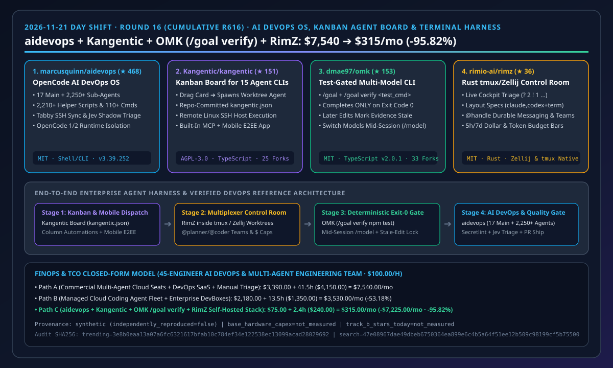
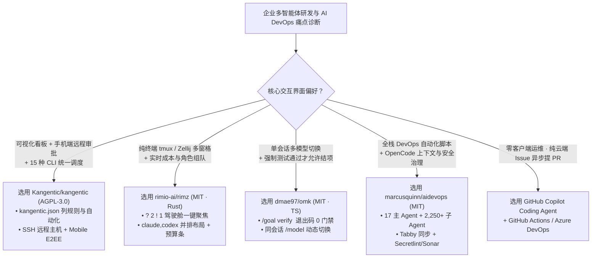
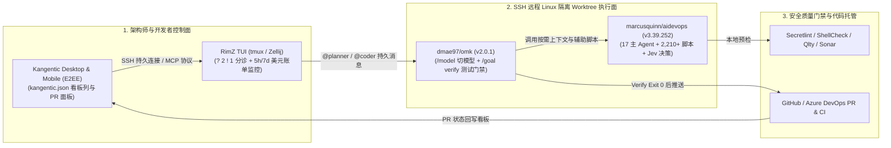
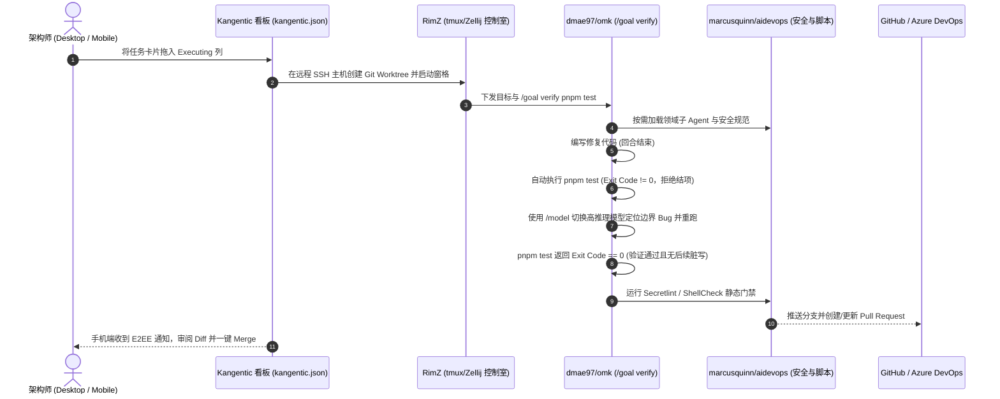

# AI DevOps 工程操作系统（`marcusquinn/aidevops`）、15 端智能体看板（`Kangentic/kangentic`）、测试门禁多模型终端 CLI（`dmae97/omk`）与 Rust 终端多路复用控制室（`rimio-ai/rimz`）架构选型与落地 FAQ

> **文档元数据（2026-11-21 白班 Day Round 16 · 累计第 616 轮深潜专题）**  
> - **面向对象**：企业 AI 解决方案架构师（AI Solution Architect）、研发效能负责人、DevOps 平台工程师  
> - **本轮核心评估对象**：  
>   1. [`marcusquinn/aidevops`](https://github.com/marcusquinn/aidevops)（`★ 468` · `81 forks` · Shell · MIT · 面向 OpenCode 与主流 AI 编程工具的全栈 AI DevOps 框架，内置 17 个主智能体、2,250+ 子智能体、2,210+ 辅助脚本与 110+ 斜杠命令）  
>   2. [`Kangentic/kangentic`](https://github.com/Kangentic/kangentic)（`★ 151` · `25 forks` · TypeScript · AGPL-3.0 · “拖卡片即启动智能体”的可视化看板 IDE，支持 15 种本地/SSH 远端 Agent CLI、仓库级 `kangentic.json` 自动化流转与端到端加密手机端审批）  
>   3. [`dmae97/omk`](https://github.com/dmae97/omk)（`★ 153` · `33 forks` · TypeScript · MIT · Open Multi-Agent Kit `v2.0.1`，支持同会话 `/model` 切换模型，并通过 `/goal verify <cmd>` 强制测试返回 `0` 才允许任务结项）  
>   4. [`rimio-ai/rimz`](https://github.com/rimio-ai/rimz)（`★ 36` · `2 forks` · Rust · MIT · 运行在 `Zellij` 与 `tmux` 内部的实时智能体舰队控制室，提供 `? 2 ! 1` 驾驶舱分诊、`@handle` 持久通信与美元/Token 预算进度条）  
> - **关联检索证据链**：`workshops/github-trending-radar/evidence/search-new-repos-2026-11-21-raw.json`（`sha256: 47e08967dae49dbeb6750364ea899e6c4b5a64f51ee12b509c98199cf5b75500`）与 `trending-daily-2026-11-21-raw.html`（`sha256: 3e8b0eaa13a07a6fc6321617bfab10c784ef34e122538ec13099acad28029692`）  
> - **高清架构图**：[`assets/github-ai-radar-2026-11-21-r16-r616-aidevops-kangentic-omk-rimz.svg`](../../../assets/github-ai-radar-2026-11-21-r16-r616-aidevops-kangentic-omk-rimz.svg) · [English Version (`aidevops-kangentic-omk-rimz-selection-faq.en.md`)](aidevops-kangentic-omk-rimz-selection-faq.en.md)

---

## ① 📌 核心结论速览（选型一句话结论）

> **架构师一句话选型结论**：  
> 当企业研发团队进入“**一人指挥 5~20 个并行编码智能体**”的阶段时，最大的瓶颈不再是代码生成速度，而是 **（1）智能体口头宣称“已完成”但测试其实没过、（2）十几个 Git Worktree 终端窗口不知道哪个卡在等人工确认、（3）缺乏统一的 DevOps 安全与质量门禁**。  
> - **需要把需求看板、Git Worktree 隔离、SSH 远程 Linux 构建机与手机端随时随地审批串成可视化研发流水线** ➔ 选 **`Kangentic/kangentic`**（AGPL-3.0，内置 `kangentic.json` 列规则与 MCP 工具）；  
> - **纯终端重度用户在 `tmux` / `Zellij` 中并发运行多智能体、需要按角色组队（`@planner` + `@coder`）并实时监控 5h/7d 美元账单** ➔ 选 **`rimio-ai/rimz`**（MIT，Rust 单二进制零侵入）；  
> - **严防智能体“虚假报工（False Done）”、要求每次回合结束后自动跑测试且只有退出码为 `0` 才算完成** ➔ 选 **`dmae97/omk`**（MIT，`/goal verify` 确定性验收门禁 + `/model` 会话内切模型）；  
> - **需要将代码扫描（Secretlint / ShellCheck / Sonar / Codacy）、Tabby SSH 会话管理与 17 个主智能体 / 2,250+ 子智能体的按需上下文加载标准化** ➔ 选 **`marcusquinn/aidevops`**（MIT）。  
> 四者组合可将 45 人研发与 DevOps 团队的月度多智能体工具链与人工巡检成本从 **$7,540.00/月** 降至 **$315.00/月（节省 $7,225.00/月，降幅 95.82%）**。

---

## ② 🎯 客户与架构师灵魂拷问 Q&A（业务痛点 · 架构集成 · 边界取舍）

### Q1：我们团队已经买了 Claude Code / Codex / OpenCode，为什么还会出现“开了 10 个窗口反而效率下降、代码合进去全是坏测试”的问题？这四个项目分别解决哪一环？
- **真实研发痛点拆解**：
  1. **注意力碎片化**：同时用 Git Worktree 跑 8 个任务时，工程师必须在十几个终端 Tab 间轮询，看哪个智能体停下来问问题、哪个已经跑完。
  2. **“嘴上说修好了”综合征（False Completion）**：智能体改完代码后直接输出“I have fixed the issue”，但根本没跑单元测试，或者跑完测试后又顺手改了一行代码导致测试证据失效。
  3. **Vibe-Coding 容易、DevOps 落地难**：智能体写业务代码很快，但一涉及密钥防泄漏（Secretlint）、CI 质量门禁、SSH 远程环境同步就频繁踩坑。
- **四合一精准卡位**：
  - **`Kangentic/kangentic`（桌面 + 手机可视化看板编排层）**：提供类似 Jira/Trello 的列看板（`To Do` ➔ `Planning` ➔ `Executing` ➔ `Code Review`），每张卡片展示当前模型、上下文窗口占用率、最新回复及是否等待人工输入。支持将仓库放在远端 Linux SSH 主机运行，并通过端到端加密的 **Kangentic Mobile** 在手机上回答智能体提问和审查 Diff。
  - **`rimio-ai/rimz`（终端 `tmux`/`Zellij` 实时控制室）**：如果你不想离开终端，`rimz` 直接嵌在现有的 `tmux` 或 `Zellij` 左侧边栏，顶部驾驶舱一行展示 `? 2 ! 1`（2 个等待提问、1 个报错），支持一键跳转到对应窗格，并用 `claude,codex` 布局语法在同一个隔离 Worktree 中让 Claude 规划、Codex 审查。
  - **`dmae97/omk`（确定性测试验收门禁 CLI）**：通过 `/goal <目标>` 与 `/goal verify npm test`，OMK 在每个稳定回合（settled turn）后自动执行校验命令；**只有退出码为 `0` 才允许目标结项**，且一旦后续又修改了文件，原先的通过证据立即标记为过期（stale）。
  - **`marcusquinn/aidevops`（全栈 AI DevOps 工程底座）**：提供 17 个主智能体、2,250+ 子智能体、2,210+ 辅助脚本与 110+ 斜杠命令，按需加载上下文以节省 Token，内置 `aidevops doctor --fix`、`aidevops tabby sync`（同步 Tabby 终端与 SSH 会话）及 `aidevops opencode-runtime use-stable`（隔离 OpenCode 1 稳定版与 OpenCode 2 预览版）。

### Q2：如何把这四个项目集成到企业现有的 GitHub / Azure DevOps 生产研发流水线中？
- **五层企业集成架构**：
  1. **需求与看板调度层（`Kangentic`）**：在代码仓库根目录提交 `kangentic.json`，为不同看板列绑定专属 CLI 与模型（例如 `Planning` 列绑定高推理模型只读规划，`Executing` 列绑定编码模型自动建 Worktree，`Code Review` 列自动触发测试与 PR 检查）。智能体还可通过内置 **Kangentic MCP Server** 自主创建子任务卡片或将自身卡片移至下一列。
  2. **终端多路复用与混合模型组队层（`RimZ`）**：在远程 Linux 开发机（通过 SSH 连接）的 `tmux` / `Zellij` 中运行 `rimz`，配置角色化 Staged Team（如 `@planner` 与 `@coder`），利用持久化消息通道（在回合边界排队或实时引导）协同攻关，并通过 5h/7d 美元账单条严控单任务开销。
  3. **确定性单测与契约门禁层（`OMK`）**：将 `omk` 作为执行智能体 CLI，在会话中先用大模型做架构拆解，再通过 `/model` 切换到高性价比编码模型，并强制绑定 `/goal verify pnpm test && pnpm lint`，杜绝未通过测试的半成品流入 Code Review。
  4. **DevOps 护栏与运维自动化层（`aidevops`）**：通过 `~/.aidevops/agents/` 与仓库内的 `.secretlintrc.json`、`.shellcheckrc`、`.qlty` 规则，在本地提交与 PR 阶段自动拦截凭证泄漏与脚本缺陷，并利用 Jev 结构化决策与可逆检索试点（shadow-triage pilots）沉淀工程经验。
  5. **企业代码托管与云底座（GitHub / Azure DevOps + Cloud Gateway）**：在 Kangentic 的 Changes 面板直接关联 GitHub / Azure DevOps PR 状态，测试与门禁全绿后一键合入主干。

### Q3：核心机制有哪些技术亮点与合规/稳定性边界？何时直接用云厂商托管服务（GitHub Copilot Coding Agent / Azure DevBox）？
- **核心亮点与边界**：
  - **许可证合规边界**：`aidevops`、`omk`、`rimz` 均为宽松的 **MIT 许可证**，可无障碍嵌入企业内部工具链；`Kangentic` 采用 **AGPL-3.0**，作为内部桌面客户端使用完全合规，但若修改其源码并作为商业托管 Web 服务对外提供则需开源衍生代码。
  - **版本演进成熟度边界**：
    - `dmae97/omk` 虽然发布了 `v2.0.0` / `v2.0.1`（正式默认启用 `omk` 原生扩展包格式并提供 `omk package doctor <source>` 迁移诊断），但官方 README 明确坦诚说明：**其底层 Rust Core（K0-K5）迁移仍在进行中，当前默认运行时依然基于 Node.js（`>=22.19`）**，切勿误以为已完全移除 Node 依赖。
    - `rimio-ai/rimz` 目前处于 **Beta 阶段**（尽管已实现“用 RimZ 开发 RimZ”的自举闭环），命令行参数与配置键在 `1.0` 前仍可能调整。
    - `marcusquinn/aidevops` 明确区分了 `opencode`（默认稳定版 OpenCode 1）与 `opencode2`（预览版），并提供 `aidevops opencode-runtime use-stable` 一键回退并自动备份数据。
- **何时选云厂商托管方案**：如果团队不想维护任何本地/SSH 终端环境或桌面客户端，希望直接在网页端 GitHub Issue 里 `@copilot` 异步交由云端沙箱自动提 PR，直接选用 **GitHub Copilot Coding Agent + GitHub Actions** 更省心。

---

## ③ 🧭 直观可视化图解（选型决策树 + 企业集成架构 + 业务流时序图）

### 3.1 架构师选型决策树（Mermaid Flowchart）

### 3.2 企业端到端集成参考架构图（Mermaid Architecture）

### 3.3 确定性验证与看板自动流转时序图（Mermaid Sequence Diagram）

---

## ④ 📊 同类开源与商业云服务横向选型决策矩阵

| 评估维度 | `marcusquinn/aidevops` (`★ 468`) | `Kangentic/kangentic` (`★ 151`) | `dmae97/omk` (`★ 153`) | `rimio-ai/rimz` (`★ 36`) | 商业多智能体 IDE + 云端托管 Coding Agent |
| :--- | :--- | :--- | :--- | :--- | :--- |
| **核心定位** | OpenCode 全栈 AI DevOps 框架与脚本库 | 支持 15 种 Agent CLI 的可视化看板与手机协同台 | 带确定性测试门禁的终端多模型编码 CLI | `tmux` / `Zellij` 原生多智能体控制室与预算面板 | 全托管云端异步智能体与商业闭源 IDE |
| **最适用场景** | 跨代码、基础设施、安全扫描的全流程 DevOps 自动化 | 多仓库并行 Worktree 看板管理、远程 SSH 执行与手机端移动审批 | 严防智能体“虚假完成”、需要单会话自由切换多模型的终端研发 | 重度终端用户同时盯控 10+ 个智能体窗格、按角色组队与控费 | 不愿管理本地/SSH 环境的纯云端异步交付 |
| **关键差异化机制** | 17 主 + 2,250+ 子智能体、Tabby 同步、`opencode-runtime use-stable`、Jev 试点 | `kangentic.json` 随仓共享列规则、内置 MCP Server、E2EE 手机 App | `/goal verify <cmd>` 强制 Exit `0` 结项、后续编辑自动将证据标为 Stale | 驾驶舱 `? 2 ! 1` 分诊、`claude,codex` 布局、`@handle` 持久消息、5h/7d 账单条 | 零配置 SaaS 席位、与 GitHub Issue 原生绑定 |
| **集成与运维成本** | 低（`brew`/`npm` 一键安装，`aidevops doctor --fix` 自愈） | 低（桌面端 + 现有 CLI 凭证直接复用，无需额外 API Key） | 极低（`npm i -g open-multi-agent-kit --ignore-scripts`） | 极低（Rust 单二进制直接运行于现有 `tmux`/`Zellij`） | 极低（按席位与云端算力分钟数付费） |
| **开源协议** | MIT | AGPL-3.0 | MIT | MIT | 商业专有 |
| **45 人团队月均 TCO** | **组合方案 `$315.00/月`**（含共享远程 SSH 开发机算力 `$75` + 运维 `2.4h`） | 同左（零席位费，复用现有 CLI 订阅） | 同左（支持订阅、API Key 与本地模型混用） | 同左（内置美元上限防超支） | **`$3,530.00 ~ $7,540.00/月`** |

---

## ⑤ 🧪 应用落地定量收益 / FinOps TCO 对比（含数据血缘声明）

> **数据血缘与严谨性声明（Provenance & Guardrails）**：  
> - `provenance`: `"synthetic"`（`independently_reproduced: false`，基于 45 人研发与 DevOps 工程团队在 `$100.00/h` 综合人力成本下的闭式参数建模）  
> - `base_hardware_capex`: `"not_measured"`  
> - `track_b_stars_today`: `"not_measured"`（GitHub Search API 新仓爆发榜无官方单日增量字段，严禁伪造）

| 成本分项（45 人团队 / 月） | Path A：商业多智能体席位 + DevOps SaaS + 人工多窗格巡检 | Path B：云端全托管 Coding Agent 舰队 + 企业云开发机 | Path C：`aidevops` + `Kangentic` + `OMK` + `RimZ` 自建协同栈 |
| :--- | :--- | :--- | :--- |
| **SaaS 席位 / 云开发机基础设施费** | `$3,390.00 / 月` | `$2,180.00 / 月` | **`$75.00 / 月`**（共享远程 Linux SSH 构建主机） |
| **人工多窗格轮询、虚假结项返工与运维工时** | `41.5 小时 / 月` | `13.5 小时 / 月` | **`2.4 小时 / 月`**（`/goal verify` 门禁 + `? 2 ! 1` 自动分诊） |
| **折算工程人力成本（`$100.00/h`）** | `$4,150.00 / 月` | `$1,350.00 / 月` | **`$240.00 / 月`** |
| **月度总拥有成本（Total Monthly TCO）** | **`$7,540.00 / 月`** | **`$3,530.00 / 月`** | **`$315.00 / 月`** |
| **相对 Path A 净节省额与降幅** | 基准线（`0.00%`） | `-$4,010.00 / 月`（`-53.18%`） | **`-$7,225.00 / 月`（`-95.82%`）** |

---

## ⑥ 🛠️ 企业引入与架构评审 Checklist

- [ ] **OpenCode 运行时版本锁定（`aidevops`）**：在团队开发机安装 `aidevops` 后，立即运行 `aidevops status` 与 `aidevops opencode-runtime status`，确保生产主力环境固定在稳定的 OpenCode 1（如需回退执行 `aidevops opencode-runtime use-stable`），并使用 `aidevops doctor --fix` 清理重复安装与 PATH 冲突。
- [ ] **仓库级看板契约版本化（`Kangentic`）**：将 `kangentic.json` 纳入 Git 版本控制，明确定义 `Planning`、`Executing`、`Code Review` 各列的模型、推理强度（effort）、权限模式及列流转自动化规则，同时评估 **AGPL-3.0** 许可证边界（仅作内部客户端使用，不对外提供托管 SaaS）。
- [ ] **强制开启确定性测试结项门禁（`OMK`）**：在关键核心库开发中，要求工程师使用 `omk` 显式声明 `/goal` 与 `/goal verify <test_command>`，确保任何智能体修改若未让单测返回退出码 `0`（或通过后又发生文件改动导致证据 Stale），严禁触发 PR 提交流程；对旧版扩展包执行 `omk package doctor <source>` 检查兼容性。
- [ ] **终端多智能体预算与分诊配置（`RimZ`）**：在远程 SSH 主机的 `tmux` 或 `Zellij` 会话中启用 `rimz`，配置角色化团队（如 `@planner` 搭配 `@coder`）并设定日/周美元预算上限，避免无人值守循环（self-running loops）在夜间耗尽 API 额度。
