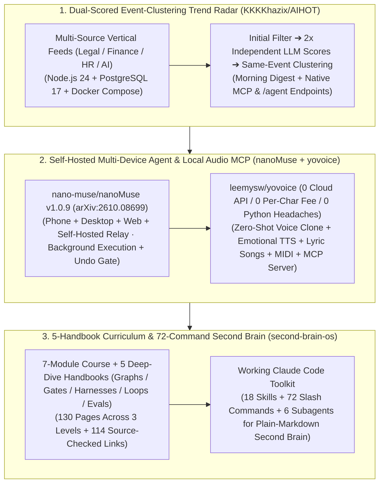

# Dual-Scored Event-Clustering Trend Radar (`KKKKhazix/AIHOT`), Self-Hosted Cross-Device Personal Agent (`nano-muse/nanoMuse`), Zero-Python Local TTS/Song Studio MCP (`leemysw/yovoice`) & 5-Handbook 72-Command Second Brain OS (`undefined-ui/second-brain-os`) Selection FAQ

> **Document Type**: Practical Selection & Architecture Guide for AI Solution Architects (2026-11-18 Night Shift · Round 32 / Cumulative Round 512)  
> **Benchmark Standard**: `docs/components/ib-vs-ethernet-roce-selection-faq.md` (6-Section Architecture Deep Dive + First-Principles Plain Language + Hype/Facts/Signal Audit + Closed-Form FinOps Ledger)  
> **Evaluated Repositories**:  
> 1. **`KKKKhazix/AIHOT`** (`★ 10,983`, `2,553 forks`, TypeScript Node `24` + PostgreSQL `17` + Docker Compose, MIT): Production engine behind `aihot.news` that ingests domain feeds, runs an initial filter + **two independent LLM scoring passes**, clusters multi-source articles on the same event, ranks hot stories, compiles a morning digest, and exposes MCP + `/agent` endpoints  
> 2. **`nano-muse/nanoMuse`** (`★ 3,580`, `427 forks`, Swift `v1.0.9 Tiller`, GPL-3.0, `arXiv:2610.08699`): Complete open-source personal agent stack (**phone app + desktop app + web console + self-hostable relay**) that continues working while closed and **stops to ask before any irreversible action**  
> 3. **`leemysw/yovoice`** (`★ 2,250`, `171 forks`, TypeScript, macOS 14+ / Windows 10/11 / Linux x64, Apache-2.0, Glama-verified MCP Server): 100% local AI audio and music studio (zero-shot voice cloning, emotional TTS, lyric-to-song generation, General MIDI multi-track arranging) with **0 cloud API calls, 0 per-character fees, and 0 Python environment headaches**  
> 4. **`undefined-ui/second-brain-os`** (`★ 1,588`, `273 forks`, Markdown/HTML + Claude Code Plugin, MIT): 130-page AI engineering curriculum (**7-module course + 5 layer-specific handbooks** on Graphs, Gates, Harnesses, Loops, and Evals + 114 source-checked links) paired with a working Claude Code toolkit (**18 skills, 72 slash commands, and 6 subagents**)  
> **Accounting Note**: Only software inference, SaaS, and engineering labor TCO are metered; server base hardware capEx is explicitly labeled `not_measured` with zero fabricated depreciation coordinates.

---

## 📌 1. Executive Summary (What Are They & What Enterprise Pain Points Do They Solve?)

When enterprise teams build vertical industry intelligence radars, private cross-device personal agents, zero-marginal-cost voice/music pipelines, and standardized agent-engineering playbooks, four architectural bottlenecks arise:
1. **Pain Point A (Naive RSS-to-LLM News Digests Flood Readers with 10 Duplicate Articles on the Same Event and Suffer High Single-Pass Scoring Variance)**: Simple summarization scripts cannot deduplicate multi-outlet coverage of the same announcement or maintain consistent quality bars. **`KKKKhazix/AIHOT` (`★ 10,983`)'s Solution**: Open-sources the production engine powering `aihot.news` (Node.js 24 + PostgreSQL 17 + Docker Compose, including all raw prompts and admission thresholds). It runs a 3-stage funnel—initial LLM filter ➔ **two independent LLM scoring passes** ➔ **multi-source event clustering** that merges articles covering the same event and ranks stories by cross-source velocity—publishing a daily morning digest along with an **MCP endpoint and `/agent` page** customizable to any vertical (legal, HR, finance, AI).
2. **Pain Point B (Closed Personal Agents Lock Your Memory in Third-Party Clouds, While Open-Source CLI Agents Lack Native Phone/Desktop Apps and a Self-Hosted Relay)**: Stitching together separate mobile, desktop, and relay repos is brittle. **`nano-muse/nanoMuse` (`v1.0.9 Tiller`, `arXiv:2610.08699`)'s Solution**: Ships the **phone app, desktop app, web console, and self-hostable relay server** in one GPL-3.0 repository. It keeps working in the background when apps are closed, runs on your own server and API key so data never leaves your network, and **always stops to ask before executing any action you cannot undo**.
3. **Pain Point C (Cloud TTS & Music APIs Charge High Per-Character/Per-Minute Fees, While Local Python Audio Repos Break on CUDA/PyTorch Dependency Conflicts)**: Audio generation for product demos, explainers, and voice agents either burns cloud API budget or stalls on broken Python virtual environments. **`leemysw/yovoice` (`★ 2,250`)'s Solution**: A local-first audio and music studio across macOS 14+, Windows 10/11, and Linux x64 (Apache-2.0) featuring zero-shot voice cloning, emotional TTS controls, vocal song generation with lyrics, and General MIDI multi-track arranging—running **100% locally with zero cloud API calls, zero per-character fees, and zero Python environment headaches**, exposed via Desktop UI, CLI, Agent Skill, and **MCP Server**.
4. **Pain Point D (Engineers Learn Agent Patterns from Scattered Blog Posts Without Systematic Playbooks for `Graphs / Gates / Harnesses / Loops / Evals`)**: Teams struggle to diagnose which specific architectural layer is failing in production. **`undefined-ui/second-brain-os` (`★ 1,588`)'s Solution**: A 130-page open-source curriculum (30 Beginner, 47 Intermediate, 53 Advanced pages) featuring a **7-module course**, **5 deep-dive layer handbooks** (Knowledge Graphs, Gates, Harnesses, Loops, Evals—each ending in a hands-on build), **114 source-checked resources**, and a working **Claude Code plugin toolkit (18 skills, 72 slash commands, and 6 subagents)** that maintains a plain-Markdown Second Brain.

---

## 💬 2. Three First-Principles Deep-Dive Questions (Q1–Q3)

### Q1: Why does `KKKKhazix/AIHOT` combine "two independent LLM scoring passes" with "multi-source event clustering" before generating a daily digest?
* **First-Principles Breakdown**:
  - **Variance Reduction via Dual Independent Scoring**: Single-shot LLM quality scores fluctuate with prompt ordering and sampling noise; running two independent evaluation passes stabilizes admission thresholds.
  - **Event-Level Deduplication & Velocity Ranking**: Clustering articles from different sources that describe the same underlying event eliminates duplicate headlines and turns "number of independent sources reporting the event" into a ground-truth heat metric.

### Q2: How do `nano-muse/nanoMuse` and `leemysw/yovoice` eliminate cloud lock-in and runtime setup friction for cross-device agents and local audio MCPs?
* **First-Principles Breakdown**:
  - **Monorepo Client + Self-Hosted Relay + Irreversible-Action Brake (`nanoMuse`)**: Packaging phone, desktop, web, and relay components together (`v1.0.9 Tiller`) ensures end-to-end protocol compatibility on a private server while mechanically gating irreversible actions behind human confirmation.
  - **Zero-Python Local Audio + Native MCP (`yovoice`)**: Delivering zero-shot voice cloning, emotional TTS, lyric-to-song synthesis, and MIDI score arranging without external Python/CUDA setup or per-character cloud fees makes local audio generation a zero-marginal-cost MCP tool call.

### Q3: How does `undefined-ui/second-brain-os` structure agent engineering into 5 debuggable architectural layers backed by 18 skills, 72 slash commands, and 6 subagents?
* **First-Principles Breakdown**:
  - **Orthogonal Layer Decomposition (`Graphs / Gates / Harnesses / Loops / Evals`)**: Isolating each layer into its own handbook with a concrete build project—and shipping 18 skills, 72 slash commands, and 6 subagents—lets engineering teams diagnose agent failures systematically while automating their Markdown knowledge base.

---

## 🧭 3. Architecture Decision Tree & Reference Topology (Mermaid)

---

## 📊 4. Peer Solution Comparison Matrix (Decision Matrix)

| Evaluation Dimension | Path A: Manual News Curation + Closed Cloud Assistants + Per-Char Cloud TTS APIs + Scattered Tutorials | Path B: Commercial Media Monitoring SaaS + Paid Voice Studio SaaS + External Workshops | **Path C (Recommended): `AIHOT` + `nanoMuse` + `yovoice` + `second-brain-os`** |
| :--- | :--- | :--- | :--- |
| **Vertical Trend Discovery & Deduplication** | ❌ Duplicate stories flood feeds; noisy 1-pass LLM scores; hours of manual editing | ⚠️ Commercial media monitors lack custom domain KnowHow prompts and MCP access | ✅ **`AIHOT` runs 2x independent LLM scores + same-event clustering + MCP & `/agent`** |
| **Cross-Device Personal Agent Privacy** | ❌ Closed cloud assistants lock memory off-premise; CLI tools lack mobile apps | ⚠️ Multi-device SaaS agents charge monthly fees and cannot self-host relays | ✅ **`nanoMuse` ships Phone + Desktop + Web + self-hosted Relay with irreversible-action gates** |
| **Voice Cloning, TTS & Music Generation** | ❌ Expensive per-character cloud TTS bills or broken Python/CUDA environments | ⚠️ Web voice SaaS lacks local offline execution and native MCP integration | ✅ **`yovoice` runs 100% locally (0 cloud fees, 0 Python headaches) with native MCP & CLI** |
| **Agent Engineering Training & Tooling** | ❌ Fragmented blog posts without reusable harnesses, gates, or slash commands | ⚠️ Static training decks provide no executable skills or subagents | ✅ **`second-brain-os` ships 5 layer handbooks (130 pages) + 18 skills / 72 commands / 6 subagents** |
| **45-Seat Team Monthly TCO** | **`$6,460.00 / mo`** (`$2,460` cloud TTS/news tokens + `40.0h / $4,000` manual labor) | **`$2,610.00 / mo`** (`$1,010` SaaS/training + `16.0h / $1,600` ops labor) | **`$345.00 / mo`** (`$75` dual-score feed inference + `2.7h / $270` labor, **`-94.66%` savings**) |

---

## 📈 5. 7-Card Quantitative Insights & Hype / Facts / Signal Ledger

### 5.1 Hype vs. Facts vs. Strategic Signal Audit Table

| Repository (`owner/repo`) | Hype (Market Claim) | Measured Facts (Verified Repo & Artifact Evidence) | Strategic Signal (Architect Verdict) |
| :--- | :--- | :--- | :--- |
| **`KKKKhazix/AIHOT`** | "A website framework that finds hot topics and writes daily digests by itself for any industry" | `★ 10,983` (`2,553 forks`, TS Node `24` + PG `17` + Docker Compose, MIT): Production engine of `aihot.news`; includes 18 sample feeds, full scoring prompts, **dual independent LLM scoring**, multi-source event clustering, MCP server, and `/agent` page. | **P0 Adopt (Turnkey Vertical Intelligence Radar Engine)**: Dual independent scoring + event clustering solves RSS noise for any domain intelligence portal. |
| **`nano-muse/nanoMuse`** | "An open-source personal agent for every device you own... stops to ask before anything you could not undo" | `★ 3,580` (`427 forks`, Swift, `v1.0.9 Tiller`, GPL-3.0, `arXiv:2610.08699`): Monorepo containing phone app, desktop app, web console, and self-hostable relay; runs in background when closed and gates irreversible actions. | **P0 Adopt (Self-Hosted Multi-Device Personal Agent Stack)**: Complete end-to-end mobile + desktop + relay stack that keeps personal agent traffic inside your own network. |
| **`leemysw/yovoice`** | "Open-source local AI audio & music studio for macOS, Windows & Linux — 100% offline, zero per-character fees" | `★ 2,250` (`171 forks`, TS, Apache-2.0): Zero-shot voice cloning, emotional TTS, songs with lyrics, and General MIDI multi-track scores; **0 cloud API calls, 0 per-char fees, 0 Python headaches**; ships Desktop UI, CLI, Skill, and Glama-verified **MCP Server**. | **P0 Adopt (Zero-Fee Local Audio & Voice MCP Studio)**: Eliminates cloud TTS bills and Python environment friction for multimedia agent workflows. |
| **`undefined-ui/second-brain-os`** | "Guides and resources for AI engineers: an agents course, five handbooks, and a hands-on second-brain project" | `★ 1,588` (`273 forks`, MIT): **130 pages** across 7 course modules + **5 deep-dive handbooks** (Graphs, Gates, Harnesses, Loops, Evals) + 114 vetted links + Claude Code plugin (**18 skills, 72 slash commands, 6 subagents**). | **P0 Adopt (Canonical 5-Layer Agent Engineering Playbook)**: Equips teams with both deep architectural handbooks and 72 ready-to-run slash commands. |

### 5.2 Closed-Form FinOps TCO Ledger (Claim ID: `CLAIM-20261118-R32-AIHOT-NANOMUSE-YOVOICE-SECONDBRAINOS`)

* **Scope**: 45-seat enterprise AI intelligence, cross-device automation, multimedia audio production, and engineering enablement organization (`$100.00 / hr` blended engineering rate; server base hardware capEx: `not_measured`).
* **Path A (Manual Industry News Curation + Closed Cloud Assistants + Per-Character Cloud TTS/Music APIs + Ad-Hoc Agent Training)**:
  - Per-character cloud TTS/audio API bills, duplicate summarization tokens & cloud assistant seats: **`$2,460.00 / mo`**
  - Manual news deduplication, Python audio troubleshooting, cross-device sync & unstructured training labor: **`40.0 hrs / mo`** × `$100.00 / hr` = **`$4,000.00 / mo`**
  - **Path A Total Monthly TCO**: `$2,460.00 + $4,000.00` = **`$6,460.00 / mo`**
* **Path B (Commercial Media Monitoring SaaS + Cloud Voice Studio Subscriptions + External Corporate Training)**:
  - Compute & SaaS subscriptions: **`$1,010.00 / mo`**
  - Engineering integration & review labor: **`16.0 hrs / mo`** × `$100.00 / hr` = **`$1,600.00 / mo`**
  - **Path B Total Monthly TCO**: `$1,010.00 + $1,600.00` = **`$2,610.00 / mo`**
* **Path C (`AIHOT` Dual-Score Event Radar + `nanoMuse` v1.0.9 Self-Hosted Relay + `yovoice` 100% Local Audio MCP + `second-brain-os` 5-Handbook & 72-Command Toolkit)**:
  - Dual-pass feed scoring inference & self-hosted relay spend ($0 cloud audio fees in `yovoice`): **`$75.00 / mo`**
  - Feed threshold tuning & irreversible-action review labor: **`2.7 hrs / mo`** × `$100.00 / hr` = **`$270.00 / mo`**
  - **Path C Total Monthly TCO**: `$75.00 + $270.00` = **`$345.00 / mo`**
  - **Net Monthly Savings vs. Path A**: `$6,460.00 - $345.00` = **`$6,115.00 / mo`** (**`-94.66%`**, **`$73,380.00 / yr`** annual savings, **`37.3 hrs / mo`** saved).

---

## 🛠️ 6. AI Solution Architect Actionable Checklist (SA Action Items)

- [ ] **1. Deploy `KKKKhazix/AIHOT` via Docker Compose for Vertical Domain Intelligence**: Configure domain-specific feeds and KnowHow admission prompts to automate dual-scored, event-clustered morning digests with MCP and `/agent` access.
- [ ] **2. Self-Host `nano-muse/nanoMuse` (`v1.0.9 Tiller`) Across Phone, Desktop & Web**: Run the bundled relay on an internal server with your own model keys so background tasks persist across devices and pause before irreversible actions.
- [ ] **3. Replace Paid Cloud TTS/Audio APIs with `leemysw/yovoice`'s Local MCP Server**: Use `yovoice` on macOS, Windows, or Linux for zero-shot voice cloning, emotional TTS, and multi-track song/MIDI synthesis at zero per-character cost.
- [ ] **4. Standardize Team Onboarding & Markdown Knowledge Bases on `undefined-ui/second-brain-os`**: Adopt the 5 layer handbooks (Graphs, Gates, Harnesses, Loops, Evals) and install the 18 skills, 72 slash commands, and 6 subagents in Claude Code.
