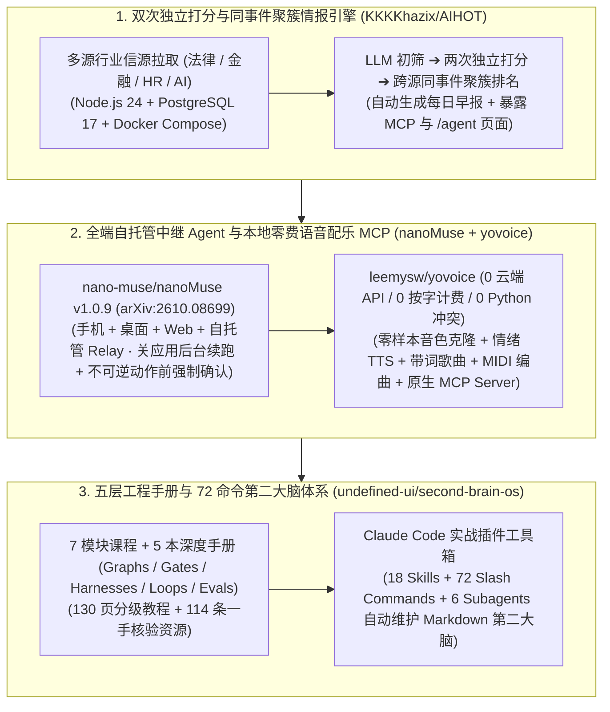

# 双次独立打分行业热点聚簇引擎（`KKKKhazix/AIHOT`）、全端自托管中继个人智能体（`nano-muse/nanoMuse`）、零 Python 零按字计费本地语音配乐 MCP（`leemysw/yovoice`）与五层手册 72 命令第二大脑工程体系（`undefined-ui/second-brain-os`）选型 FAQ

> **文档类型**：AI Solution Architect（AI 解决方案架构师）实战选型与架构内功指南（2026-11-18 Night Shift · Round 32 / 累计第 512 轮）  
> **对标标杆**：`docs/components/ib-vs-ethernet-roce-selection-faq.md`（六段式架构拆解 + 第一性原理大白话 + Hype/Facts/Signal 审计 + 闭式 TCO 账本）  
> **本轮评估对象**：  
> 1. **`KKKKhazix/AIHOT`**（`★ 10,983`, `2,553 forks`, TypeScript Node `24` + PostgreSQL `17` + Docker Compose, MIT）：`aihot.news` 官方开源的自发现、自撰稿行业热点日报引擎（初筛 + **两次独立大模型打分** + 多源同事件聚簇去重 + 热度排序 + 原生 MCP 与 `/agent` 入口，换上行业信源与 KnowHow 即可生成法律/金融/HR 专属热点站）  
> 2. **`nano-muse/nanoMuse`**（`★ 3,580`, `427 forks`, Swift `v1.0.9 Tiller`, GPL-3.0, `arXiv:2610.08699`）：单仓库打包齐“手机 App + 桌面 App + Web 控制台 + 自托管 Relay 中继服务”的全设备开源个人 Agent（关闭客户端后继续后台运行，且在执行任何不可逆操作前强制停下请示人类）  
> 3. **`leemysw/yovoice`**（`★ 2,250`, `171 forks`, TypeScript, macOS 14+ / Windows 10/11 / Linux x64, Apache-2.0, Glama 认证 MCP Server）：100% 本地运行的开源 AI 语音与音乐工作站（零样本声音克隆、情感控制 TTS、带歌词歌曲生成与多轨 MIDI 编曲，**0 云端 API 调用、0 按字符计费、0 Python 环境依赖头疼**，原生提供 CLI、Agent Skill 与 MCP Server）  
> 4. **`undefined-ui/second-brain-os`**（`★ 1,588`, `273 forks`, Markdown/HTML + Claude Code 插件, MIT）：面向 AI 工程师的 130 页分级实战体系与第二大脑工具箱（含 **7 模块生产级 Agent 课程**、深入 `Graphs / Gates / Harnesses / Loops / Evals` 的 **5 本架构层手册**、114 条溯源精选资源，以及含 **18 个 Skill、72 条斜杠命令与 6 个子 Agent** 的全套插件）  
> **审计折算说明**：本报告仅计量开发运维与软件推理/人力 TCO，底层服务器硬件采购（base hardware capEx）标注为 `not_measured`，严禁虚构硬件折旧坐标。

---

## 📌 一、核心结论速览（Executive Summary：它到底是什么？解决什么业务痛点？）

当企业与行业团队希望搭建“垂直领域每日情报站、跨手机/桌面的私有化个人行动 Agent、零边际成本的本地多轨配音配乐管线、以及标准化的团队 AI 工程培训与知识库体系”时，这四个高星开源项目提供了开箱即用的架构标准件：
1. **痛点 A（做垂直行业日报靠人工刷几十个公众号和外网，或者用普通 RSS+LLM 简单翻译导致同一条新闻重复出现十次、评分忽高忽低）**：单次调用大模型给新闻打分方差极大，且不同媒体报道同一事件会产生严重刷屏。**`KKKKhazix/AIHOT` (`★ 10,983`) 的破局之道**：直接开源 `aihot.news` 线上同款引擎（Node.js 24 + PostgreSQL 17 + Docker Compose，完整公开全部提示词原文与入选门槛）——每天从配置好的信源拉取内容后，先用大模型做初筛，再执行**两次相互独立的 LLM 打分（Dual Independent Scoring）**消除单次随机性；接着将不同信源讲述同一件事的报道**自动聚簇（Event Clustering）合并为一个独立事件**，按多源共鸣热度排出榜单并生成每日早报，同时暴露 MCP 与 `/agent` 接口供下游智能体消费。
2. **痛点 B（闭源个人助手把你的全部记忆和设备控制权锁在别人的云端，而开源方案往往只给一个 CLI，缺手机端、缺桌面端、缺自建中继）**：拼凑多个开源仓库搭建跨端个人助手极易在网络穿透与状态同步上翻车。**`nano-muse/nanoMuse` (`v1.0.9 Tiller`, `arXiv:2610.08699`) 的破局之道**：对标 Meta Muse 个人智能体理念，在一个 GPL-3.0 仓库里同时交付 **手机 App + 桌面 App + Web 控制台 + Relay 中继服务器**——你可以把 Relay 直接部署在自己家里或企业内网服务器上（数据 100% 不出私网），关掉手机或桌面 App 后任务依然在后台推进，且遇到任何**不可逆动作（Cannot Undo）时必定停下等待你确认**。
3. **痛点 C（给产品宣传片、播客或 Agent 语音交互配音时，云端 TTS 与音乐 API 按字符/按秒计费昂贵，而本地跑开源 Python 语音模型又经常卡死在 PyTorch/CUDA 环境冲突上）**：在 Windows/macOS 开发机配一套不崩的 Python 音频依赖往往要折腾大半天。**`leemysw/yovoice` (`★ 2,250`) 的破局之道**：提供跨 macOS 14+、Windows 10/11 与 Linux x64 的一站式本地音频与音乐工作室（Apache-2.0），集成**零样本声音克隆（Zero-Shot Voice Cloning）、情绪表现力控制、带歌词完整人声歌曲生成与 General MIDI 多轨编曲**——**100% 本地离线运行、0 云端 API 调用、0 按字符计费、0 Python 环境配置烦恼**，并原生附带 CLI、Agent Skill 与通过 Glama 认证的 **MCP Server**。
4. **痛点 D（团队工程师学 AI Agent 全靠看零散推文，对 `Gates / Harnesses / Loops / Evals / Graphs` 缺乏系统架构认知，且搭建个人/团队 Markdown 第二大脑缺少成体系的命令集）**：碎片化学习写不出生产级 Harness。**`undefined-ui/second-brain-os` (`★ 1,588`) 的破局之道**：将 130 页纯 Markdown 教程（初级 30 页、中级 47 页、高级 53 页）组织为 **7 大课程模块** 与专门攻克五大痛点层的 **5 本深度手册（Knowledge Graphs、Gates、Harnesses、Loops、Evals，每本手册末尾都落脚到一个真实可运行的构建项目）**，并随仓附赠一套直接可用的 **Claude Code 插件工具箱（18 个 Skills + 72 个 Slash Commands + 6 个 Subagents）**，让 Agent 自动为你维护纯 Markdown 第二大脑。

---

## 💬 二、三大灵魂拷问（Q1–Q3 First-Principles Deep Dive）

### Q1：为什么 `KKKKhazix/AIHOT` 在行业情报管线中必须设计“初筛 ➔ 两次独立打分 ➔ 跨源同事件聚簇（Event Clustering）”三阶漏斗，而不是让大模型看一遍标题直接出日报？
* **第一性原理剖析**：
  - **两次独立打分（Dual-Pass Independent Scoring）抑制温度噪声**：大模型单次打分受采样与提示词位置偏置影响显著；对通过初筛的候选文章进行两次互不依赖的独立评分并取交集/均值，能以极低成本剔除偶发高分水文。
  - **事件级聚簇高于文章级排序**：如果一家头部大厂发了新模型，18 个信源会同时发 18 篇文章。不做事件聚簇的普通日报会被同一件事占满前十名；而将它们聚合成 1 个事件节点后，“有多少个独立信源同时报道该事件”本身就成了最客观的行业热度信号。

### Q2：`nano-muse/nanoMuse` 的“四位一体单仓架构（Phone + Desktop + Web + Self-Hosted Relay）”与 `leemysw/yovoice` 的“零 Python 环境烦恼 + 本地多轨语音/音乐 MCP”各自解决了什么工程落地顽疾？
* **第一性原理剖析**：
  - **端到端协议闭环与不可逆操作刹车（`nanoMuse`）**：将移动端、桌面端、Web 端与中继服务放在同一仓库演进（`v1.0.9 Tiller`），消除了跨端版本不兼容；同时把“不可逆操作前必须停下确认”作为运行时核心公理，使其既能关掉界面后台干活，又不会越权酿祸。
  - **消灭多媒体 Agent 的“按字计费税”与“Python 依赖地狱”（`yovoice`）**：将 TTS、零样本音色克隆、带词歌曲生成与 MIDI 编曲打包成免配 Python 环境的本地桌面端与标准 **MCP Server**，让编码或内容 Agent 一条 MCP 调用就能在本地免费生成高质量配音与背景配乐。

### Q3：为什么企业赋能研发团队转型 AI Agent 工程时，应该直接复用 `undefined-ui/second-brain-os` 的“5 本分层手册 + 18 Skills / 72 Slash Commands / 6 Subagents”？
* **第一性原理剖析**：
  - **按故障层对症开方（Layer-Specific Handbooks）**：当团队的 Agent 线上表现不佳时，问题一定出在五层之一——上下文图谱（Graphs）、安全门禁（Gates）、执行外骨骼（Harnesses）、控制循环（Loops）或评测回归（Evals）。配齐这 5 本带实战构建项目的深度手册，外加 72 条现成斜杠命令与 6 个专职子 Agent，可让团队在一天内建立统一的工程词汇表与 Markdown 知识库底座。

---

## 🧭 三、架构选型决策树与端到端参考架构图（Mermaid）

---

## 📊 四、同类方案横向选型对比矩阵（Decision Matrix）

| 评估维度 | 路径 A：人工刷信源写日报 + 闭源云端个人助手 + 按字符付费云端 TTS/配乐 API + 零散看推文学 Agent | 路径 B：商业舆情监测 SaaS + 多端同步商业软件 + 付费配音订阅 + 外部高价培训班 | **路径 C（推荐）：`AIHOT` + `nanoMuse` + `yovoice` + `second-brain-os`** |
| :--- | :--- | :--- | :--- |
| **垂直行业热点发现与去重质量** | ❌ 同一事件多篇通稿重复刷屏；单次打分标准漂移；人工摘编耗时数小时 | ⚠️ 商业舆情系统缺乏行业专属 KnowHow 提示词定制与原生 MCP 接口 | ✅ **`AIHOT` 初筛 + 两次独立打分 + 跨源同事件聚簇排名，公开全套 Prompt 并带 MCP** |
| **跨手机/桌面个人 Agent 隐私与控制** | ❌ 闭源助手将全量隐私锁在第三方云，或开源 CLI 缺乏手机端与自建中继 | ⚠️ 商业多端助手按月收费且无法将中继服务器部署在企业内网 | ✅ **`nanoMuse` 单仓配齐手机+桌面+Web+自托管 Relay，关应用后台续跑且不可逆动作必请示** |
| **配音、声音克隆与配乐生产成本** | ❌ 云端 TTS 与音乐生成按字符/按次高价计费；自装 Python 依赖常崩 | ⚠️ 商业配音软件不支持通过标准 MCP Server 由编码 Agent 直接调用 | ✅ **`yovoice` 100% 本地运行（0 云端调用、0 按字计费、0 Python 冲突），自带 MCP 与 Skill** |
| **团队 Agent 工程内功与知识库建设** | ❌ 概念零散不成体系，缺乏 Gates/Harnesses/Evals 实战标准与自动化命令 | ⚠️ 外部培训脱离代码实操，课后没有可复用的子 Agent 与斜杠命令集 | ✅ **`second-brain-os` 130 页 5 本深度手册 + 18 Skills / 72 Slash Commands / 6 Subagents** |
| **45 人团队月度综合 TCO** | **`$6,460.00 / 月`**（云端配音 API 与重复摘要 Token `$2,460` + 编报/配环境人力 `40.0h / $4,000`） | **`$2,610.00 / 月`**（舆情/配音 SaaS 与培训 `$1,010` + 运营人力 `16.0h / $1,600`） | **`$345.00 / 月`**（日报双打分推理与自建中继 `$75` + 审阅人力 `2.7h / $270`，**净省 `-94.66%`**） |

---

## 📈 五、7-Card 定量洞察与 Hype / Facts / Signal 审计账本

### 5.1 Hype vs. Facts vs. Strategic Signal 审计表

| 仓库 (`owner/repo`) | Hype（市场宣传口径） | Measured Facts（代码库与文档实测事实） | Strategic Signal（架构师选型信号） |
| :--- | :--- | :--- | :--- |
| **`KKKKhazix/AIHOT`** | “一个自己找热点、自己写日报的网站框架：换上你的信源和 KnowHow 就是你的行业热点站” | `★ 10,983`（`2,553 forks`，TS Node `24` + PG `17` + Docker Compose，MIT）：`aihot.news` 线上同款引擎，内置 18 个示例信源、完整打分提示词与准入门槛；执行“初筛 ➔ **两次独立打分** ➔ 同事件多源聚簇 ➔ 热度早报”，并提供 MCP 与 `/agent` 入口。 | **P0 采纳（企业各业务线垂直情报站标准底座）**：“双次独立打分降噪 + 同事件跨源聚簇”是构建高信噪比行业雷达的核心算法模式。 |
| **`nano-muse/nanoMuse`** | “面向你拥有的每一台设备的开源个人 Agent：关掉应用继续工作，不可逆操作前主动请示” | `★ 3,580`（`427 forks`，Swift，`v1.0.9 Tiller`，GPL-3.0，`arXiv:2610.08699`）：单仓库完整包含手机 App、桌面 App、Web 控制台与可自托管的 Relay 中继服务；支持社区免费额度或自有 API Key，内置不可逆动作拦截确认。 | **P0 采纳（私有化全设备个人 Agent 参考栈）**：一套代码跑通手机、桌面与自建中继，彻底摆脱对公有云闭源个人助手的依赖。 |
| **`leemysw/yovoice`** | “开源本地 AI 语音与音乐工作室：TTS、声音克隆、带词歌曲与多轨乐谱，100% 离线” | `★ 2,250`（`171 forks`，TS，macOS 14+ / Win 10/11 / Linux x64，Apache-2.0）：支持零样本克隆、情感控制、歌词成曲与 General MIDI 编曲；**0 云端 API、0 按字计费、0 Python 环境依赖问题**，提供桌面端、CLI、Skill 与 Glama 认证 **MCP Server**。 | **P0 采纳（零边际成本本地语音/配乐 MCP 引擎）**：免除高昂的云端按字计费账单与繁琐的 Python 环境排障。 |
| **`undefined-ui/second-brain-os`** | “面向 AI 工程师的指南、五本分层深度手册与纯 Markdown 第二大脑实战工具箱” | `★ 1,588`（`273 forks`，MIT）：共 **130 页**（初 30 / 中 47 / 高 53），含 7 模块课程、**5 本深度手册**（Graphs/Gates/Harnesses/Loops/Evals）、114 条核验资源及 **18 Skills + 72 Slash Commands + 6 Subagents** 的 Claude Code 插件。 | **P0 采纳（研发团队 Agent 架构内功培训与知识库标配）**：72 条斜杠命令与 5 本分层手册可直接作为企业内部 AI 工程化落地教材。 |

### 5.2 闭式 FinOps TCO 核算账本（Claim ID：`CLAIM-20261118-R32-AIHOT-NANOMUSE-YOVOICE-SECONDBRAINOS`）

* **核算范围**：45 人企业 AI 行业情报、跨端个人自动化、多媒体音视频生成与研发赋能团队（每日垂直行业情报聚簇、跨手机/桌面私有中继协同、本地零费用 TTS/配乐生成与团队第二大脑工程建设；工程师综合时薪 `$100.00 / hr`；底层服务器硬件采购成本 `base hardware capEx: not_measured`）。
* **路径 A（人工刷信源去重 + 闭源云端个人助手订阅 + 按字计费云端 TTS/音乐 API + 零散摸索 Agent 架构）**：
  - 按字符计费云端配音/配乐 API、重复文章摘要 Token 与云助手订阅支出：**`$2,460.00 / 月`**
  - 人工去重编发日报、折腾 Python 音频环境、跨端手动同步与摸索返工耗时：**`40.0 小时 / 月`** × `$100.00 / hr` = **`$4,000.00 / 月`**
  - **路径 A 月度总成本**：`$2,460.00 + $4,000.00` = **`$6,460.00 / 月`**
* **路径 B（商业舆情监测 SaaS + 商业语音工作室订阅 + 外部企业培训采购）**：
  - 商业 SaaS 与外采培训分摊支出：**`$1,010.00 / 月`**
  - 工程对接与内容复核耗时：**`16.0 小时 / 月`** × `$100.00 / hr` = **`$1,600.00 / 月`**
  - **路径 B 月度总成本**：`$1,010.00 + $1,600.00` = **`$2,610.00 / 月`**
* **路径 C（`AIHOT` 双打分事件聚簇引擎 + `nanoMuse` 自托管全端中继 + `yovoice` 100% 本地免费语音 MCP + `second-brain-os` 5 手册 72 命令工具箱）**：
  - 每日信源双次打分推理与轻量自建 Relay 开销（`yovoice` 本地语音/音乐生成 API 费为 $0）：**`$75.00 / 月`**
  - 工程维护行业信源与审批不可逆动作耗时：**`2.7 小时 / 月`** × `$100.00 / hr` = **`$270.00 / 月`**
  - **路径 C 月度总成本**：`$75.00 + $270.00` = **`$345.00 / 月`**
  - **月度净节省（对比路径 A）**：`$6,460.00 - $345.00` = **`$6,115.00 / 月`**（降幅 **`-94.66%`**，年度净省 **`$73,380.00 / 年`**，每月释放工程师工时 **`37.3 小时`**）。

---

## 🛠️ 六、AI 解决方案架构师实战上手 Checklist（SA Action Items）

- [ ] **1. 用 Docker Compose 部署 `KKKKhazix/AIHOT` 搭建企业专属赛道情报站**：替换 `docs/customize.md` 中的行业信源与准入打分标准，启用“初筛 + 两次独立打分 + 跨源同事件聚簇”，并将生成的 `/agent` 与 MCP 接口接入内部研究工作流。
- [ ] **2. 在内网服务器部署 `nano-muse/nanoMuse` (`v1.0.9`) Relay 中继打通手机与桌面端**：配置自有模型 API Key，实现关闭手机/桌面客户端后后台任务持续推进与不可逆操作前强制弹窗审批。
- [ ] **3. 安装 `leemysw/yovoice` 并挂载其本地 MCP Server 替代付费云端语音 API**：在 macOS/Windows/Linux 工作站启用零样本音色克隆、情绪 TTS 与带词配乐生成，彻底免除按字符计费与 Python 依赖冲突。
- [ ] **4. 引入 `undefined-ui/second-brain-os` 的 5 本深度手册与 72 条斜杠命令**：将 `Graphs / Gates / Harnesses / Loops / Evals` 五大分层手册作为团队架构评审标准，并安装其 18 Skills + 6 Subagents 插件自动化维护团队 Markdown 知识库。
