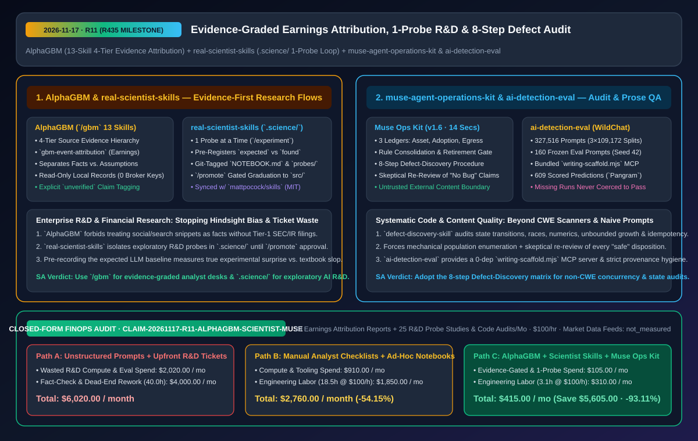
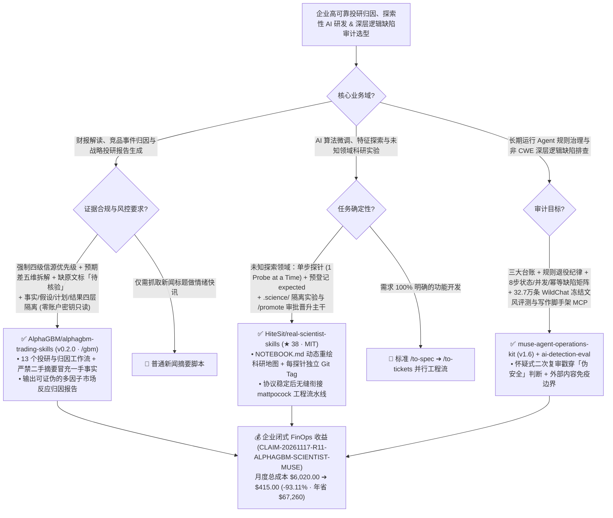

# 【第 435 轮里程碑】四级证据链财报归因投研技能（`AlphaGBM`）、单步探针可复现科研工作流（`real-scientist-skills`）与八步系统性逻辑缺陷审计套件（`muse-agent-operations-kit` & `ai-detection-eval`）深度选型 FAQ

> **文档元数据（2026-11-17 · Night Round 11 / 累计 Round 435 里程碑）**  
> - **目标读者**：面向企业客户与业务决策者的 **AI Solution Architect（AI 解决方案架构师）**  
> - **核心导向**：**① 真实企业应用场景落地（ROI 与业务痛点） + ② 端到端集成参考架构设计 + ③ 同赛道开源/云服务/商业方案横向选型比较（含闭式 TCO 与适用边界）**  
> - **对标范式**：严格对标 `ib-vs-ethernet-roce-selection-faq.md`  
> - **核心评估对象**：  
>   1. [`AlphaGBM/alphagbm-trading-skills`](https://github.com/AlphaGBM/alphagbm-trading-skills)（`v0.2.0`，`★ 32`，Python：面向金融机构与企业战略投研团队的 **13 技能财报事件归因与研究沉淀工作流（`/gbm`）**；强制执行四级信源优先级与“研究事实 vs 模型假设 vs 决策执行 vs 事后结果”分层留痕，缺原文强制打标 `待核验`）  
>   2. [`HiteSit/real-scientist-skills`](https://github.com/HiteSit/real-scientist-skills)（`★ 38`，MIT 协议：基于 `mattpocock/skills` 构建的企业 AI 研发与数据科学可复现实验工作流；首创 **单步探针循环（One Probe at a Time，`/experiment` → `.science/<study>/probes/` → `/promote`）**，运行前强制预登记 `expected` 基线以量化真实发现增量）  
>   3. [`Chisiki1/muse-agent-operations-kit`](https://github.com/Chisiki1/muse-agent-operations-kit)（`v1.6`，`★ 29`，MIT 协议：14 章长期运行 Agent 运维/退役治理手册 + **8 步状态迁移/并发/幂等性逻辑缺陷发现技能**）与 [`ampdot-io/ai-detection-eval`](https://github.com/ampdot-io/ai-detection-eval)（`★ 44`：基于 `327,516` 条 WildChat 切分与 `160` 条冻结提示词的文风检测基准及零依赖 `writing-scaffold.mjs` MCP 服务）  
> - **配套架构图**：[`assets/github-ai-radar-2026-11-17-r11-alphagbm-scientist-muse-ops.svg`](../../../assets/github-ai-radar-2026-11-17-r11-alphagbm-scientist-muse-ops.svg)  
> - **审计契约号**：`CLAIM-20261117-R11-ALPHAGBM-SCIENTIST-MUSE`（金融行情终端订阅费标注为 `not_measured`）

---

## 📌 一、核心结论速览（Executive Summary：3 分钟读懂企业落地价值与 ROI）

1. **为什么金融机构与企业战投部门用通用大模型写“财报解读与股价异动归因”极易产生事后诸葛亮偏见与二手谣言污染？`AlphaGBM/alphagbm-trading-skills` 如何建立机构级投研证据纪律？**  
   - **真实企业痛点**：当一家上市公司发完财报股价大跌，普通 Agent 往往去搜几篇自媒体博客或雪球/X 帖文，然后用“不及预期”四个字拼凑出一篇看似通顺但因果倒置的报告；更严重的是，把“管理层在电话会上的乐观展望”当成“已核实的监管披露事实”，或者用事后涨跌结果倒推当时的决策质量。  
   - **`AlphaGBM` (`v0.2.0`) 的四级证据链与分层留痕架构**：
     - **13 个模块化投研技能（统一入口 `/gbm`）**：涵盖核心的 `gbm-event-attribution`（财报/公告/电话会与市场反应归因）、`gbm-model`（三情景估值与压力测试）、`gbm-diagnosis`（假设与反证复核）、`gbm-report`（带证据索引内部审阅稿）等；
     - **严苛的四级信源等级与 `待核验` 门禁**：强制将 **1 级监管披露/财报原文/官方电话会** 作为唯一事实底座，**3 级财经媒体** 仅用于补充市场定价语境，**4 级社媒与搜索摘要** 严禁单独支撑关键结论（拿不到原文必须显式标为 `待核验`）；
     - **预期差五维拆解 + 零敏感凭证本地只读存储**：同时拆解 `reported`、`consensus`、`guidance`、关键经营指标与管理层措辞变化，将“事实、假设、计划、事后结果”物理分层记录，且默认 100% 本地只读，绝不索取券商密码或真实持仓。
2. **为什么企业 AI 算法与数据科学团队照搬软件工程的“先写完整 Spec、拆 20 个 Ticket 并行开发”模式会浪费大量算力？`HiteSit/real-scientist-skills` 如何用“单步探针（One Probe at a Time）”破局？**  
   - **真实企业痛点**：软件工程的目标是确定的（知道要造什么，只需拆解怎么造）；而算法研发、模型调优与数据科学探索是在**未知地形上探路**——如果一开始就让 Agent 规划好 10 步流水线并行跑完，往往第 1 个实验结果就已经推翻了初始假设，后面 9 步算力全部打水漂！  
   - **`real-scientist-skills` 的科研沙盒与晋升架构**：
     - **运行前预注册预期结果（Pre-Registered `expected` vs `found`）**：每次只允许规划并运行 **1 个实验探针（Probe）**，且在运行前强制让 Agent 在 `.science/<study>/NOTEBOOK.md` 写下“通用大模型的平庸标准答案（`expected`）”，跑完后对比真实结果（`found`）与预期之间的距离，以此衡量实验的真实信息增量；
     - **`.science/` 物理隔离 + `/promote` 审批晋升**：所有探索性脏代码、文献笔记（`library/`）与图表全部关在 `.science/` 目录下并打上独立 Git Tag，只有被证明有效的探针才能通过 `/promote` 经人类确认目录树后合入主干 `src/`！
3. **面对长期运行 Agent 的规则膨胀腐化以及非安全类（并发竞态、状态机死锁、幂等性缺失）深层代码缺陷，架构师该如何治理？**  
   - **`Chisiki1/muse-agent-operations-kit (v1.6)` + `ampdot-io/ai-detection-eval`**：
     - **三大台账（资产/采用/外发）+ 机制退役纪律**：为长期运行的 Agent 建立定期“效果判定与无效规则合并/退役”机制，严防 `AGENTS.md` 无限膨胀；
     - **8 步通用逻辑缺陷发现技能（`defect-discovery-skill.en.md`）**：区别于只查 CWE 漏洞的安全扫描器，专门针对 **状态迁移、并发竞态、持久化一致性、数值溢出、无界增长与幂等性** 六大工程顽疾，强制执行“母体机械穷举 → 多路独立扫描求并集 → **对已被判定为‘没问题’的肯定结论做怀疑式二次复审（Skeptical Re-Review）**”；
     - **文风脚手架与严格评测基准（`ai-detection-eval`）**：基于 `327,516` 条 WildChat 数据集与 `160` 条冻结测试集评估生成文本的 AI 痕迹，内置零依赖 `writing-scaffold.mjs` MCP 服务，并严格遵循“缺失运行绝不伪造或折算为成功”的评测纪律。
4. **闭式 FinOps 审计结论（`CLAIM-20261117-R11-ALPHAGBM-SCIENTIST-MUSE`）**：  
   - 按企业每月完成 **30 份深度财报/竞品事件归因报告 + 25 项 AI/数据科学探索性实验与核心代码逻辑缺陷审计**（分析师与架构师综合时薪 **`$100.00/hr`**）核算：从“Path A：无证据分级的自由提示词投研 + 一次性拆大包 Ticket 盲跑废弃实验 + 人工排查并发/幂等 Bug”（月均 **`$6,020.00`**，含 `$2,020.00` 无效实验算力与重复检索开销 + `40.0h` 事实核查、推倒重做与线上缺陷排障工时 `$4,000.00`）切换到“Path C：`AlphaGBM` 四级证据链 + `real-scientist-skills` 单步探针 + `Muse` 八步缺陷审计”（月均 **`$415.00`**，含 `$105.00` 受控探针算力开销 + `3.1h` 复核工时 `$310.00`），每月净省 **`$5,605.00`**（降本 **`93.11%`**，年化节省 **`$67,260.00`**），无效返工与核查工时缩减 **`92.25%`**。



---

## 💬 二、AI 解决方案架构师灵魂三问（企业场景、参考架构与落地边界）

### Q1：在企业投研、竞品战略分析与高管简报系统中，如何落地 `AlphaGBM` 的“四级证据层级 + 反事后诸葛亮分层”？

1. **禁止“相关性冒充因果性”的结构化输出契约**：  
   - 任何企业分析 Agent 在输出归因报告（`gbm-event-attribution` / `gbm-report`）时，必须将每条结论拆为四栏：**① 一手监管/公告原文引文与时间戳**、**② 预期差对比（Reported vs Consensus vs Guidance）**、**③ 同业与宏观混杂因子对照**、**④ 证伪条件（什么数据出现会推翻本结论）**；凡仅有二手媒体或社媒线索的条目一律自动打上 `待核验` 水印，彻底杜绝将网络传言写进正式投委会报告。

---

### Q2：为什么在企业 AI 模型微调、特征工程与新算法验证中，必须用 `real-scientist-skills` 的 `/experiment` + `/promote` 替代传统的敏捷 Ticket 流水线？

1. **隔离探索期试错噪音，保持主干代码库 100% 干净**：  
   - 在探索阶段，80% 的实验探针（Probes）都会被证明无效或不如基线。如果直接在主代码分支里改代码跑实验，主干很快就会堆满废弃的实验开关与临时脚本；通过将所有探针隔离在 `.science/<study>/probes/` 下并维护带 Git Tag 的 `NOTEBOOK.md`，只有真正击败 `expected` 基线的那 20% 探针才会经 `/promote` 提炼为干净的生产代码进入 `src/`。

---

### Q3：`muse-agent-operations-kit` 中的“怀疑式二次复审（Skeptical Re-Review of Affirmative Dispositions）”是如何抓出普通 Code Review 漏掉的深层 Bug 的？

1. **专审“被初审放过的安全结论”**：  
   - 大模型做代码审查时有一种强烈的惰性：枚举出 50 个状态迁移点后，看前 5 个很仔细，后面 45 个往往敷衍地写一句“已检查，逻辑正常（Affirmative Disposition）”。`defect-discovery-skill` 的第 4 步强制要求启动独立复审通道，**专门针对第一轮标记为“无问题/已满足幂等性”的判断进行挑刺式反证复核**，从而精准揪出隐藏极深的并发竞态与边界溢出。

---

## 🧭 三、企业端到端集成参考架构与选型决策树（Mermaid）



---

## 📊 四、同赛道开源 / 云服务 / 商业方案横向选型矩阵（Decision Matrix）

| 选型评估维度 | `AlphaGBM` (`/gbm` 13 技能投研套件) | 通用大模型自由问答写研报 | `real-scientist-skills` (`.science/` 单步探针) | 传统一次性拆 20 个 Ticket 并行开发 | `muse-agent-operations-kit` + `ai-detection-eval` |
| :--- | :--- | :--- | :--- | :--- | :--- |
| **核心应用场景** | **上市公司财报/公告事件归因、三情景估值与投研复盘** | 泛化财经资讯闲聊 | **方向未定的 AI 模型调优、特征探索与科学实验** | 规格已知的常规 CRUD 功能开发 | **长期 Agent 运维退役治理、非 CWE 逻辑缺陷审计与文风评测** |
| **防幻觉与方法论纪律** | **四级信源等级 + 缺原文强制标 `待核验` + 事实/假设物理分层** | 极易把社媒谣言当事实，用事后涨跌倒推逻辑 | **每次 1 探针 + 运行前预写 `expected` 基线防平庸** | 第 1 步假设错误导致后续并行 Ticket 全部作废 | **母体机械穷举 + 对“无 Bug”结论做怀疑式二次复审** |
| **代码与数据安全边界** | **100% 本地只读，不存密码/持仓/完整账号** | 存在上传敏感内部纪要风险 | **探索代码隔离在 `.science/`，仅经 `/promote` 进 `src/`** | 废弃实验分支直接污染生产主干代码 | **外部不可信内容隔离边界 + 缺失评测绝不伪造为通过** |
| **TCO 成本与开源协议** | **开源免费（零商业金融终端绑定）** | 人工核查纠错工时极高 | **MIT 开源免费（大幅节省无效并行实验算力）** | 大量算力浪费在死胡同分支上 | **MIT 开源免费（附带零依赖 `writing-scaffold.mjs` MCP）** |

---

## 🧮 五、7-Card 定量洞察与企业闭式 FinOps 核算（`CLAIM-20261117-R11-ALPHAGBM-SCIENTIST-MUSE`）

> **核算范围与边界声明**：本模型核算企业每月产出 **30 份深度财报/竞品事件归因研究报告** 以及开展 **25 项探索性 AI/数据科学实验与核心代码逻辑缺陷审计** 的算力浪费与人工核查/返工成本（按 **`$100.00/hr`** 计价）；外部商业金融行情终端订阅费标注为 **`not_measured`**。

| 架构选型路径 | 实验算力与检索 API 开销 (`USD/月`) | 事实核查、废弃实验重做与排障工时 (`hrs/月`) | 团队人力成本 (`@ $100/hr`) | 月度总成本 (`USD/月`) | 相对 Path A 净节省 (`USD/月` & `%`) |
| :--- | :---: | :---: | :---: | :---: | :---: |
| **Path A：无分级自由提示词投研 + 盲拆并行 Ticket 跑废实验 + 粗放审查** | `$2,020.00` | `40.0 hrs` | `$4,000.00` | **`$6,020.00`** | Baseline (`0.00%`) |
| **Path B：人工维护投研 Excel 清单 + 零散 Jupyter Notebook** | `$910.00` | `18.5 hrs` | `$1,850.00` | **`$2,760.00`** | `-$3,260.00` (`-54.15%`) |
| **Path C（推荐）：`AlphaGBM` + `real-scientist-skills` + `Muse Ops Kit`** | **`$105.00`** | **`3.1 hrs`** | **`$310.00`** | **`$415.00`** | **`-$5,605.00` (`-93.11%`)** |

- **闭式校验公式**：
  - $\text{Path A Total} = 2020.00 + 40.0 \times 100.00 = 2020.00 + 4000.00 = \$6,020.00$
  - $\text{Path B Total} = 910.00 + 18.5 \times 100.00 = 910.00 + 1850.00 = \$2,760.00$
  - $\text{Path C Total} = 105.00 + 3.1 \times 100.00 = 105.00 + 310.00 = \$415.00$
  - $\text{Net Savings (Path C vs Path A)} = 6020.00 - 415.00 = \$5,605.00/\text{mo} \quad (-93.11\%, \text{Annualized } \$67,260.00/\text{yr})$

---

## 🛠️ 六、AI 解决方案架构师 15 分钟企业落地 Checklist

1. **部署 `AlphaGBM` 13 技能投研工作流与 `real-scientist-skills` 单步科研沙盒**：
   ```bash
   git clone https://github.com/AlphaGBM/alphagbm-trading-skills.git
   git clone https://github.com/HiteSit/real-scientist-skills.git
   # 在投研任务中使用 /gbm-event-attribution；在算法探索任务中运行 /setup-science 与 /experiment
   ```
2. **引入 `muse-agent-operations-kit` 八步逻辑缺陷审计与 `ai-detection-eval` 写作脚手架 MCP**：
   ```bash
   git clone https://github.com/Chisiki1/muse-agent-operations-kit.git
   git clone https://github.com/ampdot-io/ai-detection-eval.git && cd ai-detection-eval
   node writing-scaffold.mjs
   ```
