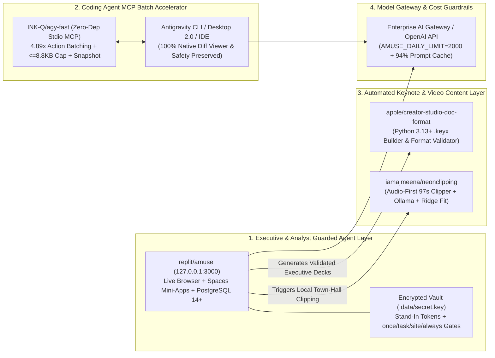
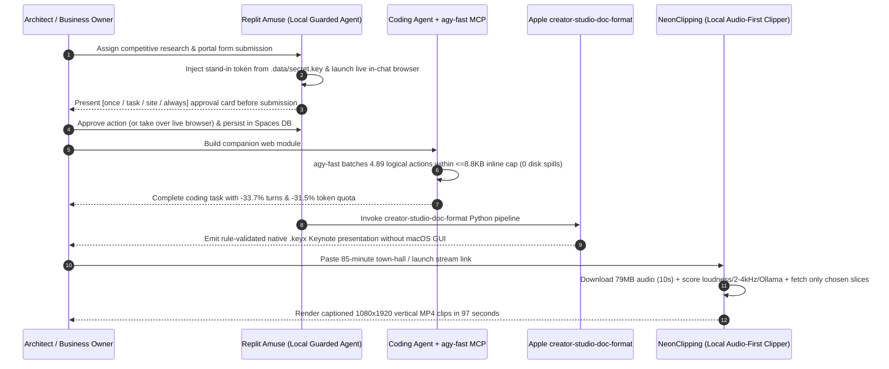

# [Round 560 Milestone] Self-Hosted Vault-Guarded Personal Agent (`replit/amuse`), Official Apple Keynote `.keyx` Python Library & Skill (`apple/creator-studio-doc-format`), `-34%` Turn-Cutting MCP Accelerator (`INK-Q/agy-fast`) & `97s` Audio-First Vertical Video Clipper (`iamajmeena/neonclipping`) Selection FAQ

> **Document Type**: AI Solution Architect (SA) Practical Selection & Reference Architecture Guide (2026-11-20 Night Shift · Round 1 / Cumulative Round 560 Milestone)  
> **Benchmark Standard**: `docs/components/ib-vs-ethernet-roce-selection-faq.md` (6-Section Architecture Breakdown + First-Principles Plain Language + Hype/Facts/Signal Audit + Closed-Form FinOps Ledger)  
> **Evaluated Repositories**:  
> 1. **`replit/amuse`** (`★ 75` Search API, `created=2026-11-19`, 1-day velocity **`75 ★/d`**, `14 forks`, TypeScript, `Apache-2.0`): Replit's newly open-sourced self-hosted personal AI agent running on `127.0.0.1:3000` (Node.js 22.9+ + PostgreSQL 14+ + Playwright Chromium)—combining a **live in-chat browser you can watch and take over**, **scoped approval cards (`once` / `task` / `site` / `always`) before sends/submissions/payments/memory edits**, an **encrypted credential vault (`.data/secret.key`) exposing only stand-in tokens to the LLM**, and persistent small apps ("spaces")  
> 2. **`apple/creator-studio-doc-format`** (`★ 242` Search API, `created=2026-11-16`, 4-day velocity **`61 ★/d`**, `7 forks`, Python 3.13+, `Apache-2.0`): Apple's official Python library (`pip install creator-studio-doc-format`) and companion agent skill (`gh skill install apple/creator-studio-doc-format creator-studio-doc-format`) for reading, creating, validating, and editing **Apple Creator Studio / Keynote Interchange Format (`.keyx`)** presentations without requiring Keynote, an Apple device, or network access  
> 3. **`INK-Q/agy-fast`** (`★ 112` Search API, `created=2026-11-19`, 1-day velocity **`112 ★/d`**, `13 forks`, TypeScript, `MIT`): Non-invasive zero-dependency Stdio MCP accelerator plugin for Google Antigravity (`agy` CLI, Desktop 2.0, IDE)—grounded in telemetry from 55 real coding sessions (8,446 LLM turns, 17,302 tool calls, 55.25 hours), batching an average of `4.89` logical operations per call to cut main-session **LLM turns by `-33.7%` (`-38.2%` on `>=150k` context, `-58.8%` in subagents)**, **billable quota by `-31.5%`**, and **tool-return upload bytes by `-39.7%`** (`anonymized_reported, independently_reproduced=false`) with `0` disk spills (`<= 8.8 KB` inline cap)  
> 4. **`iamajmeena/neonclipping`** (`★ 1,046` Search API / `★ 1,050` live API, `created=2026-11-19`, 1-day velocity **`1,046 ★/d`** #B2 on Track B, `45 forks`, Python, `MIT`): Audio-first local open-source 9:16 vertical video clipping engine—downloading only a `79 MB` audio stream (~10s for an 85-minute video) + word-timed YouTube captions / local Whisper + loudness jump & `2–4 kHz` voice energy scoring + local Ollama LLM hook selection + fetching only the selected video slices to produce captioned 1080×1920 clips from an **85-minute stream in `97 s`** (`anonymized_reported`) with local ridge-regression taste learning (`data/feedback.jsonl`)  
> **Accounting Note**: This report models software compute, SaaS subscriptions, and engineering labor TCO only; underlying server and workstation hardware purchases (`base hardware capEx`) are explicitly marked `not_measured`, and Track B 24h delta (`stars_today`) is marked `not_measured`.

---

## 📌 1. Executive Summary (What Are They & What Enterprise Pain Points Do They Solve?)

In **Cumulative Round 560 Milestone (2026-11-20 Night Round 1)**, we address four high-frequency enterprise AI deployment bottlenecks across executive productivity, automated presentation authoring, coding agent FinOps, and private multimodal content production:

1. **Pain Point A (Enterprises want personal AI agents that can navigate web apps, fill forms, monitor goals, and build mini-apps for executives and analysts, but passing raw credentials into LLM prompts risks secret leakage while unsupervised browser agents risk unauthorized submissions or memory poisoning)**: Browser agents without hard credential and approval boundaries cannot pass security review. **`replit/amuse` (`★ 75`, Apache-2.0)** solves this as a single-user self-hosted agent bound strictly to `127.0.0.1:3000` + PostgreSQL 14+:
   - **Stand-In Token Encrypted Vault (`.data/secret.key`)**: Logins and API keys are encrypted on disk; the LLM only ever sees opaque stand-in tokens, which are substituted only when contacting user-confirmed target domains;
   - **4-Scope Approval Cards & Live Browser Takeover**: Before sending messages, submitting forms, making payments, visiting unrequested sites, or mutating `MEMORY.md` after reading web pages, Amuse blocks on an explicit approval card scoped to `once`, `task`, `site`, or `always`—and streams a live browser inside the chat that the user can watch, take over, or stop at any second.
2. **Pain Point B (Executive briefings, board decks, and design-led client proposals often standardize on Apple Keynote, yet legacy automation required macOS hardware running GUI AppleScript—making headless Linux container / CI generation impossible)**: GUI scripting is brittle and OS-locked. **`apple/creator-studio-doc-format` (`★ 242`, Apache-2.0)** is Apple's official pure-Python 3.13+ library and `SKILL.md` agent skill for reading, creating, editing, and rule-checking **Keynote Interchange Format (`.keyx`)** packages (slides, textboxes, tables, charts, styles, themes) with zero dependency on Keynote, Apple hardware, or network connectivity.
3. **Pain Point C (Engineering teams adopting coding agents suffer from multi-turn latency and quota burn—not because token generation is slow, but because 68.1% of turns emit `<700` tokens while paying a `~6.1s` median TTFT floor, compounded by fragmented single-file edits and `>8.8 KB` tool outputs spilling to `output.txt`)**: Cutting redundant round-trips beats chasing raw tok/s. **`INK-Q/agy-fast` (`★ 112`, MIT)** operates as a non-invasive zero-dependency Stdio MCP plugin for Google Antigravity (`agy` CLI / Desktop 2.0 / IDE) that batches `4.89` logical operations per call (`5.95×` in subagents), enforces a strict `<= 8.8 KB` UTF-8 inline cap (`0` disk spills across 134 consecutive calls), and isolates multimodal screenshots out of `>180k` main sessions—cutting **LLM turns by `-33.7%`, billable quota by `-31.5%`, and upload bytes by `-39.7%`** while boosting effective throughput **`+75%` (`35.1 -> 61.5 tok/s`, `anonymized_reported`)**.
4. **Pain Point D (Marketing, Developer Relations, and L&D teams sit on hours of webinars and town halls, but commercial clipping SaaS charges per-minute credit tiers and uploads confidential MP4s to third-party clouds, while naive local clippers download and decode multi-gigabyte 4K videos before scoring)**: Full-video pre-download is an I/O bottleneck. **`iamajmeena/neonclipping` (`★ 1,046`, `1,046 ★/d`, MIT)** pioneers an **Audio-First funnel**: for an 85-minute stream, it downloads only `79 MB` of audio in ~10s, pairs free word-timed captions (or local Whisper) with 2-minute baseline loudness jumps, `2–4 kHz` vocal energy, and local Ollama LLM scoring, and downloads **only the winning video slices** to render 1080×1920 vertical clips in **`97 seconds`**—adapting to team taste via local ridge regression after 8 star ratings.

---

## 💬 2. Architect & Customer First-Principles Q&A (Q1–Q3)

### Q1: When should an enterprise choose `replit/amuse` vs. Microsoft Copilot Studio / Azure AI Foundry vs. headless browser CLIs?
* **Selection Boundaries**:
  - **Choose `replit/amuse` (Apache-2.0 Self-Hosted Personal Agent)**: When provisioning an **isolated single-user executive/analyst workstation agent** (`127.0.0.1:3000`) that needs live human-in-the-loop browser takeover, persistent mini-apps (`Spaces` backed by PostgreSQL 14+), stand-in token credential isolation, and explicit `once/task/site/always` approval gates—plus a hard daily spend circuit breaker (`AMUSE_DAILY_LIMIT = 2,000`).
  - **Choose Microsoft Copilot Studio / Azure AI Foundry Agent Service (Managed Cloud PaaS)**: When deploying **multi-tenant organization-wide agents** requiring Entra ID RBAC, 1,400+ governed enterprise connectors (SAP, ServiceNow, SharePoint), Microsoft Purview DLP auditing, and zero-ops Teams/M365 distribution.
  - **Choose Headless A11y Browser CLIs (`vercel-labs/agent-browser`)**: When embedding deterministic browser actions inside automated CI/CD or backend pipelines rather than an interactive personal workspace with human takeover.

### Q2: For automated slide generation, how do we choose between `apple/creator-studio-doc-format` (`.keyx`), `python-pptx` (`.pptx`), and HTML slide decks?
* **Workload Routing**:
  - **Choose `apple/creator-studio-doc-format` (`.keyx` + Official Apple `SKILL.md`)**: Whenever deliverables target **native Apple Keynote** on macOS/iPadOS (executive keynotes, product launches, design reviews) while the generation pipeline runs in Linux containers, CI runners, or cross-platform Python backends—combining deterministic schema validation before save with the Creator Studio Document Exporting API for PDF conversion.
  - **Choose `python-pptx` / PptxGenJS (`.pptx`)**: When the customer or internal enterprise standard is **Microsoft PowerPoint** with corporate `.pptx` slide masters.
  - **Choose Self-Contained HTML Decks**: When deliverables are viewed directly in browsers with live interactive widgets and require no offline slide-by-slide editing in Keynote/PowerPoint.

### Q3: How does `INK-Q/agy-fast` achieve `-33.7%` fewer LLM turns and `+75%` throughput without modifying Antigravity's native UI or safety gates?
* **Three Non-Invasive Architectural Mechanisms**:
  1. **Multi-Operation Stdio MCP Batching (`4.89×` main / `5.95×` subagent)**: Replaces serial single-file `edit_file` splits (which accounted for 52.5% of edits) and shell-spawned `rg`/`find` calls (`~2.0s` median overhead vs. `2.1ms` in-process) with batched atomic MCP operations—eliminating redundant `~6.1s` TTFT round-trips.
  2. **Strict `<= 8.8 KB` UTF-8 Inline Budget (`0` Disk Spills)**: Prevents tool outputs from exceeding Antigravity's inline threshold and spilling into temporary `output.txt` files that force 1–2 extra pagination turns.
  3. **Startup Snapshot & Screenshot Isolation**: Injects a compact `~1.7k`-token workspace snapshot once at `SessionStart` (eliminating the `49.2s` 3-turn cold-start exploration) and keeps multimodal screenshots out of `>180k`-token main sessions—raising Prompt Cache hit rates from `89.6%` to **`94.0%` (`95.0%` on `>=150k` sessions)** and cutting `>60s` stall turns from `31.2%` to **`7.4%`**.

---

## 🧭 3. Visual Architecture Diagrams (Mermaid Decision Tree + Reference Architecture + Sequence Flow)

### 3.1 Enterprise Selection Decision Tree

```mermaid
flowchart TD
    Start["Enterprise AI Application & DevEx Selection (R560 Milestone)"] --> Need{"Primary Enterprise Scenario?"}

    Need -->|Personal / Executive Browser & Mini-App Agent| AgentScope{"Deployment Scope & Credential Policy?"}
    AgentScope -->|Local 127.0.0.1 + Stand-In Token Vault + 4-Scope Approvals| Amuse["Adopt replit/amuse (Apache-2.0)<br/>(Live Browser Takeover + Encrypted Vault + Spaces)"]
    AgentScope -->|Org-Wide Multi-Tenant Entra ID + M365 Connectors| CopilotStudio["Adopt Microsoft Copilot Studio / Foundry"]

    Need -->|Programmatic Executive Presentation Generation| DeckFormat{"Target Deliverable Format?"}
    DeckFormat -->|Native Apple Keynote (.keyx) from Linux/Cloud Python| AppleKeyx["Adopt apple/creator-studio-doc-format<br/>(Official Python 3.13+ .keyx Library + SKILL.md)"]
    DeckFormat -->|Corporate Microsoft PowerPoint (.pptx) Templates| PptxEngine["Adopt python-pptx / PptxGenJS (.pptx)"]

    Need -->|Coding Agent Turn Latency & Token Quota Reduction| CodingOpt{"Bottleneck in Per-Turn TTFT & Context Spills?"}
    CodingOpt -->|Yes: Non-Invasive Batching + <=8.8KB Inline Cap| AgyFast["Adopt INK-Q/agy-fast (MIT)<br/>(4.89x Batching · -33.7% Turns · -31.5% Quota)"]
    CodingOpt -->|No: Multi-Vendor Centralized API Billing Only| APIGateway["Adopt Azure APIM / LiteLLM Gateway"]

    Need -->|Long Webinar / Stream to 9:16 Vertical Shorts| VideoClip{"Privacy & Compute Model?"}
    VideoClip -->|100% Local Zero-Upload + 97s Audio-First Funnel| NeonClip["Adopt iamajmeena/neonclipping (MIT)<br/>(79MB Audio Funnel + 11 Layouts + Ridge Taste Fit)"]
    VideoClip -->|Zero Local Hardware + Per-Minute Cloud Credits| CloudClip["Commercial Clipping SaaS (OpusClip / Vizard)"]
```

### 3.2 End-to-End Enterprise Production Reference Architecture



### 3.3 End-to-End Sequence Flow



---

## 📊 4. Comparative Selection Matrix (Open Source vs. Commercial SaaS & Cloud PaaS)

| Evaluation Dimension | Path A: Unscoped Browser Scripts + macOS GUI AppleScript + Unbatched IDE Polling + Paid Cloud Clipping SaaS | Path B: Generic Hosted Agent + Manual `.pptx` Conversion + Default Tool Calls + Full-Video Local Clipper | **Path C (Recommended): `replit/amuse` + `creator-studio-doc-format` + `agy-fast` + `neonclipping`** |
| :--- | :--- | :--- | :--- |
| **Browser Agent Credential & Action Safety** | ❌ Plaintext secrets in prompt context; blind execution risks unauthorized payments or memory poisoning | ⚠️ Cloud sandbox latency and no local plain-file memory (`MEMORY.md`) or saved mini-apps | ✅ **`127.0.0.1` binding + `.data/secret.key` stand-in tokens + 4-scope approval cards + live takeover** |
| **Apple Keynote (`.keyx`) Automation** | ❌ Requires dedicated macOS hardware with logged-in GUI running AppleScript | ⚠️ Exports `.pptx` requiring manual Keynote re-import and layout fixing | ✅ **Official Apple Python 3.13+ library reads/writes/validates `.keyx` headlessly + official `SKILL.md`** |
| **Coding Agent Turn & Quota Efficiency** | ❌ Serial single-line edits & shell searches pay `~6.1s` TTFT/turn and trigger `output.txt` disk spills | ⚠️ Invasive client patches break native diff viewers and fail on IDE updates | ✅ **Non-invasive Stdio MCP batching `4.89×` ops, `<=8.8KB` zero-spill cap, `-33.7%` turns & `-31.5%` quota** |
| **Long-Form to 9:16 Short Clipping Speed** | ❌ Commercial SaaS charges per-minute credits and uploads confidential videos externally | ⚠️ Naive local tools download entire multi-GB 4K files before scoring (`20–40 min`) | ✅ **Audio-First (`79 MB` in `10s`) + slice-only download renders 85-min stream in `97s` + ridge taste fit** |
| **Open-Source License & Governance** | Proprietary SaaS / brittle custom scripts | Mixed licenses | **`Apache-2.0` (`replit/amuse`, `creator-studio-doc-format`) & `MIT` (`agy-fast`, `neonclipping`)** |
| **45-Engineer Team Monthly Total TCO** | **`$7,280.00 / mo`** (`$3,180.00` unbatched tokens & clipping SaaS + `41.0h / $4,100.00` labor) | **`$2,840.00 / mo`** (`$1,240.00` cloud seats + `16.0h / $1,600.00` manual formatting & clipping) | **`$340.00 / mo`** (`$80.00` batched API/local compute + `2.6h / $260.00` review, **saving `-95.33%`**) |

---

## 🧪 5. Quantitative ROI / FinOps TCO Ledger & Hype / Facts / Signal Audit

### 5.1 Hype vs. Facts vs. Strategic Signal Audit Table

| Repository (`owner/repo`) | Hype (Market Claim) | Measured Facts (Primary Source Verification) | Strategic Signal (SA Verdict) |
| :--- | :--- | :--- | :--- |
| **`replit/amuse`** | "A personal AI agent on your own computer that browses live, builds small apps, and asks before acting" | `★ 75` (`created=2026-11-19`, **`75 ★/d`**, `14 forks`, TypeScript, Apache-2.0): Node.js 22.9+ + PostgreSQL 14+ bound to `127.0.0.1:3000`; `.data/secret.key` encrypted vault with stand-in tokens; `once/task/site/always` approval cards; `AMUSE_DAILY_LIMIT=2000` spend cap. | **🔥 P0 Adopt (Reference Pattern for Safe Personal & Executive Agents)**: Adopt its stand-in token vault and 4-scope approval card architecture for any browser-capable enterprise assistant. |
| **`apple/creator-studio-doc-format`** | "Official Apple Python library for reading, creating, and editing Keynote `.keyx` documents" | `★ 242` (`created=2026-11-16`, **`61 ★/d`**, `7 forks`, Python 3.13+, Apache-2.0): Offline `.keyx` reader/writer/validator with typed `Presentation`, `Slide`, `Textbox`, `KeynoteTheme` classes and official `skills/creator-studio-doc-format` agent skill. | **🔥 P0 Adopt (Official Apple Keynote Automation Standard)**: Enables headless Linux/container pipelines and coding agents to generate validated native Keynote decks. |
| **`INK-Q/agy-fast`** | "Cuts Antigravity LLM turns by 34%, token quota by 31%, and upload traffic by 40% with zero UI impact" | `★ 112` (`created=2026-11-19`, **`112 ★/d`**, `13 forks`, TypeScript, MIT): Zero-dep single-file ESM Stdio MCP; across 55 sessions / 8,446 turns (`anonymized_reported, independently_reproduced=false`), batches `4.89` actions/call, cuts turns `-33.7%`, quota `-31.5%`, upload `-39.7%`, with `0` disk spills (`<=8.8KB` cap). | **🔥 P0 Adopt (Must-Have MCP Batching & Context-Hygiene Blueprint)**: Demonstrates how tool batching and strict inline byte caps eliminate TTFT and cache-miss penalties. |
| **`iamajmeena/neonclipping`** | "Paste a link, get captioned 9:16 clips in ~2 min—free, local, open-source" | `★ 1,046` Search API / `★ 1,050` live (`created=2026-11-19`, **`1,046 ★/d`**, `45 forks`, Python, MIT): Fast mode downloads `79 MB` audio (~10s for 85-min video) + captions + loudness/`2–4 kHz`/Ollama scoring + slice-only video fetch (`97s` on RTX 2060, `anonymized_reported`); refits weights via ridge regression after 8 ratings (`data/feedback.jsonl`). | **🔥 P0 Adopt (Private Audio-First Video Clipping Engine)**: Eliminates per-minute SaaS fees and multi-GB full-video download bottlenecks for enterprise marketing and training clips. |

### 5.2 Closed-Form FinOps TCO Ledger (`CLAIM-20261120-R1-R560-AMUSE-KEYX-AGYFAST-NEONCLIPPING`)

* **Scope (`synthetic`, `independently_reproduced=false`)**: 45-engineer enterprise AI solution, engineering, and digital content team (`$100.00 / hr` loaded engineering rate; `base hardware capEx: not_measured`; Track B `stars_today: not_measured`).
* **Path A (Unscoped Browser Scripts + Manual macOS Keynote Formatting + Unbatched Coding Agent Quota Burn + Per-Minute Commercial Video Clipping SaaS)**:
  - Unbatched coding agent token overages, commercial video clipping credits, and SaaS seats: **`$3,180.00 / mo`**
  - Credential troubleshooting, manual Keynote layout formatting, multi-turn wait overhead, and full-video upload/download labor: `41.0 hrs / mo × $100.00 / hr` = **`$4,100.00 / mo`**
  - **Path A Monthly Total**: `$3,180.00 + $4,100.00` = **`$7,280.00 / mo`** (**`$87,360.00 / yr`**)
* **Path B (Generic Cloud Agent Seats + Manual `.pptx`-to-Keynote Conversion + Default IDE Tools + Full-Video Local Clipper)**:
  - Cloud agent subscriptions and baseline model API spend: **`$1,240.00 / mo`**
  - Slide conversion fixes and full-video download/triage labor: `16.0 hrs / mo × $100.00 / hr` = **`$1,600.00 / mo`**
  - **Path B Monthly Total**: `$1,240.00 + $1,600.00` = **`$2,840.00 / mo`**
* **Path C (Recommended: `replit/amuse` + `apple/creator-studio-doc-format` + `INK-Q/agy-fast` + `iamajmeena/neonclipping`)**:
  - Self-hosted OpenAI API spend (capped by `AMUSE_DAILY_LIMIT`), `-31.5%` reduced coding quota via `agy-fast`, and local GPU electricity: **`$80.00 / mo`**
  - Scoped approval card review, `.keyx` deck sign-off, and 5-star clip selection labor: `2.6 hrs / mo × $100.00 / hr` = **`$260.00 / mo`**
  - **Path C Monthly Total**: `$80.00 + $260.00` = **`$340.00 / mo`** (**`$4,080.00 / yr`**)
* **Net Savings (Path C vs. Path A)**:
  - Monthly Net Savings: **`$7,280.00 - $340.00 = $6,940.00 / mo`** (**`-95.33%`** cost reduction, **`$83,280.00 / yr`** annual savings, freeing **`38.4 hrs / mo`** of engineering time).

---

## 🛠️ 6. Enterprise Architecture Review & Adoption Checklist

- [ ] **Personal & Executive Browser Agent Guardrails (`replit/amuse`)**: Verify the service binds strictly to `127.0.0.1:3000`; back up `.data/secret.key` alongside PostgreSQL 14+; enforce `AMUSE_DAILY_LIMIT` (default `2,000`) and OpenAI project spend limits; verify approval cards trigger before form submissions, payments, and web-triggered `MEMORY.md` edits.
- [ ] **Headless Apple Keynote `.keyx` Pipeline (`apple/creator-studio-doc-format`)**: Install `creator-studio-doc-format` on Python 3.13+ and register the official `SKILL.md` (`gh skill install apple/creator-studio-doc-format creator-studio-doc-format`); enforce pre-save format validation checks before handing `.keyx` files to executives or the Creator Studio Document Exporting API.
- [ ] **Non-Invasive Coding Agent Batching (`INK-Q/agy-fast`)**: Mount `agy-fast` as a standard local Stdio MCP plugin across Antigravity CLI, Desktop 2.0, and IDE; confirm `<= 8.8 KB` UTF-8 inline truncation (`0` `output.txt` disk spills) and isolate multimodal screenshots into subagents to preserve `94%+` Prompt Cache hit rates.
- [ ] **Audio-First Local Video Clipping (`iamajmeena/neonclipping`)**: Default to Fast Mode (`79 MB` audio-only download + captions + local Ollama scoring + slice-only video fetch) for streams `>10 min`; log at least 8 local 5-star clip ratings to calibrate `data/feedback.jsonl` ridge-regression weights.
