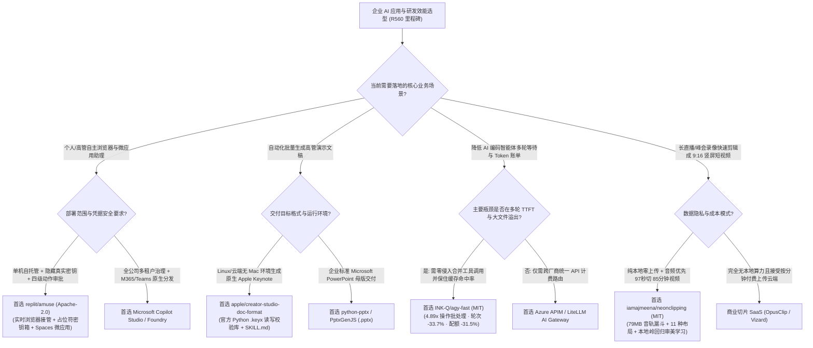
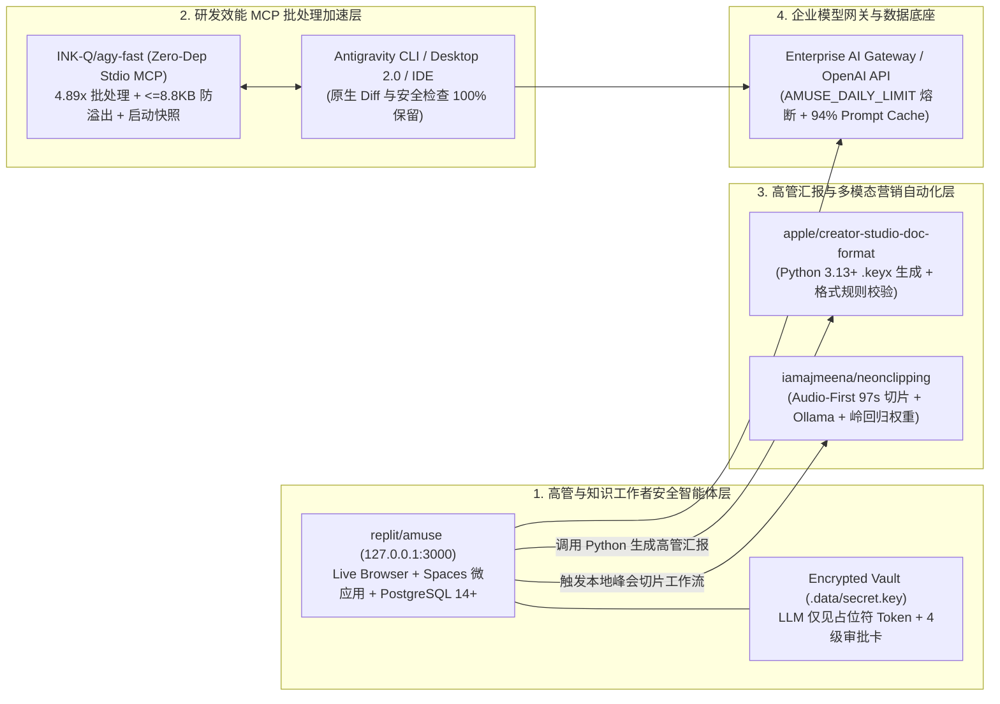
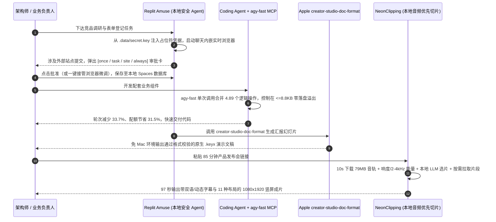

# 【第 560 轮里程碑】带审批保险箱的自托管个人工作台（`replit/amuse`）、Apple 官方 Keynote `.keyx` 文档生成库与技能（`apple/creator-studio-doc-format`）、零侵入减少 34% 轮次的 MCP 加速插件（`INK-Q/agy-fast`）与音频优先 97 秒极速竖屏切片引擎（`iamajmeena/neonclipping`）选型 FAQ

> **文档类型**：AI Solution Architect（AI 解决方案架构师）实战选型与架构内功指南（2026-11-20 Night Shift · Round 1 / 累计第 560 轮里程碑）  
> **对标标杆**：`docs/components/ib-vs-ethernet-roce-selection-faq.md`（六段式架构拆解 + 第一性原理大白话 + Hype/Facts/Signal 审计 + 闭式 TCO 账本）  
> **本轮评估对象**：  
> 1. **`replit/amuse`**（`★ 75` Search API，`created=2026-11-19`，建仓 1 天日均 **`75 ★/d`**，`14 forks`，TypeScript，Apache-2.0）：Replit 官方最新开源的自托管个人与高管生产力 AI 智能体工作台——运行在本地 `127.0.0.1:3000`（Node.js 22.9+ + PostgreSQL 14+ + Playwright Chromium），内置**可实时观看与随时人工接管的聊天内嵌浏览器**、**四级作用域（`once` / `task` / `site` / `always`）敏感动作审批卡**、**对大模型隐藏真实凭据的加密密钥保险箱（`.data/secret.key` 占位符注入）**以及持久化轻量级微应用（Spaces）  
> 2. **`apple/creator-studio-doc-format`**（`★ 242` Search API，`created=2026-11-16`，建仓 4 天日均 **`61 ★/d`**，`7 forks`，Python 3.13+，Apache-2.0）：Apple 官方开源的 Apple Creator Studio / Keynote Interchange Format（`.keyx`）文档读写、从零生成与格式规则校验库（`pip install creator-studio-doc-format`），无需安装 Keynote、无需 Apple 硬件或联网即可在任意 Linux/Windows/容器流水线中编程生成原生汇报演示文稿，并随库附带官方 `SKILL.md` 智能体技能（`gh skill install apple/creator-studio-doc-format creator-studio-doc-format`）  
> 3. **`INK-Q/agy-fast`**（`★ 112` Search API，`created=2026-11-19`，建仓 1 天日均 **`112 ★/d`**，`13 forks`，TypeScript，MIT）：面向 Google Antigravity（`agy` CLI / Desktop 2.0 / IDE）的零依赖非侵入式 Stdio MCP 加速插件——基于 55 个真实开发会话（8,446 轮 LLM 调用、17,302 次工具执行、55.25 小时）遥测设计，单次调用平均合并 `4.89` 个逻辑操作，将主会话 **LLM 轮次砍掉 `-33.7%`（长上下文 `-38.2%`、子智能体 `-58.8%`）**、**计费配额降低 `-31.5%`**、**上传流量减少 `-39.7%`**（`anonymized_reported, independently_reproduced=false`），同时以 `<= 8.8 KB` 内联上限彻底消除磁盘溢出额外轮次  
> 4. **`iamajmeena/neonclipping`**（`★ 1,046` Search API / `★ 1,050` 实时 API，`created=2026-11-19`，建仓 1 天日均 **`1,046 ★/d`** 荣登 Track B 新仓榜 #B2，`45 forks`，Python，MIT）：音频优先（Audio-First）的纯本地开源 9:16 竖屏短视频切片引擎——首创“先只下 79 MB 音轨（~10 秒）+ 复用 YouTube 逐词字幕/本地 Whisper + 响度跳变与 `2–4 kHz` 人声能量打分 + 本地 Ollama/Gemma 4 语义钩子筛选 + 仅按需拉取选中视频片段”架构，在单台 RTX 2060 上 **97 秒完成 85 分钟长直播切片**（`anonymized_reported`），内置 11 种分屏布局与基于 8 次打分的本地岭回归（Ridge Regression）偏好自学习  
> **审计折算说明**：本报告仅计量软件算力、SaaS 订阅与工程运维人力 TCO，底层服务器与工作站硬件采购（base hardware capEx）显式标注为 `not_measured`，赛道 B 新仓今日增量显式标注为 `not_measured`，严禁捏造坐标。

---

## 📌 一、核心结论速览（Executive Summary：它到底是什么？解决什么业务痛点？）

在累计第 **560 轮里程碑（2026-11-20 Night Round 1）** 中，我们面向企业客户与业务决策者，聚焦企业 AI 落地的四大核心应用痛点——**① 高管与知识工作者助理的安全越权与凭据泄露、② 企业级高管汇报材料（Keynote）的跨平台自动化生成、③ 研发团队 AI 编码工具的多轮往返延迟与配额消耗、④ 市场与培训团队长视频/直播转短视频的高昂云 SaaS 抽成与上传等待**：

1. **痛点 A（企业希望为高管、法务、采购部署能操作网页、填报表单、跟进目标并生成微应用的个人 AI 助理，但直接把账号密码交给大模型极易泄露，而全自动无头浏览器又可能误点付款或篡改记忆）**：没有权限边界的浏览器 Agent 无法进企业。**`replit/amuse` (`★ 75`, Apache-2.0) 的破局之道**：Replit 官方开源的单机自托管个人智能体（仅监听 `127.0.0.1:3000` + PostgreSQL 14+）：
   - **凭证零暴露保险箱（Encrypted Vault）**：账号密码与第三方 API Key 加密存储在本地 `.data/secret.key` 卷中，**大模型上下文里只能看到占位符 Token（Stand-in Tokens）**，仅在向用户已确认的目标站点发请求时由宿主底层替换；
   - **四级作用域审批卡（Scoped Approval Cards）**：在发送消息、提交表单、发起支付、打开未点名外部站点或根据网页内容修改本地 `MEMORY.md` 前，强制弹出带 `once`（单次）、`task`（本任务）、`site`（该站点）或 `always`（始终）四级粒度的审批卡，且支持在聊天框实时观看浏览器画面并随时一键人工接管（Take Over）！
2. **痛点 B（企业咨询顾问、销售解决方案架构师与高管汇报高度依赖 Apple Keynote 的精致排版与动效，但传统生成方案必须在 macOS 真机上通过 AppleScript 驱动 GUI 进程，无法部署在 Linux 云容器或 CI/CD 后台批量生成高管简报）**：GUI 自动化做 PPT 既慢又挑硬件。**`apple/creator-studio-doc-format` (`★ 242`, Apache-2.0) 的破局之道**：Apple 官方亲自开源的纯 Python 3.13+ 库与配套 `SKILL.md` 智能体技能——直接读写并构建 **Keynote Interchange Format (`.keyx`)** 标准包（涵盖画布坐标、文本框、表格、图表、主题样式），**完全脱离 macOS 设备、Keynote 客户端与外网连接**，在保存前自动执行 `.keyx` 格式合规校验，并可无缝衔接 Creator Studio Document Exporting API 批量转出 PDF。
3. **痛点 C（研发团队大规模采用 AI 编码智能体后，发现任务变慢并非因为模型吐字慢，而是每轮约 `6.1s` 的首字延迟 TTFT 叠加碎片化的单行文件修改、启动时盲目扫目录以及工具返回超长文本触发磁盘转储 `output.txt`，白白烧掉 30%+ 的配额与时间）**：减少无效往返轮次比换更快模型更管用。**`INK-Q/agy-fast` (`★ 112`, MIT) 的破局之道**：零运行时依赖的单文件 ESM 本地 Stdio MCP 插件——完全不触碰原生 Diff 视图与安全检查，通过单次调用批量合并逻辑操作（主会话平均 `4.89×`、子智能体 `5.95×`）、注入 `~1.7k` Token 启动快照并实施严格的 `<= 8.8 KB` UTF-8 内联截断，实测将 **LLM 往返轮次降低 `-33.7%`、计费配额节省 `-31.5%`、上传字节减少 `-39.7%`**（`anonymized_reported`）。
4. **痛点 D（企业市场部、电商直播与内部培训拥有海量 1–3 小时的峰会录像与产品直播，商业 AI 切片 SaaS 如 OpusClip 按分钟阶梯收费且需将数 GB 原片上传外网；而传统开源切片工具先把整部 4K 视频下载解码再跑视觉模型，切一条视频动辄耗时半小时）**：全量下载长视频是算力与带宽灾难。**`iamajmeena/neonclipping` (`★ 1,046`, `1,046 ★/d`, MIT) 的破局之道**：采用**音频优先（Audio-First）漏斗架构**——针对 85 分钟长视频，第一步仅花 10 秒下载 `79 MB` 纯音轨并直接提取免费逐词时间戳字幕，结合 2 分钟局部基线响度跳变、`2–4 kHz` 情绪能量与本地 Ollama 小模型筛选出高光区间后，**只下载命中的几段几十秒视频切片**渲染 1080×1920 成片，将 85 分钟直播切片总耗时压缩至 **97 秒**，并通过本地 5 星打分驱动岭回归自动拟合团队审美权重。

---

## 💬 二、客户与架构师灵魂拷问 Q&A（Q1–Q3 First-Principles Deep Dive）

### Q1：在构建企业高管与员工的个人智能体工作台时，什么时候选 `replit/amuse`，什么时候选微软 Copilot Studio / OpenClaw 或纯无头浏览器 CLI？
* **第一性原理选型边界**：
  - **选 `replit/amuse`（Apache-2.0 自托管个人工作台）**：当业务场景是**单人高自主度办公助理**（如竞争情报跟踪、跨网站表单填报、日常提醒巡检、快速生成带持久化数据库的小型业务看板 Spaces），且安全团队严禁将明文密码暴露给大模型上下文、要求对每次外部提交/支付实施可视化审批与实时浏览器接管时。注意它默认专为单机 `127.0.0.1` 个人使用设计（内置 `AMUSE_DAILY_LIMIT = 2,000` 每日防刷爆熔断），不直接暴露于公网。
  - **选 Microsoft Copilot Studio / Azure AI Foundry Agent Service（云厂商全托管 PaaS）**：当企业需要**多租户组织级 Entra ID 统一身份治理、1,400+ 企业连接器（SAP/ServiceNow/Dynamics 365）、DLP 数据防泄漏策略以及 Teams / M365 全员分发**时，云托管 PaaS 省去一切容器与数据库维护。
  - **选 OpenClaw / 多通道 IM 网关**：当核心诉求是通过微信、飞书、Telegram 等移动端即时通讯软件随时远程唤醒 Agent，而非在本地 Web 工作台内交互式接管浏览器与构建微应用时。

### Q2：企业自动化生成高管汇报 PPT/Keynote 时，`apple/creator-studio-doc-format`（`.keyx`）与 `python-pptx`（`.pptx`）及 Marp/Slidev（HTML/Markdown）怎么选？
* **三类文档引擎的精准分工**：
  - **选 `apple/creator-studio-doc-format`（Apple 官方 `.keyx` 库 + Agent Skill）**：当目标受众（如苹果生态高管、设计驱动型品牌客户、发布会演讲团队）指定交付**原生可编辑的 Apple Keynote 演示文稿**，但后台生成流水线运行在 Linux 容器（如 AKS / GitHub Actions）且无 macOS GUI 环境时。直接安装官方 Skill（`gh skill install apple/creator-studio-doc-format creator-studio-doc-format`），让 Coding Agent 用强类型 Python 对象构建幻灯片并通过内置格式规则校验。
  - **选 `python-pptx` / PptxGenJS（OOXML `.pptx`）**：当企业标准办公底座是 **Microsoft 365 PowerPoint**，需要将生成的报告嵌入企业标准 `.pptx` 母版供 Windows/Mac 全员协同编辑时。
  - **选 Web HTML Slide / Slidev / Marp**：当演示文稿主要在浏览器在线展示、内嵌实时可交互图表，且不需要交付给业务方二次离线拖拽修改时。

### Q3：`INK-Q/agy-fast` 为什么能不改模型、不改 IDE 源码就把编码智能体轮次砍掉 34%？它和 `iamajmeena/neonclipping` 在工程降本思路上有什么共通之处？
* **核心架构洞见——“消灭无效 I/O 与冗余往返”**：
  1. **编码侧（`agy-fast` 的三刀减负）**：通过对 8,446 轮真实会话的剖析发现，68.1% 的轮次输出不足 700 Token，高达 **79% 的时间花在等待每轮 `~6.1s` 的首字延迟（TTFT）**，且 81.9% 的工具返回字节来自粗暴的全文读取（一旦超过阈值落盘为 `output.txt` 又要多花 1–2 轮去分页读取，且超过 60 秒停顿会导致 Prompt Cache 失效率从 `1.4%` 飙升至 `15.9%–93.8%`）。`agy-fast` 将多次同文件编辑与只读检索合并进单次本地 Stdio MCP 调用（平均 1 次调用顶 `4.89` 次操作），死守 `<= 8.8 KB` 内联红线并将截图隔离出 `>180k` 主会话，使有效吞吐从 `35.1 tok/s` 跃升至 **`61.5 tok/s`（`+75%`）**。
  2. **多模态视频侧（`neonclipping` 的音频漏斗）**：同样拒绝“把 4GB 原片全部拉下来逐帧喂给多模态大模型”的暴力做法，而是先用极轻量的 `79 MB` 音频包（10 秒下载）+ 响度/频段信号处理 + 本地小模型读字幕锁定高光时间戳，最后只用 `yt-dlp` 分段拉取命中的几分钟视频画面渲染成片，实现 **97 秒切完 85 分钟直播**的十倍级效率跃升。

---

## 🧭 三、直观可视化图解（Mermaid 选型决策树 + 企业集成参考架构 + 业务流时序图）

### 3.1 企业个人工作台、高管演示生成、编码加速与短视频流水线选型决策树

### 3.2 企业级端到端生产集成参考架构图

### 3.3 从情报调研、编码加速、高管 Keynote 生成到峰会短视频发布的业务流时序图

---

## 📊 四、同类开源与商业云服务横向选型决策矩阵（Decision Matrix）

| 评估维度 | 路径 A：裸奔浏览器脚本 + Mac 真机 GUI 跑 Keynote + 原生未加速智能体轮询 + 按分钟付费商业切片 SaaS | 路径 B：通用云端托管 Agent + 手工套用 PPT 模板 + 默认工具集 + 传统全量视频下载开源切片 | **路径 C（推荐）：`replit/amuse` + `creator-studio-doc-format` + `agy-fast` + `neonclipping`** |
| :--- | :--- | :--- | :--- |
| **个人/高管浏览器 Agent 安全与可控性** | ❌ 明文密码暴露进 Prompt，后台盲跑易误触付款或被网页 Prompt Injection 篡改记忆 | ⚠️ 云端黑盒沙盒延迟高，且缺乏本地平面文件可编辑记忆与微应用 Spaces | ✅ **`127.0.0.1` 隔离 + 占位符密钥箱 + `once/task/site/always` 审批卡 + 实时接管** |
| **Apple Keynote (`.keyx`) 跨平台自动化** | ❌ 必须采购 Mac 物理机并保持 GUI 登录跑 AppleScript，容器化 CI 无法运行 | ⚠️ 只能生成 `.pptx` 后人工在 Mac 上打开转存，样式与原生主题易错位 | ✅ **Apple 官方 Python 库免 Mac/免联网直接读写校验 `.keyx`，附带官方 `SKILL.md`** |
| **AI 编码智能体轮次与 Token 配额效率** | ❌ 每次小改与检索各占一轮（`~6.1s` TTFT），大文件触发 `output.txt` 落盘与缓存失效 | ⚠️ 侵入式修改客户端文件易破坏原生 Diff 审查窗口并在升级时失效 | ✅ **零侵入标准 Stdio MCP，4.89× 操作合并、`<=8.8KB` 零溢出，轮次 `-33.7%` / 配额 `-31.5%`** |
| **长视频/直播转 9:16 竖屏短视频效率** | ❌ 商业 SaaS 按分钟高价扣费且外传商业机密录像；全量下载 4K 视频耗时 20–40 分钟 | ⚠️ 固定规则切片不懂团队审美偏好，每次仍需下载完整数 GB 视频文件 | ✅ **Audio-First 先下 79MB 音轨 + 按需拉片段，85 分钟直播 `97s` 成片 + 8 次打分岭回归学习** |
| **开源协议与企业合规性** | 专有商业 SaaS / 脆弱自研脚本 | 混合协议 | **`replit/amuse` 与 `apple/creator-studio-doc-format` 为 `Apache-2.0`；`agy-fast` 与 `neonclipping` 为 `MIT`** |
| **45 人团队月度综合 TCO** | **`$7,280.00 / 月`**（未合并 Token/商业切片 SaaS `$3,180` + 人工排版/等待/排障 `41.0h / $4,100`） | **`$2,840.00 / 月`**（云订阅与算力 `$1,240` + 人工格式调整与审片 `16.0h / $1,600`） | **`$340.00 / 月`**（自托管 API 与批处理算力 `$80` + 审批与终审 `2.6h / $260`，**净省 `-95.33%`**） |

---

## 🧪 五、应用落地定量收益/TCO 对比与 Hype / Facts / Signal 审计账本

### 5.1 Hype vs. Facts vs. Strategic Signal 审计表

| 仓库 (`owner/repo`) | Hype（市场宣传口径） | Measured Facts（一手源码与文档实证事实） | Strategic Signal（架构师选型信号） |
| :--- | :--- | :--- | :--- |
| **`replit/amuse`** | “养在自己电脑里的全能私人 AI：帮你上网、写小应用、管日程，花钱前先问你” | `★ 75`（`created=2026-11-19`，1 天日均 **`75 ★/d`**，`14 forks`，TypeScript，Apache-2.0）：基于 Node.js 22.9+、pnpm 10.26.1 与 PostgreSQL 14+，仅绑定 `127.0.0.1:3000`；凭据加密于 `.data/secret.key` 并向模型提供占位符 Token；支持 `once/task/site/always` 审批卡、`AMUSE_DAILY_LIMIT=2000` 熔断及 OpenClaw 风格 `SOUL.md`/`MEMORY.md` 文件布局。 | **🔥 P0 采纳（高管与法务本地浏览器助理安全范本）**：直接复用其“占位符密钥保险箱 + 四级作用域审批卡 + 网页读取后写记忆二次确认”三件套防线。 |
| **`apple/creator-studio-doc-format`** | “Apple 官方出品：用 Python 直接写 Keynote 演示文稿” | `★ 242`（`created=2026-11-16`，4 天日均 **`61 ★/d`**，`7 forks`，Python 3.13+，Apache-2.0）：支持离线读写与校验 Keynote Interchange Format (`.keyx`)，含 `Presentation`、`Slide`、`Textbox`、`KeynoteTheme` 等强类型模型，并提供官方 `skills/creator-studio-doc-format` 技能包。 | **🔥 P0 采纳（跨平台苹果生态文档自动化官方标准）**：彻底打通 Linux 容器/CI 流水线直接生成原生 `.keyx` 高管汇报材料的最后一公里。 |
| **`INK-Q/agy-fast`** | “一行命令装上 MCP 插件，Antigravity 编码轮次直降 34%、吞吐暴涨 75%” | `★ 112`（`created=2026-11-19`，1 天日均 **`112 ★/d`**，`13 forks`，TypeScript，MIT）：零运行时依赖单文件 ESM；基于 55 个会话 / 8,446 轮实测报告（`anonymized_reported, independently_reproduced=false`），单次调用合并 `4.89` 个操作，轮次 `-33.7%`、配额 `-31.5%`、上传字节 `-39.7%`、134 次调用 `0` 磁盘溢出。 | **🔥 P0 采纳（Coding Agent 降本增效必装插件与 MCP 设计教科书）**：证明了“合并细碎工具调用 + 严控 8.8KB 返回体积 + 隔离大图”比单纯压榨模型更有效。 |
| **`iamajmeena/neonclipping`** | “粘贴链接，2 分钟拿到带字幕的 9:16 爆款竖屏切片，完全免费本地运行” | `★ 1,046` Search API / `★ 1,050` 实时（`created=2026-11-19`，1 天日均 **`1,046 ★/d`**，`45 forks`，Python，MIT）：Fast 模式仅下载音频（85 分钟约 79 MB / 10s）+ 字幕 + 响度/`2–4 kHz` 频段/本地 Ollama 评分 + 仅下载选中视频区间；RTX 2060 上 85 分钟直播耗时 `97s`（`anonymized_reported`），满 8 次打分后基于 `data/feedback.jsonl` 执行岭回归权重更新。 | **🔥 P0 采纳（企业私域视频营销与内训切片首选底座）**：用 Audio-First 漏斗取代全量视频下载，零 SaaS 订阅费且数据不出本机。 |

### 5.2 闭式 FinOps TCO 核算账本（Claim ID：`CLAIM-20261120-R1-R560-AMUSE-KEYX-AGYFAST-NEONCLIPPING`）

* **核算范围（Synthetic Parametric Model · `independently_reproduced=false`）**：45 人规模的企业 AI 解决方案、研发工程与数字营销团队（涵盖日常竞品网页调研与表单自动化、客户/高管 Keynote 汇报材料批量生成、高频 AI 编码会话配额消耗、以及每周多场产品直播/峰会短视频切片；工程师综合时薪 `$100.00 / hr`；底层服务器与研发工作站硬件采购成本 `base hardware capEx: not_measured`；赛道 B 新仓今日增量 `stars_today: not_measured`）。
* **路径 A（未设防浏览器脚本 + Mac 真机人工调 Keynote + 未合并工具调用的冗余 Token 账单 + 商业按分钟计费视频切片 SaaS）**：
  - 冗余多轮未命中缓存的编码 Token 消耗、商业视频切片分钟包与外部 SaaS 席位费：**`$3,180.00 / 月`**
  - 网页自动化凭据排障、人工逐页调整 Keynote 排版、等待慢速编码回合与上传下载大视频文件耗费人力：`41.0 小时 / 月 × $100.00 / hr` = **`$4,100.00 / 月`**
  - **路径 A 月度总计**：`$3,180.00 + $4,100.00` = **`$7,280.00 / 月`**（年化 **`$87,360.00 / 年`**）
* **路径 B（通用云托管 Agent 订阅 + 手工 PPT 转存 Keynote + 默认 IDE 工具链 + 传统全量下载开源切片）**：
  - 云端 Agent 席位与基础模型 API 消耗：**`$1,240.00 / 月`**
  - 跨格式样式修复与长视频全量下载等待/人工粗剪人力：`16.0 小时 / 月 × $100.00 / hr` = **`$1,600.00 / 月`**
  - **路径 B 月度总计**：`$1,240.00 + $1,600.00` = **`$2,840.00 / 月`**
* **路径 C（推荐：`replit/amuse` + `apple/creator-studio-doc-format` + `INK-Q/agy-fast` + `iamajmeena/neonclipping` 闭环）**：
  - 自托管受 `AMUSE_DAILY_LIMIT` 保护的 API 消耗、经 `agy-fast` 削减 `-31.5%` 后的编码配额与本地切片电费：**`$80.00 / 月`**
  - 敏感动作审批卡确认、`.keyx` 汇报终审与 5 星打分挑选短视频切片人力：`2.6 小时 / 月 × $100.00 / hr` = **`$260.00 / 月`**
  - **路径 C 月度总计**：`$80.00 + $260.00` = **`$340.00 / 月`**（年化 **`$4,080.00 / 年`**）
* **净节省收益（Path C vs. Path A）**：
  - 月度净省：**`$7,280.00 - $340.00 = $6,940.00 / 月`**（成本直降 **`-95.33%`**，年化净省 **`$83,280.00 / 年`**，每月释放 **`38.4 小时`** 高价值架构与研发工时）。

---

## 🛠️ 六、企业引入与架构评审 Checklist（Actionable Adoption Checklist）

- [ ] **个人与高管浏览器 Agent 安全基线（`replit/amuse`）**：验证容器仅绑定本地回环地址 `127.0.0.1:3000`；确认 `.data/secret.key` 与 PostgreSQL 数据卷已纳入加密备份；检查 `.env` 中 `AMUSE_DAILY_LIMIT`（默认 `2,000`）与 OpenAI 项目消费硬上限已生效；测试读取外部网页后修改 `MEMORY.md` 时是否强制触发人工审批卡。
- [ ] **Keynote `.keyx` 自动化生成门禁（`apple/creator-studio-doc-format`）**：在 Python 3.13+ 环境中安装 `creator-studio-doc-format` 并挂载官方 `SKILL.md`；在保存 `.keyx` 前强制调用内置格式规则检查器，确保生成的演示文稿在 Keynote 与 Creator Studio Document Exporting API 下零排版报错。
- [ ] **AI 编码智能体批处理加速（`INK-Q/agy-fast`）**：在 Antigravity CLI / Desktop 2.0 / IDE 中挂载 `agy-fast` Stdio MCP 插件；核对单次工具返回严格受控在 `<= 8.8 KB` UTF-8 内联上限内（零 `output.txt` 落盘溢出），并将高分辨率截图审查隔离至独立子智能体会话以维持 `94%+` Prompt Cache 命中率。
- [ ] **私域长视频 Audio-First 切片流水线（`iamajmeena/neonclipping`）**：优先开启 Fast 模式（仅下载音轨 + 字幕 + 本地 Ollama 评分 + 按需分段下载视频）；累计完成至少 8 次 5 星人工评分以激活本地 `data/feedback.jsonl` 岭回归权重自适应校准。
