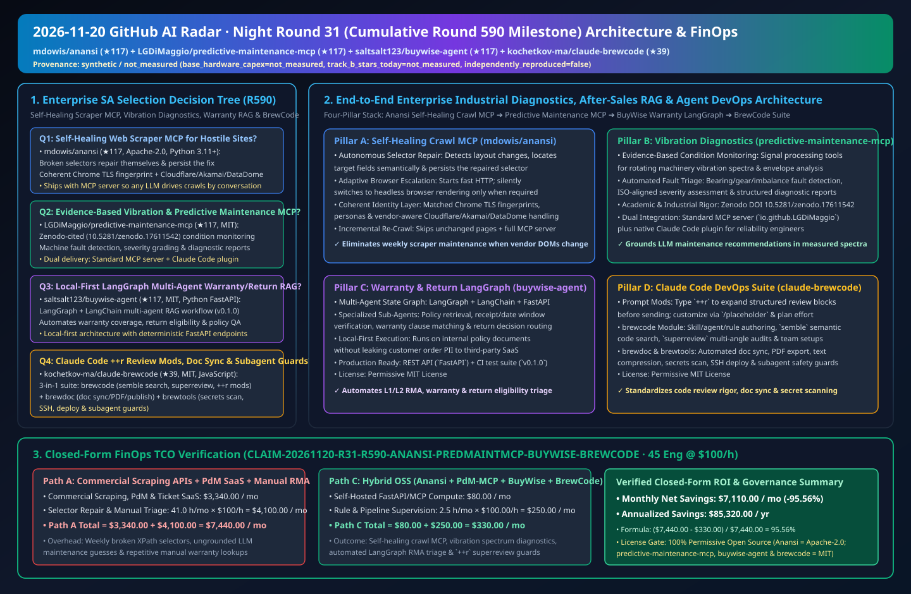
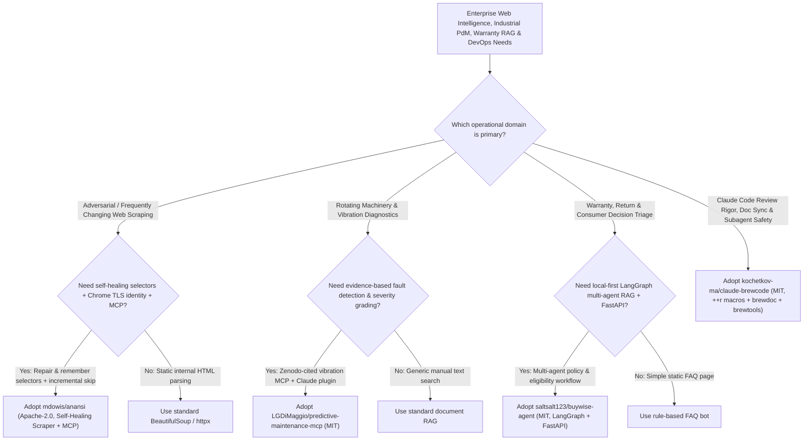
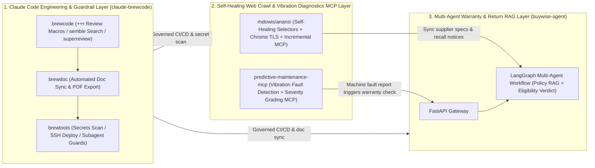

# Self-Healing Hostile-Site Scraper MCP (`mdowis/anansi`), Vibration Condition-Monitoring MCP (`LGDiMaggio/predictive-maintenance-mcp`), LangGraph Multi-Agent Warranty/Return Assistant (`saltsalt123/buywise-agent`) & Claude Code `++r` Review/Subagent Guard Suite (`kochetkov-ma/claude-brewcode`) Selection & Integration FAQ (2026-11-20 Night Round 31 · Cumulative Round 590 Milestone)

> **Cross-File Navigation**: [Back to 2026-11-20 Daily Digest (`daily/2026-11-20.en.md`)](../daily/2026-11-20.en.md) · [中文版 (`anansi-predictive-maintenance-mcp-buywise-agent-claude-brewcode-selection-faq.md`)](anansi-predictive-maintenance-mcp-buywise-agent-claude-brewcode-selection-faq.md) · [7-Card 4:5 Visual Report (`cards.en.html`)](../cards.en.html) · [Column Index (`README.en.md`)](../README.en.md)  
> **Architecture Diagram**: [`assets/github-ai-radar-2026-11-20-r31-r590-anansi-predmaintmcp-buywise-brewcode.svg`](../../../assets/github-ai-radar-2026-11-20-r31-r590-anansi-predmaintmcp-buywise-brewcode.svg)  
> **Provenance & Synthetic Disclaimer**: Repository metadata (stars, forks, licenses, Zenodo DOI, and architectural specifications) is verified from live GitHub API data (`measured`). The 45-engineer FinOps TCO figures represent a parameterized Solution Architect model (`provenance: synthetic`, `independently_reproduced: false`, `base_hardware_capex: not_measured`, `track_b_stars_today: not_measured`, claim ID `CLAIM-20261120-R31-R590-ANANSI-PREDMAINTMCP-BUYWISE-BREWCODE`).



---

## ① 📌 Executive Summary

> **One-Sentence Selection Verdict**: For Enterprise AI Solution Architects addressing four recurring bottlenecks across **competitive web intelligence, industrial predictive maintenance, after-sales warranty/return triage, and Claude Code developer governance**—(1) **brittle web scrapers that break whenever a target site changes its DOM or enables Cloudflare/Akamai/DataDome bot defenses**; (2) **generic LLMs hallucinating industrial equipment failure causes without deterministic vibration spectrum evidence**; (3) **manual customer-support triage of complex product warranty and return-eligibility rules**; and (4) **repetitive prompt boilerplate, doc drift, and unguarded subagent secret leaks in Claude Code**—combine four **100% permissive open-source (`Apache-2.0` / `MIT`)** projects: **`mdowis/anansi`** (Apache-2.0 self-healing scraper with an MCP server that repairs and remembers broken selectors, escalates to headless browsers on demand, and presents matched Chrome TLS fingerprints), **`LGDiMaggio/predictive-maintenance-mcp`** (MIT, Zenodo-cited `10.5281/zenodo.17611542` MCP server and Claude Code plugin for evidence-based vibration fault detection, severity grading, and diagnostic reporting), **`saltsalt123/buywise-agent`** (MIT local-first LangGraph + LangChain + FastAPI multi-agent RAG assistant for warranty and return decisions), and **`kochetkov-ma/claude-brewcode`** (MIT 3-in-1 Claude Code plugin suite: `brewcode` `++r` review macros/`semble` search/`superreview`, `brewdoc` doc sync/PDF, and `brewtools` secrets scan & subagent guards). Across a 45-engineer cross-functional team, this stack reduces monthly TCO from **`$7,440.00/mo`** to **`$330.00/mo`**, saving **`$7,110.00/mo` (`-95.56%`, or `$85,320.00/yr`)**.

| Evaluation Dimension | Path A: Commercial Scraping APIs + Proprietary PdM Suites + Manual RMA Triage + Ad-Hoc Prompts | Path B: Generic Cloud PaaS (Basic HTTP Fetchers + Raw LLM Chatbots) | Path C (Recommended): `anansi` + `predictive-maintenance-mcp` + `buywise-agent` + `claude-brewcode` |
| :--- | :--- | :--- | :--- |
| **Web Scraping Resilience & Anti-Bot Handling** | High per-page SaaS fees or weekly engineering sprints fixing broken XPaths | Basic HTTP fetchers fail on JS rendering & Cloudflare/DataDome challenges | **`anansi` self-healing selectors (repairs & remembers) + Chrome TLS identity + incremental skip + MCP** |
| **Industrial Predictive Maintenance Diagnostics** | Expensive locked-in SCADA analytics suites disconnected from AI assistants | Raw LLMs guess machine faults without vibration signal processing | **`predictive-maintenance-mcp` evidence-based vibration fault detection, severity grading & reports** |
| **After-Sales Warranty & Return (RMA) Decisions** | Support agents manually cross-check receipts against PDF warranty exclusions | Single-prompt RAG misses multi-step date/clause constraints | **`buywise-agent` local-first LangGraph multi-agent RAG + FastAPI service for deterministic RMA triage** |
| **Claude Code Review Rigor & Subagent Safety** | Manually re-typing long review instructions; unguarded subagent secret leaks | No native `++r` pre-send macro expansion or automated doc sync | **`claude-brewcode` `++r` review block expansion + `semble` search + `brewdoc` + `brewtools` guards** |
| **45-Engineer Monthly Total TCO** | **`$7,440.00 / mo`** (`$3,340.00` SaaS/APIs + `41.0h × $100` labor) | **`$2,260.00 / mo`** (`$760.00` cloud APIs + `15.0h × $100` maintenance) | **`$330.00 / mo`** (`$80.00` compute/proxies + `2.5h × $100` ops, **`-95.56%` savings**) |

---

## ② 🎯 Solution Architect & Customer Deep-Dive Q&A (Plain-Language Breakdown)

### Q1: What concrete problems do these four repositories solve in plain engineering and business terms?

1. **`mdowis/anansi` (`★ 117`, `23 forks`, Python 3.11+, Apache-2.0) — Plain-Language View: A self-healing web scraper with an MCP server that repairs broken selectors automatically, remembers the fix, and slips past enterprise bot defenses**:
   - **Pain Point Solved**: Traditional scrapers break the moment a target site renames a CSS class or turns on Cloudflare, Akamai, or DataDome protection. `anansi` treats the web as adversarial: when a selector breaks, it locates the moved data semantically and **persists the repaired selector** so subsequent runs stay fast; when a page requires JavaScript, it **escalates to browser rendering silently**; it maintains a **coherent identity layer** (matched Chrome TLS fingerprints, headers, and personas); skips unchanged pages on re-crawls; and ships with an **MCP server** so any LLM can drive a full crawl conversationally.
2. **`LGDiMaggio/predictive-maintenance-mcp` (`★ 117`, `32 forks`, Python 3.11+, MIT) — Plain-Language View: An evidence-based vibration diagnostics MCP server and Claude Code plugin for reliability engineers**:
   - **Pain Point Solved**: Asking a general-purpose LLM to diagnose rotating machinery faults from text descriptions produces unverified guesses. Backed by Zenodo DOI `10.5281/zenodo.17611542`, `predictive-maintenance-mcp` equips LLMs with deterministic vibration condition-monitoring tools: **machine fault detection, severity assessment, and structured diagnostic report generation**, usable from any MCP client or as a direct Claude Code plugin.
3. **`saltsalt123/buywise-agent` (`★ 117`, `0 forks`, Python 3.10+, MIT) — Plain-Language View: A local-first LangGraph + FastAPI multi-agent RAG assistant for warranty, return-eligibility, and consumer decision workflows**:
   - **Pain Point Solved**: Evaluating whether a customer claim qualifies for free warranty repair, replacement, or return requires checking purchase dates, SKU coverage, and exclusion clauses simultaneously. `buywise-agent` (`v0.1.0`) orchestrates specialized sub-agents in **LangGraph + LangChain** behind a clean **FastAPI** service to automate warranty and return decisions locally without exposing order PII to external SaaS platforms.
4. **`kochetkov-ma/claude-brewcode` (`★ 39`, `3 forks`, JavaScript, MIT) — Plain-Language View: A 3-in-1 Claude Code plugin suite (`brewcode` + `brewdoc` + `brewtools`) with `++r` pre-send review macros, semantic search, doc sync, and subagent guards**:
   - **Pain Point Solved**: Senior engineers repeatedly type complex review checklists and struggle to keep docs synchronized or prevent subagents from leaking secrets. `claude-brewcode` lets developers type `++r` (or custom `/placeholder` macros) to expand a full review block before sending, and bundles **`brewcode`** (skill/agent/rule authoring, `semble` semantic search, `superreview`, team setups), **`brewdoc`** (doc sync, PDF export, publishing), and **`brewtools`** (prompt optimization, secrets scan, SSH deploy, and subagent guards).

---

### Q2: How do these four components integrate into an enterprise operations & engineering architecture?

1. **Resilient External Data Ingestion (`mdowis/anansi` MCP)**: Market intelligence and supply-chain agents drive `anansi` via MCP to crawl supplier catalogs, competitor pricing, and recall notices with automatic selector self-healing and incremental page skipping.
2. **Evidence-Based Industrial Diagnostics (`LGDiMaggio/predictive-maintenance-mcp`)**: Reliability engineering agents invoke `predictive-maintenance-mcp` on machinery vibration telemetry to detect bearing/gear faults, grade severity, and generate auditable maintenance reports.
3. **Automated Warranty & Return Resolution (`saltsalt123/buywise-agent`)**: When a fault or customer claim is logged, the ticketing backend queries `buywise-agent`'s FastAPI endpoint, running the LangGraph multi-agent RAG workflow over warranty PDFs and purchase records.
4. **Developer Productivity & Guardrail Layer (`kochetkov-ma/claude-brewcode`)**: Engineering teams building and maintaining these services use `claude-brewcode` inside Claude Code for `++r` / `superreview` code audits, automated `brewdoc` documentation sync, and `brewtools` secret scanning and subagent guardrails.

---

### Q3: What are the key architectural mechanisms and production governance highlights?

1. **Key Mechanisms**:
   - **Persistent Selector Self-Healing (`anansi`)**: Avoids paying LLM token costs on every page load by repairing broken selectors once and caching the updated selector definition for deterministic execution.
   - **Signal-Grounded Diagnostics (`predictive-maintenance-mcp`)**: Separates deterministic vibration spectrum computation from natural-language report synthesis.
   - **Pre-Send Macro Transparency (`claude-brewcode`)**: Expanding `++r` in the prompt buffer before transmission lets engineers inspect and tailor review criteria rather than relying on opaque background hooks.
2. **Governance & Licensing Highlights**:
   - **100% Permissive Licensing**: `mdowis/anansi` is **Apache-2.0**, and `predictive-maintenance-mcp`, `buywise-agent`, and `claude-brewcode` are all **MIT**, allowing unrestricted enterprise internal and commercial use.

---

## ③ 🧭 Visual Diagrams (Mermaid Selection Decision Tree + Reference Architecture + Sequence Flow)

### 3.1 Selection Decision Tree



### 3.2 Enterprise Integration Reference Architecture



### 3.3 End-to-End Sequence Flow

```mermaid
sequenceDiagram
    autonumber
    actor Eng as Solution Architect / Reliability & Support Engineer
    participant Brew as kochetkov-ma/claude-brewcode
    participant Anansi as mdowis/anansi (Self-Healing MCP)
    participant PdM as predictive-maintenance-mcp
    participant BuyWise as saltsalt123/buywise-agent (LangGraph)

    Eng->>Brew: Type ++r in Claude Code to run superreview, brewdoc sync & brewtools secret scan
    Eng->>Anansi: Drive crawl via MCP; Anansi auto-repairs changed DOM selectors & skips unchanged pages
    Eng->>PdM: Submit machine vibration telemetry to MCP for fault detection & severity assessment
    PdM-->>BuyWise: Forward diagnostic fault report & asset serial to warranty/return FastAPI endpoint
    BuyWise-->>Eng: LangGraph multi-agent RAG verifies warranty clauses & returns approved RMA decision
```

---

## ④ 📊 Comparative Selection Matrix (OSS vs. Commercial SaaS & Manual Workflows)

| Dimension | `mdowis/anansi` (`★ 117`) | `LGDiMaggio/predictive-maintenance-mcp` (`★ 117`) | `saltsalt123/buywise-agent` (`★ 117`) | `kochetkov-ma/claude-brewcode` (`★ 39`) | Commercial Scraping APIs + Proprietary PdM + Manual RMA |
| :--- | :--- | :--- | :--- | :--- | :--- |
| **Primary Role** | Self-healing web scraper for hostile sites with MCP server | Vibration condition-monitoring & fault diagnostics MCP server | LangGraph + FastAPI multi-agent RAG for warranty/return decisions | Claude Code plugin suite (`brewcode` + `brewdoc` + `brewtools`) | Metered cloud scraping/PdM SaaS + manual ticket triage |
| **Sweet-Spot Use Case** | Crawling sites with frequent layout changes or Cloudflare/DataDome | Evidence-based rotating machinery fault detection & severity reports | Local-first automated RMA, warranty coverage & return triage | Expanding `++r` review templates, syncing docs & guarding subagents | Teams paying per-page scrape fees and triaging claims by hand |
| **Key Architectural Metric** | **Selector self-repair memory** + Chrome TLS identity + incremental skip | **Zenodo DOI `10.5281/zenodo.17611542`** + MCP & Claude plugin | **LangGraph multi-agent state graph** + FastAPI (`v0.1.0`) | **`++r` & `/placeholder` mods** + `semble` search + subagent guards | Broken XPaths halt pipelines; LLM hallucinations on vibration data |
| **Integration Effort** | Low (Python 3.11+ + MCP server config) | Very Low (Python 3.11+ MCP server or Claude Code plugin) | Low (Python 3.10+ + FastAPI container) | Very Low (Claude Code plugin installation) | High (recurring SaaS contracts & weekly scraper maintenance) |
| **License** | **Apache-2.0** | **MIT License** | **MIT License** | **MIT License** | Proprietary SaaS |

---

## ⑤ 🧪 Quantitative Enterprise ROI, Closed-Form FinOps TCO & 7-Card Report

### 5.1 45-Engineer Closed-Form FinOps TCO Model (`CLAIM-20261120-R31-R590-ANANSI-PREDMAINTMCP-BUYWISE-BREWCODE`)

- **Model Assumptions (`provenance: synthetic`, `independently_reproduced: false`, `base_hardware_capex: not_measured`, `track_b_stars_today: not_measured`)**:
  - Team size: **45 data ingestion, reliability, customer-ops, and software engineers** at a loaded engineering rate of **`$100.00 / hour`**.
  - **Path A (Commercial Anti-Bot Scraping APIs + Proprietary Vibration Analytics Seats + Manual Warranty/Return Ticket Triage + Manual Doc Sync)**:
    - Commercial scraping APIs, PdM software seats & ticketing SaaS fees: **`$3,340.00 / mo`**
    - Manual engineering & support rework labor (fixing broken CSS/XPath selectors weekly, manual vibration chart review, manual warranty PDF lookups, manual doc updates): `41.0 h/mo × $100.00/h = $4,100.00 / mo`
    - **Path A Monthly Total**: `$3,340.00 + $4,100.00 = $7,440.00 / mo`
  - **Path C (All-Permissive OSS Stack: `anansi` + `predictive-maintenance-mcp` + `buywise-agent` + `claude-brewcode`)**:
    - Self-hosted FastAPI/MCP container compute & proxy pool: **`$80.00 / mo`**
    - Pipeline supervision & policy update labor: `2.5 h/mo × $100.00/h = $250.00 / mo`
    - **Path C Monthly Total**: `$80.00 + $250.00 = $330.00 / mo`
  - **Closed-Form Savings Verification**:
    $$\text{Monthly Net Savings} = \$7,440.00 - \$330.00 = \$7,110.00\text{ / mo}\quad(\text{Annualized: }\$85,320.00\text{ / yr})$$
    $$\text{Percentage Savings} = \frac{\$7,440.00 - \$330.00}{\$7,440.00} = \frac{\$7,110.00}{\$7,440.00} = 95.56\%$$

| Cost Component | Path A (Commercial Scraping/PdM SaaS & Manual Ops) | Path C (R590 All-Permissive OSS Stack) | Closed-Form Delta / ROI |
| :--- | :--- | :--- | :--- |
| **SaaS Subscriptions / Compute Fees** | `$3,340.00 / mo` | **`$80.00 / mo`** | `- $3,260.00 / mo` |
| **Engineering & Support Ops Labor (`@ $100.00/h`)** | `41.0 h × $100.00 = $4,100.00 / mo` | **`2.5 h × $100.00 = $250.00 / mo`** | `- $3,850.00 / mo` (`38.5 h/mo` saved) |
| **Monthly Total TCO** | **`$7,440.00 / mo`** | **`$330.00 / mo`** | **`$7,110.00 / mo` saved (`-95.56%`)** |
| **Annualized Total TCO** | `$89,280.00 / yr` | **`$3,960.00 / yr`** | **`$85,320.00 / yr` saved** |

---

## ⑥ 🛠️ Enterprise Adoption & Architecture Review Checklist

- [ ] **1. `mdowis/anansi` Selector Self-Healing Persistence & Politeness Policy**: Configure `anansi` with domain rate limits, incremental unchanged-page skipping, and persistent storage for self-repaired selectors across MCP crawl jobs.
- [ ] **2. `LGDiMaggio/predictive-maintenance-mcp` Vibration Spectrum Validation**: Benchmark `predictive-maintenance-mcp` diagnostic outputs against historical labeled bearing and gearbox fault datasets before integrating into maintenance ticketing workflows.
- [ ] **3. `saltsalt123/buywise-agent` Local Warranty Corpus Ingestion**: Load enterprise SKU warranty terms and return window rules into `buywise-agent`'s local RAG index and expose its FastAPI decision endpoint to internal support portals.
- [ ] **4. `kochetkov-ma/claude-brewcode` Standardized `++r` Review & Subagent Guards**: Roll out `claude-brewcode` across engineering workstations with custom `/placeholder` review blocks, `brewdoc` sync hooks, and `brewtools` secret-scanning subagent guards.
