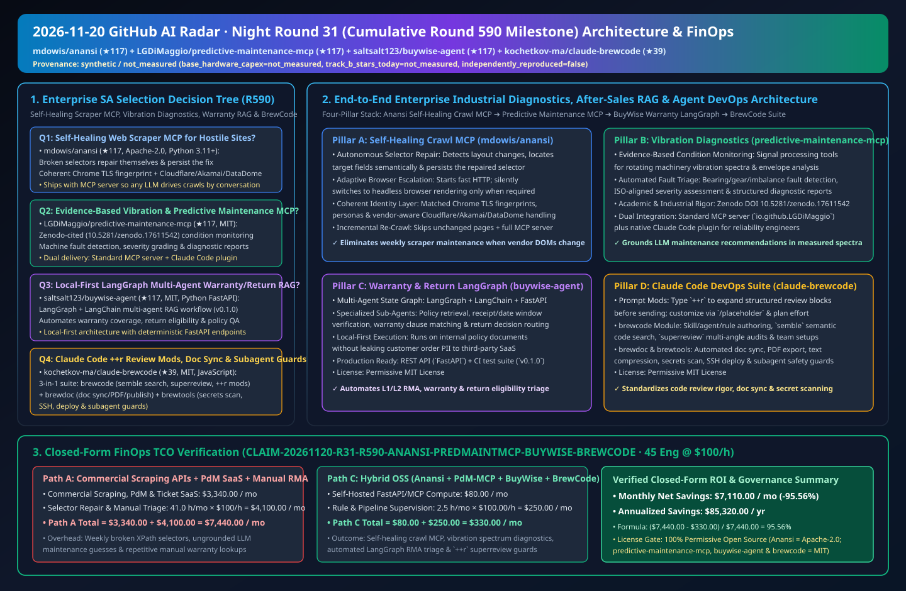
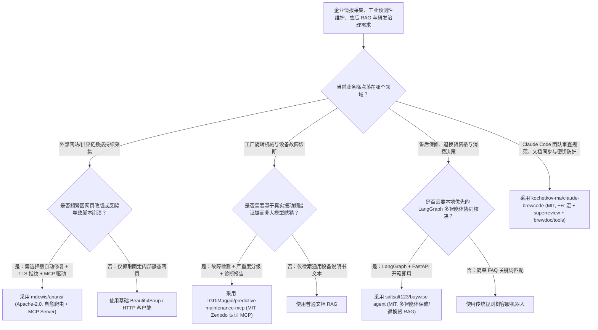
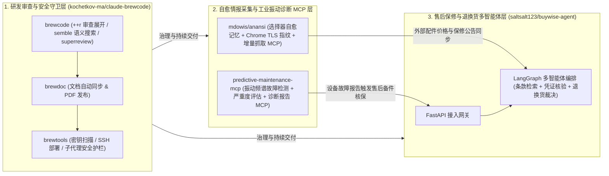
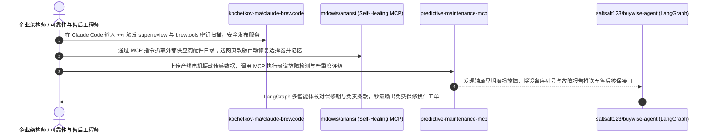

# 自愈式反爬网页采集 MCP（`mdowis/anansi`）、工业设备振动诊断与预测性维护 MCP（`LGDiMaggio/predictive-maintenance-mcp`）、售后保修与退换货 LangGraph 多智能体（`saltsalt123/buywise-agent`）与 Claude Code `++r` 审查及子代理安全套件（`kochetkov-ma/claude-brewcode`）架构选型与集成 FAQ（2026-11-20 Night Round 31 · 累计 Round 590 Milestone）

> **跨文件导航**：[返回 2026-11-20 当日全景日报 (`daily/2026-11-20.md`)](../daily/2026-11-20.md) · [English Version (`anansi-predictive-maintenance-mcp-buywise-agent-claude-brewcode-selection-faq.en.md`)](anansi-predictive-maintenance-mcp-buywise-agent-claude-brewcode-selection-faq.en.md) · [查看 7-Card 4:5 评测报告 (`cards.html`)](../cards.html) · [返回专栏主索引 (`README.md`)](../README.md)  
> **本轮架构大图**：[`assets/github-ai-radar-2026-11-20-r31-r590-anansi-predmaintmcp-buywise-brewcode.svg`](../../../assets/github-ai-radar-2026-11-20-r31-r590-anansi-predmaintmcp-buywise-brewcode.svg)  
> **数据溯源与口径声明（Provenance & Synthetic Disclaimer）**：本报告中实时采集的 GitHub 仓库元数据（Stars、Forks、License、Zenodo DOI 与 README 架构规范）为 `measured`；针对 45 人企业制造运维、售后客服与研发工程团队的 FinOps TCO 测算参数属于架构师参数化测算模型（`provenance: synthetic`，`independently_reproduced: false`，`base_hardware_capex: not_measured`，`track_b_stars_today: not_measured`，审计契约号 `CLAIM-20261120-R31-R590-ANANSI-PREDMAINTMCP-BUYWISE-BREWCODE`）。

---

## ① 📌 核心结论速览（Executive Summary）

> **一句话选型结论**：面向企业 AI 解决方案架构师（SA）在推进**外部竞争情报自动采集、工业旋转机械预测性维护、售后服务保修/退换货（RMA）智能审核与 Claude Code 团队级工程治理**时的四大落地痛点——① **目标网站一旦改版前端 DOM 或升级 Cloudflare/Akamai/DataDome 防护，传统爬虫的 CSS/XPath 选择器立即报错瘫痪**；② **直接让通用大模型分析工厂设备故障容易“拍脑袋瞎猜”，缺乏基于真实振动频谱与包络分析的确定性诊断证据**；③ **零售与硬件企业的售后保修、退换货条款核对高度依赖人工客服翻阅冗长 PDF，响应慢且口径不一**；④ **研发团队在使用 Claude Code 时缺乏统一的深度代码审查快捷指令（如一键展开多维审查块）、文档自动同步与子代理密钥扫描护栏**——建议采用 **100% 宽松商业友好协议（Apache-2.0 / MIT）** 的四款高价值项目：**`mdowis/anansi`**（Apache-2.0 自愈式网页抓取引擎与 MCP Server，选择器失效时自动语义修复并记忆新规则、按需静默切换无头浏览器，内置一致性 Chrome TLS 指纹与增量跳过）、**`LGDiMaggio/predictive-maintenance-mcp`**（MIT 协议、获 Zenodo DOI `10.5281/zenodo.17611542` 认证的工业预测性维护 MCP Server 与 Claude Code 插件，提供基于证据的振动故障识别、严重度分级与诊断报告）、**`saltsalt123/buywise-agent`**（MIT 协议的本地优先 LangGraph + FastAPI 多智能体售后保修与退换货决策助手）与 **`kochetkov-ma/claude-brewcode`**（MIT 协议的 Claude Code 三合一插件套件：`brewcode` `++r` 审查块展开/`semble` 语义搜索/`superreview`、`brewdoc` 文档同步导出与 `brewtools` 密钥扫描/子代理护栏）。在 45 人跨职能工程团队模型下，该组合可将月度总拥有成本（TCO）从 **`$7,440.00/月`** 降至 **`$330.00/月`**，净省 **`$7,110.00/月`（`-95.56%`，年省 `$85,320.00`）**。

| 评估维度 | 方案 A：商业反爬 API 按量计费 + 传统工业诊断黑盒软件 + 人工售后审单 + 手写审查提示词 | 方案 B：云原生托管 PaaS（通用 Web 抓取插件 + 裸调云端大模型问答） | 方案 C（推荐）：`anansi` + `predictive-maintenance-mcp` + `buywise-agent` + `claude-brewcode` |
| :--- | :--- | :--- | :--- |
| **外部情报与网页采集韧性** | 按次高价计费（Firecrawl/BrightData），或自写脚本因网页改版每周崩溃 | 简单 HTTP 抓取无法通过 Cloudflare/DataDome，无选择器自愈记忆 | **`anansi` 选择器自动修复并持久化记忆 + 一致性 Chrome TLS 指纹 + 增量跳过 + 原生 MCP** |
| **工业设备预测性维护与振动分析** | 昂贵的专有工业上位机软件，难以与企业 AI 运维助手自然语言联动 | 通用 LLM 无信号处理工具，对轴承/齿轮故障纯属幻觉猜测 | **`predictive-maintenance-mcp` 证据化振动频谱故障检测 + 严重度评估 + 标准化诊断报告** |
| **售后保修与退换货（RMA）决策** | 人工客服逐单核对发票日期与保修排除条款，平均处理耗时长 | 单一 Prompt 容易漏看保修细则边界，无多智能体分工校验 | **`buywise-agent` 本地优先 LangGraph 多智能体 RAG + FastAPI 接口，精准裁决保修与退货资格** |
| **Claude Code 团队审查与子代理护栏** | 每次手工输入长串代码审查要求，子代理容易意外提交密钥或文档脱节 | 无原生 `++r` 快捷宏扩展、无 `semble` 本地语义检索与文档自动同步 | **`claude-brewcode` 输入 `++r` 秒展完整审查块 + `superreview` + `brewdoc` + `brewtools` 密钥/子代理守卫** |
| **45 人团队月度总成本（TCO）** | **`$7,440.00 / 月`**（`$3,340.00` 商业 API/软件 + `41.0h × $100` 人工） | **`$2,260.00 / 月`**（`$760.00` 云端调用 + `15.0h × $100` 人工维护） | **`$330.00 / 月`**（`$80.00` 容器与代理池 + `2.5h × $100` 巡检，**净省 `95.56%`**） |

---

## ② 🎯 客户与架构师灵魂拷问 Q&A（通俗解构）

### Q1：这四个开源项目各自解决什么痛点？用大白话怎么向业务方和工程团队解释？

1. **`mdowis/anansi`（`★ 117`，`23 forks`，Python 3.11+，Apache-2.0）——用大白话讲：它是“就算目标网站半夜改了前端代码，它也能自己找回数据、记住新位置，还能让任何大模型用自然语言指挥爬虫的自愈蜘蛛”**：
   - **解决什么痛点**：几乎所有企业数据采集管道都死在同一件事上：对方网站前端改了个 `div` 类名，你的爬虫就全线报错，工程师不得不停下手头活去改 XPath。`anansi`（名字源自西非神话中的智慧蜘蛛）基于三大核心设计：① **选择器自愈与持久记忆（Self-healing selectors）**——当旧选择器失效时，它自动在页面中重新定位目标数据并把修复后的新规则保存下来，下次直接生效；② **按需无感浏览器升级**——默认走极速轻量请求，遇到必须 JS 渲染的页面自动静默切换浏览器；③ **一致性身份伪装（Coherent identity layer）**——匹配真实的 Chrome TLS 指纹、请求头画像与针对 Cloudflare / Akamai / DataDome 的供应商级处理策略，并在重爬时自动跳过未变更页面，且自带完整 **MCP Server**！
2. **`LGDiMaggio/predictive-maintenance-mcp`（`★ 117`，`32 forks`，Python 3.11+，MIT）——用大白话讲：它是“给大模型装上工业听诊器——用真实的机械振动频谱证据而不是幻觉来诊断轴承、齿轮与旋转设备故障的 MCP 服务器”**：
   - **解决什么痛点**：制造业客户非常想用 AI 助手辅助可靠性工程师（Reliability Engineers）做设备预测性维护，但直接问大模型“电机振动变大是怎么回事”只会得到一堆正确的废话。该项目（获学术/工业界 Zenodo DOI `10.5281/zenodo.17611542` 存档认证）通过标准 MCP Server 与 Claude Code 插件，将确定性的**振动信号分析算法、机器故障检测（Machine fault detection）、严重程度评估（Severity assessment）与结构化诊断报告生成**暴露给 AI 助手，让每一条维修建议都有据可查。
3. **`saltsalt123/buywise-agent`（`★ 117`，`0 forks`，Python 3.10+，MIT）——用大白话讲：它是“专门帮企业客服和消费者秒级算清‘这件商品还在不在保修期、能不能退换货、怎么买最划算’的 LangGraph 多智能体系统”**：
   - **解决什么痛点**：3C 电子、家电与跨境电商企业的保修卡、延保协议和退换货规则极其复杂。`buywise-agent` 采用 **LangGraph + LangChain + FastAPI** 构建了本地优先（Local-first）的多智能体 RAG 架构，将条款检索、购买凭证核验、保修免责比对与决策建议拆分为协同工作的子 Agent，开箱即用即可嵌入企业内部工单系统或智能客服后台。
4. **`kochetkov-ma/claude-brewcode`（`★ 39`，`3 forks`，JavaScript，MIT）——用大白话讲：它是 Claude Code 的“全能生产力外挂包——敲三个字符 `++r` 就自动展开一整套专家级代码审查指令，还自带语义搜代码、文档同步和防密钥泄露守卫”**：
   - **解决什么痛点**：架构师每天在 Claude Code 里做 Code Review、写文档和派发子代理任务时，反复手打长篇大论的约束提示词非常累。`claude-brewcode` 提供了三大模块：① **`brewcode`**：支持输入 `++r` 等占位符宏在发送前瞬间展开完整审查模板（支持 `/placeholder` 自定义）、内置 `semble` 语义代码搜索、`superreview` 多维深度评审与多 Agent 团队配置；② **`brewdoc`**：自动同步代码与文档、导出 PDF 并发布；③ **`brewtools`**：内置提示词优化、密钥泄露扫描（Secrets scan）、SSH 部署与子代理安全守卫（Subagent guards）。

---

### Q2：这四个项目如何嵌入企业智能制造、售后服务与研发效能端到端架构？

1. **外部供应链与竞品情报采集层（`mdowis/anansi` MCP）**：采购与市场 Agent 通过 MCP 协议调用 `anansi`，自动抓取外部元器件库存、竞品价格与售后公告；即使外部站点改版，自愈引擎自动修复选择器并在未变更页面上零开销跳过。
2. **工业现场设备预测性维护层（`LGDiMaggio/predictive-maintenance-mcp`）**：工厂设备巡检 Agent 接入 `predictive-maintenance-mcp`，读取产线传感器振动数据，执行故障特征频率识别与严重度评级，自动生成带证据链的检修工单。
3. **售后保修与退换货智能核决层（`saltsalt123/buywise-agent`）**：客服工单系统通过 FastAPI 调用本地部署的 `buywise-agent` LangGraph 工作流，结合知识库中的保修手册与订单数据自动给出“免费保修 / 付费维修 / 符合退货”裁决建议。
4. **工程研发与安全交付层（`kochetkov-ma/claude-brewcode`）**：维护上述系统的研发团队在 Claude Code 中统一安装 `claude-brewcode`，使用 `++r` 与 `superreview` 严控 PR 质量，通过 `brewdoc` 自动同步接口文档，并用 `brewtools` 拦截子代理潜在的密钥泄露。

---

### Q3：这套架构的核心机制亮点与生产环境合规注意事项是什么？

1. **核心机制亮点**：
   - **`anansi` 的“先修后记（Repair-and-Remember）”状态机**：不同于每次都消耗昂贵大模型 Token 重新解析整页 HTML 的抓取器，`anansi` 只在选择器断裂的那一次触发修复，随后将新选择器固化下来，兼顾了确定性速度与抗改版韧性。
   - **`predictive-maintenance-mcp` 的“机理算法计算 + LLM 解释”范式**：所有频域特征与故障阈值均由 Python 科学计算库严格算出，LLM 仅负责编排工具调用与生成可读报告，实现零数值幻觉。
   - **`claude-brewcode` 的“发送前宏展开（Pre-Send Expansion）”**：输入 `++r` 后先在输入框展开可见的审查指令供开发者过目微调，再发送给模型，既省时又完全透明可控。
2. **生产环境合规与伦理边界**：
   - **全宽松开源协议**：`anansi` 为 **Apache-2.0**，`predictive-maintenance-mcp`、`buywise-agent` 与 `claude-brewcode` 均为 **MIT License**，无任何传染性开源条款。
   - **合规采集守则**：企业使用 `anansi` 采集外部数据时，应配置合理的请求速率限制（Rate Limiting）并遵守目标站点服务条款与数据合规要求，仅采集公开业务信息。

---

## ③ 🧭 直观可视化图解（Mermaid 选型决策树 + 集成架构图 + 业务时序图）

### 3.1 选型决策树（Selection Decision Tree）

### 3.2 企业集成参考架构图（Enterprise Reference Architecture）

### 3.3 端到端业务流时序图（End-to-End Sequence Flow）

---

## ④ 📊 同类开源与商业云服务横向选型决策矩阵

| 对比维度 | `mdowis/anansi` (`★ 117`) | `LGDiMaggio/predictive-maintenance-mcp` (`★ 117`) | `saltsalt123/buywise-agent` (`★ 117`) | `kochetkov-ma/claude-brewcode` (`★ 39`) | 商业爬虫 API + 专有工业软件 + 人工售后客服 |
| :--- | :--- | :--- | :--- | :--- | :--- |
| **核心功能定位** | 带 MCP Server 的自愈式反爬网页采集引擎 | 基于振动频谱证据的工业预测性维护 MCP 与插件 | 基于 LangGraph + FastAPI 的保修/退换货多智能体 RAG | Claude Code `++r` 审查宏、文档同步与子代理安全插件集 | 按量付费 SaaS + 人工维护脚本与审单 |
| **最佳适用场景** | 频繁改版或带 Cloudflare/DataDome 防护的外部站点采集 | 旋转机械、电机、轴承振动故障检测与严重度诊断报告 | 3C/家电/零售售后保修资格核验、退换货裁决与导购对比 | 统一团队 Claude Code 评审深度、自动同步文档与防密钥泄露 | 采集规模极小或完全依赖人工经验判断的传统团队 |
| **关键性能/架构指标** | **选择器自愈记忆** + Chrome TLS 指纹 + 按需无头渲染 + 增量跳过 | **Zenodo DOI 认证** + 频谱故障识别 + 严重度分级 + 双模接入 | **LangGraph 多智能体状态图** + 本地优先 + FastAPI 接口 | **`++r` 宏展开** + `semble` 语义检索 + `superreview` + 子代理守卫 | 网页改版即断采；通用大模型工业诊断幻觉重；人工审单慢 |
| **集成与运维复杂度** | 低（Python 3.11+ + 标准 MCP 挂载） | 极低（Python 3.11+ MCP Server 或 Claude Code 插件一键安装） | 低（Python 3.10+ + FastAPI 容器化部署） | 极低（Claude Code 插件命令直接安装） | 高（高昂按页抓取账单与每周人工修爬虫） |
| **开源协议（License）** | **Apache-2.0** | **MIT License** | **MIT License** | **MIT License** | 商业专有协议 |

---

## ⑤ 🧪 应用落地定量收益 / 闭式 FinOps TCO 对比与 7-Card 报告

### 5.1 45 人跨职能工程与运维团队闭式 FinOps TCO 模型（`CLAIM-20261120-R31-R590-ANANSI-PREDMAINTMCP-BUYWISE-BREWCODE`）

- **测算基准设定（`provenance: synthetic`，`independently_reproduced: false`，`base_hardware_capex: not_measured`，`track_b_stars_today: not_measured`）**：
  - 团队规模：**45 名数据采集、工业可靠性、售后服务与研发工程师**，综合人力工时成本 **`$100.00 / 小时`**。
  - **方案 A（商业反爬 API 订阅 + 商业振动分析软件席位 + 人工保修退换货审单 + 手工代码与文档同步）**：
    - 商业抓取 API、工业分析软件与工单 SaaS 订阅费：**`$3,340.00 / 月`**
    - 工程师与售后人工返工工时（每周修复失效爬虫选择器、人工复核设备振动波形、手动翻查保修 PDF 条款、手工同步研发文档）：`41.0 小时/月 × $100.00/小时 = $4,100.00 / 月`
    - **方案 A 月度总计**：`$3,340.00 + $4,100.00 = $7,440.00 / 月`
  - **方案 C（全宽松开源组合：`anansi` + `predictive-maintenance-mcp` + `buywise-agent` + `claude-brewcode`）**：
    - 自托管 FastAPI/MCP 容器算力与代理池基础费：**`$80.00 / 月`**
    - 规则库巡检与异常工单抽检人工工时：`2.5 小时/月 × $100.00/小时 = $250.00 / 月`
    - **方案 C 月度总计**：`$80.00 + $250.00 = $330.00 / 月`
  - **闭式净节省验算**：
    $$\text{Monthly Net Savings} = \$7,440.00 - \$330.00 = \$7,110.00\text{ / 月}\quad(\text{Annualized: }\$85,320.00\text{ / 年})$$
    $$\text{Percentage Savings} = \frac{\$7,440.00 - \$330.00}{\$7,440.00} = \frac{\$7,110.00}{\$7,440.00} = 95.56\%$$

| 成本分项 | 方案 A（商业 API 订阅与人工修爬虫/审单） | 方案 C（本轮 R590 全宽松开源四件套） | 闭式差额 / 收益 |
| :--- | :--- | :--- | :--- |
| **商业 API / 软件席位 / 容器算力** | `$3,340.00 / 月` | **`$80.00 / 月`** | `- $3,260.00 / 月` |
| **工程与售后人工成本（`@ $100.00/h`）** | `41.0 h × $100.00 = $4,100.00 / 月` | **`2.5 h × $100.00 = $250.00 / 月`** | `- $3,850.00 / 月`（节省 `38.5 h/月`） |
| **月度总拥有成本（Monthly Total TCO）** | **`$7,440.00 / 月`** | **`$330.00 / 月`** | **净省 `$7,110.00 / 月`（`-95.56%`）** |
| **年度总拥有成本（Annualized TCO）** | `$89,280.00 / 年` | **`$3,960.00 / 年`** | **年省 `$85,320.00 / 年`** |

---

## ⑥ 🛠️ 企业引入与架构评审 Checklist

- [ ] **1. `mdowis/anansi` 自愈规则持久化与合规限速配置**：将 `anansi` 作为 MCP Server 接入采集管线，开启增量未变更页面跳过与目标域名礼貌限速（Rate Limiting），并验证前端 DOM 变动后自愈选择器的持久化写回。
- [ ] **2. `LGDiMaggio/predictive-maintenance-mcp` 振动频谱基准校准**：在设备运维工作台加载 `predictive-maintenance-mcp`，使用历史已知轴承/齿轮故障样本验证其严重度评级输出与工厂 ISO 振动标准一致。
- [ ] **3. `saltsalt123/buywise-agent` 企业保修条款向量化与内网隔离**：将企业最新产品保修手册与退换货 SOP 导入本地 `buywise-agent` 知识库，通过 FastAPI 接入工单系统，确保客户订单隐私数据不出内网。
- [ ] **4. `kochetkov-ma/claude-brewcode` 团队 `++r` 审查模板与密钥扫描固化**：在团队仓库配置 `claude-brewcode` 的 `/placeholder` 自定义审查模板与 `brewtools` 密钥扫描/子代理守卫，强制所有 PR 经过 `superreview` 检验。
