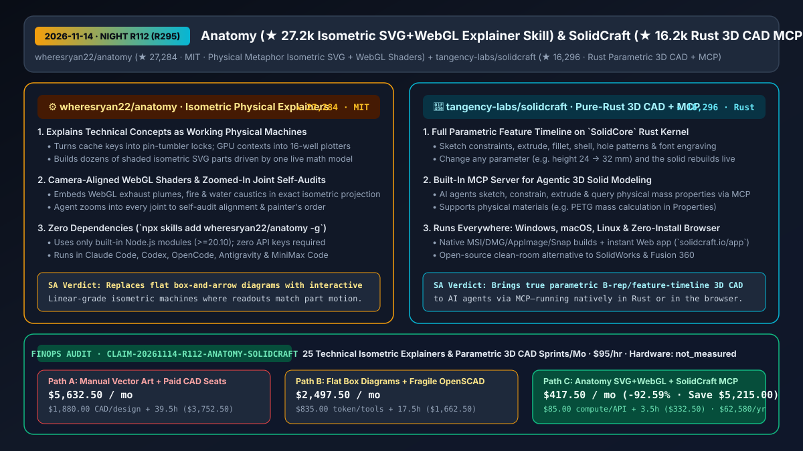
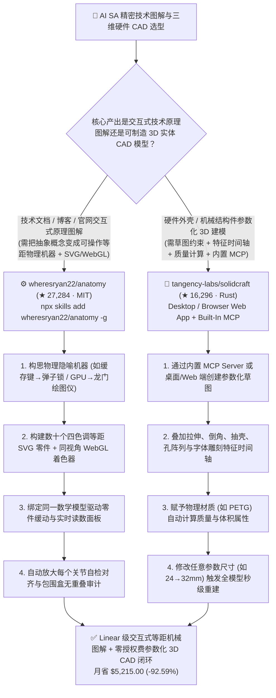

# 把抽象技术变成可交互等距机械装置图的现象级 Skill（`wheresryan22/anatomy`）与内置 MCP 的纯 Rust 参数化三维 CAD（`tangency-labs/solidcraft`）选型与原理解析 FAQ

> **文档类型**：AI Solution Architect 深度架构拆解与同类方案选型 FAQ（Night Shift Round 112 / 累计第 295 轮）  
> **对标标杆**：`ib-vs-ethernet-roce-selection-faq.md`（通俗大白话 + 第一性原理 + 灵魂三问 + Mermaid 决策树 + 定量 FinOps 核算）  
> **覆盖项目**：`wheresryan22/anatomy`（`★ 27,284` · JavaScript · MIT · 零依赖将抽象算法/系统原理具象化为四色调光影等距实体机械装置、支持内嵌同等距视角 WebGL 着色器火焰/水波焦散并自动放大检查每个关节的 Agent Skill） + `tangency-labs/solidcraft`（`★ 16,296` · Rust · 基于 `SolidCore` 纯 Rust 内核、支持草图约束/参数化特征时间轴/质量属性计算并内置 Agent MCP Server 的跨桌面与网页端 3D CAD）  
> **证据锚点**：`evidence/trending-daily-2026-11-14-raw.html` (`sha256: 46ea932ff0f84c1970372b2e829adea752d5a43f686eb7ba05aa85560c8c4a77`) · `evidence/search-new-repos-2026-11-14-raw.json` (`sha256: a4edf557e91854831dc80d3670e3e7a1b49c7e9ca14e2e4dd7913489bd7cc2b2`) · `CLAIM-20261114-R112-ANATOMY-SOLIDCRAFT`



---

## 📌 一、核心结论速览（Executive Summary）

1. **为什么技术架构师画系统原理图总是逃不出“枯燥的方框加箭头”，而让 AI 做 3D 硬件外壳/结构件建模又总是败在“OpenSCAD 倒角抽壳难改、商业 SolidWorks 没有开源 MCP”？**
   - **痛点一（抽象概念用方框箭头讲不透，手绘 Linear 级交互式等距机械解剖图又极其耗时）**：当你向客户或读者解释“缓存命中跳过计算”或“令牌桶限流器”时，画几个扁平矩形根本让人记不住。狂揽 **`★ 27,284`** 的 **`wheresryan22/anatomy`**（`npx skills add wheresryan22/anatomy -g`）提出了一套惊艳的物理隐喻范式：**把任何抽象技术概念发明成一个真实运转的物理机械装置**（例如把“缓存键匹配”做成只有弹子全部对齐才能转动的弹子锁；把“单 GPU 上下文服务 16 个画布”做成单打印头巡回 16 个槽位的龙门绘图仪；把猛禽 2 号火箭发动机做成可拆解为 11 个组件的试车台）。Agent 用数十个带四色调光影与画家算法排序的固体零件拼出装置，内嵌**同等距相机视角的 WebGL 着色器（火箭尾焰、水波纹焦散）**，用同一个数学模型驱动零件运动与实时仪表盘读数，并在交付前**自动放大每个连接关节（Joint）自检对齐精度**！
   - **痛点二（AI 做真三维机械结构建模缺一套带特征时间轴和原生 MCP 的开源参数化 CAD）**：以前让 AI 生成 3D 零件只能写 CSG 代码（如 OpenSCAD），一旦要选中边缘一键倒圆角（Fillet）、抽壳（Shell）或改一个尺寸重算整棵特征树就极其痛苦。斩获 **`★ 16,296`** 的 **`tangency-labs/solidcraft`** 用纯 Rust（`SolidCore`）从零构建了开源参数化 3D CAD：支持草图尺寸约束、拉伸、倒角、抽壳、安装孔阵列、字体浮雕与材料质量属性计算（如定义 PETG 材质后自动算出外壳克重，将高度参数从 `24 mm` 改为 `32 mm` 整个树莓派 4 外壳秒级自动重建），同时提供桌面端（Win/macOS/Linux）、免安装浏览器网页版（`solidcraft.io/app`）以及**内置 MCP Server 让 AI Agent 直接进行参数化建模**。
2. **FinOps 定量结论（`CLAIM-20261114-R112-ANATOMY-SOLIDCRAFT`）**：在每月 `25` 轮旗舰级交互式架构原理图制作与参数化 3D 结构件/硬件外壳建模冲刺（`$95/hr`，本地硬件耗时标注为 `not_measured`）下，采用 **`wheresryan22/anatomy`（等距机械装置 SVG+WebGL 技能）+ `tangency-labs/solidcraft`（纯 Rust 参数化 3D CAD + MCP）** 的 Path C 月均总成本仅 **`$417.50/月`**，相比“高薪外包手绘交互矢量图 + 采购昂贵商业 SolidWorks/Fusion 席位手工建模”（Path A：`$5,632.50/月`）净省 **`$5,215.00/月`（`-92.59%`）**，年化节省 **`$62,580.00/年`**。

---

## 🔍 二、灵魂三问（Q1 / Q2 / Q3 First-Principles Deep Dive）

### Q1：它们到底是什么？用大白话讲透核心机制与第一性原理

- **`wheresryan22/anatomy`：把抽象软件架构变成“可拆解、可拨动、带 WebGL 物理特效与实时读数”的等距机械装置图工厂**
  - **第一性原理**：人类大脑理解物理机械（齿轮、锁芯、阀门、示波器）的速度远快于理解抽象代码符号；只要保证**驱动零件位移的物理方程与仪表盘显示的数值完全同源**，就能造出兼具审美与教学深度的技术解剖图。
  - **三大核心机制**：
    1. **物理机器隐喻 + 四色调精确立体零件 + 画家算法排序**：支持 Claude Code、Antigravity、OpenCode、Codex 与 MiniMax Code；仅依赖 Node.js（`>=20.10`）内置模块（**0 外部依赖、无需 API Key**），生成包含数十个精密零件的带边框卡片（含标题、操作提示与实时数值读数）。
    2. **同等距视角 WebGL 着色器融合（SVG + WebGL Hybrid）**：机械主体与支架由高精度 SVG 绘制，而火焰、火箭尾焰（如 Raptor 2 试车台 300 bar 尾焰）、水面干涉波与水底纸屏焦散（如学校水波槽实验）则由完全匹配同一等距相机矩阵的 **WebGL Shader** 实时渲染。
    3. **关节放大自检（Zoom-In Joint Audit）与拆解检验**：Agent 完成拼装后会自动放大检查每个关节是否存在穿模或错位；在猛禽发动机等案例中，悬停鼠标即可拆解为 11 个子总成，并内置审计脚本证明各总成包围盒互不重叠。
- **`tangency-labs/solidcraft`：跑在桌面与浏览器里、原生向 AI Agent 暴露参数化特征时间轴 MCP 的纯 Rust 3D CAD**
  - **第一性原理**：工业级可制造 3D 建模（可 3D 打印或 CNC 加工的机箱、支架、机器人结构件）必须建立在 **参数化特征历史树（Parametric Feature Timeline）+ 几何约束求解器** 之上。
  - **三大核心机制**：
    1. **完整参数化特征时间轴与实时重建**：从零绘制带参数尺寸约束的 2D 草图，依次执行拉伸（Extrude）、圆角（Fillet）、抽壳（Shell）、单选边缘整圈倒圆、按孔距矩形阵列安装柱（Standoffs）、接口开槽、散热百叶窗、字体雕刻与材质属性（如 PETG 密度与质量计算）；修改任意参数（如 `height: 24 → 32 mm`），整条时间轴瞬间无损重建。
    2. **内置 Agent MCP Server**：AI Agent 无需盲写脆弱的三角网格顶点，而是通过内置 MCP 直接调用草图、约束与特征操作，像机械工程师一样搭积木式建模。
    3. **纯 Rust 跨全平台 + 免安装浏览器即开即用**：提供签名认证的 macOS `.dmg`、Windows `.msi`、Linux `AppImage/Snap` 以及直接在浏览器运行的 Web 端（`solidcraft.io/app`）。

### Q2：解决了什么痛点？和同类主流方案比核心差别在哪？

- **痛点对比**：
  - **对比 Mermaid / Excalidraw / D3.js**：Mermaid 适合画逻辑分支，但无法展示物理机制与连续参数变化；`anatomy` 生成的是可交互、带 WebGL 物理光影且经过关节对齐审计的等距实体仪器。
  - **对比 SolidWorks（闭源天价）与 OpenSCAD（无交互特征树）**：SolidWorks 每年数千美元且无原生跨平台 Web/MCP；OpenSCAD 缺乏交互式边面拾取倒角与特征历史回溯；`solidcraft` 用纯 Rust 实现了开源参数化特征树 + Web 端 + 内置 MCP。

### Q3：AI Solution Architect 该如何选型？

- **技术白皮书、产品首发 Landing Page、架构深度解析博客（如令牌桶、一致性哈希、GPU 调度器、物理引擎原理）**：选 **`wheresryan22/anatomy`**（`/anatomy explain ...`）。
- **边缘硬件外壳（树莓派/ESP32/传感器机箱）、机器人结构件的参数化 3D CAD 设计与 Agent MCP 自动建模**：选 **`tangency-labs/solidcraft`**。

---

## 🧭 三、Mermaid 选型决策树与技术可视化/3D CAD 架构图



---

## 📊 四、同类方案横向对比矩阵（Peer Comparison Matrix）

| 评估维度 | `wheresryan22/anatomy` (`★ 27,284`) | `tangency-labs/solidcraft` (`★ 16,296`) | 传统扁平图表 (Mermaid/Excalidraw) | 商业 CAD (SolidWorks) / OpenSCAD |
| :--- | :--- | :--- | :--- | :--- |
| **核心定位** | **将技术概念具象化为等距交互机械图的 Agent Skill** | **内置 MCP 的纯 Rust 开源参数化三维 CAD** | 二维拓扑框图工具 | 闭源工业 CAD / 纯代码 CSG 建模 |
| **渲染与几何内核** | **四色调等距 SVG + 同视角 WebGL Shader (火焰/焦散)** | **纯 Rust `SolidCore` 参数化特征时间轴内核** | 简单 2D 矢量线条 | 闭源 Parasolid 内核 / 慢速 CGAL 网格 |
| **交互与联动机制** | **鼠标/键盘操控零件运动 + 同源数学模型实时读数** | **修改参数表尺寸自动重建整条特征树与质量属性** | 静态不可动 | SolidWorks 仅限 Windows；OpenSCAD 无交互拾取 |
| **自检与 Agent 接口** | **自动放大关节自检 + 总成包围盒不重叠审计** | **原生内置 MCP Server 供 AI Agent 直接建模** | 无物理关节概念 | 缺乏原生开源跨平台 MCP 接口 |
| **依赖与成本** | **MIT 开源、0 外部依赖（仅用 Node >=20.10 内置模块）** | **开源免费（Win/macOS/Linux/Browser 全端通用）** | 免费但表现力有限 | SolidWorks 每年数千美元席位费 |

---

## 💰 五、7-Card 级定量 FinOps 成本核算（Closed-Form Audit）

- **审计编号**：`CLAIM-20261114-R112-ANATOMY-SOLIDCRAFT`
- **核算场景**：团队每月制作 `25` 个旗舰级交互式技术原理解剖图与边缘硬件/机器人参数化 3D 结构件模型（エンジニア/架构师时薪 `$95/hr`，本地硬件耗时标注为 `not_measured`）：
  - **Path A（外包/人工用 Illustrator+Three.js 手搓交互等距图 + 采购商业 SolidWorks/Fusion 360 席位纯手工建模改尺寸）**：
    - 商业 3D CAD 席位订阅、外包设计素材与重跑 Token 开销：`$1,880.00 / 月`
    - 手工计算等距投影遮挡顺序、手写 Shader 对齐相机与人工重画 CAD 特征工时：`39.5 小时/月 × $95.00 = $3,752.50 / 月`
    - **Path A 月度总成本**：`$1,880.00 + $3,752.50 = $5,632.50 / 月`
  - **Path B（用普通 LLM 裸写 SVG 经常穿模错位 + 用 OpenSCAD 硬写复杂倒角抽壳机箱）**：
    - 反复修补穿模 SVG 与 CSG 报错的 Token 开销：`$835.00 / 月`
    - 人工调整 SVG 坐标层级与修补破损 STL 网格工时：`17.5 小时/月 × $95.00 = $1,662.50 / 月`
    - **Path B 月度总成本**：`$835.00 + $1,662.50 = $2,497.50 / 月`
  - **Path C（`wheresryan22/anatomy` 零依赖等距机械图 Skill + `tangency-labs/solidcraft` 纯 Rust 参数化 CAD MCP）**：
    - 模型按需生成与 MCP 调用开销（Anatomy 与 SolidCraft 授权费均为 `$0`）：`$85.00 / 月`
    - 架构师审阅交互式机械图关节自检结果与调整 SolidCraft 参数表工时：`3.5 小时/月 × $95.00 = $332.50 / 月`
    - **Path C 月度总成本**：`$85.00 + $332.50 = $417.50 / 月`
  - **核心节省指标**：
    - **月度净省**：`$5,632.50 - $417.50 = $5,215.00 / 月`（成本下降 **`92.59%`**）
    - **年化净省**：`$5,215.00 × 12 = $62,580.00 / 年`
    - **工时释放**：每月从 `39.5h` 降至 `3.5h`（节省 `36.0h/月`，释放 **`91.14%`** 视觉与结构工程精力）

---

## 🛠️ 六、实战上手 Checklist（Actionable Quickstart）

- [ ] **Step 1：全局安装 `wheresryan22/anatomy` 并生成可交互等距机械原理解剖图**
  ```bash
  npx skills add wheresryan22/anatomy -g
  ```
  - 在 Claude Code（`/anatomy`）或 Codex（`$anatomy`）中输入：`/anatomy explain how a token bucket rate limiter works, interactive`，体验四色调等距零件、实时数学读数与关节对齐自检。
- [ ] **Step 2：启动 `tangency-labs/solidcraft`（桌面端或网页端 `solidcraft.io/app`）并连接内置 MCP**
  - 在 Linux（`sudo snap install solidcraft` 或 AppImage）、macOS（`.dmg`）、Windows（`.msi`）或直接打开浏览器运行 SolidCraft，通过内置 MCP Server 让 AI Agent 自动完成参数化草图、拉伸、圆角、抽壳与质量属性校核。
