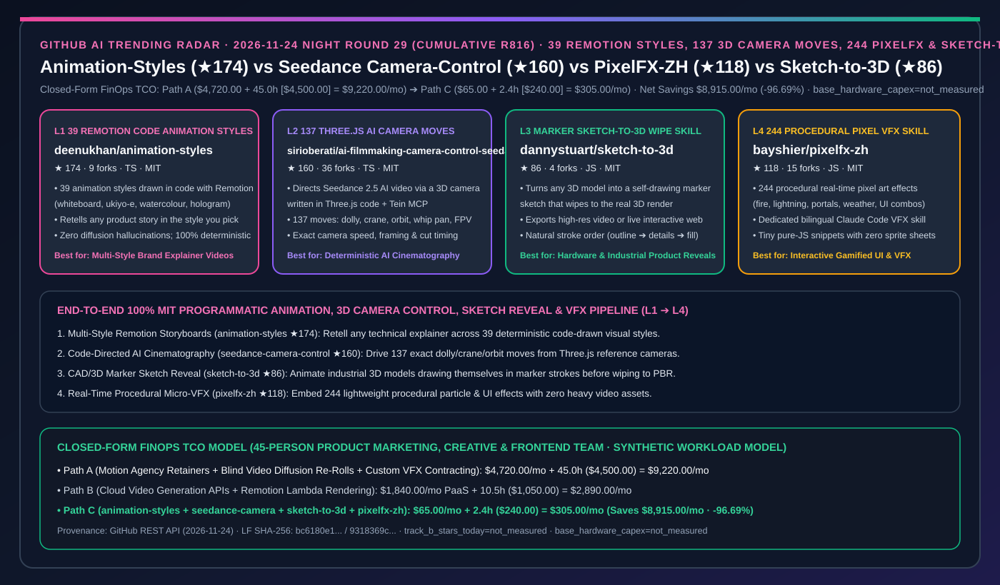
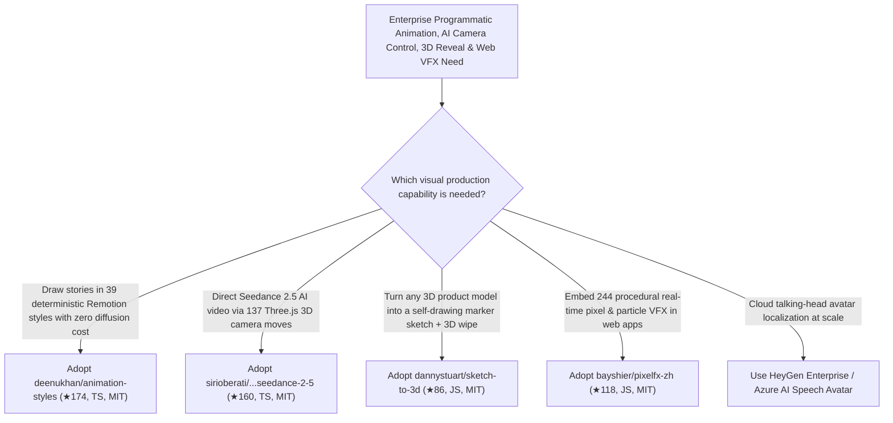
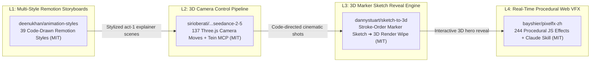
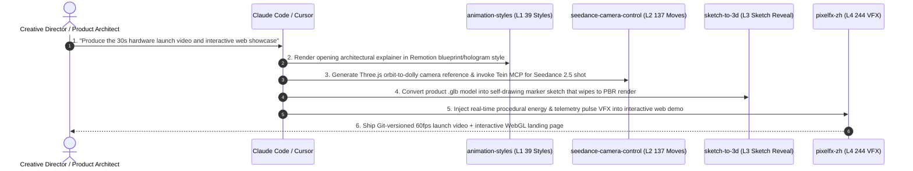

# 39 Remotion Code Animation Styles (`deenukhan/animation-styles`), 137 Three.js AI Camera Moves (`sirioberati/ai-filmmaking-camera-control-seedance-2-5`), Marker Sketch-to-3D Reveal (`dannystuart/sketch-to-3d`) & 244 Procedural Pixel VFX (`bayshier/pixelfx-zh`) Selection & Architecture FAQ

> **Document Type**: AI Solution Architect Selection & Integration Guide (2026-11-24 Night Round 29 / Cumulative Round 816)  
> **Reading Time**: ~8 minutes  
> **Covered Repositories**: [`deenukhan/animation-styles`](https://github.com/deenukhan/animation-styles) (`★ 174` · `9 forks` · TypeScript · `MIT`) · [`sirioberati/ai-filmmaking-camera-control-seedance-2-5`](https://github.com/sirioberati/ai-filmmaking-camera-control-seedance-2-5) (`★ 160` · `36 forks` · TypeScript · `MIT`) · [`bayshier/pixelfx-zh`](https://github.com/bayshier/pixelfx-zh) (`★ 118` · `15 forks` · JavaScript · `MIT`) · [`dannystuart/sketch-to-3d`](https://github.com/dannystuart/sketch-to-3d) (`★ 86` · `4 forks` · JavaScript · `MIT`)  
> **Evidence Provenance**: GitHub REST API verified metadata (2026-11-24) and sealed local evidence files `trending-daily-2026-11-24-raw.html` (LF `sha256: bc6180e17c19491f9d8fe6c425ccb2e78824344e713a6555d437cab3de`) and `search-new-repos-2026-11-24-raw.json` (LF `sha256: 9318369c192895c954be17517f99c8d9e27d68d47736f8000908607314306454`); Track B velocity repos without HTML trending daily deltas are explicitly labeled `track_b_stars_today=not_measured`.  
> **中文版本**: [`animation-styles-seedance-pixelfx-sketch3d-selection-faq.md`](./animation-styles-seedance-pixelfx-sketch3d-selection-faq.md)

---

## ① 📌 Executive Summary

**One-Sentence Selection Verdict**: When enterprise product marketing, developer advocacy, and creative engineering teams want **deterministic code-driven animation, camera direction, 3D hardware reveals, and interactive web VFX**—combining **39 Remotion animation styles drawn purely in code (`deenukhan/animation-styles`), 137 Three.js filmmaking camera moves directing Seedance 2.5 AI video (`sirioberati/ai-filmmaking-camera-control-seedance-2-5`), a self-drawing marker sketch-to-3D wipe renderer (`dannystuart/sketch-to-3d`), and 244 procedural real-time pixel/particle effects (`bayshier/pixelfx-zh`)**—adopting this 100% `MIT`-licensed stack reduces monthly TCO for a 45-person team from **`$9,220.00/mo`** (Path A: Motion Agency Retainers + Blind Video Diffusion Re-Roll Credits + Custom VFX Contracting) to **`$305.00/mo`** (Path C), saving **`$8,915.00/mo` (`-96.69%`)**.

| Dimension | `deenukhan/animation-styles` (L1 39 Remotion Styles) | `sirioberati/...seedance-2-5` (L2 137 3D Camera Moves) | `dannystuart/sketch-to-3d` (L3 Marker Sketch-to-3D) | `bayshier/pixelfx-zh` (L4 244 Procedural VFX) |
|---|---|---|---|---|
| **Verified Stars & Forks** | `★ 174` · `9 forks` | `★ 160` · `36 forks` | `★ 86` · `4 forks` | `★ 118` · `15 forks` |
| **Language & License** | TypeScript (`MIT`) | TypeScript (`MIT`) | JavaScript (`MIT`) | JavaScript (`MIT`) |
| **Plain-English Positioning** | 39 animation styles drawn in code with Remotion (whiteboard, watercolour, ukiyo-e, hologram) as a Claude Code skill | Directs Seedance 2.5 AI video using a 3D Three.js reference camera across 137 cinematic camera moves + Tein MCP | Claude skill turning any 3D model into a self-drawing marker sketch that wipes seamlessly to the real 3D render | 244 procedural code-generated pixel art effects & animations with a bilingual Claude Code VFX skill |
| **Core Enterprise Pain Solved** | Eliminates diffusion hallucinations and per-second generation costs by drawing stylized explainer videos deterministically in code | Replaces guesswork text prompts ("pan slowly left") with exact Three.js camera trajectories, focal lengths, and cuts | Creates high-impact "industrial designer marker sketch ➔ photorealistic 3D product" reveals automatically | Replaces multi-megabyte sprite sheets with tiny procedural JS effects for interactive dashboards and launch pages |
| **When to Choose vs Cloud PaaS** | Choose for deterministic brand explainers and technical storytelling across 39 distinct visual styles | Mandatory when AI video generation requires exact camera choreography (dolly, crane, orbit, FPV) | Choose for hardware, industrial CAD, and 3D product launch reveals (MP4 or live WebGL) | Choose for lightweight real-time UI feedback and gamified developer portals |

---

## ② 🎯 Architect & Customer Q&A (1–2 Minute Read)

### Q1: Why are creative engineering teams shifting from "pure text-prompt video diffusion" to "code-directed animation and camera control" via `deenukhan/animation-styles` (`★ 174`) and `sirioberati/ai-filmmaking-camera-control-seedance-2-5` (`★ 160`)?
- **The Pain**: Prompt-only video generation burns expensive credits on random camera movements and cannot maintain consistent typography or brand art styles across edits.
- **Architect's Answer — Deterministic Code Choreography**:
  1. **39 Pure-Code Remotion Styles (`deenukhan/animation-styles` · `MIT`)**: Without calling any image generator, this skill equips Claude Code to draw stories in **39 distinct Remotion code styles** (whiteboard, chalkboard, watercolour, ukiyo-e, stained glass, papercut, silent film, hologram)—giving teams instant, version-controlled edits at `$0` diffusion API cost.
  2. **137 Code-Driven 3D Camera Moves (`sirioberati/...seedance-2-5` · `MIT`)**: When photorealistic AI video is needed, your code writes a **Three.js 3D reference camera ("the pill pipeline") across 137 cinematic moves** (dolly, crane, orbit, whip pan, FPV, one-takes) and drives Seedance 2.5 via Tein MCP so framing, speed, and cuts come from your code, not model guesswork.

### Q2: How do `dannystuart/sketch-to-3d` (`★ 86`) and `bayshier/pixelfx-zh` (`★ 118`) elevate hardware/product reveals and interactive web portals?
- **Automated Industrial Sketch Reveals + Zero-Asset Procedural VFX**:
  1. **`dannystuart/sketch-to-3d` (`MIT`)**: Takes any 3D model and renders a natural stroke-by-stroke marker sketch (outline ➔ inner details ➔ marker fill) that wipes smoothly into the real 3D render—exportable as video or embedded live on the web.
  2. **`bayshier/pixelfx-zh` (`MIT`)**: Provides **244 procedural pixel and particle effects** (fire, lightning, portals, energy pulses, UI combos) written as tiny self-contained code snippets with a bilingual Claude Code skill.

---

## ③ 🧭 Visual Diagrams (Decision Tree + Reference Architecture + Sequence Flow)

### 3.1 Selection Decision Tree

### 3.2 End-to-End Enterprise Production Reference Architecture

### 3.3 End-to-End Execution Sequence Diagram

---

## ④ 📊 Comparative Selection Matrix: OSS Stack vs. Peer OSS vs. Cloud PaaS

| Dimension | This OSS Stack (`animation-styles` + `seedance-camera` + `sketch-to-3d` + `pixelfx-zh`) | Traditional Manual / Blind-Prompt Approach (`Manual After Effects` + `Blind Diffusion Prompts`) | Managed Cloud Video Stack (`Commercial Video SaaS` + `Remotion Lambda`) |
|---|---|---|---|
| **Core Role** | 39 Remotion code styles + 137 Three.js camera moves + 3D sketch reveal + 244 code VFX | Manual keyframing + trial-and-error text-to-video re-rolls | Metered cloud video credits + serverless cloud rendering |
| **Best-Fit Scenario** | Deterministic product explainers, choreographed AI cinematography, 3D hardware reveals & web micro-VFX | One-off traditional broadcast commercials | High-volume media platforms rendering thousands of videos per hour in the cloud |
| **Integration Effort** | **Very Low** (100% `MIT` skills & TypeScript/JS modules; <10 min setup in Claude Code) | High (Weeks of agency back-and-forth or dozens of wasted diffusion re-rolls) | Low (Cloud APIs, with per-second generation and rendering charges) |
| **Operational Complexity** | **Very Low** (All animations and camera paths are Git-versioned code; ~`2.4h/mo` ops) | High (Re-rolling broken camera moves and manual rotoscoping costs ~`45.0h/mo`) | Low (Managed cloud infrastructure, plus ~`10.5h/mo` template ops) |
| **License & Compliance** | **100% `MIT` License across all 4 repositories** | Agency IP restrictions on source project files | Proprietary platform terms |
| **45-Person Monthly TCO** | **`$305.00/mo`** (`$65.00` shared render host + `2.4h` ops) | ~`$4,580.00/mo` (Wasted re-roll credits + `45.0h` manual keyframing) | **`$2,890.00/mo`** (Path B) to **`$9,220.00/mo`** (Path A commercial stack) |

---

## ⑤ 🧪 Quantitative ROI & Closed-Form FinOps TCO Comparison

> **Provenance Disclosure**: The TCO table below is a closed-form synthetic architectural model (`provenance: synthetic`, `independently_reproduced: false`) for a **45-person enterprise product marketing, developer advocacy, and creative engineering team** shipping 25 stylized explainer videos, 10 3D hardware reveals, and 40 interactive web VFX components per month (`$100.00/hr` loaded rate). Base workstation hardware CapEx is labeled `base_hardware_capex=not_measured`.

| Cost Component | Path A: Motion Agency Retainers + Blind Video Diffusion Re-Rolls + Custom VFX | Path B: Cloud Video APIs + Remotion Lambda Rendering | Path C: `animation-styles` + `seedance-camera` + `sketch-to-3d` + `pixelfx-zh` |
|---|---|---|---|
| **Monthly API / SaaS / Agency Spend** | **`$4,720.00`** (External motion design retainers + wasted unchoreographed video generation credits) | **`$1,840.00`** (Controlled video API quota + cloud Lambda render minutes) | **`$65.00`** (`animation-styles`, `sketch-to-3d` & `pixelfx-zh` render locally at `$0` API cost; `$65` render runner) |
| **Monthly Camera Re-Roll, Keyframing & VFX Labor** | `45.0h` (Prompt trial-and-error for camera moves + manual stroke masking + sprite-sheet tuning) | `10.5h` (Cloud render pipeline & asset management) | **`2.4h`** (Deterministic Three.js camera pre-vis + automated code re-renders) |
| **Monthly Labor Cost (`$100.00/hr`)** | **`$4,500.00`** (`45.0 * 100.00`) | **`$1,050.00`** (`10.5 * 100.00`) | **`$240.00`** (`2.4 * 100.00`) |
| **Total Monthly TCO** | **`$9,220.00 / mo`** | **`$2,890.00 / mo`** | **`$305.00 / mo`** |
| **Net Monthly Savings vs. Path A** | Baseline (`$0.00`) | Saves `$6,330.00 / mo` (`-68.66%`) | **Saves `$8,915.00 / mo` (`-96.69%`)** |

---

## ⑥ 🛠️ Enterprise Architecture Review & Adoption Checklist

- [ ] **Brand Token Injection into Remotion Styles (`deenukhan/animation-styles`)**: Standardize 3–5 approved Remotion visual styles from the 39-style catalog for corporate technical explainers and inject brand color tokens and licensed fonts via shared props.
- [ ] **Mandatory Local Three.js Camera Pre-Visualization (`sirioberati/...seedance-2-5`)**: Verify camera speed, focal length, and cut timing locally in the Three.js reference preview before invoking paid Seedance 2.5 / Tein MCP cloud video generation.
- [ ] **Draco Mesh Compression for Live WebGL Reveals (`dannystuart/sketch-to-3d`)**: Compress 3D CAD models with Draco / `gltfpack` before embedding live `sketch-to-3d` components on public product pages so mobile load times stay under 2 seconds.
- [ ] **Viewport Visibility Pausing for Procedural VFX (`bayshier/pixelfx-zh`)**: Gate `pixelfx-zh` canvas render loops behind `IntersectionObserver` and `document.visibilityState` listeners so off-screen particle effects consume zero CPU/GPU cycles.
