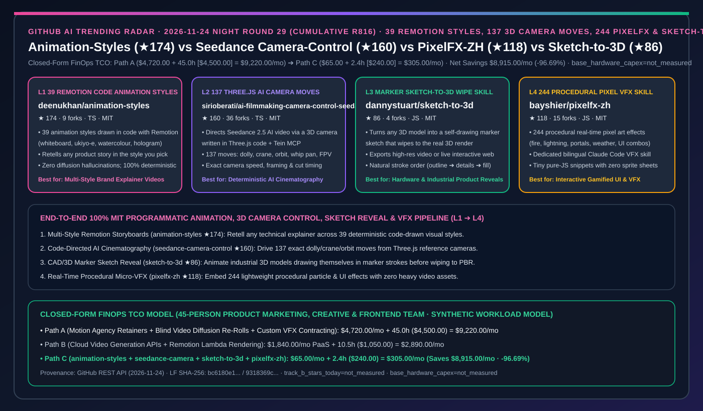
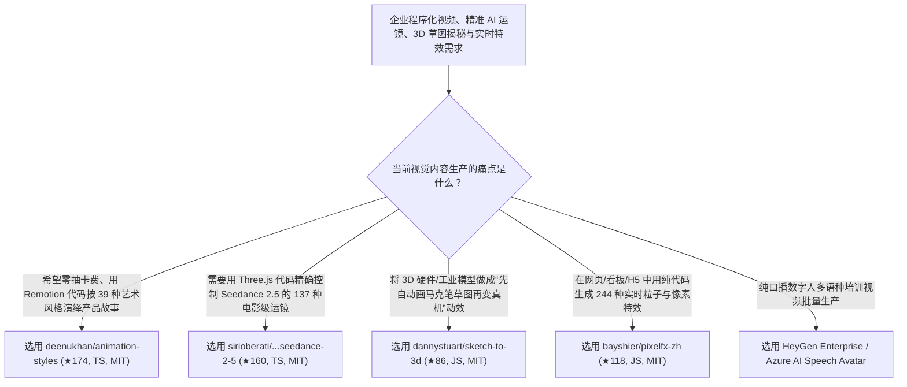
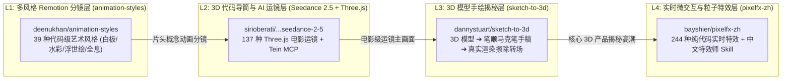
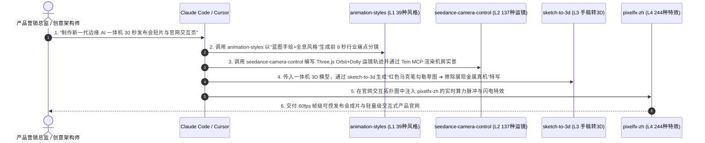

# 39 种 Remotion 代码级动画视觉风格（`deenukhan/animation-styles`）、137 种 Three.js 电影级运镜控制（`sirioberati/ai-filmmaking-camera-control-seedance-2-5`）、3D 模型手绘马克笔渐显技能（`dannystuart/sketch-to-3d`）与 244 种实时像素粒子特效技能（`bayshier/pixelfx-zh`）选型与集成 FAQ

> **文档类型**：AI 解决方案架构师（AI Solution Architect）选型决策指南（2026-11-24 Night Round 29 / 累计第 816 轮）  
> **阅读耗时**：约 8 分钟  
> **覆盖项目**：[`deenukhan/animation-styles`](https://github.com/deenukhan/animation-styles)（`★ 174` · `9 forks` · TypeScript · `MIT`） · [`sirioberati/ai-filmmaking-camera-control-seedance-2-5`](https://github.com/sirioberati/ai-filmmaking-camera-control-seedance-2-5)（`★ 160` · `36 forks` · TypeScript · `MIT`） · [`bayshier/pixelfx-zh`](https://github.com/bayshier/pixelfx-zh)（`★ 118` · `15 forks` · JavaScript · `MIT`） · [`dannystuart/sketch-to-3d`](https://github.com/dannystuart/sketch-to-3d)（`★ 86` · `4 forks` · JavaScript · `MIT`）  
> **证据溯源**：GitHub REST API 实测元数据（2026-11-24）与本地冻结证据文件 `trending-daily-2026-11-24-raw.html`（LF `sha256: bc6180e17c19491f9d8fe6c425ccb2e78824344e713a6555d437cab3de`）、`search-new-repos-2026-11-24-raw.json`（LF `sha256: 9318369c192895c954be17517f99c8d9e27d68d47736f8000908607314306454`）；Track B 仓库无 HTML 榜单对应的单日增量，统一标记为 `track_b_stars_today=not_measured`。  
> **English Version**: [`animation-styles-seedance-pixelfx-sketch3d-selection-faq.en.md`](./animation-styles-seedance-pixelfx-sketch3d-selection-faq.en.md)

---

## ① 📌 核心结论速览（Executive Summary）

**选型一句话结论**：当企业产品营销、技术布道、工业设计展示与游戏化增长团队希望用 AI 编码智能体实现**“用确定性代码而非失控扩散模型制作高审美多模态视频与动效”**——涵盖 **39 种基于 Remotion 的纯代码手绘/水彩/浮世绘/全息动画风格（`deenukhan/animation-styles`）、用 Three.js 代码精确指挥 Seedance 2.5 完成 137 种电影级推拉摇移运镜（`sirioberati/ai-filmmaking-camera-control-seedance-2-5`）、把任意 3D 产品模型转化为“先按笔顺自动画马克笔草图再擦除过渡到真实 3D 渲染”的揭秘动效（`dannystuart/sketch-to-3d`），以及 244 种零贴图纯代码实时生成的像素粒子与 UI 特效（`bayshier/pixelfx-zh`）**——采用这套 100% `MIT` 开源协议的四层创意工程底座，可将 45 人团队的月度 TCO 从外包MG动画工作室 + 盲抽视频生成模型废片成本 + 定制特效研发（Path A）的 **`$9,220.00/月`** 降至 **`$305.00/月`**（净省 **`$8,915.00/月`**，降幅 **`-96.69%`**）。

| 评估维度 | `deenukhan/animation-styles` (L1 39种 Remotion 风格) | `sirioberati/...seedance-2-5` (L2 137种 3D 代码运镜) | `dannystuart/sketch-to-3d` (L3 手绘草图转 3D 揭秘) | `bayshier/pixelfx-zh` (L4 244种实时代码像素特效) |
|---|---|---|---|---|
| **GitHub 实测热度** | `★ 174` · `9 forks` | `★ 160` · `36 forks` | `★ 86` · `4 forks` | `★ 118` · `15 forks` |
| **实现语言与开源协议** | TypeScript (`MIT`) | TypeScript (`MIT`) | JavaScript (`MIT`) | JavaScript (`MIT`) |
| **一句话通俗定位** | 基于 Remotion 用纯代码绘制 39 种动画视觉风格（白板/黑板/水彩/浮世绘/剪纸/全息等）的 Claude 技能 | 用 Three.js 编写 3D 摄像机轨迹来精确控制 Seedance 2.5 AI 视频生成（含 137 种电影运镜与 Tein MCP） | 将任意 3D 模型转化为“先按笔顺自动画马克笔线稿上色、再无缝擦除切入真实 3D 渲染”的技能 | 244 种纯代码实时生成的像素粒子与 UI 特效（火焰/闪电/传送门/连招）中文版及 Claude 特效师技能 |
| **解决的核心业务痛点** | 无需调用黑盒文生图/文生视频模型，直接用确定性 TypeScript 代码把企业故事按指定艺术风格重绘出来 | 终结纯提示词写“镜头缓慢环绕推进”时视频大模型完全听不懂运镜速度、焦距与切镜时机的顽疾 | 为工业硬件、消费电子与架构模型提供极具视觉冲击力的“工业设计手稿 ➔ 实物 3D”产品发布揭秘效果 | 免去加载几兆字节 Sprite 序列帧大图，几行 JS 代码即可在网页/小游戏/H5 中注入丝滑实时特效 |
| **何时选它 vs 云托管** | 制作多画风技术科普动画、品牌故事短片与架构演示片头时必选 | 需要精确控制 AI 生成视频的运镜轨迹（Dolly/Crane/Orbit/FPV）时必选 | 硬件/汽车/机械/3D 资产发布页需要“草图变真机”高光转场时必选 | 交互式 H5、开发者活动页、游戏化看板需要轻量级实时反馈特效时选它 |

---

## ② 🎯 客户与架构师灵魂拷问 Q&A（1–2 分钟速读）

### Q1：为什么现在顶尖的创意工程团队都在从“纯 Prompt 抽卡生成视频”转向“用代码（Remotion / Three.js）控制动画与运镜”？`deenukhan/animation-styles`（`★ 174`）和 `sirioberati/ai-filmmaking-camera-control-seedance-2-5`（`★ 160`）代表了什么新范式？
- **痛点**：纯提示词抽卡（Prompt-only Diffusion）有两个致命缺陷：① 风格与字体不可控（改一句文案整个画面重抽）；② 摄像机运动全靠模型瞎猜（想要一个精确 2.5 秒的希区柯克变焦或 FPV 穿机柜镜头，抽 50 次都抽不对）。
- **架构师解答——“代码定骨架与运镜，模型填血肉”的双轨范式**：
  1. **纯代码确定性多画风重绘（`deenukhan/animation-styles` · `MIT`）**：完全不依赖图像生成模型，而是将 **39 种经典动画美术风格**（白板手绘、黑板粉笔、水彩晕染、日本浮世绘、彩色玻璃、中国剪纸、默片胶片、科幻全息等）沉淀为可复用的 **Remotion TypeScript 代码模板**。架构师只需把业务剧本交给 Claude Code，即可零抽卡费、100% 确定性地输出任意画风的矢量级高清短片。
  2. **Three.js 代码导筒控制 AI 电影运镜（`sirioberati/...seedance-2-5` · `MIT`）**：当确实需要生成写实人物与场景时，不再用文字求模型“镜头往左移”，而是**先用 Three.js 代码从 137 种标准电影运镜（Dolly 推轨、Crane 摇臂、Orbit 环绕、Whip Pan 甩镜、FPV 穿越、一镜到底）中生成精确的 3D 摄像机参考视频（The Pill Pipeline）**，再通过 Tein MCP 驱动 Seedance 2.5 严格按代码设定的机位、速度、构图与剪辑点渲染画面。

### Q2：对于制造、硬件、机器人或云基础设施团队，如何用 `dannystuart/sketch-to-3d`（`★ 86`）和 `bayshier/pixelfx-zh`（`★ 118`）瞬间拉满产品发布会的工业美感与交互反馈？
- **工业手稿揭秘 + 实时代码微特效**：
  1. **`dannystuart/sketch-to-3d`（`MIT`）打造“工业设计师手稿变真机”**：传入任意 `.glb`/`.obj` 3D 模型（如新款服务器机箱、无人机或芯片封装），该技能会自动按人类画师逻辑（**先用红/黑马克笔勾勒外轮廓 ➔ 添内部结构细节 ➔ 涂马克笔色块 ➔ 一道扫光擦除过渡到真实 PBR 3D 渲染**），既可导出高清发布视频，也可直接嵌入官网作为实时交互 WebGL 组件。
  2. **`bayshier/pixelfx-zh`（`MIT`）注入 244 种零体积代码特效**：内置 244 段极小巧的实时程序化像素特效（电流脉冲、火焰、传送门、能量聚拢、状态爆点）及中文 Claude 特效师 Skill，极适合为技术拓扑图中的“数据包加速流转、故障节点熔断告警”提供富有生命力的动态反馈。

---

## ③ 🧭 直观可视化图解（Mermaid 决策树 + 集成架构 + 时序图）

### 3.1 技术选型决策树

### 3.2 企业端到端生产集成参考架构图

### 3.3 业务流全链路时序图

---

## ④ 📊 同类开源与商业云服务横向选型决策矩阵

| 对比维度 | 本轮开源组合 (`animation-styles` + `seedance-camera` + `sketch-to-3d` + `pixelfx-zh`) | 传统制作与盲抽方案 (`外包 AE/三维工作室` + `纯文字盲抽视频大模型`) | 商业云渲染与视频 SaaS (`Runway/Sora 企业席位` + `Remotion Lambda 云渲染`) |
|---|---|---|---|
| **功能定位** | 39 种 Remotion 代码画风 + 137 种 Three.js 精准运镜 + 3D 草图揭秘 + 244 种代码特效 | 纯人工逐帧拉关键帧 + 不可控的提示词随机抽卡 | 商业视频生成配额包 + 云端分布式渲染集群 |
| **适用场景** | 高频产品功能发布短片、工业/硬件 3D 揭秘、技术架构多画风解读、高互动率网页微特效 | 一年只拍一条的千万级传统电视广告（TVC） | 视频日产量达数千条、需要云端百节点并发渲染的媒体平台 |
| **集成成本** | **极低**（全部为标准 Claude Code `SKILL.md` + `MIT` 协议前端代码，10 分钟跑通） | 极高（外包沟通周期长达 2–4 周，改一个字需要重新渲染交付） | 低（按量购买 API 与云渲染分钟数即可） |
| **运维复杂度** | **极低**（全部资产代码化存入 Git，月均维护仅 `2.4h`） | 极高（反复抽卡废片筛选与手动对齐运镜剪辑耗费 `45.0h/月`） | 低（云端全托管，月均模板与账单管理约 `10.5h`） |
| **开源协议与合规** | **四仓全部为 `MIT` 协议**（生成的代码与视频 100% 归属企业，无商用版权纠纷） | 外包合同常限制源文件（工程文件）修改权 | 商业平台条款限制 |
| **45 人团队月度 TCO** | **`$305.00/月`**（含 `$65.00` 内部渲染/预览容器 + `2.4h` 运维） | 约 `$4,580.00/月`（含废片 API 消耗 + `45.0h` 抽卡返工与剪辑工时） | **`$2,890.00/月`**（Path B）至 **`$9,220.00/月`**（Path A 商业全栈） |

---

## ⑤ 🧪 应用落地定量收益 / TCO 对比（Closed-Form FinOps 模型）

> **数据性质声明（Provenance Metadata）**：以下 TCO 模型为面向 **45 人企业产品营销、技术布道与前端创意工程团队**（每月生产 25 支多画风功能发布与架构讲解短片、10 组 3D 产品手稿揭秘动画与 40 个交互式特效组件，折算时薪 `$100.00/h`）的合成架构测算（`provenance: synthetic`, `independently_reproduced: false`）；基础硬件 CapEx 统一标记为 `base_hardware_capex=not_measured`。

| 成本构成项 | Path A：商业动画外包 + 盲抽视频模型废片账单 + 定制特效采购 | Path B：商业视频 API 套餐 + Remotion Lambda 云渲染 | Path C：`animation-styles` + `seedance-camera` + `sketch-to-3d` + `pixelfx-zh` |
|---|---|---|---|
| **API / SaaS / 外包月费** | **`$4,720.00`**（外包分镜设计费 + 因运镜不受控反复重抽浪费的商业视频积分） | **`$1,840.00`**（受控视频 API 配额 + 云端函数渲染费） | **`$65.00`**（`animation-styles`、`sketch-to-3d` 与 `pixelfx-zh` 100% 本地代码渲染 `$0` API 费；仅需 `$65` 渲染节点） |
| **月度运镜重抽、AE 手工拉关键帧与特效适配工时** | `45.0h`（反复修改提示词抽运镜 + 手工描边做草图转场 + 切图调序列帧） | `10.5h`（云端渲染流水线与素材管理） | **`2.4h`**（Three.js 代码锁定 137 种运镜一次成片，脚本自动重渲染） |
| **人工创意工程成本（`$100.00/h`）** | **`$4,500.00`** (`45.0 * 100.00`) | **`$1,050.00`** (`10.5 * 100.00`) | **`$240.00`** (`2.4 * 100.00`) |
| **月度总拥有成本（Total Monthly TCO）** | **`$9,220.00 / 月`** | **`$2,890.00 / 月`** | **`$305.00 / 月`** |
| **相对 Path A 净节省** | 基准线 (`$0.00`) | 节省 `$6,330.00 / 月` (`-68.66%`) | **净省 `$8,915.00 / 月` (`-96.69%`)** |

---

## ⑥ 🛠️ 企业引入与架构评审 Checklist

- [ ] **企业品牌色与字体注入 Remotion 风格库（`deenukhan/animation-styles`）**：从 39 种内置代码动画风格中选定 3–5 种作为企业官方技术栏目标准视觉（如架构拆解固定用“蓝图/白板风”，高管故事固定用“水彩/剪纸风”），并在公共配置中锁定企业标准 VI 色值。
- [ ] **Three.js 预演通过后再调商业视频 API（`sirioberati/...seedance-2-5`）**：严格执行“本地 Three.js 3D 摄像机低成本预演（Pre-vis）➔ 确认运镜速度与切镜帧号 ➔ 最后调用 Tein MCP / Seedance 2.5 渲染成片”的两步流，杜绝直接在付费视频 API 上盲目试错。
- [ ] **3D 模型拓扑减面与 WebGL 渐进加载（`dannystuart/sketch-to-3d`）**：在将工业 CAD 模型送入 `sketch-to-3d` 生成官网实时交互组件前，先使用 `gltfpack` / Draco 压缩将面数控制在合理范围，确保移动端浏览器首屏秒开。
- [ ] **Canvas 特效按视口可见性自动启停（`bayshier/pixelfx-zh`）**：在网页中嵌入 `pixelfx-zh` 的实时像素特效时，挂载 `IntersectionObserver` 监听，当特效区域滚出屏幕视口或页面切至后台标签页时自动暂停 `requestAnimationFrame` 循环，保障笔记本电池续航。
