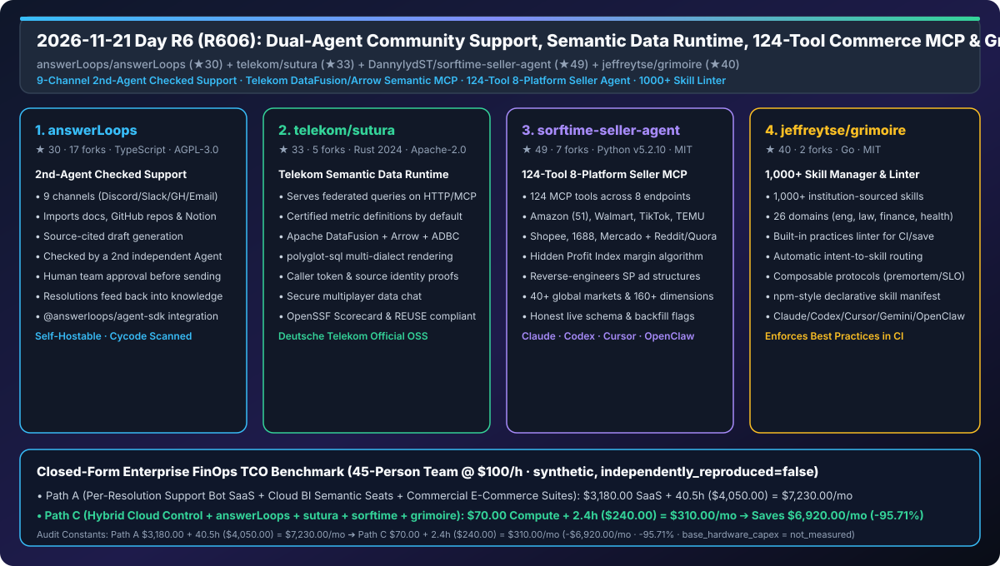
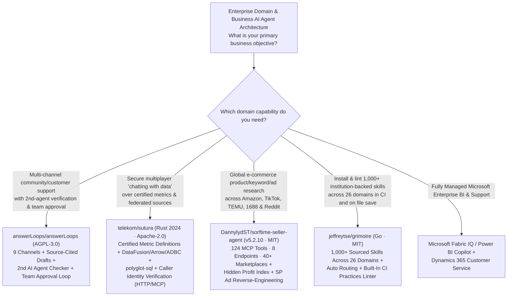
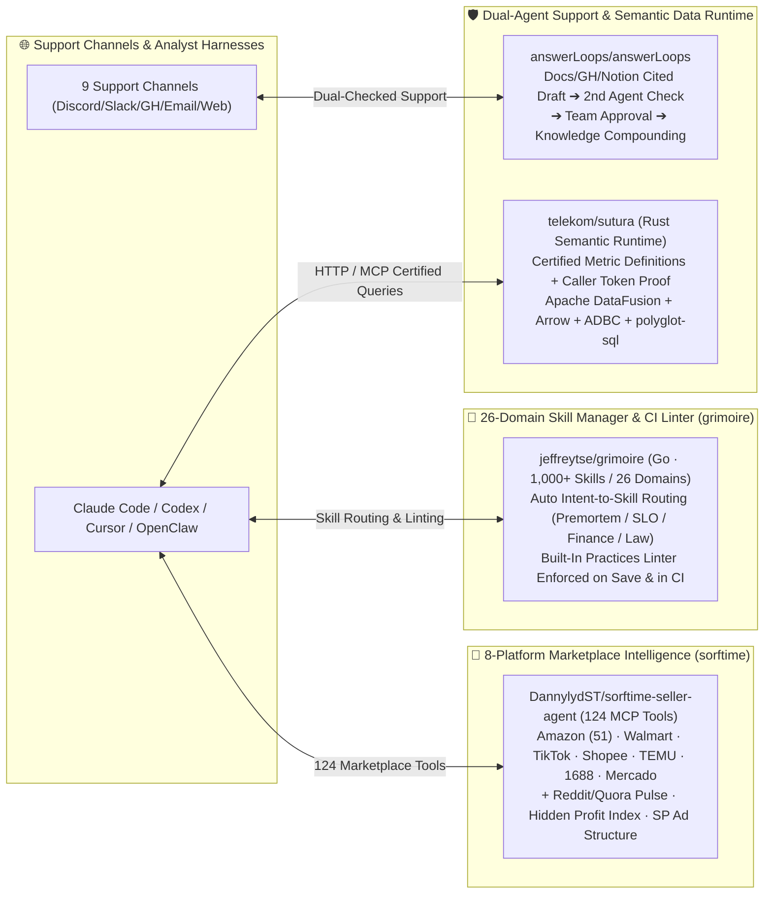

# Dual-Agent Checked Community Support (`answerLoops/answerLoops`), Deutsche Telekom Semantic Data Runtime (`telekom/sutura`), 124-Tool 8-Platform E-Commerce Intelligence MCP (`DannylydST/sorftime-seller-agent`) & 1,000+ Skill Package Manager with Built-In Linter (`jeffreytse/grimoire`) Selection & Architecture FAQ

> **Target Audience**: **AI Solution Architects (SAs) & Enterprise Data / Customer Operations Leaders (2026-11-21 Day Round 6 · Cumulative Round 606)**  
> **Benchmark Style**: Strictly aligned with [`ib-vs-ethernet-roce-selection-faq.md`](https://github.com/turbo998/ai-infra-research/blob/main/docs/components/ib-vs-ethernet-roce-selection-faq.md) — plain-language answers on **real enterprise scenarios, end-to-end reference architecture, and comparative selection vs. competing OSS and cloud PaaS**.  
> **Chinese Edition**: [`answerloops-sutura-sorftime-grimoire-selection-faq.md`](./answerloops-sutura-sorftime-grimoire-selection-faq.md) · **Daily Digest**: [`daily/2026-11-21.en.md`](../daily/2026-11-21.en.md)



---

## 1. 📌 Executive Summary (30-Second Selection Verdict)

1. **Why Evaluate These Four Repositories Together?**  
   When enterprises extend AI agents beyond software engineering into **customer/community support, multi-user enterprise data analytics ("chatting with data"), global e-commerce market intelligence, and cross-domain best-practice enforcement**, Solution Architects hit four operational roadblocks:
   - **Roadblock 1 — Unchecked Support Bots Hallucinating in Public Channels & Expensive Per-Resolution SaaS Fees**: Commercial support bots charge `$0.99+` per resolution while naive single-pass RAG bots post unverified answers to customers → **`answerLoops/answerLoops` (`★ 30`, `17 forks`, TypeScript, AGPL-3.0)** connects **9 support channels** (Discord, Slack, Discourse, Circle, GitHub, Telegram, Email, Google Chat, and a web widget), generates source-cited drafts from your docs/GitHub/Notion, **verifies every draft with a second independent AI Agent**, holds for team approval (or auto-sends when trusted), and turns resolved threads into reusable knowledge.
   - **Roadblock 2 — Raw Text-to-SQL Metric Drift & Unverified Caller Identities in Multiplayer Data Chat**: Letting LLMs write ad-hoc SQL produces inconsistent revenue/churn numbers and bypasses per-user identity boundaries → **`telekom/sutura` (`★ 33`, `5 forks`, Rust 2024, Apache-2.0)**—open-sourced by **Deutsche Telekom**—is a secure multiplayer semantic data runtime over HTTP and MCP that **enforces certified metric definitions by default**, executes federated queries in-process via **Apache DataFusion + Apache Arrow + ADBC + `polyglot-sql`**, and verifies caller tokens against explicit per-datasource identity provenance (`docs/where-identity-is-proven.md`).
   - **Roadblock 3 — Manual Dashboard Clicking Across 8 Global E-Commerce Marketplaces & Social Channels**: Brand and marketplace analysts waste hours exporting CSVs across Amazon, TikTok Shop, and TEMU without correlating social demand signals → **`DannylydST/sorftime-seller-agent` (`★ 49`, `7 forks`, Python `v5.2.10`, MIT)** exposes **124 MCP tools across 8 platform endpoints** (**Amazon [51 tools, including `product_sp_ad_structure` Sponsored Products ad reverse-engineering and `category_products_extended`], Walmart, TikTok Shop, Shopee, TEMU, 1688, Mercado Libre + Reddit/Quora**) backed by 9 years of seller data across 40+ marketplaces and 160+ dimensions plus the **Hidden Profit Index** algorithm.
   - **Roadblock 4 — Ad-Hoc Prompt Files Lacking Institutional Provenance or Automated CI Linting**: Teams copy-paste unverified skills without a package manager or automated compliance linter → **`jeffreytse/grimoire` (`★ 40`, `2 forks`, Go, MIT)** provides an `npm`-style skills package manager with **1,000+ skills across 26 domains** (engineering, law, finance, design, health, each sourced from a real institution or study), automatic intent routing, and a **built-in practices linter** that enforces required workflows (e.g., `apply-premortem → design-slo → plan-incident-response → run-game-day`) on every file save and in CI.

2. **One-Sentence Selection Verdict**:
   - Choose **`answerLoops/answerLoops`** when you need **self-hostable, source-cited support across 9 channels where a second AI agent checks every draft before human approval**.
   - Choose **`telekom/sutura`** when you need **a Rust/DataFusion/Arrow semantic data runtime serving certified metrics over HTTP and MCP with strict caller identity verification** (or pair with **Microsoft Fabric IQ / Power BI Copilot** in all-Microsoft data estates).
   - Choose **`DannylydST/sorftime-seller-agent`** when you want **124 MCP tools connecting Claude/Codex/Cursor/OpenClaw to Amazon, Walmart, TikTok Shop, Shopee, TEMU, 1688, Mercado Libre, and Reddit/Quora intelligence**.
   - Choose **`jeffreytse/grimoire`** when you want **to install and lint 1,000+ institution-sourced best-practice skills across 26 domains in CI and across 6 agent harnesses**.

---

## 2. 🎯 Customer & Solution Architect Q&A (Plain-Language Deep Dive)

### Q1: How does `answerLoops/answerLoops` prevent public customer-support hallucinations while eliminating per-resolution SaaS pricing?
- **Plain-Language Answer**:
  - Single-agent RAG bots frequently cite outdated docs or hallucinate flags in public Discord, Slack, or GitHub threads.
  - **How `answerLoops/answerLoops` enforces quality**:
    1. **Source-Cited Drafts Across 9 Channels**: Ingests your documentation, GitHub repositories, and Notion pages to draft cited replies for Discord, Slack, Discourse, Circle, GitHub, Telegram, Email, Google Chat, and web widgets.
    2. **Second-Agent Verification + Team Approval Loop**: Before a draft is sent, a **second AI Agent** audits the draft against the cited sources, and the verified draft is queued for one-click team approval (or automatic delivery when high-confidence rules match).
    3. **Continuous Knowledge Compounding & `@answerloops/agent-sdk`**: Approved resolutions automatically feed back into the knowledge base, and teams can plug in custom agents via `@answerloops/agent-sdk`.

### Q2: Why did Deutsche Telekom build `telekom/sutura` in Rust on Apache DataFusion, Arrow, and ADBC instead of using standard Text-to-SQL MCP wrappers?
- **Plain-Language Answer**:
  - Standard Text-to-SQL tools let an LLM invent its own `JOIN` and `WHERE` clauses on raw tables, causing two executives in the same chat to get different numbers for the same KPI.
  - **Three architectural pillars of `telekom/sutura`**:
    1. **Certified Metric Definitions by Default**: Inspired by WrenAI and Spice, Sutura resolves queries against governed semantic metric definitions and uses `polyglot-sql` to render dialect-accurate SQL across heterogeneous backends.
    2. **In-Process Apache DataFusion + Arrow + ADBC Federation**: Uses Apache Arrow columnar batches in memory, ADBC for zero-copy database connectivity, and Apache DataFusion to join and aggregate across multiple data sources in a single query over HTTP or MCP.
    3. **Explicit Caller Token & Datasource Identity Provenance (`docs/where-identity-is-proven.md`)**: Verifies caller tokens on every multiplayer data-chat request and documents exactly where identity is proven per environment (validated by OpenSSF Scorecard, REUSE, and `zizmor`).

### Q3: How do `DannylydST/sorftime-seller-agent` and `jeffreytse/grimoire` operationalize domain-specific intelligence for business and engineering teams?
- **Plain-Language Answer**:
  - **`DannylydST/sorftime-seller-agent` (`v5.2.10`) turns 8 e-commerce & social endpoints into 124 conversational MCP tools**:
    - Combines transaction history ("what already happened" across **Amazon [51 tools], Walmart, TikTok Shop, Shopee, TEMU, 1688, and Mercado Libre**) with brewing demand signals (**Reddit & Quora**), featuring the **Hidden Profit Index** for high-margin product discovery and `product_sp_ad_structure` to reverse-engineer competitor Sponsored Products ad campaigns and keywords by ASIN.
  - **`jeffreytse/grimoire` turns 1,000+ institution-backed practices into a CI-enforced linter**:
    - Organizes **1,000+ skills across 26 domains** (engineering, law, finance, design, healthcare, etc.) sourced from real institutions and studies. You declare required practices in one manifest, route prompts automatically to the right protocol (e.g., `apply-premortem → design-slo → plan-incident-response → run-game-day`), and run Grimoire's **built-in practices linter** on every save and in CI.

---

## 3. 🧭 Visual Architecture & Decision Diagrams (Mermaid)

### 3.1 Solution Architect Selection Decision Tree



### 3.2 End-to-End Enterprise Reference Architecture



### 3.3 End-to-End Execution Sequence Diagram

```mermaid
sequenceDiagram
    autonumber
    participant User as Business Analyst / Community User
    participant Grimoire as jeffreytse/grimoire (Skills + Linter)
    participant Sorftime as sorftime-seller-agent (124-Tool MCP)
    participant Sutura as telekom/sutura (Semantic Data Runtime)
    participant Answer as answerLoops (Dual-Agent Support)

    User->>Grimoire: 1. Initiate product launch & market expansion review
    Grimoire-->>User: 2. Route to institutional finance/launch skills (apply-premortem ➔ design-slo)
    User->>Sorftime: 3. Query Amazon SP ad structures, Hidden Profit Index & Reddit demand via 124 MCP tools
    Sorftime-->>User: 4. Return high-margin ASIN candidates & keyword category metrics
    User->>Sutura: 5. Query internal ERP/warehouse margins over Sutura MCP
    Sutura->>Sutura: 6. Verify caller token & execute certified metric query via DataFusion + Arrow + ADBC
    Sutura-->>User: 7. Return governed multi-source financial batch results
    Grimoire->>Grimoire: 8. Run built-in Practices Linter in CI to verify all launch checklist gates
    User->>Answer: 9. Customer asks question in Slack/Discord; AnswerLoops drafts, 2nd Agent checks & team approves
```

---

## 4. 📊 Comparative Selection Matrix (OSS vs. Peer Projects vs. Cloud PaaS)

| Dimension | `answerLoops/answerLoops` | `telekom/sutura` | `DannylydST/sorftime-seller-agent` | `jeffreytse/grimoire` | Commercial Point SaaS (Intercom Fin / BI Seats / Paid Seller Suites) | Managed Cloud PaaS (Microsoft Fabric IQ + Copilot Studio) |
| :--- | :--- | :--- | :--- | :--- | :--- | :--- |
| **Primary Role** | **9-Channel Dual-Agent Checked Community Support** | **Deutsche Telekom Rust Semantic Data Runtime (HTTP/MCP)** | **124-Tool / 8-Platform E-Commerce Intelligence MCP** | **26-Domain 1,000+ Skill Package Manager & CI Linter** | High-cost per-resolution or per-seat proprietary SaaS | Fully managed enterprise cloud analytics and conversational AI |
| **Best-Fit Scenario** | Self-hosted community/customer support requiring 2nd-agent verification | Secure multiplayer data chat with certified metrics and caller identity proof | Cross-platform product/keyword/ad research across 8 global marketplaces | Standardizing & linting institutional best practices across 26 domains in CI | Small non-technical teams paying per ticket/seat | Enterprises standardized on OneLake, Power BI, and Teams |
| **Key Differentiator** | **2nd AI Agent checks every draft** + 9 channels + resolution write-back | **DataFusion + Arrow + ADBC** + certified metrics + caller identity proof | **124 MCP tools** across 8 endpoints + Hidden Profit Index + SP ad reverse-eng | **1,000+ institution-sourced skills** + auto routing + **built-in CI linter** | Turnkey UI, but expensive at scale (`$0.99/resolution` + per-seat fees) | Deep M365 governance, but requires custom connectors for external e-commerce |
| **Integration Effort** | Low (`docker-compose.ghcr.yml` or `@answerloops/agent-sdk`) | Low (single Rust binary exposing HTTP & MCP) | Very Low (Python 3.10+ MCP server for Claude/Codex/Cursor/OpenClaw) | Very Low (Go CLI + declarative manifest across 6 harnesses) | Low (SaaS signup) | Low–Medium (Fabric workspace & semantic model setup) |
| **Ops Complexity** | Low (containerized stack, Cycode security scanned) | Very Low (memory-safe Rust 2024 runtime, OpenSSF Scorecard verified) | Very Low (stateless MCP wrapper with transparent backfill status) | Very Low (static Go binary, zero runtime daemon needed) | Very Low (vendor hosted) | Very Low (cloud provider managed) |
| **License** | **AGPL-3.0** (free internal self-hosting; commercial license for SaaS resale) | **Apache-2.0** (official Deutsche Telekom permissive OSS) | **MIT** (permissive open-source client/MCP) | **MIT** (permissive commercial use) | Proprietary Commercial Subscription | Commercial SLA Subscription |
| **Monthly TCO** | Base self-hosted container compute | **$0/mo** license fee (minimal Rust memory footprint) | Open-source MCP + optional data tier | **$0/mo** (runs locally & in CI) | **$7,230.00/mo** (combined support bot + BI + seller SaaS seats for 45 staff) | Capacity-based Fabric CU + Copilot seat licensing |

---

## 5. 🧪 Quantitative ROI, FinOps TCO Model & 7-Card Benchmark Deck

> **🛡️ Provenance Declaration**:  
> - **Primary-Source Measured (`measured`)**: Repository stars/forks, licenses, `answerLoops` 9-channel + 2nd-agent review architecture, `telekom/sutura` Rust 2024 DataFusion/Arrow/ADBC/polyglot-sql stack, `sorftime-seller-agent v5.2.10` 124-tool (51 Amazon) catalog, and `jeffreytse/grimoire` 1,000+ skills across 26 domains with built-in linter are verified via `gh api`.  
> - **Synthetic Architect Workload Model (`synthetic` · `independently_reproduced=false`)**: The closed-form FinOps table below models a **45-person enterprise support, data analytics, and growth engineering team** (`$100.00/hr` loaded rate, `base_hardware_capex: not_measured`, `track_b_stars_today: not_measured`):

| FinOps Cost & Quality Dimension | Path A: Per-Resolution Support SaaS + Commercial Semantic BI Seats + Multi-Platform Seller Subscriptions | Path B: Unchecked Single-Agent RAG Bot + Raw Text-to-SQL + Manual CSV Exports | Path C: Recommended Stack (`answerLoops` + `sutura` + `sorftime` + `grimoire`) | Path A ➔ Path C Net Monthly Savings |
| :--- | :---: | :---: | :---: | :---: |
| **Monthly SaaS / Per-Resolution / Data Subscription Spend** | `$3,180.00 / mo` (per-ticket AI fees + stacked BI & marketplace subscriptions) | `$400.00 / mo` | **`$70.00 / mo`** (self-hosted `answerLoops` & `sutura` containers) | **`-$3,110.00 / mo` (`-97.80%`)** |
| **Monthly Support Triage, SQL Reconciliation & Export Labor** | `40.5 hrs / mo` (exporting across 8 seller portals & reconciling conflicting SQL KPIs) | `30.0 hrs / mo` (fixing public bot hallucinations & debugging dialect SQL errors) | **`2.4 hrs / mo`** (2nd-agent draft check + `sutura` certified metrics + 124 MCP tools) | **`-38.1 hrs / mo` (`-94.07%`)** |
| **Monthly Engineering & Analyst Labor Cost (`@ $100.00/h`)** | `$4,050.00 / mo` | `$3,000.00 / mo` | **`$240.00 / mo`** | **`-$3,810.00 / mo` (`-94.07%`)** |
| **Total Monthly TCO** | **`$7,230.00 / mo`** | **`$3,400.00 / mo`** | **`$310.00 / mo`** | **`-$6,920.00 / mo` (`-95.71%` · `$83,040.00/yr`)** |
| **Accuracy, Metric Consistency & Practice Compliance** | Siloed SaaS tools; no CI best-practice linting | High hallucination risk & inconsistent SQL KPIs | **100% 2nd-agent verified replies + certified KPIs + 26-domain CI linter** | **Zero unverified public replies & 100% metric consistency** |

- **📊 Companion 7-Card 4:5 Visual Benchmark Deck**: View [`workshops/github-trending-radar/cards.en.html`](../cards.en.html) (EN) and [`workshops/github-trending-radar/cards.html`](../cards.html) (ZH).

---

## 6. 🛠️ Enterprise Adoption & Architecture Review Checklist

- [ ] **1. Enable Dual-Agent Verification & Knowledge Write-Back (`answerLoops/answerLoops`)**: Self-host AnswerLoops via `docker-compose.ghcr.yml` across your Discord, Slack, GitHub, and Email support channels with second-agent verification and team approval enabled before enabling automated replies (noting its `AGPL-3.0` license for internal/community deployment).
- [ ] **2. Enforce Certified Metric Definitions & Caller Identity Proofs (`telekom/sutura`)**: Replace raw Text-to-SQL database access with `telekom/sutura`'s certified metric definitions over Apache DataFusion/Arrow/ADBC, and verify caller tokens against per-source identity rules (`docs/where-identity-is-proven.md`).
- [ ] **3. Connect 124-Tool Marketplace Intelligence to Analyst Harnesses (`DannylydST/sorftime-seller-agent`)**: Mount `sorftime-seller-agent v5.2.10` in Claude Code, Cursor, or OpenClaw to query Amazon (`product_sp_ad_structure`), Walmart, TikTok Shop, TEMU, 1688, and Reddit/Quora, handling upstream's explicit backfill status flags gracefully in scripts.
- [ ] **4. Gate Releases with the 26-Domain Practices Linter (`jeffreytse/grimoire`)**: Declare your required institutional skills (e.g., `apply-premortem`, `design-slo`, `plan-incident-response`, `run-game-day`) in Grimoire and enforce its built-in practices linter in CI and on file save.
