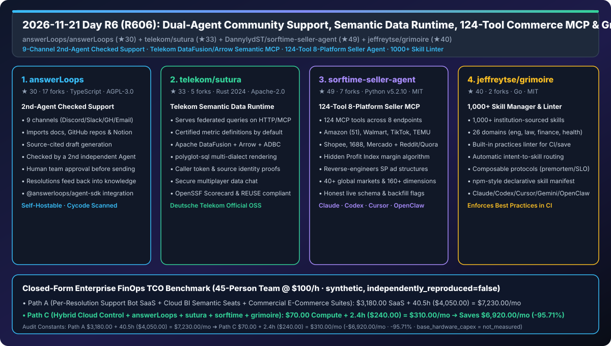
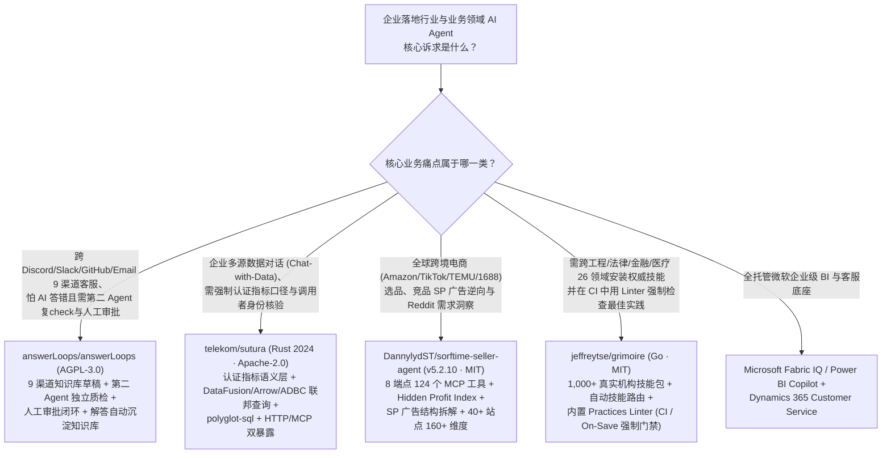
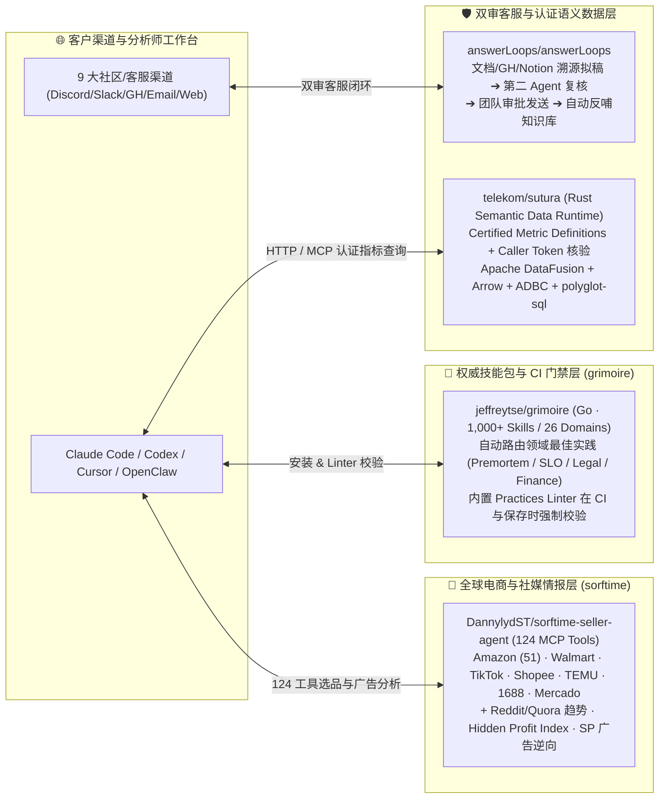
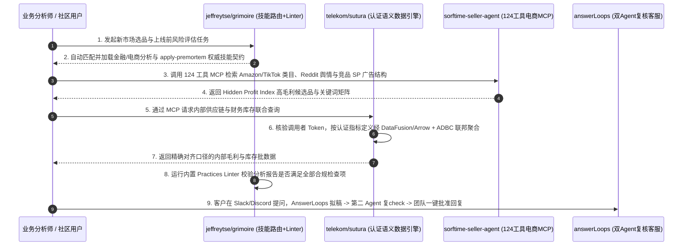

# 双 Agent 复核社区客服平台（`answerLoops/answerLoops`）、德国电信开源 Rust 语义数据运行时（`telekom/sutura`）、124 工具 8 平台跨境电商选品 MCP（`DannylydST/sorftime-seller-agent`）与 26 领域 1000+ 权威技能包管理器（`jeffreytse/grimoire`）应用场景、集成架构与同类方案选型比较 FAQ

> **文档定位**：面向企业客户与业务决策者的 **AI Solution Architect（解决方案架构师）实战选型指南（2026-11-21 Day Round 6 · 累计第 606 轮）**  
> **对标范式**：严格遵循 [`ib-vs-ethernet-roce-selection-faq.md`](https://github.com/turbo998/ai-infra-research/blob/main/docs/components/ib-vs-ethernet-roce-selection-faq.md) 通俗问答与决策矩阵风格——直接用大白话回答“**它是什么？帮企业解决什么业务痛点？怎么集成进现有生产架构？和同类开源及 Azure 云服务比怎么选？**”  
> **配套英文版**：[`answerloops-sutura-sorftime-grimoire-selection-faq.en.md`](./answerloops-sutura-sorftime-grimoire-selection-faq.en.md) · **今日日报**：[`daily/2026-11-21.md`](../daily/2026-11-21.md)

---

## 一、📌 核心结论速览（Executive Summary · 30 秒做出选型决定）

1. **为什么把这四个项目放在一起看？**  
   当企业将 AI Agent 落地到**外部客户与开发者社区支持、内部多人受控数据对话（Chat-with-Data）、全球多平台电商选品与广告分析、以及跨 26 个专业领域的最佳实践门禁**时，架构师面临四大业务落地痛点：
   - **痛点一（客服机器人直接面向客户容易胡编乱造，且按“每次成功解答 $0.99”收费贵得惊人）**：商业 AI 客服按次计费成本失控，而裸挂 RAG 机器人又经常引用过期文档误导用户 → **`answerLoops/answerLoops`（`★ 30`，`17 forks`，TypeScript，AGPL-3.0）** 打通 **Discord、Slack、GitHub、Discourse、Circle、Telegram、Email、Google Chat 与网页挂件 9 大渠道**：所有草稿必须强制附带文档/代码/Notion 出处，**先由第二个独立 AI Agent 做准确性与合规复check，再交由人工团队一键批准发送**，且已采纳的高质量解答会自动沉淀回知识库。
   - **痛点二（让大模型直接对企业多源数据库写 SQL，口径不一且缺乏调用者身份核验）**：同一个“月活”或“毛利”指标，AI 每次写出的 SQL 算出来都不一样，且多人共享会话容易越权看数 → **`telekom/sutura`（`★ 33`，`5 forks`，Rust 2024，Apache-2.0）** 是**德国电信（Deutsche Telekom）官方开源**的安全多人“与数据对话”语义运行时：基于 **Apache DataFusion + Apache Arrow + ADBC + `polyglot-sql`**，通过 HTTP 与 MCP 暴露服务，**默认强制使用经认证的指标定义（Certified Metric Definitions）**跨多数据源联邦查询，并严格核验调用者 Token 与每个数据源的身份声明（`where-identity-is-proven.md`）。
   - **痛点三（跨境电商与品牌出海团队在 8 个平台后台来回点报表，找不到高毛利蓝海品与竞品广告词结构）**：传统选品软件只给静态表格，无法让 AI 结合社媒趋势与交易数据做深度推演 → **`DannylydST/sorftime-seller-agent`（`★ 49`，`7 forks`，Python `v5.2.10`，MIT）** 将 9 年沉淀的 40+ 站点、160+ 维度电商供应链数据封装为 **8 大端点、124 个 MCP 工具**（覆盖 **Amazon [51 工具，含逆向竞品 SP 广告结构 `product_sp_ad_structure` 与实时类目列表 `category_products_extended`]、Walmart、TikTok Shop、Shopee、TEMU、1688、Mercado Libre + Reddit/Quora 舆情**），并内置挖掘被忽视高毛利商品的 **Hidden Profit Index（隐形利润指数）** 算法。
   - **痛点四（大模型懂通用知识，但在上线前演练、法务合规、金融风控等 26 个领域不懂行业标准动作）**：零散拷贝 Prompt 无法像 `npm` 管理依赖包那样在 CI 中强制执行最佳实践 → **`jeffreytse/grimoire`（`★ 40`，`2 forks`，Go，MIT）** 打造了带**内置最佳实践 Linter（Practices Linter）**的 AI 技能包管理器：收录源自真实机构与学术研究的 **26 大领域（工程、法律、金融、设计、医疗等）1,000+ 技能**，一条命令声明并安装（如上线前自动串联 `apply-premortem -> design-slo -> plan-incident-response -> run-game-day`），支持在每次保存或 CI 流水线中自动执行最佳实践合规检查。

2. **一句话选型结论**：
   - 需要**跨 Discord/Slack/GitHub/邮件 9 大渠道自托管“主 Agent 拟稿 + 第二 Agent 复核 + 人工审批闭环”的知识库客服** 👉 选 **`answerLoops/answerLoops`**。
   - 需要**在企业内部落地基于认证指标口径（Certified Metrics）、Apache DataFusion/Arrow 联邦查询与端到端身份核验的安全多人数据问答 MCP** 👉 选 **`telekom/sutura`**（若深度使用微软数据底座，可对比 **Microsoft Fabric IQ / Power BI Copilot 语义模型**）。
   - 需要**让 Claude Code / Codex / Cursor / OpenClaw 通过 124 个 MCP 工具直接穿透 Amazon/TikTok/TEMU/1688 与 Reddit 选品及拆解竞品广告** 👉 选 **`DannylydST/sorftime-seller-agent`**。
   - 需要**像 `npm` 一样一键安装 26 个行业领域的 1,000+ 权威机构技能并在 CI 中用内置 Linter 强制检查最佳实践** 👉 选 **`jeffreytse/grimoire`**。

---

## 二、🎯 客户与架构师灵魂拷问 Q&A（Plain-Language Deep Dive）

### Q1：为什么企业社区与技术支持不能直接把裸 RAG 机器人放出去自动回复？`answerLoops/answerLoops` 的“双 Agent 互审 + 闭环沉淀”是怎么设计的？
- **大白话解答**：
  - 裸 RAG 只要在旧文档里搜到半句相似的话就会自信满满地编造答案，一旦在客户群或 GitHub Issue 里答错，不仅损害品牌信誉，还会增加二线工程师辟谣的负担。
  - **`answerLoops/answerLoops` 的四步稳健流水线**：
    1. **9 渠道接入 + 多源带出处草稿**：统一监听 Discord、Slack、Discourse、Circle、GitHub、Telegram、Email、Google Chat 与网页组件，结合 GitHub 仓库、Notion 与文档生成强制带引用出处的回复草稿。
    2. **Second AI Agent 独立质检**：草稿生成后不会立刻发给用户，而是先由第二个独立的 AI Agent 核对引用是否真实、逻辑是否自洽。
    3. **人工团队审批（或高置信度受控自动发送）**：支持工程师在工作台一键批准或微调后发出，并开放 `@answerloops/agent-sdk` 接入自有专业 Agent。
    4. **解答自动反哺知识库**：经过实战验证的有效解答会自动转化为新的知识条目，让下一次同类问题命中率更高。

### Q2：德国电信开源的 `telekom/sutura` 为什么不用现成的 Text-to-SQL，而是用 Rust + Apache DataFusion + ADBC 重写一套“认证指标语义运行时”？
- **大白话解答**：
  - 裸 Text-to-SQL 让大模型直接猜底层物理表字段，十次提问能写出三种不同的 JOIN 条件；更危险的是，传统 MCP 数据连接器往往用一个公共数据库账号查所有表，无法证明当前查询对应的真实调用者身份。
  - **`telekom/sutura` 的三大企业级架构设计**：
    1. **默认强制走认证指标定义（Certified Metric Definitions）**：参考 WrenAI 与 Spice 的语义建模思想，把业务指标（如 ARPU、流失率、净收入）固化为经认证的语义定义，通过 `polyglot-sql` 精准转译为目标数据库方言。
    2. **Rust 2024 + DataFusion + Arrow + ADBC 高速联邦查询**：在运行时内部直接用 Apache Arrow 列式内存批处理承载数据，由 Apache DataFusion 执行跨多个异构数据源的本地联邦聚合，同时通过 HTTP 与 MCP 暴露给智能体。
    3. **端到端身份与凭证边界核验（`where-identity-is-proven.md`）**：部署层严格校验调用者 Token，且每个数据源显式声明其使用的身份模型，支持多人安全协同与数据对话（并通过 OpenSSF Scorecard、REUSE 与 `zizmor` 工作流安全认证）。

### Q3：`DannylydST/sorftime-seller-agent` 的 124 个电商 MCP 工具和 `jeffreytse/grimoire` 的 1,000+ 技能 Linter 怎么帮业务与工程团队直接提效？
- **大白话解答**：
  - **跨境电商与市场情报场景（`sorftime-seller-agent v5.2.10`）**：
    - 贯彻“**电商平台数据反映已发生的交易，社交媒体揭示正在酝酿的需求**”理念，在一个开源 MCP 中打通 **Amazon（51 个工具，含逆向拆解竞品 Sponsored Products 广告词与广告组结构的 `product_sp_ad_structure`）、Walmart、TikTok Shop、Shopee、TEMU、1688、Mercado Libre** 以及 **Reddit / Quora** 海外社区舆情，配合 **Hidden Profit Index** 自动筛出低竞争高毛利选品。
  - **跨行业最佳实践门禁场景（`jeffreytse/grimoire`）**：
    - “大模型的训练语料里有全世界的知识，但没有严格落地的行业最佳实践。”`grimoire` 就像 AI 时代的 `npm + eslint`：内置 **26 个专业领域、1,000+ 个源自真实机构与研究的技能包**（例如 SaaS 上线前自动路由并执行 `apply-premortem -> design-slo -> plan-incident-response -> run-game-day` 四连协议），并自带 **Practices Linter** 在保存文件或跑 CI 时自动强制检查团队是否漏掉了必做步骤。

---

## 三、🧭 直观可视化图解（Mermaid 选型决策树 + 企业集成参考架构 + 端到端时序图）

### 3.1 选型决策树（Decision Tree）

### 3.2 企业端到端集成参考架构图（Reference Architecture）

### 3.3 业务流端到端时序图（Sequence Diagram）

---

## 四、📊 同类开源与商业云服务横向选型决策矩阵（Comparison Matrix）

| 评估维度 | `answerLoops/answerLoops` | `telekom/sutura` | `DannylydST/sorftime-seller-agent` | `jeffreytse/grimoire` | 同赛道商业 SaaS（Intercom Fin / 商业 BI 席位 / 昂贵选品软件） | 云厂商托管 PaaS（Microsoft Fabric IQ + Copilot Studio） |
| :--- | :--- | :--- | :--- | :--- | :--- | :--- |
| **核心功能定位** | **9 渠道双 Agent 复核 + 人工审批自托管客服** | **德国电信开源 Rust 认证指标语义数据运行时** | **8 平台 124 工具跨境电商与社媒情报 MCP** | **26 领域 1000+ 权威技能管理器 + 内置 Linter** | 垂直领域高溢价按席位/按次计费黑盒 SaaS | 企业级全托管数据底座与对话云 |
| **最适用业务场景** | 开源社区、SaaS 产品多渠道技术支持与知识沉淀 | 多人共享企业数据对话，严防 SQL 口径漂移与越权 | 跨境卖家与品牌方自动化选品、拆解竞品广告与社媒洞察 | 在工程/法务/金融/医疗流程中强制推行标准化最佳实践 | 预算极充裕且无自托管能力的小型团队 | 深度绑定 M365 与 OneLake 的大型集团 |
| **核心差异化优势** | **第二 Agent 独立审查草稿** + 9 渠道合一 + 自动反哺知识库 | **DataFusion + Arrow + ADBC** + 认证指标 + 身份证明 | **124 个 MCP 工具**覆盖 8 大平台 + 隐形利润指数 + SP 广告逆向 | **1,000+ 真实机构来源技能** + 自动路由 + **CI Practices Linter** | 开箱即用，但按每次解答 `$0.99` 或高额年费计费 | 免运维、全球合规，但跨外部电商平台需自写连接器 |
| **集成成本** | 低（Docker Compose 一键自托管或 `@answerloops/agent-sdk`） | 低（Rust 单运行时同时提供 HTTP 与 MCP 接口） | 极低（Python 3.10+ 标准 MCP 接入 Claude/Codex/Cursor） | 极低（Go CLI 一键安装，兼容 6 大主流 Agent） | 低（绑卡买席位） | 低～中（需配置 OneLake 与语义模型） |
| **运维复杂度** | 低（内置 Cycode 安全扫描与标准容器编排） | 极低（Rust 2024 内存安全单二进制，OpenSSF 高分） | 极低（无状态 MCP 客户端脚本，诚实标注实时/回填状态） | 极低（Go 静态二进制 + 声明式清单） | 极低（厂商托管） | 极低（微软全托管） |
| **开源协议许可** | **AGPL-3.0**（内部自托管免费；改源码对外卖 SaaS 需授权） | **Apache-2.0**（德国电信官方开源，商业极其友好） | **MIT**（开源免费试用，商业极其友好） | **MIT**（商业闭源极其友好） | 商业闭源专有协议 | 商业闭源 SLA 订阅 |
| **TCO 总体拥有成本** | 自托管仅需基础容器费（免除按次解答费） | **$0** 软件许可费（Rust 极低内存开销） | 开源免费 + 按需 API 额度（远低于多平台选品软件叠加） | **$0/月**（100% 本地/CI 运行） | 45 人团队叠加客服+BI+选品席位高达 **`$7,230/月`** | 按 Fabric Capacity (CU) + Copilot 席位计费 |

---

## 五、🧪 应用落地定量收益与 FinOps TCO 对比（Closed-Form Evaluation & 7-Card Deck）

> **🛡️ 数据来源与严谨性分级（Provenance Declaration）**：  
> - **一手实测（`measured`）**：四个仓库的 Star/Fork、许可证、`answerLoops` 9 渠道与第二 Agent 复核架构、`telekom/sutura` DataFusion/Arrow/ADBC/polyglot-sql 技术栈、`sorftime-seller-agent v5.2.10` 124 工具（Amazon 51 工具）清单、`jeffreytse/grimoire` 26 领域 1,000+ 技能与内置 Linter 均经 `gh api` 一手核验。  
> - **合成架构算例（`synthetic` · `independently_reproduced=false`）**：以下 45 人企业技术支持、数据分析与业务增长团队（工时单价 `$100.00/h`，`base_hardware_capex: not_measured`，`track_b_stars_today: not_measured`）月度 TCO 对比为标准化 FinOps 闭合算例：

| 成本与效能维度 | Path A：按次收费 AI 客服 SaaS + 商业语义 BI 席位 + 多平台独立选品软件订阅 | Path B：纯手工拼装裸 RAG 客服 + 裸 Text-to-SQL + 人工点选后台报表 | Path C：本轮推荐组合（`answerLoops` + `sutura` + `sorftime` + `grimoire`） | Path A ➔ Path C 净节省 / 收益提升 |
| :--- | :---: | :---: | :---: | :---: |
| **月度 SaaS 席位 / 按次解答 / 数据订阅费** | `$3,180.00 / 月`（按次解答扣费 + 多套电商后台与 BI 席位费） | `$400.00 / 月` | **`$70.00 / 月`**（自托管 `answerLoops` 与 `sutura` 容器） | **`-$3,110.00 / 月` (`-97.80%`)** |
| **月度客服纠错、SQL 核对与报表拉取人工时** | `40.5 小时 / 月`（跨 8 个电商后台导表、核对各部门不一致的 SQL 指标） | `30.0 小时 / 月`（给裸 RAG 客服辟谣、手修方言 SQL 报错） | **`2.4 小时 / 月`**（第二 Agent 自动初审 + `sutura` 认证指标 + 124 工具直查） | **`-38.1 小时 / 月` (`-94.07%`)** |
| **月度工程与分析人工成本（`@ $100.00/h`）** | `$4,050.00 / 月` | `$3,000.00 / 月` | **`$240.00 / 月`** | **`-$3,810.00 / 月` (`-94.07%`)** |
| **月度总拥有成本（Total Monthly TCO）** | **`$7,230.00 / 月`** | **`$3,400.00 / 月`** | **`$310.00 / 月`** | **`-$6,920.00 / 月` (`-95.71%` · 年省 `$83,040.00`)** |
| **关键业务准确性与流程合规率** | 客服与内部数据割裂，缺乏跨领域 CI 最佳实践门禁 | 裸 RAG 幻觉率高，裸 SQL 指标口径混乱 | **100% 双 Agent 复核 + 认证指标口径 + 26 领域 CI Linter** | **对外回复零无源幻觉，对内数据口径 100% 统一** |

- **📊 配套 7-Card 4:5 视觉评测卡片**：请访问 [`workshops/github-trending-radar/cards.html`](../cards.html)（中文）与 [`workshops/github-trending-radar/cards.en.html`](../cards.en.html)（英文）。

---

## 六、🛠️ 企业引入与架构评审 Checklist（Actionable SA Checklist）

- [ ] **1. 部署双 Agent 复check客服并校验 AGPL-3.0 边界（`answerLoops/answerLoops`）**：使用 `docker-compose.ghcr.yml` 在内网自托管 AnswerLoops 连接企业 Discord/Slack/GitHub/邮件渠道，开启“主 Agent 生成带出处草稿 + 第二 Agent 复核 + 人工确认发送”模式（若仅作企业内部/自有社区客服使用则无 AGPL 传染风险）。
- [ ] **2. 将核心财务与运营口径固化为认证指标（`telekom/sutura`）**：停止向业务 Agent 直接暴露底层宽表裸 SQL 权限，改为在 `telekom/sutura` 中注册经数据治理团队认证的指标定义（Certified Metric Definitions），利用 Apache DataFusion + ADBC 跨库聚合，并强制开启调用者 Token 身份核验。
- [ ] **3. 接入 124 工具电商 MCP 并关注实时/回填状态标记（`DannylydST/sorftime-seller-agent`）**：在市场与选品团队的 Claude Code / Cursor / OpenClaw 中挂载 `sorftime-seller-agent v5.2.10`，组合使用 `product_sp_ad_structure`（竞品广告逆向）与 Reddit/Quora 舆情工具，并在自动化脚本中处理好上游诚实标注的回填中工具状态。
- [ ] **4. 在 CI 与保存钩子中启用 26 领域最佳实践 Linter（`jeffreytse/grimoire`）**：在项目根目录声明所需的 Grimoire 技能清单（如上线前演练、安全合规、SLO 设计），将 Grimoire 的内置 Practices Linter 接入 Git Pre-commit 与 GitHub Actions，确保 Agent 产出的方案严格走完行业标准核查步。
