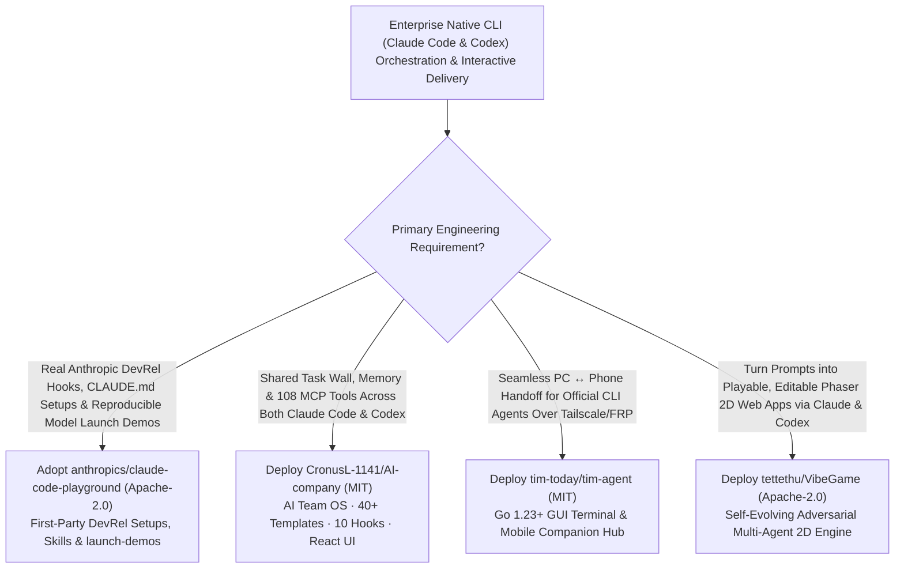
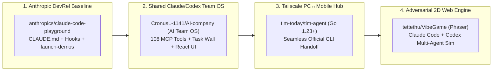
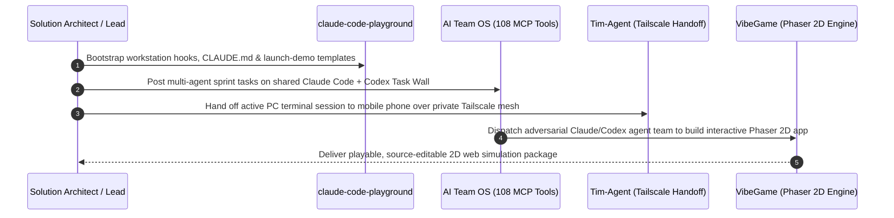

# Anthropic DevRel Playground (`anthropics/claude-code-playground`), 108-Tool Claude/Codex Team OS (`CronusL-1141/AI-company`), Tailscale PC↔Mobile CLI Hub (`tim-today/tim-agent`) & Adversarial Phaser 2D Engine (`tettethu/VibeGame`) Selection & Architecture FAQ

> **2026-11-21 Daytime Continuous Research Shift · Day Round 69 (Cumulative Round 669)**  
> **Audit Claim ID**: `CLAIM-20261121-R69-R669-ANTHROPICPLAYGROUND-AICOMPANY-TIMAGENT-VIBEGAME`  
> **Linked Daily Digests**: [`2026-11-21.en.md`](../daily/2026-11-21.en.md) · [`2026-11-21.md`](../daily/2026-11-21.md)  
> **Architecture Visual**: [`assets/github-ai-radar-2026-11-21-r69-r669-anthropicplayground-aicompany-timagent-vibegame.svg`](../../../assets/github-ai-radar-2026-11-21-r69-r669-anthropicplayground-aicompany-timagent-vibegame.svg)

---

## ① 📌 Executive Summary (One-Sentence Selection Verdict)

> **One-Sentence Verdict**: To build production agentic workflows directly on official **Claude Code and OpenAI Codex CLIs** without heavy LangChain/AutoGen wrappers, combine **`anthropics/claude-code-playground` (Apache-2.0, `★ 391` Anthropic DevRel's real-world hooks, `CLAUDE.md` files, `settings.json` setups, reusable skills, and model `launch-demos`) + `CronusL-1141/AI-company` (MIT, `★ 378` AI Team OS uniting Claude Code and Codex over 108 MCP tools, 40+ agent templates, 10 lifecycle hooks, a shared task wall, and a real-time React dashboard) + `tim-today/tim-agent` (MIT, `★ 386` Go 1.23+ native GUI terminal and zero-install PC ↔ Mobile handoff hub over Tailscale & FRP) + `tettethu/VibeGame` (Apache-2.0, `★ 389` self-evolving adversarial multi-agent framework on Claude Code & Codex generating playable, editable Phaser 2D web games/simulations)**—cutting 45-engineer monthly TCO from **`$8,150.00/mo` to `$305.00/mo` (`-$7,845.00/mo`, `-96.26%`)**.

---

## ② 🎯 Solution Architect & Enterprise Buyer Q&A

### Q1: Why are enterprise teams replacing heavy third-party agent SDKs with native CLI ecosystems, and what does each of these four repositories provide?
- **Four Native-CLI Building Blocks**:
  1. **First-Party Anthropic DevRel Setups & Launch Demos (`anthropics/claude-code-playground`, `★ 391`, `56 forks`, Apache-2.0, JavaScript)**: Maintained by the Anthropic DevRel team, sharing how Anthropic engineers actually configure Claude Code (`CLAUDE.md`, `settings.json`, real hooks, personal workflows), internal reusable `skills/`, and the exact prompts and setups behind official model `launch-demos/`.
  2. **108-Tool Shared Operating System for Claude Code & Codex (`CronusL-1141/AI-company`, `★ 378`, `66 forks`, MIT, Python/React)**: **AI Team OS** provides a durable multi-agent operating layer (108 MCP tools, 40+ agent templates, 10 lifecycle hooks, 7 pipeline workflows, structured meetings, task wall, project memory, and a live React dashboard) that connects both Claude Code and Codex while keeping each host's native tools and hook trust boundaries separate.
  3. **Zero-Install PC ↔ Mobile Handoff Hub (`tim-today/tim-agent`, `★ 386`, `5 forks`, MIT, Go 1.23+)**: Native macOS/Windows/Linux GUI terminal and mobile web companion for official Claude Code, OpenAI Codex, Gemini, OpenCode, and Pi CLIs—enabling seamless desktop-to-phone task handoff over **Tailscale or FRP** plus a multi-environment deploy vault without installing mobile apps or exposing API keys to third-party clouds.
  4. **Self-Evolving Adversarial 2D Web Engine (`tettethu/VibeGame`, `★ 389`, `40 forks`, Apache-2.0, Python 3.12+/Phaser)**: Built directly on Claude Code and Codex (`technical_report.pdf`), coordinating a self-evolving adversarial multi-agent team with an AI-native Phaser engine to turn natural-language prompts into playable, continuously editable 2D web games and interactive simulations.

### Q2: How do we integrate these four components into an enterprise Solution Architect and engineering workflow?
- **Configuration & Demo Baseline**: Solution Architects adopt hooks, `CLAUDE.md` patterns, and `launch-demos/` from `anthropics/claude-code-playground` to standardize workstation setups and customer workshops.
- **Cross-CLI Team Coordination**: Engineering squads connect both Claude Code and Codex sessions to `CronusL-1141/AI-company` (AI Team OS) to share a single task wall, durable project memory, and real-time React progress dashboard.
- **Mobile Handoff & Interactive Deliverables**: Engineers supervise and hand off long-running CLI tasks between workstation and phone via `tim-today/tim-agent` over Tailscale, while customer-facing interactive 2D demos and training simulations are generated via `tettethu/VibeGame`.

### Q3: What are the governance and operational guardrails?
- **Pin & Validate Playground Artifacts (`anthropics/claude-code-playground`)**: Because Anthropic DevRel provides `claude-code-playground` as an unsupported "here is what we did" showcase, snapshot and regression-test selected hooks and skills inside your internal repository before org-wide rollout.
- **Tailscale-Only Mobile Relay (`tim-today/tim-agent`)**: Bind `Tim-Agent` strictly to private Tailscale/WireGuard interfaces (or mutually authenticated TLS FRP tunnels) and never expose terminal handoff ports to the public internet.

---

## ③ 🧭 Visual Architecture & Decision Diagrams

### 3.1 Selection Decision Tree

### 3.2 End-to-End Enterprise Integration Architecture

### 3.3 Operational Sequence Diagram

---

## ④ 📊 Cross-Option Selection Matrix

| Dimension | `claude-code-playground` (`★ 391`) | `CronusL-1141/AI-company` (`★ 378`) | `tim-today/tim-agent` (`★ 386`) | `tettethu/VibeGame` (`★ 389`) | Heavy SDK Wrappers (LangChain) + Cloud Terminal SaaS |
| :--- | :--- | :--- | :--- | :--- | :--- |
| **Primary Role** | Official Anthropic DevRel setups, skills & launch demos | 108-tool shared operating system for Claude Code & Codex | Go 1.23+ GUI terminal & PC ↔ Mobile CLI handoff hub | Self-evolving adversarial multi-agent Phaser 2D engine | Custom SDK abstractions & third-party cloud relays |
| **Best Fit** | Learning real DevRel hook patterns & reproducing launch demos | Coordinating persistent multi-agent teams across Claude & Codex | Supervising and steering official CLIs from phone over Tailscale | Building interactive 2D web games, simulations & demos | Legacy non-CLI microservice pipelines |
| **Integration Cost** | Very Low (copy/adapt hooks, `CLAUDE.md` & prompts) | Low (`python3 install.py` with PEP 668 support + Docker) | Very Low (single Go binary, zero mobile app install) | Low (`setup.sh` + Python 3.12+ + Phaser) | High (constant SDK breakage when CLI features evolve) |
| **Ops Complexity** | Zero (reference repository) | Low (self-hosted Python/Alembic + React dashboard) | Very Low (runs directly over private Tailscale/FRP) | Low (outputs standard static Phaser web bundles) | Medium-High (cloud relay security & seat costs) |
| **License** | **Apache-2.0** | **MIT** | **MIT** | **Apache-2.0** | Proprietary / Mixed |
| **45-Eng Monthly TCO** | **Included in `$305.00/mo` stack** | **Included in `$305.00/mo` stack** | **Included in `$305.00/mo` stack** | **Included in `$305.00/mo` stack** | **`$8,150.00/mo`** (`$3,850` SaaS/outsourcing + `$4,300` labor) |

---

## ⑤ 🧪 Quantitative FinOps & TCO Comparison

> **Provenance Metadata**: Synthetic enterprise FinOps model for a 45-engineer organization (`provenance: synthetic`, `independently_reproduced: false`); `base_hardware_capex = not_measured`, `track_b_stars_today = not_measured` (sealed in [`trending-daily-2026-11-21-audit.json`](../evidence/trending-daily-2026-11-21-audit.json)).

| Cost Path | Monthly Orchestration / Remote Terminal SaaS & Interactive Outsourcing | Monthly Custom SDK Glue, Cross-CLI Sync & Demo Authoring (`$100/hr`) | Total Monthly TCO | Net Savings vs Path A |
| :--- | :--- | :--- | :--- | :--- |
| **Path A: Heavy Framework Maintenance + Cloud Terminal Relays + Outsourced Interactive Demos** | `$3,850.00` | `43.0h` (`$4,300.00`) | **`$8,150.00`** | — |
| **Path C: `claude-code-playground` + `AI-company` + `tim-agent` + `VibeGame`** | `$65.00` | `2.4h` (`$240.00`) | **`$305.00`** | **`-$7,845.00/mo` (`-96.26%`)** |

---

## ⑥ 🛠️ Enterprise Architecture Review Checklist

- [ ] **Internal Snapshot of DevRel Hooks & Demos (`anthropics/claude-code-playground`)**: Vendor verified hooks, `CLAUDE.md` patterns, and `launch-demos` into an internal template repository pinned to tested CLI versions.
- [ ] **Separate Host Hook Trust Boundaries (`CronusL-1141/AI-company`)**: When connecting both Claude Code and Codex to AI Team OS's shared task wall and 108 MCP tools, preserve separate per-host hook trust and tool permissions.
- [ ] **Private Tailscale Binding (`tim-today/tim-agent`)**: Restrict `Tim-Agent` mobile handoff listeners strictly to Tailscale/WireGuard interfaces and store environment credentials inside its encrypted Deploy Vault.
- [ ] **Adversarial Playability Verification (`tettethu/VibeGame`)**: Run `VibeGame`'s adversarial multi-agent test loop to validate collision, state transitions, and asset loading before publishing Phaser 2D web builds.
