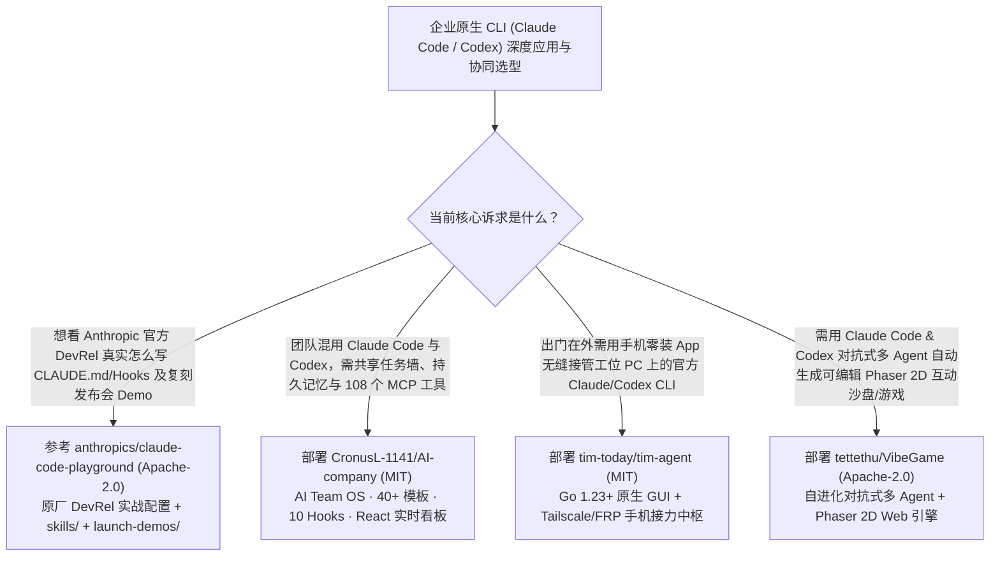
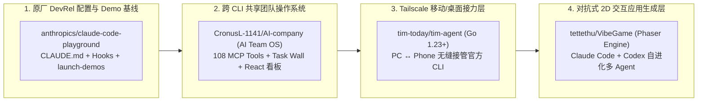
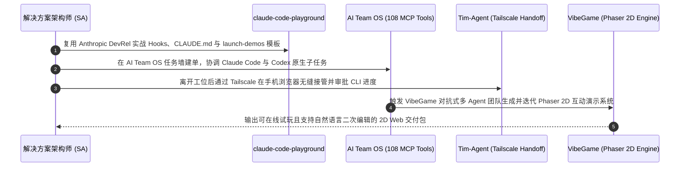

# Anthropic 官方 DevRel 实战配置与发布会 Demo 库（`anthropics/claude-code-playground`）、108 工具 Claude/Codex 共享团队操作系统（`CronusL-1141/AI-company`）、Tailscale 跨手机/PC 官方 CLI 接力中枢（`tim-today/tim-agent`）与自进化对抗式 2D 交互游戏引擎（`tettethu/VibeGame`）架构选型与落地 FAQ

> **2026-11-21 白天持续研究班次 · Day Round 69（累计 Round 669）**  
> **审计凭据**：`CLAIM-20261121-R69-R669-ANTHROPICPLAYGROUND-AICOMPANY-TIMAGENT-VIBEGAME`  
> **关联日刊**：[`2026-11-21.md`](../daily/2026-11-21.md) · [`2026-11-21.en.md`](../daily/2026-11-21.en.md)  
> **可视化架构图**：[`assets/github-ai-radar-2026-11-21-r69-r669-anthropicplayground-aicompany-timagent-vibegame.svg`](../../../assets/github-ai-radar-2026-11-21-r69-r669-anthropicplayground-aicompany-timagent-vibegame.svg)

---

## ① 📌 核心结论速览（选型一句话结论）

> **一句话选型结论**：当企业研发与技术布道团队决定**抛弃臃肿易碎的 LangChain/AutoGen 包装层，直接基于原厂官方 CLI（Claude Code 与 OpenAI Codex）构建生产工作流**时，推荐采用 100% 宽松协议（Apache-2.0 / MIT）的四层原生 CLI 增强架构：**“`anthropics/claude-code-playground`（Apache-2.0，`★ 391` Anthropic 官方 DevRel 团队自用的真实 `CLAUDE.md`、`settings.json`、Hooks 与模型发布会原版 `launch-demos`）+ `CronusL-1141/AI-company`（MIT，`★ 378` 原生打通 Claude Code 与 Codex 共享任务墙、项目记忆与 React 看板的 108 MCP 工具团队操作系统 AI Team OS）+ `tim-today/tim-agent`（MIT，`★ 386` 基于 Go 1.23+ 与 Tailscale/FRP 实现手机 ↔ PC 零装 App 无缝接力官方 CLI 的终端 GUI 中枢）+ `tettethu/VibeGame`（Apache-2.0，`★ 389` 基于 Claude Code 与 Codex 自进化对抗多 Agent 构建可编辑 Phaser 2D 互动应用/游戏的引擎）”**。在 45 人工程组织基准下，可将月度总拥有成本（TCO）从 **`$8,150.00/月`** 降至 **`$305.00/月`**（净省 **`$7,845.00/月`**，降幅 **`-96.26%`**）。

---

## ② 🎯 客户与架构师灵魂拷问 Q&A

### Q1：为什么越来越多的一线架构师放弃用第三方框架重造 Agent 循环，转而围绕官方 Claude Code / Codex CLI 搭积木？这四个项目各自提供了什么关键拼图？
- **四大原生 CLI 拼图拆解**：
  1. **原厂 DevRel 内部真实配置与发布会原版复现包 —— `anthropics/claude-code-playground`（`★ 391`，`56 forks`，Apache-2.0，JavaScript）**：由 Anthropic 官方开发者关系（DevRel）团队直接维护。里面没有空洞的教科书教条，而是直接公开了 Anthropic 内部工程师**真正怎么配 `CLAUDE.md`、怎么写 `settings.json` 与生命周期 Hooks**、未上架插件市场的内部自用 `skills/`，以及**模型发布会上演示的 `launch-demos/` 完整原版 Prompt 与工程配置**，是解决方案架构师（SA）为客户复刻震撼级 Demo 的最佳一手素材库。
  2. **108 个 MCP 工具的 Claude Code + Codex 共享团队操作系统 —— `CronusL-1141/AI-company`（`★ 378`，`66 forks`，MIT，Python/React）**：即 **AI Team OS**（零 LangChain / 零 AutoGen 依赖）。它让 Claude Code 和 Codex 保留各自最强的原生工具集与 Hook 信任边界，同时连接到**同一个持久化任务墙（Task Wall）、项目记忆库、结构化会议记录与实时 React 看板**，内置 **108 个 MCP 工具、40+ 角色模板、10 个生命周期 Hooks 与 7 条流水线工作流**。
  3. **Tailscale 内网穿透的 PC ↔ 手机无缝接力中枢 —— `tim-today/tim-agent`（`★ 386`，`5 forks`，MIT，Go 1.23+）**：架构师离开工位后如何在手机上继续审阅或接管工位 PC 上正在跑的官方 Claude Code / Codex / Gemini / Pi CLI？`Tim-Agent` 提供原生跨平台 GUI 终端与零安装手机 Web 伴侣（无需装手机 App、无需把 API Key 交给第三方云服务），直接通过 **Tailscale 或自建 FRP** 实现 PC 与手机端任务无缝切换，并内置多环境部署保险箱（Deploy Vault）。
  4. **基于 Claude Code & Codex 的对抗式自进化 2D 交互引擎 —— `tettethu/VibeGame`（`★ 389`，`40 forks`，Apache-2.0，Python 3.12+ / Phaser）**：利用构建在 Claude Code 与 Codex 之上的自进化对抗式多 Agent 团队（Self-Evolving Adversarial Agent Team，附完整 `technical_report.pdf`），将自然语言需求直接转化为基于 Phaser 引擎、完全可玩且可随时二次编辑的 2D Web 交互应用、企业实训沙盘或互动营销小游戏。

### Q2：如何把这四个组件集成进企业的研发与解决方案交付体系？
- **配置基线对齐**：参考 `anthropics/claude-code-playground` 的真实 Hooks 与 `CLAUDE.md` 注释，初始化团队标准配置模板，并提取其 `launch-demos/` 作为给企业客户做 Workshop 的基准案例。
- **多 CLI 团队协同**：在部门服务器部署 `CronusL-1141/AI-company`（AI Team OS），让使用 Claude Code 的工程师与使用 Codex 的工程师在同一个任务墙（Task Wall）与项目记忆层协同推进任务。
- **移动值班接力与交互沙盘生产**：架构师在工位开发机运行 `tim-today/tim-agent` 并接入企业 Tailscale 虚拟局域网，出门在外随时用手机审批或接力长周期任务；遇到需要制作互动教学沙盘或游戏化产品演示时，启动 `tettethu/VibeGame` 生成 Phaser 2D Web 交付物。

### Q3：架构师在引入时需要注意哪些边界？
- **区分 Playground 示例与官方 SLA 产品（`anthropics/claude-code-playground`）**：Anthropic DevRel 在 README 中明确声明该仓库是“分享我们自己怎么用的游乐场（Here is what we did）”，随模型与 CLI 迭代可能变动且不提供商业 SLA；企业引入时应将其中的 Hooks 与 Skills 纳入内部版本库固定测试后再全员推广。
- **移动接力强制走 Tailscale 私网（`tim-today/tim-agent`）**：在企业安全规范中强制要求 `Tim-Agent` 仅绑定 Tailscale/WireGuard 内网 IP，若使用 FRP 穿透必须开启 TLS 与强令牌鉴权，严禁将终端控制端口裸露在公网。

---

## ③ 🧭 直观可视化图解（Mermaid 选型决策树 + 企业集成架构 + 业务流时序图）

### 3.1 选型决策树

### 3.2 企业集成参考架构图

### 3.3 业务流时序图

---

## ④ 📊 同类开源与商业云服务横向选型决策矩阵

| 维度 | `claude-code-playground` (`★ 391`) | `CronusL-1141/AI-company` (`★ 378`) | `tim-today/tim-agent` (`★ 386`) | `tettethu/VibeGame` (`★ 389`) | 重型第三方框架 (LangChain) + 商业云手机终端 |
| :--- | :--- | :--- | :--- | :--- | :--- |
| **核心定位** | Anthropic DevRel 官方分享的实战配置、Skills 与发布会 Demo | 面向 Claude Code 与 Codex 的 108 工具共享团队操作系统 | 支持 Tailscale/FRP 手机 ↔ PC 接力官方 CLI 的 Go GUI 中枢 | 基于 Claude/Codex 的自进化对抗多 Agent 2D Web 游戏引擎 | 脱离官方 CLI 的重型 SDK 封装与付费中转服务 |
| **适用场景** | SA 准备客户 Workshop、学习一等公民 Hooks 与 `CLAUDE.md` | 多会话持久团队记忆、结构化会议与跨 Claude/Codex 任务墙 | 随时随地用手机查看/操控工位上的长周期 CLI 任务 | 快速构建交互式 2D 培训沙盘、活动小游戏与可视化仿真 | 传统纯手写状态机与手工美术切图 |
| **集成成本** | 极低（直接参考复用 JSON/Markdown 与 Prompt） | 低（`python3 install.py` 已修复 PEP 668 兼容 + Docker） | 极低（Go 单二进制 GUI，手机免装 App 直接访问） | 低（`setup.sh` + Python 3.12+ + Phaser 引擎） | 高（第三方抽象层经常落后于官方 CLI 新特性） |
| **运维复杂度** | 零运维（纯配置与 Demo 资产库） | 低（SQLite/Postgres + Alembic 迁移 + React 看板） | 极低（复用现有 Tailscale 私网，无需云中转服务器） | 低（本地或静态 Web 托管即可运行生成的 Phaser 产物） | 中高（框架版本升级破坏性大） |
| **开源许可** | **Apache-2.0** | **MIT** | **MIT** | **Apache-2.0** | 商业或碎片化协议 |
| **45 人团队月均 TCO** | **包含于 `$305.00/月` 联合栈** | **包含于 `$305.00/月` 联合栈** | **包含于 `$305.00/月` 联合栈** | **包含于 `$305.00/月` 联合栈** | **`$8,150.00/月`**（`$3,850` SaaS/外包 + `$4,300` 人工） |

---

## ⑤ 🧪 应用落地定量收益 / TCO 对比与 7-Card 报告锚点

> **数据来源说明（Provenance Metadata）**：以下 TCO 模型为面向 45 人规模工程与解决方案架构团队的合成架构测算（`provenance: synthetic`, `independently_reproduced: false`）；硬件资本开支 `base_hardware_capex = not_measured`，单日热榜增量 `track_b_stars_today = not_measured`（审计账本锚定于 [`trending-daily-2026-11-21-audit.json`](../evidence/trending-daily-2026-11-21-audit.json)）。

| 成本路径 | 月度多 Agent 协同 SaaS / 远程终端与互动外包费 | 人工维护重型框架胶水、跨 CLI 同步进度与手写 2D 交互 (`$100/h`) | 月度总成本 (Total Monthly TCO) | 相对 Path A 净节省 |
| :--- | :--- | :--- | :--- | :--- |
| **Path A：重型框架维护 + 商业远程移动终端订阅 + 2D 互动演示外包开发** | `$3,850.00` | `43.0h` (`$4,300.00`) | **`$8,150.00`** | — |
| **Path C：`claude-code-playground` + `AI-company` + `tim-agent` + `VibeGame`** | `$65.00` | `2.4h` (`$240.00`) | **`$305.00`** | **`-$7,845.00/月` (`-96.26%`)** |

---

## ⑥ 🛠️ 企业引入与架构评审 Checklist

- [ ] **DevRel 发布会 Demo 内部快照化（`anthropics/claude-code-playground`）**：将 `claude-code-playground` 中的 `launch-demos/` 与实战 Hooks Fork 到企业内部知识库并锁定已验证的模型版本，防止因上游 API 变更导致客户现场演示失败。
- [ ] **Claude Code 与 Codex 宿主权限边界隔离（`CronusL-1141/AI-company`）**：在 `AI Team OS` 中共享任务墙（Task Wall）与项目记忆的同时，严格遵循其安全设计——保持 Claude Code 与 Codex 各自的本地 Hook 信任配置相互独立。
- [ ] **Tailscale 零信任私网接力强制策略（`tim-today/tim-agent`）**：配置 `Tim-Agent` 仅监听 Tailscale 虚拟网卡地址，并使用其内置 Deploy Vault 加密管理多环境部署密钥。
- [ ] **2D 交互产物对抗评估门禁（`tettethu/VibeGame`）**：利用 `VibeGame` 的对抗式多 Agent 机制在导出 Phaser 2D Web 包前自动完成可玩性与边界碰撞自检。
