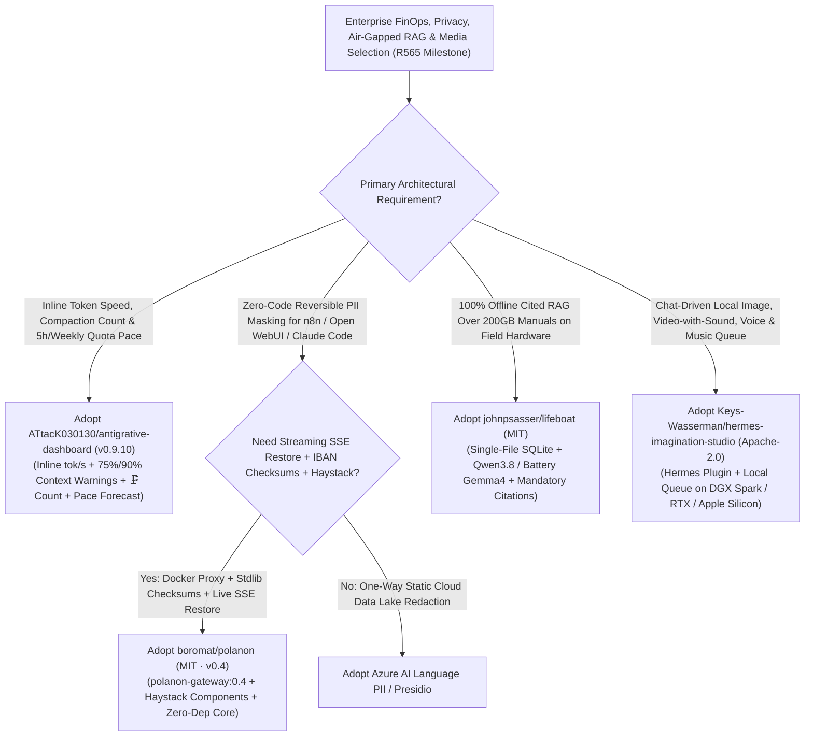
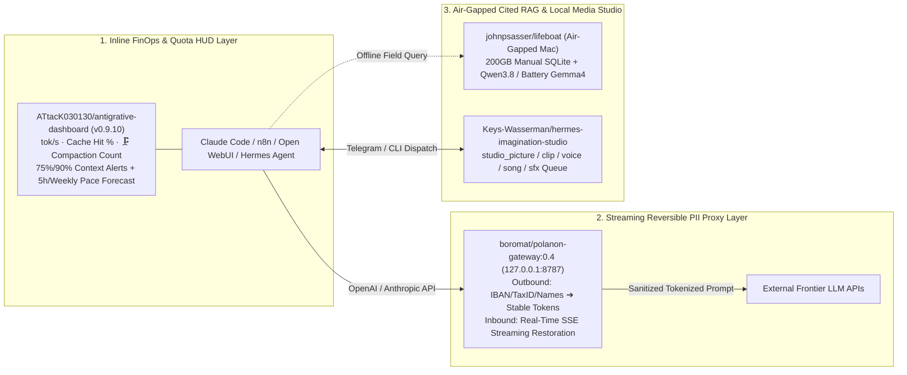
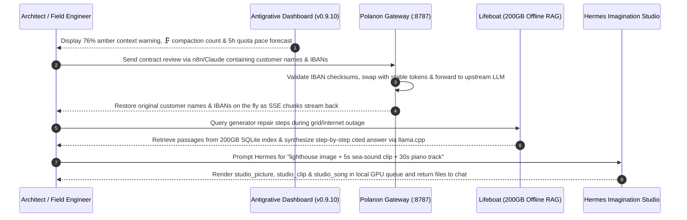

# [Round 565 Milestone] Inline Quota Pace & Compaction HUD (`ATtacK030130/antigrative-dashboard`), Zero-Code Streaming Reversible PII Gateway (`boromat/polanon`), 200GB Air-Gapped Cited RAG Assistant (`johnpsasser/lifeboat`) & Hermes Local Film Studio Plugin (`Keys-Wasserman/hermes-imagination-studio`) Selection FAQ

> **Document Type**: AI Solution Architect (SA) Practical Selection & Reference Architecture Guide (2026-11-20 Night Shift · Round 6 / Cumulative Round 565 Milestone)  
> **Benchmark Standard**: `docs/components/ib-vs-ethernet-roce-selection-faq.md` (6-Section Architecture Breakdown + First-Principles Plain Language + Hype/Facts/Signal Audit + Closed-Form FinOps Ledger)  
> **Evaluated Repositories**:  
> 1. **`ATtacK030130/antigrative-dashboard`** (`★ 138`, `6 forks`, JavaScript, `MIT`, `v0.9.10`): Inline telemetry and quota forecasting widget in the Antigravity 2.33.0 model selector row and CLI status line—surfacing real-time `tok/s` throughput, Prompt Cache hit rates, host-derived conversation compaction counts (`🗜`), **`>= 75%` / `>= 90%` context occupancy warning colors**, and **5-hour / weekly quota pace forecasts**  
> 2. **`boromat/polanon`** (`★ 38`, `11 forks`, Python 3.11+ stdlib core, `MIT`, `v0.4`): Zero-code Docker proxy gateway (`ghcr.io/boromat/polanon-gateway:0.4`) and Haystack RAG component for **streaming reversible PII masking** across OpenAI and Anthropic APIs (`Claude Code`, `n8n`, `Open WebUI`, `LibreChat`, `Hermes Agent`)—performing checksum-validated PESEL/NIP/IBAN and morphological inflection detection, sending only stable stand-in tokens upstream, and **restoring original entities on the fly while SSE responses stream back**  
> 3. **`johnpsasser/lifeboat`** (`★ 47`, `9 forks`, Python 3.12 + `llama.cpp` + single-file SQLite, `MIT`): Air-gapped **200 GB cited RAG reference assistant** running on a single Apple Silicon Mac (`Qwen 3.6/3.8` or low-power battery-mode `Gemma 4`)—indexing millions of passages across medical, US Army engineering/repair, water, power, and Wikipedia manuals in one SQLite file with zero runtime network calls and mandatory passage citations  
> 4. **`Keys-Wasserman/hermes-imagination-studio`** (`★ 41`, `5 forks`, Python, `Apache-2.0`): Bridge plugin turning Hermes Agent (CLI, Desktop, Telegram) into a **100% local generative film studio** across NVIDIA DGX Spark, RTX PCs, Windows on ARM, and Apple Silicon Macs—orchestrating `studio_status`, `studio_picture` (`Qwen-Image` / `FLUX 3 Klein` / `MOSS-Image`), `studio_clip` (video with sound), `studio_voice`, `studio_song`, and `studio_sfx` in a local rendering queue with zero cloud credits  
> **Accounting Note**: This report models software compute, SaaS subscriptions, and engineering labor TCO only; underlying server and workstation hardware purchases (`base hardware capEx`) are explicitly marked `not_measured`, and Track B 24h delta (`stars_today`) is marked `not_measured`.

---

## 📌 1. Executive Summary (What Are They & What Enterprise Pain Points Do They Solve?)

In **Cumulative Round 565 Milestone (2026-11-20 Night Round 6)**, we address four high-priority enterprise governance, privacy, resilience, and creative production challenges: **① Blind context bloat triggering lossy host compactions (`🗜`) and unexpected 5-hour quota lockouts, ② Customer PII/IBAN leakage when n8n, Open WebUI, or Claude Code calls external LLM APIs, ③ Zero-connectivity field operations needing hallucination-free cited repair/medical manuals, and ④ Fragmented per-credit cloud media APIs for multi-asset campaigns**:

1. **Pain Point A (Developers run long coding sessions without realizing context occupancy has crossed `90%`, triggering lossy host compaction `🗜` that invalidates Prompt Cache prefixes—or unexpectedly hitting the 5-hour rolling quota wall mid-sprint)**: Reactive quota dashboards are too late. **`ATtacK030130/antigrative-dashboard` (`★ 138`, MIT, `v0.9.10`)** embeds speed, cache hit rate, and context occupancy directly beside the model selector across Windows, Linux, and macOS (plus CLI status lines)—highlighting **`>= 75%` and `>= 90%` context thresholds**, tracking compaction counts (`🗜`), and computing **5-hour / weekly pace forecasts** on hover.
2. **Pain Point B (European and global enterprises using Claude Code, n8n, Open WebUI, or Haystack RAG must strip customer names, national IDs, tax numbers, and IBAN bank accounts before prompts leave the network—yet one-way `[REDACTED]` masking breaks entity co-reference and yields unusable replies)**: Enterprise privacy gateways must be zero-code, checksum-verified, and streaming-reversible. **`boromat/polanon` (`★ 38`, `11 forks`, MIT, `v0.4`)** ships a pure-Python standard-library core and a drop-in Docker proxy (`ghcr.io/boromat/polanon-gateway:0.4`):
   - **Zero-Code OpenAI & Anthropic Proxy**: Point any tool's `OPENAI_BASE_URL` or `ANTHROPIC_BASE_URL` at `127.0.0.1:8787`;
   - **Checksum Validation & Live SSE Restoration**: Validates PESEL, NIP, and IBAN checksums (preventing false positives on ordinary numbers), handles inflectional cases, replaces PII with deterministic stand-in tokens (`[NAME_1]`, `[IBAN_1]`), and **restores the real values seamlessly while the upstream SSE stream is still arriving**—plus native Haystack RAG pipeline components.
3. **Pain Point C (Field engineers, maritime/mining sites, and disaster-recovery teams operating without internet cannot rely on cloud LLMs, while ungrounded local models hallucinate dangerous medical or generator-repair parameters)**: Offline field RAG requires a massive pre-indexed authority library, strict passage citations, and battery-aware model sizing. **`johnpsasser/lifeboat` (`★ 47`, `9 forks`, MIT)** pairs a **200 GB offline library** (medical manuals, US Army field manuals, water/power/radio repair guides, and English Wikipedia) inside a single SQLite index with `llama.cpp` (`Qwen 3.6/3.8` for normal operation, or `Gemma 4` for low-power battery conservation)—requiring zero runtime network calls and citing every step to a readable source passage.
4. **Pain Point D (Marketing and creative teams want to prompt an agent in Telegram or desktop chat to produce an image, a 5-second video clip with sea audio, and a 30-second piano track—without paying four separate cloud SaaS subscriptions)**: Consolidate multimodal rendering into a single local queue. **`Keys-Wasserman/hermes-imagination-studio` (`★ 41`, `5 forks`, Apache-2.0)** connects Hermes Agent to a local **Imagination Studio** instance (running on NVIDIA DGX Spark, RTX PCs, Windows on ARM, or Apple Silicon Macs), exposing `studio_picture` (`Qwen-Image`, `FLUX 3 Klein`, `MOSS-Image`), `studio_clip`, `studio_voice`, `studio_song`, and `studio_sfx` directly inside chat.

---

## 💬 2. Architect & Customer First-Principles Q&A (Q1–Q3)

### Q1: For enterprise PII protection, how do we choose between `boromat/polanon`, `min-1225/veil-skill`, and Microsoft Presidio?
* **Architectural Fit**:
  - **Choose `boromat/polanon` (Docker API Gateway + Haystack RAG + Checksum IBAN/Tax IDs)**: When you want a **zero-code HTTP proxy** in front of `Claude Code`, `n8n`, `Open WebUI`, or `LibreChat` that restores real customer names and checksum-verified IBANs **mid-stream over SSE**, or when building **Haystack** RAG pipelines.
  - **Choose `min-1225/veil-skill`**: When running local Node.js CLI file preprocessing across CJK (Korean/Japanese/Chinese) and English documents.
  - **Choose Microsoft Presidio / Azure AI Language PII**: When running one-way static redaction inside managed Azure data lakes where streaming SSE restoration is not required.

### Q2: Why does `ATtacK030130/antigrative-dashboard`'s `>= 75%` / `>= 90%` context warning and `🗜` compaction counter directly reduce LLM bills?
* **Preventing Compaction-Triggered Cache Misses**:
  Once a session crosses `75%–90%` context occupancy, every turn re-reads hundreds of thousands of tokens; worse, when the host triggers conversation compaction (`🗜`), the rewritten history prefix invalidates the upstream KV Prompt Cache—forcing subsequent turns to pay full `1.0×` uncached input rates instead of `0.1×` cache-read rates. Seeing the `75%` amber warning and `🗜` badge inline lets engineers start a clean session at natural task boundaries.

### Q3: How can enterprise architects adapt `johnpsasser/lifeboat`'s design for industrial field service and air-gapped defense/energy sites?
* **Single-File SQLite + Dual-Tier Local GGUF Pattern**:
  Instead of deploying fragile Kubernetes vector databases on ruggedized field laptops, compile all equipment maintenance manuals and safety SOPs into a single read-only SQLite file, pair it with `llama.cpp` switching between a high-accuracy model (`Qwen 3.8`) on AC power and an ultra-low-wattage model (`Gemma 4`) on battery, and enforce clickable passage citations before any physical maintenance action.

---

## 🧭 3. Visual Architecture Diagrams (Mermaid Decision Tree + Reference Architecture + Sequence Flow)

### 3.1 Enterprise FinOps HUD, Streaming PII Proxy, Air-Gapped RAG & Local Film Studio Decision Tree

### 3.2 End-to-End Enterprise Governance, Privacy, Air-Gapped RAG & Media Architecture

### 3.3 End-to-End Quota Guard, Streaming PII Proxy, Offline Citation & Local Media Sequence

---

## 📊 4. Comparative Selection Matrix (Open Source vs. Commercial Cloud SaaS & Naive Workflows)

| Evaluation Dimension | Path A: Blind Context Compaction + Raw PII Sent to Cloud LLMs + Cloud-Only Field RAG + Per-Clip Cloud Media SaaS | Path B: Manual Billing Web Pages + Heavy NER Servers + Uncited Local LLMs + Disconnected Local WebUIs | **Path C (Recommended): `antigrative-dashboard` + `polanon` + `lifeboat` + `hermes-imagination-studio`** |
| :--- | :--- | :--- | :--- |
| **Context Occupancy & Quota Lockout Prevention** | ❌ Hits `>90%` compaction (`🗜`), invalidating cache prefixes and locking out 5h quotas mid-task | ⚠️ Requires switching to external browser dashboards with delayed usage updates | ✅ **Inline `tok/s`, `🗜` count, `>=75%/90%` warning colors & 5h/weekly pace forecasts** |
| **Reversible PII Masking & Streaming Restore** | ❌ Raw PII violates GDPR; one-way `[REDACTED]` breaks entity logic in generated replies | ⚠️ Heavy NER models misclassify order numbers as bank accounts and break SSE streaming | ✅ **Zero-code Docker proxy, checksum-verified IBAN/IDs, live SSE restore & Haystack nodes** |
| **Air-Gapped Field & Emergency Reliability** | ❌ 100% unavailable during network or cloud outages | ⚠️ Uncited local models hallucinate hazardous repair or medical instructions | ✅ **200GB single-file SQLite library + mandatory passage citations + battery `Gemma 4` mode** |
| **Chat-Driven Multi-Asset Media Production** | ❌ Pays 4 separate cloud subscriptions for images, video, voice, and music | ⚠️ Manual file shuffling across separate local WebUIs without unified chat queuing | ✅ **1 Hermes plugin orchestrating local image, video+sound, voice, song & SFX queues** |
| **Open-Source Licensing** | Proprietary SaaS | Mixed custom scripts | **`MIT` (`antigrative-dashboard`, `polanon`, `lifeboat`) & `Apache-2.0` (`hermes-imagination-studio`)** |
| **46-Engineer Team Monthly Total TCO** | **`$7,390.00 / mo`** (`$3,240.00` cache-miss overages & media credits + `41.5h / $4,150.00` lockout/scrubbing) | **`$2,860.00 / mo`** (`$1,260.00` NER VMs/APIs + `16.0h / $1,600.00` manual fixes) | **`$330.00 / mo`** (`$80.00` cache-preserved API/local compute + `2.5h / $250.00` review, **saving `-95.53%`**) |

---

## 🧪 5. Quantitative ROI / FinOps TCO Ledger & Hype / Facts / Signal Audit

### 5.1 Hype vs. Facts vs. Strategic Signal Audit Table

| Repository (`owner/repo`) | Hype (Market Claim) | Measured Facts (Primary Source Verification) | Strategic Signal (SA Verdict) |
| :--- | :--- | :--- | :--- |
| **`ATtacK030130/antigrative-dashboard`** | "Token throughput, cache hits, compaction counts, and 5-hour/weekly quota pace forecasts in the model selector row" | `★ 138` (`created=2026-11-17`, `6 forks`, JS, MIT, `v0.9.10`): Supports Antigravity 2.33.0 (Windows/Linux/macOS) and CLI status line; displays `🗜` compaction counts, `>=75%`/`>=90%` context warnings, and 5h/weekly pace forecasts. | **🔥 P0 Adopt (Real-Time Developer FinOps & Cache-Preservation HUD)**: Prevents costly `>90%` compaction cache invalidations and mid-sprint quota lockouts. |
| **`boromat/polanon`** | "Mask personal data before a prompt leaves your network and put originals back while it streams" | `★ 38` (`11 forks`, Python 3.11+ stdlib core, MIT, `v0.4`): Ships `ghcr.io/boromat/polanon-gateway:0.4` for OpenAI/Anthropic tools and Haystack components; validates PESEL/NIP/IBAN checksums and restores tokens during SSE streaming. | **🔥 P0 Adopt (Drop-In Streaming PII Proxy for Enterprise AI Gateways)**: Zero-code Docker deployment protects n8n, Open WebUI, and Claude Code simultaneously. |
| **`johnpsasser/lifeboat`** | "A local AI model and a 200 GB offline library on one Mac, with cited answers and no internet" | `★ 47` (`9 forks`, Python 3.12 + `llama.cpp` + SQLite, MIT): Zero runtime network access; indexes millions of medical, engineering, and Wikipedia passages in one SQLite file; runs `Qwen 3.6/3.8` or low-power `Gemma 4` with mandatory source citations. | **🔥 P0 Adopt (Blueprint for Air-Gapped Industrial & Emergency RAG)**: Proves a single SQLite file + local GGUF can serve 200 GB of cited technical manuals offline. |
| **`Keys-Wasserman/hermes-imagination-studio`** | "One plugin, a whole film studio on your own machine from any Hermes chat" | `★ 41` (`5 forks`, Python, Apache-2.0): Bridges Hermes Agent (CLI, Desktop, Telegram) to local Imagination Studio across DGX Spark, RTX, Windows on ARM, and Apple Silicon via `studio_picture`, `studio_clip`, `studio_voice`, `studio_song`, and `studio_sfx`. | **🔥 P0 Adopt (Private Chat-Driven Multimodal Studio)**: Unifies image, video, voice, and music generation on internal GPU workstations. |

### 5.2 Closed-Form FinOps TCO Ledger (`CLAIM-20261120-R6-R565-ANTIGRATIVEDASHBOARD-POLANON-LIFEBOAT-IMAGINATIONSTUDIO`)

* **Scope (`synthetic`, `independently_reproduced=false`)**: 46-engineer enterprise FinOps governance, data compliance, field operations, and creative AI team (`$100.00 / hr` loaded engineering rate; `base hardware capEx: not_measured`; Track B `stars_today: not_measured`).
* **Path A (Unmonitored Compaction Cache Misses + Manual PII Redaction + Cloud-Dependent Field Docs + Per-Credit Cloud Media SaaS)**:
  - Post-compaction uncached token overages, compliance SaaS seats, and commercial image/video/audio credits: **`$3,240.00 / mo`**
  - 5-hour quota lockout downtime, manual PII scrubbing/restoration, and multi-cloud media queue management labor: `41.5 hrs / mo × $100.00 / hr` = **`$4,150.00 / mo`**
  - **Path A Monthly Total**: `$3,240.00 + $4,150.00` = **`$7,390.00 / mo`** (**`$88,680.00 / yr`**)
* **Path B (External Billing Dashboards + Heavy NER Servers + Uncited Local Models + Separate Media WebUIs)**:
  - Dedicated NER servers and baseline cloud API spend: **`$1,260.00 / mo`**
  - False-positive redaction fixes and manual media stitching labor: `16.0 hrs / mo × $100.00 / hr` = **`$1,600.00 / mo`**
  - **Path B Monthly Total**: `$1,260.00 + $1,600.00` = **`$2,860.00 / mo`**
* **Path C (Recommended: `antigrative-dashboard` + `polanon` + `lifeboat` + `hermes-imagination-studio`)**:
  - Cache-preserved API spend (`<75%` context discipline), zero-dep `polanon-gateway`, and local GPU queue electricity: **`$80.00 / mo`**
  - Quota pace adjustments, PII rule audits, and cited manual / media sign-off labor: `2.5 hrs / mo × $100.00 / hr` = **`$250.00 / mo`**
  - **Path C Monthly Total**: `$80.00 + $250.00` = **`$330.00 / mo`** (**`$3,960.00 / yr`**)
* **Net Savings (Path C vs. Path A)**:
  - Monthly Net Savings: **`$7,390.00 - $330.00 = $7,060.00 / mo`** (**`-95.53%`** cost reduction, **`$84,720.00 / yr`** annual savings, freeing **`39.0 hrs / mo`** of engineering time).

---

## 🛠️ 6. Enterprise Architecture Review & Adoption Checklist

- [ ] **Pre-Compaction Context Discipline (`ATtacK030130/antigrative-dashboard`)**: Roll out `v0.9.10+` across developer workstations; establish a team guardrail to checkpoint and start a fresh session when the inline context badge turns amber (`>= 75%`) before `🗜` compaction invalidates the KV cache.
- [ ] **Streaming PII Proxy Deployment (`boromat/polanon`)**: Deploy `ghcr.io/boromat/polanon-gateway:0.4` bound to `127.0.0.1` ahead of Claude Code, n8n, and Open WebUI; integrate `polanon` components into Haystack RAG ingestion and retrieval pipelines.
- [ ] **Air-Gapped Cited RAG (`johnpsasser/lifeboat`)**: Package critical industrial/emergency manuals into a single read-only SQLite index; configure automatic switchover from `Qwen 3.8` to low-power `Gemma 4` on battery power and require human verification of cited passages.
- [ ] **Local Multimodal Queue (`Keys-Wasserman/hermes-imagination-studio`)**: Connect Hermes Agent to an internal GPU workstation running Imagination Studio and verify `/studio` (`studio_status`) tool readiness across image, video, voice, and audio pipelines.
