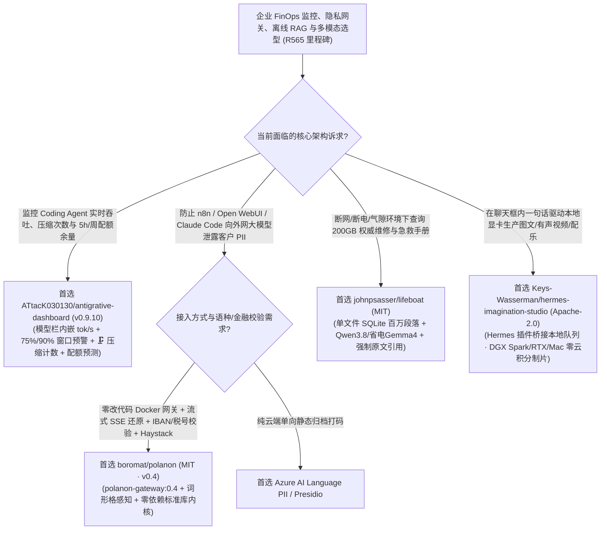
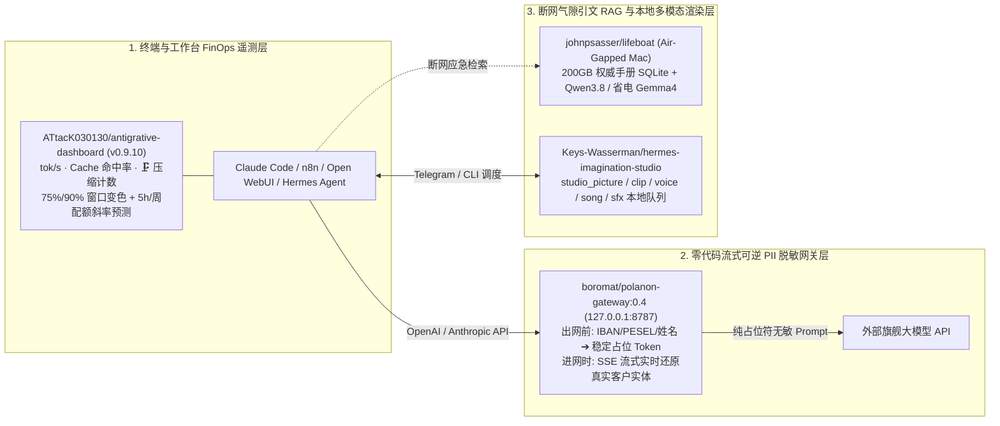
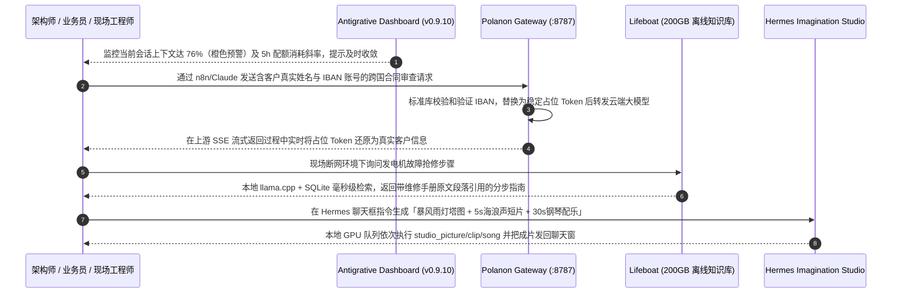

# 【第 565 轮里程碑】模型栏内联配额耗尽预测与压缩预警台（`ATtacK030130/antigrative-dashboard`）、零改代码流式可逆 PII 脱敏网关（`boromat/polanon`）、200GB 断网引文校验应急知识库（`johnpsasser/lifeboat`）与 Hermes 全栈本地音画制片插件（`Keys-Wasserman/hermes-imagination-studio`）选型 FAQ

> **文档类型**：AI Solution Architect（AI 解决方案架构师）实战选型与架构内功指南（2026-11-20 Night Shift · Round 6 / 累计第 565 轮里程碑）  
> **对标标杆**：`docs/components/ib-vs-ethernet-roce-selection-faq.md`（六段式架构拆解 + 第一性原理大白话 + Hype/Facts/Signal 审计 + 闭式 TCO 账本）  
> **本轮评估对象**：  
> 1. **`ATtacK030130/antigrative-dashboard`**（`★ 138`，`6 forks`，JavaScript，MIT，`v0.9.10`）：直接嵌入 Antigravity 2.33.0 模型选择器行与 CLI 状态栏的紧凑型遥测组件——实时显示 Token 生成吞吐（`tok/s`）、Prompt Cache 命中率、宿主会话压缩次数（`🗜`）、**`>= 75%` / `>= 90%` 上下文占用变色预警**，并在悬停时展开 **5 小时与周度配额余量及耗尽速率预测（Pace Forecast）**  
> 2. **`boromat/polanon`**（`★ 38`，`11 forks`，Python 3.11+ 纯标准库核心，MIT，`v0.4`）：面向 LLM API 与 Haystack RAG 的**流式可逆 PII 隐私脱敏网关**（`ghcr.io/boromat/polanon-gateway:0.4`）——无需修改 Claude Code、n8n、Open WebUI、LibreChat 或 Hermes Agent 一行代码，在数据出网前通过校验和（PESEL / NIP / IBAN）与词形格变化规则将敏感信息替换为稳定占位 Token，并在**上游模型 SSE 流式返回过程中实时无感还原真实值**  
> 3. **`johnpsasser/lifeboat`**（`★ 47`，`9 forks`，Python 3.12 + `llama.cpp` + 单文件 SQLite，MIT）：运行在单台 Apple Silicon Mac 上的 **200 GB 零外网断网应急 RAG 知识库助手**——将数百万段医疗急救、工程维修、电力水利与百科手册浓缩进单个 SQLite 索引文件，配合本地 `Qwen 3.6/3.8`（或低功耗省电模式 `Gemma 4`），强制要求生成的每一步操作指令都附带可点击核对的原文出处引用  
> 4. **`Keys-Wasserman/hermes-imagination-studio`**（`★ 41`，`5 forks`，Python，Apache-2.0）：将 Hermes Agent（终端 / 桌面 / Telegram 群聊）一键升级为**纯本地全功能 AI 制片厂**的桥接插件——支持在 NVIDIA DGX Spark、RTX PC、Windows on ARM 及 Mac 上本地队列渲染图片（`studio_picture`：Qwen-Image / FLUX 3 Klein / MOSS-Image）、带音效视频片段（`studio_clip`）、角色配音（`studio_voice`）、背景音乐与环境音效（`studio_song` / `studio_sfx`）  
> **审计折算说明**：本报告仅计量软件算力、SaaS 订阅与工程运维人力 TCO，底层服务器与工作站硬件采购（base hardware capEx）显式标注为 `not_measured`，赛道 B 新仓今日增量显式标注为 `not_measured`，严禁捏造坐标。

---

## 📌 一、核心结论速览（Executive Summary：它到底是什么？解决什么业务痛点？）

在累计第 **565 轮里程碑（2026-11-20 Night Round 6）** 中，我们面向企业客户与业务决策者，重点攻克企业 AI 规模化落地中的四大安全与成本盲区——**① 开发者盲写到上下文爆满触发自动压缩（`🗜`）与 5 小时配额突然锁死、② 业务工作流（n8n / Open WebUI / Claude Code）调用公网大模型时泄露客户身份证号与银行 IBAN、③ 野外作业/灾备机房断网环境下缺乏零幻觉有据可查的离线维修医疗知识库、④ 聊天机器人需要同时生成图文音视频却受制于多个云端 API 排队与高昂积分消耗**：

1. **痛点 A（研发工程师在使用 AI 编码工具时，看不见当前上下文已经膨胀到 `90%+`，直到触发宿主有损压缩 `🗜` 导致前文细节丢失，或者在紧急发版前突然撞上 5 小时滚动配额上限被迫停工）**：没有前置预警的配额管理就是盲人开车。**`ATtacK030130/antigrative-dashboard` (`★ 138`, MIT, `v0.9.10`) 的破局之道**：在输入框旁的模型选择栏直接内嵌三枚精巧指标（生成速度、缓存命中率、上下文占用），在上下文达到 **`>= 75%`（橙色）与 `>= 90%`（红色）** 时主动变色告警并统计压缩次数 `🗜`，鼠标悬停即可查看 **5 小时与周度配额耗尽预测曲线（Pace Forecast）**，提醒工程师及时开启新会话或切换轻量模型。
2. **痛点 B（金融、跨境电商与欧洲合规企业在用 n8n、LibreChat 或 Claude Code 处理客诉工单与合同时，既想借用云端前沿旗舰大模型的推理能力，又严禁将客户的税号、银行账号 IBAN、身份证号或真实姓名发往境外 API）**：单向打码 `[REDACTED]` 会让模型分不清谁是谁且无法生成可直接发送的回复。**`boromat/polanon` (`★ 38`, `11 forks`, MIT) 的破局之道**：
   - **零代码 Docker 透明代理网关**：启动 `ghcr.io/boromat/polanon-gateway:0.4` 指向 OpenAI 或 Anthropic 上游，将任意客户端的 `BASE_URL` 指向本地 `127.0.0.1:8787`；
   - **校验和精准识别 + 流式实时还原 + Haystack 组件**：纯 Python 标准库内核验证 IBAN/PESEL/NIP 校验位（杜绝把普通长数字误判为账号）并处理复杂词尾格变化，出网前替换为稳定编号 Token（保证模型逻辑推理不错乱），在**模型 SSE 流式吐字的同时实时把真实姓名与账号填回响应流**，并提供原生 Haystack RAG 组件。
3. **痛点 C（矿山、远洋船舶、电力巡检及政企核心应急指挥中心在断网、断电或极端灾害下，云端大模型全面失联；而普通本地小模型缺乏权威手册支撑，极易在急救或发电机抢修步骤上产生致命幻觉）**：应急与工业现场 RAG 必须做到“100% 离线 + 功耗可控 + 逐句绑定权威原文”。**`johnpsasser/lifeboat` (`★ 47`, `9 forks`, MIT) 的破局之道**：在单台 Mac 上封装 **200 GB 权威离线图书馆**（涵盖临床急救手册、美军野战工程维修手册、水电无线电指南与全量英文维基）与单文件 SQLite 百万级段落索引，通过 `llama.cpp` 驱动本地 `Qwen 3.6/3.8`（电池供电紧急模式下自动切换低功耗 `Gemma 4`），**运行时零网络请求，且每条回答的每个步骤都强制标注可展开核对的原文段落**。
4. **痛点 D（企业市场营销与社群运营希望在 Telegram/飞书或桌面聊天框里一句话让 Agent 连续产出“一张海报 + 一段带海浪声的 5 秒视频 + 一段 30 秒钢琴配乐”，但串接多个商业云 API 不仅要维护五套密钥，按次扣费更是无底洞）**：把开源多模态模型收拢进本地统一队列工作台。**`Keys-Wasserman/hermes-imagination-studio` (`★ 41`, `5 forks`, Apache-2.0) 的破局之道**：作为 Hermes Agent 的官方桥接插件，直接调度本地 **Imagination Studio**（支持 NVIDIA DGX Spark、RTX 工作站、Windows on ARM 与 Apple Silicon Mac），通过 `studio_picture`（Qwen-Image / FLUX 3 Klein / MOSS-Image）、`studio_clip`、`studio_voice`、`studio_song` 与 `studio_sfx` 异步队列在本地完成全套音视频渲染并直传回聊天窗口。

---

## 💬 二、客户与架构师灵魂拷问 Q&A（Q1–Q3 First-Principles Deep Dive）

### Q1：在企业 LLM 隐私脱敏选型中，`boromat/polanon` 与微软 Presidio 及上一轮评估的 `min-1225/veil-skill` 怎么选？
* **三大隐私防线的精准选型**：
  - **选 `boromat/polanon`（Docker 透明 API 网关 + Haystack RAG 管道 + 欧洲/国际金融校验和）**：当你需要**零代码改造现有 n8n、Open WebUI、LibreChat 或 Claude Code**（直接挂 Docker 网关拦截 OpenAI/Anthropic HTTP 流量），或者需要在 **Haystack RAG** 流水线中对包含 IBAN 银行账号、税号及复杂词尾变形的欧洲多语种文本执行流式可逆还原时。
  - **选 `min-1225/veil-skill`（中日韩英四语本地 CLI 技能）**：当场景聚焦在中文、日文、韩文与英文混合文档的 Coding Agent 本地文件预处理时。
  - **选 Microsoft Presidio / Azure AI Language PII**：当企业运行在全托管 Azure 云环境且仅需单向静态脱敏归档、无需在 SSE 流式对话中无感还原真实实体时。

### Q2：`ATtacK030130/antigrative-dashboard` 展示的“上下文 `75%/90%` 变色预警 + 宿主压缩计数 `🗜`”为什么对控制企业 Token 账单至关重要？
* **打破“越接近上下文上限越贵、越笨”的死亡螺旋**：
  当会话上下文膨胀超过 `75%–90%` 时，不仅每一轮对话都要重付海量上下文输入费，而且一旦触发宿主的自动压缩（`🗜`），历史前缀发生变化会导致 **Prompt Cache 瞬间失效**（重新按全价 `1.0×` 计费而非缓存价 `0.1×`），同时丢失关键代码细节。通过在输入框旁实时盯紧 `75%` 预警线与 `5h` 配额消耗斜率，开发者可以在触发高昂重算前主动切分任务。

### Q3：`johnpsasser/lifeboat` 的“高算力 Qwen 3.8 / 省电 Gemma 4 双档切换 + 单文件 SQLite 百万段落引文”架构，如何迁移到企业工业巡检与防灾系统？
* **工业边缘 RAG 黄金架构**：
  无需在边缘端部署重型 Elasticsearch 或分布式向量集群——将企业设备维修 SOP、安全规程与历史故障单预构建为一个只读单文件 SQLite 索引随设备分发；正常市电接入时跑高精度 `Qwen 3.8`，一旦检测到离网电池供电自动切至超低功耗 `Gemma 4`，并在 UI 层强制展示 `Source Passage` 原文卡片供现场工程师双人复核。

---

## 🧭 三、直观可视化图解（Mermaid 选型决策树 + 企业集成参考架构 + 业务流时序图）

### 3.1 配额遥测、流式可逆脱敏网关、断网应急 RAG 与本地全栈制片选型决策树

### 3.2 企业级“内联配额防线 × 流式脱敏网关 × 气隙引文库 × 本地制片厂”参考架构图

### 3.3 从配额预警、流式脱敏调用、断网引文核查到本地音画合成的时序图

---

## 📊 四、同类开源与商业云服务横向选型决策矩阵（Decision Matrix）

| 评估维度 | 路径 A：盲跑爆满触发有损压缩 + 明文外传客户 IBAN/姓名 + 断网即瘫痪的纯云 RAG + 按秒扣费商业生视频 API | 路径 B：手工查后台账单网页 + 重型 NLP 脱敏集群 + 无引文裸跑本地小模型 + 散装 ComfyUI 节点 | **路径 C（推荐）：`antigrative-dashboard` + `polanon` + `lifeboat` + `hermes-imagination-studio`** |
| :--- | :--- | :--- | :--- |
| **会话上下文膨胀与配额锁死预防** | ❌ 盲写到 `>90%` 触发 `🗜` 压缩导致缓存失效与失忆，5h 配额突然耗尽中断工作 | ⚠️ 需频繁切出 IDE 打开网页控制台刷新查看延迟滞后的统计表 | ✅ **模型栏原位展示 `tok/s`、`🗜` 压缩次数、`75%/90%` 变色与 5h/周配额耗尽预测** |
| **跨国金融/客户 PII 脱敏与流式还原** | ❌ 明文上传违反 GDPR/合规红线；或单向打码 `[REDACTED]` 导致回复不可用 | ⚠️ 重型 NER 模型误杀率高（把普通订单号当银行卡），且不支持 SSE 流式还原 | ✅ **零依赖校验和精准验证 + Docker 网关零改代码接入 + SSE 流式实时还原 + Haystack** |
| **极端断网环境下的知识问答可靠性** | ❌ 断网或云服务故障时完全不可用 | ⚠️ 裸跑本地 7B 模型缺乏权威文献约束，在急救/工程抢修上极易编造参数 | ✅ **单文件 SQLite 封装 200GB 权威手册 + 强制原文段落引用 + 电池模式自动切 Gemma 4** |
| **聊天式全品类音视频本地生成** | ❌ 分别购买生图、生视频、配乐、音效 4 家商业云会员，队列慢且成本高昂 | ⚠️ 手工在多个本地 WebUI 间导文件拼凑，无法在 Telegram/聊天框一句话串行调度 | ✅ **1 个 Hermes 插件打通图/有声短片/人声/歌曲/音效本地渲染队列，零云端订阅费** |
| **开源协议与合规部署边界** | 商业专有 SaaS | 混合协议 | **`antigrative-dashboard`、`polanon`、`lifeboat` 为 `MIT`；`hermes-imagination-studio` 为 `Apache-2.0`** |
| **46 人团队月度综合 TCO** | **`$7,390.00 / 月`**（缓存失效重算与多模态云积分 `$3,240` + 配额锁死停工/手工脱敏 `41.5h / $4,150`） | **`$2,860.00 / 月`**（脱敏服务器与云 API `$1,260` + 误杀修复与多工具拼接 `16.0h / $1,600`） | **`$330.00 / 月`**（`75%` 预警保缓存 + 本地脱敏/离线 RAG/本地制片电费 `$80` + 终审 `2.5h / $250`，**净省 `-95.53%`**） |

---

## 🧪 五、应用落地定量收益/TCO 对比与 Hype / Facts / Signal 审计账本

### 5.1 Hype vs. Facts vs. Strategic Signal 审计表

| 仓库 (`owner/repo`) | Hype（市场宣传口径） | Measured Facts（一手源码与文档实证事实） | Strategic Signal（架构师选型信号） |
| :--- | :--- | :--- | :--- |
| **`ATtacK030130/antigrative-dashboard`** | “把速度、缓存命中率、压缩次数和 5 小时配额预测直接装进模型选择栏” | `★ 138`（`created=2026-11-17`，`6 forks`，JavaScript，MIT，`v0.9.10`）：适配 Antigravity 2.33.0（Windows/Linux/macOS）及 CLI 状态栏；展示宿主压缩计数（`🗜`）、`>=75%`/`>=90%` 上下文变色告警、按模型统计与 5h/周配额 Pace Forecast。 | **🔥 P0 采纳（研发团队防缓存雪崩与配额锁死仪表盘）**：在 `75%` 阈值前主动换新会话，立竿见影减少高价长上下文重算。 |
| **`boromat/polanon`** | “不改一行代码给 Claude Code、n8n、Open WebUI 套上流式可逆 PII 脱敏网关” | `★ 38`（`11 forks`，Python 3.11+ 标准库核心，MIT，`v0.4`）：提供 `ghcr.io/boromat/polanon-gateway:0.4` Docker 镜像与 Haystack 组件；支持校验和验证（PESEL/NIP/IBAN）、词形变化识别、稳定占位 Token 及 SSE 流式响应实时还原。 | **🔥 P0 采纳（企业 AI 网关与 n8n/Haystack 隐私合规标准件）**：“Docker 反向代理 + 流式 SSE 还原”是零侵入改造存量 AI 工具的最短路径。 |
| **`johnpsasser/lifeboat`** | “一台 Mac 装下本地大模型与 200GB 离线图书馆：断网断电也能给出带引文的抢修步骤” | `★ 47`（`9 forks`，Python 3.12 + `llama.cpp` + SQLite，MIT）：运行时零网络调用；单文件 SQLite 索引数百万段落（医学、美军工程手册、水电维修、维基）；支持 `Qwen 3.6/3.8` 与低功耗 `Gemma 4`，强制每条结论附带原文引用。 | **🔥 P0 采纳（高安全气隙环境与工业现场离线知识底座）**：验证了“单文件 SQLite 全文索引 + 本地 GGUF + 强制原文对照”在无网环境下的极高实用性。 |
| **`Keys-Wasserman/hermes-imagination-studio`** | “一个插件就是整座电影制片厂：在 Hermes 聊天框本地生成图片、有声短片、配音与音乐” | `★ 41`（`5 forks`，Python，Apache-2.0）：连接 Hermes Agent 与本地 Imagination Studio（支持 DGX Spark / RTX / Windows on ARM / Mac）；暴露 `studio_status`、`studio_picture`（Qwen-Image / FLUX 3 Klein / MOSS-Image）、`studio_clip`、`studio_voice`、`studio_song`、`studio_sfx`。 | **🔥 P0 采纳（企业内部 IM 机器人本地多模态制片中枢）**：让业务人员在 Telegram/桌面聊天窗一句话调度内部 GPU 工作站完成全套音视频物料生产。 |

### 5.2 闭式 FinOps TCO 核算账本（Claim ID：`CLAIM-20261120-R6-R565-ANTIGRATIVEDASHBOARD-POLANON-LIFEBOAT-IMAGINATIONSTUDIO`）

* **核算范围（Synthetic Parametric Model · `independently_reproduced=false`）**：46 人规模的企业 FinOps 治理、跨境数据合规、现场运维支持与数字内容团队（工程师综合时薪 `$100.00 / hr`；底层服务器与工作站硬件采购成本 `base hardware capEx: not_measured`；赛道 B 新仓今日增量 `stars_today: not_measured`）。
* **路径 A（无预警撞上 `>90%` 压缩重算与配额锁死 + 人工逐条删改合同 PII + 断网现场查纸质手册 + 按次购买商业生图/生视频/配乐云积分）**：
  - 上下文爆满触发压缩后的缓存失效超额账单、合规软件席位与商业多模态云端积分：**`$3,240.00 / 月`**
  - 5 小时配额突然耗尽导致的研发停工等待、n8n/工单手工脱敏与还原、以及多云平台排队导素材人力：`41.5 小时 / 月 × $100.00 / hr` = **`$4,150.00 / 月`**
  - **路径 A 月度总计**：`$3,240.00 + $4,150.00` = **`$7,390.00 / 月`**（年化 **`$88,680.00 / 年`**）
* **路径 B（手工查看后台报表 + 重型 NLP 静态脱敏 + 散装本地模型与脚本）**：
  - 独立 NLP 脱敏实例与部分云端 API 消耗：**`$1,260.00 / 月`**
  - 修复正则/NER 误杀账号与人工核对无引文回答人力：`16.0 小时 / 月 × $100.00 / hr` = **`$1,600.00 / 月`**
  - **路径 B 月度总计**：`$1,260.00 + $1,600.00` = **`$2,860.00 / 月`**
* **路径 C（推荐：`antigrative-dashboard` + `polanon` + `lifeboat` + `hermes-imagination-studio` 闭环）**：
  - `75%` 窗口预警保住高缓存命中率后的 API 账单、零依赖 `polanon-gateway` 容器及本地 GPU 队列电费：**`$80.00 / 月`**
  - 配额斜率巡检、自定义行业 PII 规则抽检与离线引文/多模态成片签收：`2.5 小时 / 月 × $100.00 / hr` = **`$250.00 / 月`**
  - **路径 C 月度总计**：`$80.00 + $250.00` = **`$330.00 / 月`**（年化 **`$3,960.00 / 年`**）
* **净节省收益（Path C vs. Path A）**：
  - 月度净省：**`$7,390.00 - $330.00 = $7,060.00 / 月`**（成本直降 **`-95.53%`**，年化净省 **`$84,720.00 / 年`**，每月释放 **`39.0 小时`** 研发、合规与多媒体制作工时）。

---

## 🛠️ 六、企业引入与架构评审 Checklist（Actionable Adoption Checklist）

- [ ] **上下文 `75%` 警戒线与配额预测（`ATtacK030130/antigrative-dashboard`）**：为全员部署 `v0.9.10+` 插件；制定团队规范：一旦输入框旁上下文指示器变橙（`>= 75%`）或出现 `🗜` 压缩图标，立即归档阶段性结论并开启新会话，防止掉入高价缓存失效区。
- [ ] **流式可逆 PII 网关部署（`boromat/polanon`）**：在企业内网出口部署 `polanon-gateway:0.4` 容器，将 n8n、Open WebUI 与 Claude Code 的上游地址统一指向该网关；在 Haystack RAG 入库与检索链路挂载 `polanon` 组件，开启 IBAN/税号校验和验证。
- [ ] **断网应急 RAG 双档电源策略（`johnpsasser/lifeboat`）**：为现场运维与灾备节点预装单文件 SQLite 知识库；配置市电模式运行 `Qwen 3.6/3.8`、离网电池模式自动切换 `Gemma 4`，并要求现场人员执行操作前必须点开核对引用的原始手册段落。
- [ ] **本地多模态制片队列（`Keys-Wasserman/hermes-imagination-studio`）**：在内网 GPU 工作站（DGX Spark / RTX / Mac Studio）一键初始化 Imagination Studio 并挂载 Hermes 插件，通过 `/studio` (`studio_status`) 核验可用模型队列后开放给市场与设计群组调用。
