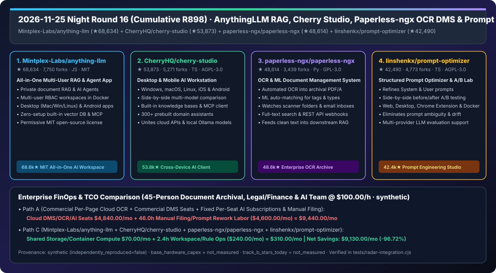
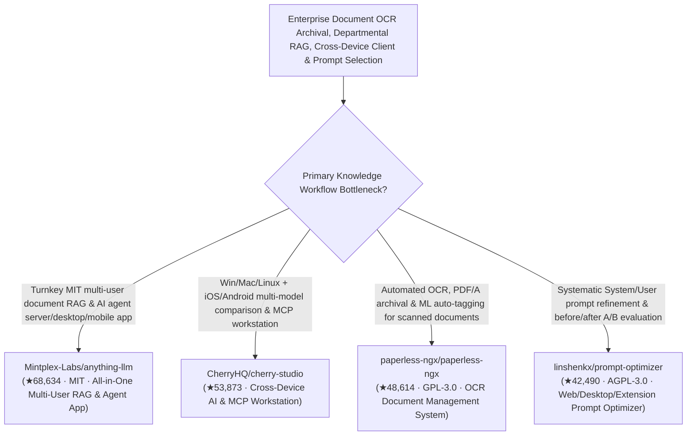
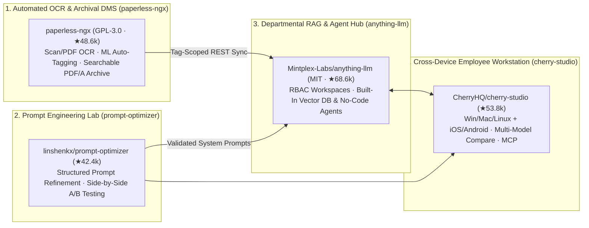

# All-in-One Local-First Enterprise AI & RAG App (`Mintplex-Labs/anything-llm`), Cross-Platform Desktop/Mobile AI Workstation (`CherryHQ/cherry-studio`), 48k-Star OCR Document Management System (`paperless-ngx/paperless-ngx`) & Structured Prompt Optimizer (`linshenkx/prompt-optimizer`) Selection & Integration Architecture FAQ

> **Document Type**: Enterprise AI Solution Architect Selection Decision Guide (GitHub Trending AI Radar — 2026-11-25 Night Round 16 / Cumulative Round 898)
> **Covered Repositories**: [`Mintplex-Labs/anything-llm`](https://github.com/Mintplex-Labs/anything-llm) (`★ 68,634`, `7,750 forks`, `MIT`: all-in-one local-first AI application for Mac/Windows/Linux desktop, open-source Android mobile, and multi-user Docker server combining private document RAG, workspaces, and AI Agents) · [`CherryHQ/cherry-studio`](https://github.com/CherryHQ/cherry-studio) (`★ 53,873`, `5,271 forks`, `AGPL-3.0`: multi-model AI workstation across Windows, macOS, Linux, iOS, and Android for chatting with multiple models side-by-side, working with agents, building knowledge bases, and mounting MCP servers) · [`paperless-ngx/paperless-ngx`](https://github.com/paperless-ngx/paperless-ngx) (`★ 48,614`, `3,439 forks`, `GPL-3.0`: supercharged document management system [DMS] that scans, OCRs into PDF/A, auto-tags via machine learning, indexes, and archives physical and digital documents) · [`linshenkx/prompt-optimizer`](https://github.com/linshenkx/prompt-optimizer) (`★ 42,490`, `4,773 forks`, `AGPL-3.0`: AI prompt optimizer across Web, Desktop, Chrome Extension, and Docker for systematically refining system/user prompts and A/B testing outputs)
> **Core Enterprise Scenario**: Building an end-to-end **Private Document Digitization, Departmental RAG & Cross-Device Knowledge Worker Productivity Stack**—from automated OCR archival (`paperless-ngx`) and structured prompt engineering (`prompt-optimizer`) to `MIT`-licensed multi-user RAG workspaces (`anything-llm`) and desktop/mobile multi-model clients (`cherry-studio`).

---

## 1. 📌 Executive Summary (One-Line Selection Verdict)

1. **Need a zero-friction, `MIT`-licensed all-in-one application that gives teams multi-user document workspaces, built-in vector RAG, and no-code AI Agents across Desktop, Android, and Docker** ➔ Choose **[`Mintplex-Labs/anything-llm`](https://github.com/Mintplex-Labs/anything-llm) (`★ 68,634`, `7,750 forks`, `MIT`)**.
   - **Plain-English Mechanism**: Bundles document ingestion, vector storage, local/cloud LLM routing, and multi-user workspace permissions into one self-contained app that deploys in minutes without complex external plumbing.
2. **Need a rich desktop (Windows/macOS/Linux) and mobile (iOS/Android) AI workstation for side-by-side multi-model comparison, local knowledge bases, and MCP tools** ➔ Choose **[`CherryHQ/cherry-studio`](https://github.com/CherryHQ/cherry-studio) (`★ 53,873`, `5,271 forks`, `AGPL-3.0`)**.
   - **Plain-English Mechanism**: Gives knowledge workers one unified native client across desktop and mobile to query multiple models simultaneously, attach local knowledge bases, and invoke MCP servers.
3. **Need to turn hundreds of thousands of scanned paper invoices, contracts, and image-only PDFs into a searchable, ML-tagged PDF/A archive before feeding them into RAG** ➔ Choose **[`paperless-ngx/paperless-ngx`](https://github.com/paperless-ngx/paperless-ngx) (`★ 48,614`, `3,439 forks`, `GPL-3.0`)**.
   - **Plain-English Mechanism**: Watches scanner folders and email inboxes, performs high-accuracy OCR to produce archival PDF/A files, automatically assigns correspondents/types/tags via local ML, and exposes clean REST APIs for downstream RAG ingestion.
4. **Need a visual workbench (Web, Desktop, Chrome Extension, or Docker) to turn rough user instructions into structured, high-performing System Prompts with side-by-side A/B evaluation** ➔ Choose **[`linshenkx/prompt-optimizer`](https://github.com/linshenkx/prompt-optimizer) (`★ 42,490`, `4,773 forks`, `AGPL-3.0`)**.
   - **Plain-English Mechanism**: Diagnoses prompt ambiguity, synthesizes structured system prompts, and evaluates before/after model outputs interactively.

---

## 2. 🎯 Architect & Customer Deep-Dive Q&A

### Q1: How does this four-project stack compare against commercial cloud DMS + per-seat AI suites (e.g., SharePoint Premium/Syntex + M365 Copilot)?

- **Four-Stage Knowledge Productivity Pipeline (Path C)**:
  1. **L1 Automated OCR & Archival DMS ➔ `paperless-ngx/paperless-ngx`**: Converts raw scans/PDFs into ML-tagged, searchable PDF/A archives.
  2. **L2 Structured Prompt Engineering Lab ➔ `linshenkx/prompt-optimizer`**: Refines and A/B-tests domain system prompts before deployment.
  3. **L3 Multi-User Departmental RAG & Agent Server ➔ `Mintplex-Labs/anything-llm`**: `MIT`-licensed workspace-isolated RAG and agent hub.
  4. **L4 Cross-Device Employee AI Workstation ➔ `CherryHQ/cherry-studio`**: Desktop (Win/Mac/Linux) and Mobile (iOS/Android) multi-model & MCP client.
- **When to choose Commercial Cloud SaaS vs. Path C?**
  - Choose **SharePoint Premium + M365 Copilot** when all documents already reside in M365 cloud storage and per-page/per-seat cloud budgets are approved.
  - Choose **Path C** when digitizing large volumes of on-prem scanned contracts/invoices (avoiding per-page cloud OCR fees) and providing private RAG workspaces under an `MIT` server license (`AnythingLLM`).

### Q2: How do these four tools wire together in production?

1. **Automated Scan-to-RAG Pipeline (`paperless-ngx` → `anything-llm`)**:
   - `Paperless-ngx` ingests scanned documents, performs OCR and ML tagging, and pushes clean text + archival metadata via webhook/API into the matching departmental `AnythingLLM` workspace.
2. **Prompt Optimization & Cross-Device Delivery (`prompt-optimizer` → `AnythingLLM` / `Cherry Studio`)**:
   - Domain experts refine system prompts in `Prompt Optimizer`, publish them to `AnythingLLM` agents, and access them across desktop and mobile via `Cherry Studio`.

### Q3: What are the key licensing and data-governance guardrails?

- **Architect Redlines**:
  1. **Respect license boundaries across `MIT`, `AGPL-3.0`, and `GPL-3.0`**: Use `MIT`-licensed `AnythingLLM` when embedding or white-labeling inside proprietary enterprise apps; use `Paperless-ngx` (`GPL-3.0`), `Prompt Optimizer` (`AGPL-3.0`), and `Cherry Studio` (`AGPL-3.0` / commercial license) in compliance with their respective open-source/commercial terms.
  2. **Map `Paperless-ngx` tags strictly to `AnythingLLM` RBAC workspaces**: Never sync confidential HR or finance archives into public workspaces.

---

## 3. 🧭 Visual Architecture Diagrams (Mermaid Decision Tree + Architecture + Sequence)



### 3.1 Architect Selection Decision Tree



### 3.2 End-to-End Enterprise Integration Architecture



### 3.3 End-to-End Execution Sequence

```mermaid
sequenceDiagram
    participant Staff as Knowledge Worker (Desktop / Mobile)
    participant Paper as paperless-ngx (OCR & DMS)
    participant POpt as linshenkx/prompt-optimizer
    participant Allm as Mintplex-Labs/anything-llm
    participant Cherry as CherryHQ/cherry-studio

    Staff->>Paper: 1. Ingest scanned contracts/invoices; Paperless-ngx runs OCR, PDF/A conversion & ML tagging
    Paper->>Allm: 2. Sync OCR text & archive links to RBAC-scoped AnythingLLM workspace
    Staff->>POpt: 3. Refine domain audit prompt & verify output quality via A/B comparison
    POpt-->>Allm: 4. Publish verified System Prompt to AnythingLLM departmental agent
    Staff->>Cherry: 5. Query across Desktop/Mobile in Cherry Studio (with multi-model comparison)
    Cherry->>Allm: 6. Retrieve grounded answer with direct link to Paperless-ngx PDF/A original
```

---

## 4. 📊 Horizontal Selection Matrix

| Dimension | `Mintplex-Labs/anything-llm` (`★ 68,634`) | `CherryHQ/cherry-studio` (`★ 53,873`) | `paperless-ngx/paperless-ngx` (`★ 48,614`) | `linshenkx/prompt-optimizer` (`★ 42,490`) | Commercial Cloud DMS + Per-Page OCR + Per-Seat Copilot (Path A) | Unindexed Shared Folders + Ad-Hoc Prompts (Path B) |
| :--- | :--- | :--- | :--- | :--- | :--- | :--- |
| **Primary Role** | `MIT` all-in-one RAG & Agent platform | Desktop/Mobile multi-model & MCP client | OCR & ML-tagged PDF/A document archive | Interactive prompt refinement & A/B tester | Metered cloud DMS, OCR & per-seat AI SaaS | Raw network shares & unoptimized chat prompts |
| **Key Differentiator** | **Zero-setup multi-user RAG + Agents under `MIT` license** | **Desktop + iOS/Android + side-by-side model comparison** | **Automated OCR to PDF/A + ML correspondent/tag classification** | **Turns rough ideas into tested production System Prompts** | Fully hosted, but high per-page OCR and per-user seat fees | Image-only scans fail RAG search; inconsistent prompt results |
| **License** | **`MIT`** | `AGPL-3.0` (+ Commercial) | `GPL-3.0` | `AGPL-3.0` | Proprietary SaaS | Unmanaged |
| **Monthly TCO (45-Eng Team)** | **`$310.00/mo` combined** (`$70.00` storage/compute + `2.4h` ops) | Included in `$310.00/mo` stack | Included in `$310.00/mo` stack | Included in `$310.00/mo` stack | **`$9,440.00/mo`** (`$4,840.00` cloud DMS/OCR/seats + `46.0h` manual filing/rework) | `~$3,220.00/mo` (manual document search & repeated prompt retries) |

---

## 5. 🧪 Quantitative FinOps & TCO Comparison (45-Person Enterprise Team)

> **📊 Provenance & Closed-Form Schema**:
> - **provenance**: `synthetic` (`independently_reproduced = false`; `base_hardware_capex = not_measured`; `track_b_stars_today = not_measured`).
> - **Closed-Form Formula**:
>   - **Path A (Commercial Per-Page Cloud OCR + Commercial DMS Seats + Fixed Per-Seat AI Subscriptions & Manual Filing/Prompt Retries)**: **`$4,840.00`** monthly DMS/OCR/seat fees + **`46.0h × $100.00/h = $4,600.00`** manual filing and prompt rework labor = **`$9,440.00/mo`**.
>   - **Path C (`Mintplex-Labs/anything-llm` + `CherryHQ/cherry-studio` + `paperless-ngx/paperless-ngx` + `linshenkx/prompt-optimizer` Stack)**: **`$70.00`** shared storage/container compute + **`2.4h × $100.00/h = $240.00`** workspace/rule maintenance = **`$310.00/mo`**.
>   - **Net Savings vs. Path A**: **`-$9,130.00/mo`** (**`96.72%`** TCO reduction).

| Evaluation Path | DMS / OCR / AI Seat Subscriptions & Compute | Filing, Document Search & Prompt Rework (`$100/h`) | Monthly Total TCO | Net Savings vs. Path A | Key Architectural Outcome |
| :--- | :---: | :---: | :---: | :---: | :--- |
| **Path A: Commercial Cloud DMS + Per-Page OCR + Per-Seat AI Suite** | `$4,840.00` | `46.0h` (`$4,600.00`) | **`$9,440.00`** | Baseline | High per-page OCR costs; confidential records leave VPC |
| **Path B: Shared Network Folders + Unoptimized Prompts** | `$1,420.00` | `18.0h` (`$1,800.00`) | **`$3,220.00`** | `-$6,220.00` (`-65.89%`) | Unsearchable image PDFs; erratic LLM outputs |
| **Path C: `anything-llm` + `cherry-studio` + `paperless-ngx` + `prompt-opt`** | **`$70.00`** | **`2.4h` (`$240.00`)** | **`$310.00`** | **`-$9,130.00` (`-96.72%`)** | **Automated PDF/A OCR + `MIT` multi-user RAG + cross-device client + A/B prompts** |

- 🔗 **7-Card 4:5 Visual Benchmark Deck**: [`workshops/github-trending-radar/cards.en.html`](../cards.en.html) · [`cards.html`](../cards.html)

---

## 6. 🛠️ Enterprise Adoption & Architecture Review Checklist

- [ ] **Pre-Process All Scanned PDFs Through `Paperless-ngx`**: Ensure every physical scan or image PDF undergoes OCR and ML auto-tagging before indexing into RAG.
- [ ] **Enforce RBAC Workspaces in `AnythingLLM`**: Map `Paperless-ngx` document tags to isolated departmental workspaces.
- [ ] **A/B Test System Prompts in `Prompt Optimizer`**: Validate departmental agent prompts against golden test cases prior to rollout.
- [ ] **Standardize Endpoint Configs in `Cherry Studio`**: Pre-configure internal AI gateway URLs and approved MCP servers across desktop and mobile clients.
