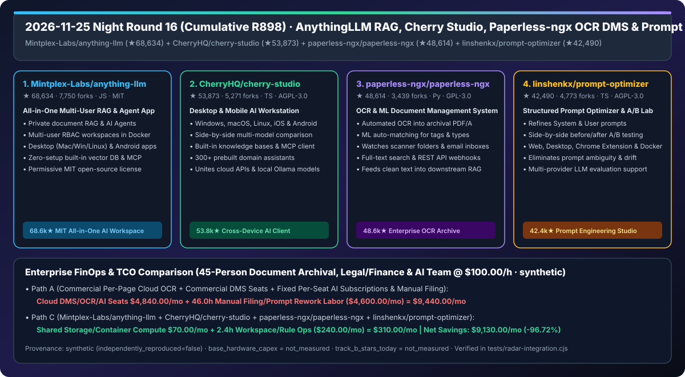
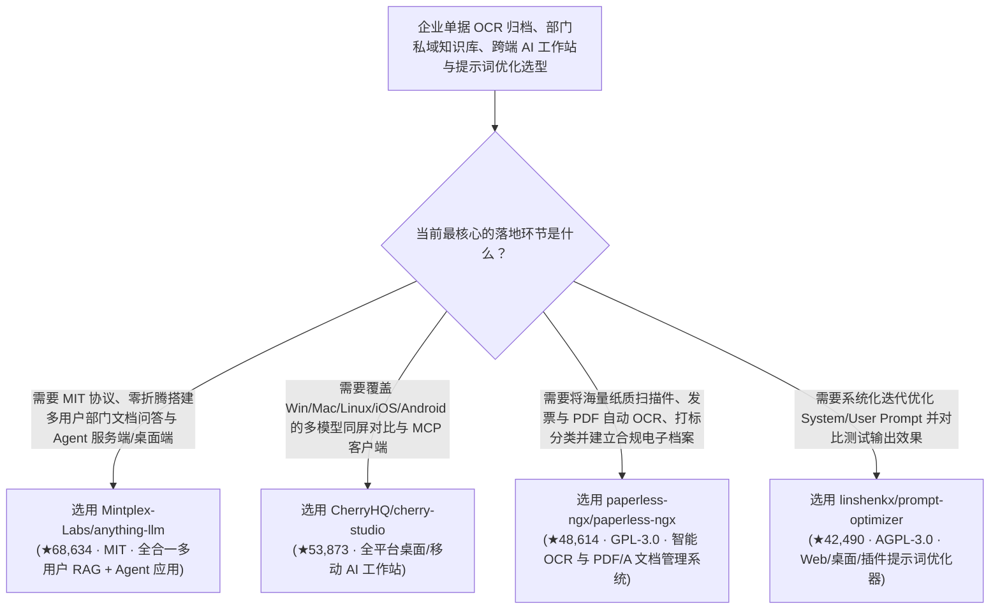
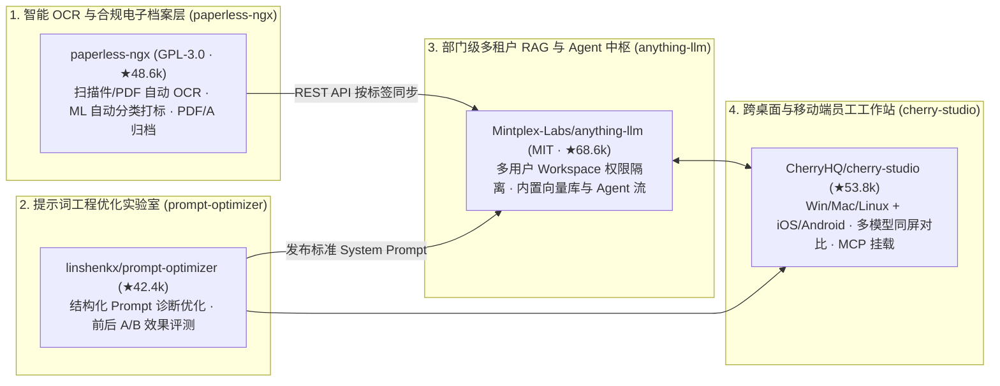
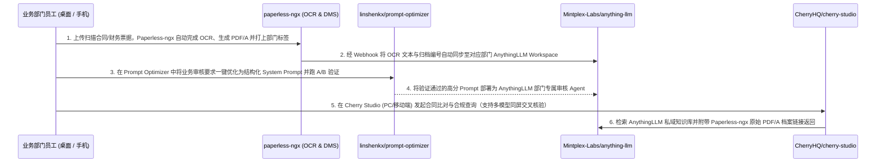

# 全合一本地优先企业文档与智能体工作台（`Mintplex-Labs/anything-llm`）、跨桌面与移动端多模型 AI 工作站（`CherryHQ/cherry-studio`）、4.8 万星智能 OCR 文档归档管理系统（`paperless-ngx/paperless-ngx`）与系统提示词迭代优化工作台（`linshenkx/prompt-optimizer`）选型与集成架构 FAQ

> **文档类型**：企业 AI 解决方案架构师（AI Solution Architect）选型决策指南（GitHub Trending AI 雷达 2026-11-25 Night Round 16 / 累计第 898 轮）
> **覆盖项目**：[`Mintplex-Labs/anything-llm`](https://github.com/Mintplex-Labs/anything-llm)（`★ 68,634`、`7,750 forks`、`MIT`：6.8 万星全合一企业私域文档问答与 AI Agent 应用，同时提供 Mac/Windows/Linux 桌面端、开源 Android 移动端与支持多用户权限的 Docker 服务端）· [`CherryHQ/cherry-studio`](https://github.com/CherryHQ/cherry-studio)（`★ 53,873`、`5,271 forks`、`AGPL-3.0`：5.3 万星全平台 AI 生产力工作站 [Windows/macOS/Linux + iOS/Android 移动端]，支持多模型同屏对比对话、知识库构建、MCP Server 挂载与日常任务自动化）· [`paperless-ngx/paperless-ngx`](https://github.com/paperless-ngx)（`★ 48,614`、`3,439 forks`、`GPL-3.0`：4.8 万星企业级开源文档管理系统 [DMS]，将纸质扫描件、发票、合同与 PDF 自动执行 OCR 识别、机器学习自动分类打标 [Correspondent/Document Type/Tags] 并建立全文检索档案库）· [`linshenkx/prompt-optimizer`](https://github.com/linshenkx/prompt-optimizer)（`★ 42,490`、`4,773 forks`、`AGPL-3.0`：4.2 万星 AI 提示词优化器，支持 Web、桌面、Chrome 插件与 Docker 部署，帮助架构师与业务专家对 System/User Prompt 进行结构化迭代与前后效果对比验证）
> **核心场景**：当传统制造、律所、财务与政企客户推进“纸质/扫描单据数字化归档 + 部门级私有知识库问答 + 个人多模型桌面生产力工作站”落地时，架构师面临四个紧密衔接的选型问题：**“企业每年几十万份扫描合同、发票与公文怎么先做标准化 OCR 归档、自动打标签并长期合规留存（`paperless-ngx`）？归档后的文档用哪款 `MIT` 协议零门槛全合一系统快速搭出多用户部门知识库与 Agent（`anything-llm`）？员工日常在电脑和手机上想同时对比调用多个云端/本地大模型与 MCP 工具，哪款客户端最成熟（`cherry-studio`）？业务人员写不好高质量 System Prompt 怎么办（`prompt-optimizer`）？”** 本文给出四合一企业知识生产力参考架构。

---

## 一、📌 核心结论速览（选型一句话结论）

1. **想用一套 `MIT` 协议、零复杂配置的全合一系统，在几分钟内为部门搭起“带多用户权限、文档拖拽入库、内置向量检索与可视化 Agent Builder”的私有 ChatGPT** ➔ 选 **[`Mintplex-Labs/anything-llm`](https://github.com/Mintplex-Labs/anything-llm)（`★ 68,634`，`7,750 forks`，`MIT`）**。
   - **通俗原理**：把文档解析器、向量数据库、多模型路由、No-Code Agent 流与多租户 Workspace 权限全部打包在一个应用里；既可以单机装在 Windows/Mac/Linux 电脑和 Android 手机上离线跑，也可以用 Docker 一键部署为全团队共享的服务器版本。
2. **需要为每位知识工作者配备一个跨 Windows、macOS、Linux、iOS 与 Android 的全能桌面/移动 AI 客户端，支持“一问多模同屏对比”、本地知识库与一键挂载 MCP 工具** ➔ 选 **[`CherryHQ/cherry-studio`](https://github.com/CherryHQ/cherry-studio)（`★ 53,873`，`5,271 forks`，`AGPL-3.0`）**。
   - **通俗原理**：在员工桌面端统一收口各大云厂商 API 与本地 Ollama 模型，遇到重要方案撰写时可同时让 Claude、GPT、Gemini 与 DeepSeek 同屏作答横向比对，并直接挂载企业内部 MCP 工具与知识库。
3. **企业在做 RAG 之前，首先面临“海量纸质扫描件、财务发票、历史传真与零散 PDF 没有统一档案编号、没有 OCR 文本层、找不到原件”的基础数据治理痛点** ➔ 选 **[`paperless-ngx/paperless-ngx`](https://github.com/paperless-ngx/paperless-ngx)（`★ 48,614`，`3,439 forks`，`GPL-3.0`）**。
   - **通俗原理**：不要把未归档的脏乱扫描件直接往向量库里塞。先用 `Paperless-ngx` 监听扫描仪目录或邮箱附件，自动执行高质量 OCR 生成可搜索 PDF/A 长期归档件，利用内置机器学习模型自动匹配往来单位（Correspondent）、单据类型与标签，再通过 REST API 干净地同步给下游 RAG 知识库。
4. **想让不懂提示词工程的业务专家与产品经理，在把 Prompt 写入 `AnythingLLM` / `Cherry Studio` 或生产代码前，自动把一句模糊大白话优化成结构严谨的工业级 System Prompt 并对比输出质量** ➔ 选 **[`linshenkx/prompt-optimizer`](https://github.com/linshenkx/prompt-optimizer)（`★ 42,490`，`4,773 forks`，`AGPL-3.0`）**。
   - **通俗原理**：提供开箱即用的 Docker Web 端与 Chrome 浏览器插件，自动诊断原始提示词的歧义、缺失约束与格式漏洞，一键生成多版结构化候选提示词并支持使用真实业务测试集实时跑 A/B 对比。

---

## 二、🎯 客户与架构师灵魂拷问 Q&A（深度架构拆解）

### Q1：在企业落地“文档数字化管理 + 全员 AI 知识工作台”时，这四个开源项目 vs 商业云套件（如 SharePoint Premium / Syntex + M365 Copilot）怎么选？

- **四步企业知识生产力流水线（Path C）**：
  1. **L1 原始单据 OCR 与合规档案库 ➔ `paperless-ngx/paperless-ngx`**：负责扫描件/PDF 的 OCR 数字化、PDF/A 归档与机器学习自动分类打标。
  2. **L2 提示词工程标准化与测试台 ➔ `linshenkx/prompt-optimizer`**：负责将业务专家的审核/问答规则提炼为高稳定度 System Prompt。
  3. **L3 部门级多租户 RAG 与 Agent 服务端 ➔ `Mintplex-Labs/anything-llm`**：以 `MIT` 协议承载各部门 Workspace 隔离的文档问答与自动化 Agent。
  4. **L4 个人跨端多模型工作站 ➔ `CherryHQ/cherry-studio`**：为桌面（Win/Mac/Linux）与移动端（iOS/Android）员工提供多模型同屏比对与本地 MCP 交互。
- **何时选商业云套件（SharePoint Premium + M365 Copilot） vs 自建本轮开源四件套（Path C）？**
  - 若企业所有文档原本就 100% 存储在 SharePoint Online 且已购买全员 M365 Copilot 与按页计费的 SharePoint Premium，直接用微软云原生方案最省心。
  - **何时采用本轮开源四件套（Path C）？** 当企业存在大量**必须留在内网 NAS/存储服务器上的敏感财务发票、法务合同与人事档案**、需要免费处理数十万页历史扫描件 OCR 归档（`paperless-ngx`）、并希望以零席位费为全员提供多模型桌面/手机客户端（`Cherry Studio`）与部门知识库（`AnythingLLM`）时，Path C 可节省 **96%+** 的按页 OCR 与按人头 SaaS 订阅成本。

### Q2：如何把这四个项目集成进企业内网生产环境？

1. **自动化单据归档与清洗管道（`paperless-ngx` → `anything-llm`）**：
   - 扫描仪与业务邮箱将合同/票据投递至 `Paperless-ngx` 消费目录，完成 OCR、PDF/A 转换与自动打标后，通过 Webhook / REST API 将清洗后的标准文本与元数据自动同步至对应部门的 `AnythingLLM` Workspace。
2. **提示词调优与助手发布闭环（`prompt-optimizer` → `AnythingLLM` / `Cherry Studio`）**：
   - 架构师与业务骨干在内部部署的 `Prompt Optimizer` 中迭代打磨法务审合同、财务审票据等专项 System Prompt，验证通过后一键发布为 `AnythingLLM` 部门 Agent 与 `Cherry Studio` 预设企业助手。

### Q3：生产落地的许可证与权限红线是什么？

- **架构师避坑红线**：
  1. **区分 `MIT`、`AGPL-3.0` 与 `GPL-3.0` 的商用边界**：`AnythingLLM` 采用宽松的 `MIT` 协议；`Cherry Studio`（桌面端还涉及企业商业授权条款）、`Prompt Optimizer`（`AGPL-3.0`）与 `Paperless-ngx`（`GPL-3.0`）适合企业原样内部自托管使用，切勿在未获商业授权的情况下抹除品牌标识对外打包售卖。
  2. **部门档案与 Workspace 权限严格对齐**：从 `Paperless-ngx` 向 `AnythingLLM` 同步文档时，必须按文档的标签/部门属性（如 `HR-Confidential`、`Finance-AP`）路由至受 RBAC 保护的独立 Workspace，严禁混入全员公共知识库。

---

## 三、🧭 直观可视化图解（Mermaid 决策树 + 集成架构 + 时序图）

### 3.1 架构师选型决策树

### 3.2 企业端到端生产集成参考架构图

### 3.3 纸质单据扫描入库、自动 OCR 分发、提示词优化与跨端问答时序图

---

## 四、📊 同类开源与商业云服务横向选型决策矩阵

| 对比维度 | `Mintplex-Labs/anything-llm` (`★ 68,634`) | `CherryHQ/cherry-studio` (`★ 53,873`) | `paperless-ngx/paperless-ngx` (`★ 48,614`) | `linshenkx/prompt-optimizer` (`★ 42,490`) | 商业云端 DMS + 按页 OCR + 全员商业 Copilot 席位 (Path A) | 共享网盘乱堆扫描件 + 手写未调优短提示词 (Path B) |
| :--- | :--- | :--- | :--- | :--- | :--- | :--- |
| **核心能力定位** | `MIT` 全合一多用户 RAG 与 Agent 平台 | 跨桌面/移动端多模型与 MCP 工作站 | 智能 OCR、自动打标与 PDF/A 档案系统 | 系统/用户提示词迭代优化与对比平台 | 按页/按存储/按人头三重收费的商业云服务 | 局域网 SMB 文件夹 + 裸调网页聊天框 |
| **核心技术突破** | **零配置打包向量库/Agent/多租户 + `MIT` 协议** | **全平台覆盖（含 iOS/Android）+ 多模型同屏对比** | **自动 OCR 转 PDF/A + 机器学习自动匹配标签** | **一键消除提示词歧义并直观做前后 A/B 测试** | 免自建，但历史百万页扫描件云端 OCR 与席位费极贵 | 扫描件无文本层根本搜不到；模糊 Prompt 导致回答质量波动极大 |
| **开源协议** | **`MIT`** | `AGPL-3.0` (+ 商业许可) | `GPL-3.0` | `AGPL-3.0` | 闭源商业 SaaS | 无治理 |
| **月度 TCO（45 人团队）** | **四件套合建仅 `$310.00/月`**（`$70.00` 存储/OCR 容器算力 + `2.4h` 维护） | 同左（员工复用按量 API 与本地模型） | 同左（内网无限页数 OCR 归档零按页税） | 同左（显著减少因烂 Prompt 导致的重复追问 Token） | **`$9,440.00/月`**（`$4,840.00` 商业 DMS/按页 OCR 与全员席位 + `46.0h` 人工归档找文件） | 约 `$3,220.00/月`（大量人工翻找扫描件与反复重写 Prompt 工时） |

---

## 五、🧪 应用落地定量收益/TCO 对比与 7-Card 报告

> **📊 数据来源与闭式核算声明（Provenance & Closed-Form Schema）**：
> - **provenance**: `synthetic`（基于 45 人企业档案数字化、法务/财务文档审查与全员 AI 办公团队月度工作负载模型：`independently_reproduced = false`；硬件采购基线 `base_hardware_capex = not_measured`；Track B 单日增量 `track_b_stars_today = not_measured`）。
> - **核算公式**：
>   - **Path A（采购按页计费商业云端 OCR 与商业文档管理 SaaS + 全员固定 AI 办公席位 + 人工手工重命名归档扫描件与反复追问低效 Prompt）**：月度商业 DMS/OCR 与 SaaS 席位费 **`$4,840.00`** + 手工录入单据标签、翻找历史扫描件与返工人工 **`46.0h × $100.00/h = $4,600.00`** = **`$9,440.00/月`**。
>   - **Path C（自建 `Mintplex-Labs/anything-llm` + `CherryHQ/cherry-studio` + `paperless-ngx/paperless-ngx` + `linshenkx/prompt-optimizer` 企业级文档与 AI 生产力底座）**：内网存储与容器算力分摊 **`$70.00`** + 归档规则与 Workspace 权限维护人工 **`2.4h × $100.00/h = $240.00`** = **`$310.00/月`**。
>   - **净节省（Net Savings vs Path A）**：**`-$9,130.00/月`**（成本降低 **`96.72%`**）。

| 评估方案 | 商业 DMS / OCR / AI 席位与算力成本 | 单据归档、翻找原件与返工人工（`$100/h`） | 月度总 TCO | 相对 Path A 净节省 | 核心业务交付收益 |
| :--- | :---: | :---: | :---: | :---: | :--- |
| **Path A：商业云端 DMS + 按页计费 OCR + 全员固定 AI 席位** | `$4,840.00` | `46.0h` (`$4,600.00`) | **`$9,440.00`** | Baseline | 存量扫描件按页 OCR 费用高昂；涉密合同不便上传外部云 |
| **Path B：共享文件夹乱存 PDF + 未经优化的口语化 Prompt** | `$1,420.00` | `18.0h` (`$1,800.00`) | **`$3,220.00`** | `-$6,220.00` (`-65.89%`) | 扫描图片无 OCR 层无法被 RAG 检索；回答质量极不稳定 |
| **Path C：`anything-llm` + `cherry-studio` + `paperless-ngx` + `prompt-opt`** | **`$70.00`** | **`2.4h` (`$240.00`)** | **`$310.00`** | **`-$9,130.00` (`-96.72%`)** | **自动 OCR 归档 + `MIT` 多用户 RAG + 全端工作站 + 结构化 Prompt** |

- 🔗 **关联 7-Card 4:5 视觉评测报告**：[`workshops/github-trending-radar/cards.html`](../cards.html) · [`cards.en.html`](../cards.en.html)

---

## 六、🛠️ 企业引入与架构评审 Checklist

- [ ] **先过 `Paperless-ngx` OCR 与分类再入 RAG**：将所有纸质扫描件与无文本层 PDF 统一先经 `paperless-ngx` 转化为带文本层与标准元数据标签的 PDF/A，再同步至 `AnythingLLM`。
- [ ] **在 `AnythingLLM` 中开启多用户角色与 Workspace 隔离**：按部门配置独立 Workspace 与只读/管理员权限，开启内置会话审计日志。
- [ ] **使用 `Prompt Optimizer` 建立企业标准提示词模板库**：要求所有上线至部门知识库的 System Prompt 必须先通过 `linshenkx/prompt-optimizer` 的对比测试。
- [ ] **在 `Cherry Studio` 中统一指向企业内部 AI 网关**：通过集中配置下发内部模型端点与受控 MCP 工具列表。
