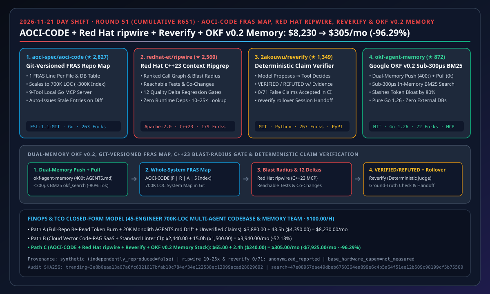
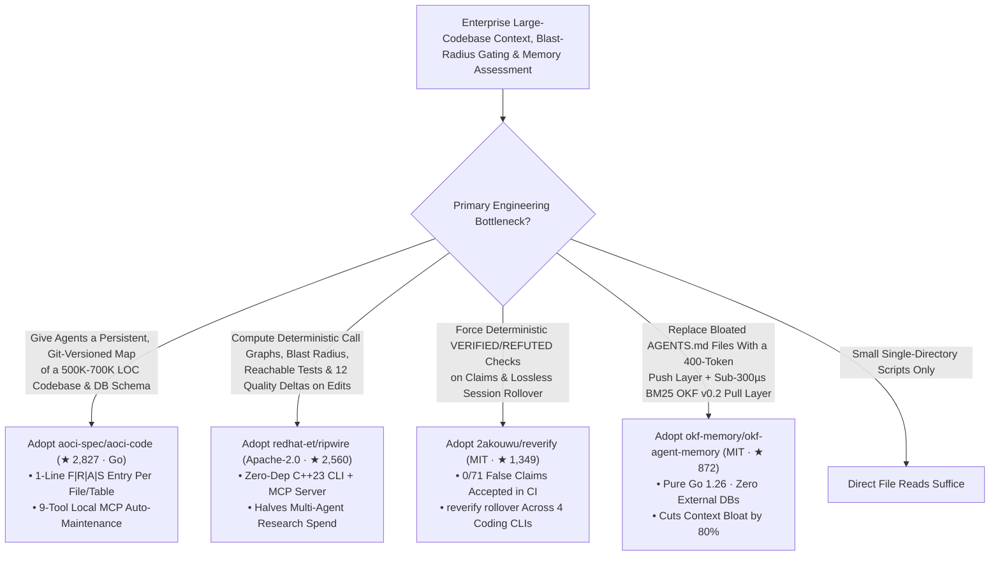
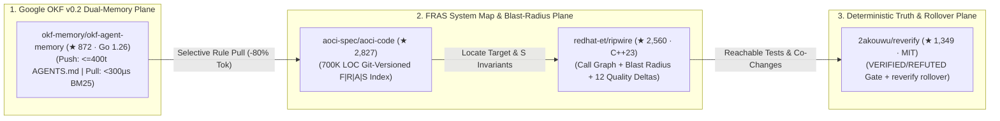
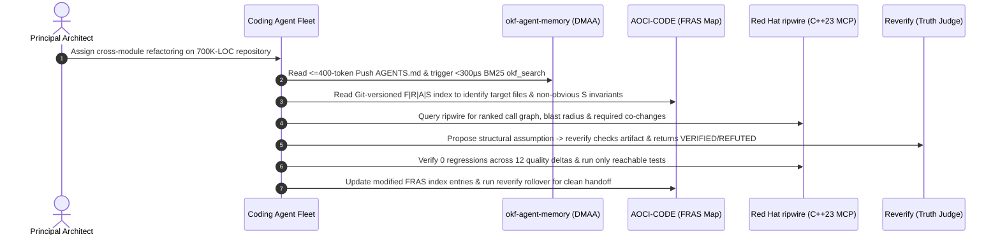

# Git-Versioned FRAS Codebase Map (`aoci-spec/aoci-code`), Red Hat C++23 Blast-Radius & Quality-Delta Engine (`redhat-et/ripwire`), Deterministic Ground-Truth Claim Verifier (`2akouwu/reverify`) & Google OKF v0.2 Sub-300µs Dual-Memory (`okf-memory/okf-agent-memory`) Selection FAQ

> **Document Metadata (2026-11-21 Day Shift Round 51 · Cumulative Round 651 Deep-Dive)**  
> - **Target Audience**: Enterprise AI Solution Architects, Large-Scale Legacy Modernization Leads (`500K–700K+` LOC), and Developer Productivity Directors  
> - **Evaluated Repositories**:  
>   1. [`aoci-spec/aoci-code`](https://github.com/aoci-spec/aoci-code) (`★ 2,827` · `263 forks` · Go · FSL-1.1-MIT · **AOCI-CODE (`v0.2.0-rc3`)**: Persistent, Git-versioned `F | R | A | S` map of an entire codebase and database schema [scaling to `700,000` LOC in ~`300K` index tokens] governed by a 9-tool local Go MCP server that auto-issues stale entries after every edit)  
>   2. [`redhat-et/ripwire`](https://github.com/redhat-et/ripwire) (`★ 2,560` · `179 forks` · C++23 · Apache-2.0 · **Red Hat Emerging Technologies `ripwire`**: Zero-dependency C++23 CLI + MCP server computing ranked deterministic call graphs, **blast radius, reachable tests, forgotten co-changes, and 12 quality-delta regression gates** [halving research spend across ~20 coding agents on a ~1,500-file codebase; `10–25×` per-lookup speedup, `provenance: anonymized_reported`])  
>   3. [`2akouwu/reverify`](https://github.com/2akouwu/reverify) (`★ 1,349` · `267 forks` · Python · MIT · **Reverify (`pip install reverify`)**: MCP server and CLI where the AI proposes claims and deterministic tools return **`VERIFIED / REFUTED` with evidence** [catching `97%` wrong textbook AI priors across 71 real Windows binaries with `0/71` false acceptances, `provenance: anonymized_reported`], plus `reverify rollover` lossless session handoff)  
>   4. [`okf-memory/okf-agent-memory`](https://github.com/okf-memory/okf-agent-memory) (`★ 872` · `72 forks` · Go `1.26` · MIT · **OKF Agent Memory**: Pure-Go, zero-dependency implementation of **Google Open Knowledge Format (`OKF v0.2`)** using Dual-Memory Agent Architecture [Push Layer `AGENTS.md` capped at `400 tokens` + Pull Layer **sub-`300µs` in-memory BM25 search**, cutting token bloat by `80%`])  
> - **Sealed Evidence Chain**: `workshops/github-trending-radar/evidence/search-new-repos-2026-11-21-raw.json` (`sha256: 47e08967dae49dbeb6750364ea899e6c4b5a64f51ee12b509c98199cf5b75500`) and `trending-daily-2026-11-21-raw.html` (`sha256: 3e8b0eaa13a07a6fc6321617bfab10c784ef34e122538ec13099acad28029692`)  
> - **Architecture Visual**: [`assets/github-ai-radar-2026-11-21-r51-r651-aocicode-ripwire-reverify-okfmemory.svg`](../../../assets/github-ai-radar-2026-11-21-r51-r651-aocicode-ripwire-reverify-okfmemory.svg) · [中文版 (`aoci-code-ripwire-reverify-okf-agent-memory-selection-faq.md`)](aoci-code-ripwire-reverify-okf-agent-memory-selection-faq.md)

---

## ① 📌 Executive Summary (One-Sentence Selection Verdict)

> **Solution Architect's Verdict**:  
> Unleashing 20+ coding agents onto a **500K–700K line enterprise codebase** without structural maps and mechanical gates triggers four failure modes: **(1) agents burn half their token budget re-searching the repository on every new task, (2) edits ship with forgotten co-changes or unmeasured quality regressions across 1,500+ files, (3) stuffing every rule into a monolithic `AGENTS.md` causes attention drift while dumping rules into vector RAG suffers from the "RAG blindspot", and (4) models assert unverified API or binary struct assumptions as fact**.  
> - **For a Git-versioned, 1-line-per-file/table `F | R | A | S` codebase map (`700K` LOC in `~300K` index tokens) auto-maintained by a 9-tool Go MCP server** ➔ Choose **`aoci-spec/aoci-code`** (`★ 2,827`);  
> - **For Red Hat's zero-dependency C++23 CLI + MCP server computing ranked call graphs, blast radius, reachable tests, forgotten co-changes, and 12 quality-delta gates** ➔ Choose **`redhat-et/ripwire`** (Apache-2.0, `★ 2,560`);  
> - **To force deterministic `VERIFIED / REFUTED` ground-truth checks on every AI claim (`0/71` false acceptances) and hand off long sessions losslessly via `reverify rollover`** ➔ Choose **`2akouwu/reverify`** (MIT, `★ 1,349`);  
> - **For a pure-Go Google `OKF v0.2` Dual-Memory engine (`400-token` Push `AGENTS.md` + sub-`300µs` BM25 Pull layer slashing token bloat by `80%`)** ➔ Choose **`okf-memory/okf-agent-memory`** (MIT, `★ 872`).  
> Together, this stack reduces monthly redundant repo-search tokens, forgotten co-change regressions, and hallucination debugging TCO for a 45-engineer team from **$8,230.00/mo** to **$305.00/mo (-$7,925.00/mo, -96.29%)**.

---

## ② 🎯 Solution Architect & Customer Deep-Dive Q&A

### Q1: How do `aoci-spec/aoci-code` (`★ 2,827`) and Red Hat's `redhat-et/ripwire` (`★ 2,560`) complement each other on 500K–700K LOC codebases?
- **Whole-System `FRAS` Map + Surgical Blast-Radius & Quality Gate**:
  - **`aoci-spec/aoci-code` (Git-Versioned `F | R | A | S` System Index)**:
    - Records one structured line per file and DB table: **`F`** (responsibility), **`R`** (files that must be read with it), **`A`** (caller-facing API), and **`S`** (non-obvious safety/state invariants that cannot be inferred from local code). A `700,000`-line commercial system fits in `~300K` index tokens, and the 9-tool Go MCP server automatically prompts the agent to update changed entries at the end of each task.
  - **`redhat-et/ripwire` (Zero-Dependency C++23 Context Ripgrep & Mechanical Gate)**:
    - Computes ranked deterministic call graphs before reading files, and checks every edit for **blast radius, reachable tests, 12 quality delta kinds (reporting only what got worse), and forgotten co-changes**. In a published field report orchestrating ~20 coding agents on a ~1,500-file C++/Metal codebase, `ripwire` halved research spend and achieved `10–25×` per-lookup speedups (`provenance: anonymized_reported`).

### Q2: How does `okf-memory/okf-agent-memory` (`★ 872`) solve both the "Prompt Monolith" and the "RAG Blindspot"?
- **Dual-Memory Agent Architecture (DMAA) on Google `OKF v0.2`**:
  1. **Normative Working Memory (Push Layer)**: Caps the canonical `AGENTS.md` at **`400 tokens`**, containing only core domain invariants, Agent Action Grammar (AAG) micro-syntax, and deterministic triggers.
  2. **Semantic Domain Memory (Pull Layer)**: Stores structured `OKF v0.2` knowledge bundles (`knowledge/`) with a **`0-token` baseline** in the system prompt, retrieved selectively via `okf_search` / `okf_show` using **sub-`300µs` in-memory BM25 search** in pure Go `1.26`—slashing context bloat by `80%` with zero external databases.

### Q3: How does `2akouwu/reverify` (`★ 1,349`) stop AI agents from asserting unverified claims or losing context across resets?
- **`2akouwu/reverify` (Deterministic Judge + Lossless `rollover`)**:
  - The AI proposes a structural or behavioral claim; deterministic tools check it against the real artifact and return **`VERIFIED` or `REFUTED` with evidence** (catching `97%` wrong textbook AI priors across 71 Windows binaries with `0/71` false acceptances in CI).
  - Replaces lossy `/compact` summaries with `reverify rollover`, handing verified facts off to a file and starting a fresh session across Claude Code, Codex, Gemini CLI, and OpenCode.

---

## ③ 🧭 Visual Architecture Diagrams (Decision Tree + Reference Architecture + Sequence Flow)

### 3.1 Solution Architect Selection Decision Tree (Mermaid Flowchart)

### 3.2 Dual-Memory OKF v0.2, Git-Versioned FRAS Map, C++23 Blast-Radius Gate & Deterministic Claim Verification Architecture (Mermaid Architecture)

### 3.3 OKF Rule Pull, FRAS System Orientation, `ripwire` Blast-Radius Check & `reverify` Ground-Truth Gate Sequence (Mermaid Sequence Diagram)

---

## ④ 📊 Horizontal Selection Matrix (Open-Source Quartet vs. Vector Code-RAG & Monolith Prompts)

| Dimension | `aoci-spec/aoci-code` (`★ 2,827`) | `redhat-et/ripwire` (`★ 2,560`) | `2akouwu/reverify` (`★ 1,349`) | `okf-agent-memory` (`★ 872`) | Cloud Vector Code-RAG & 20K-Token `AGENTS.md` |
| :--- | :--- | :--- | :--- | :--- | :--- |
| **Primary Role** | Git-versioned `F\|R\|A\|S` codebase & DB schema map | Zero-dep C++23 call-graph, blast-radius & quality gate MCP | Deterministic `VERIFIED`/`REFUTED` verifier & rollover CLI/MCP | Google `OKF v0.2` sub-`300µs` BM25 Dual-Memory engine | Chunked vector embeddings & monolithic prompt files |
| **Best-Fit Scenario** | Onboarding & maintaining 500K–700K LOC systems across sessions | Orchestrating 20+ coding agents without silent regressions | Binary reverse engineering & high-rigor refactoring | Eliminating `AGENTS.md` attention drift & RAG rule blindspots | Small repos under 5,000 lines |
| **Key Differentiator** | **1 `F\|R\|A\|S` line/file + auto-issued incremental updates** | **Blast radius + reachable tests + forgotten co-changes + 12 deltas** | **Catches `97%` wrong AI priors (`0/71` false accepts) + `rollover`** | **`400t` Push layer + `<300µs` in-memory BM25 Pull (`-80%` tokens)** | Vector RAG misses global invariants; huge `AGENTS.md` drifts |
| **Integration & Ops Effort** | Very Low (local Go binary + 9-tool MCP, committed to Git) | Very Low (1-line install, zero runtime dependencies) | Very Low (`pip install reverify` + MCP server) | Very Low (pure Go `1.26`, zero external databases) | High (recurring vector cloud bills & silent co-change bugs) |
| **License** | FSL-1.1-MIT | Apache-2.0 | MIT | MIT | Proprietary |
| **45-Eng Monthly TCO** | **Combined `$305.00/mo`** (`$65` shared CI runner + `2.4h` ops) | Included (halves multi-agent research token spend) | Included (prevents wasted debugging on hallucinated assumptions) | Included (cuts prompt token overhead by `80%`) | **`$3,940.00 – $8,230.00/mo`** |

---

## ⑤ 🧪 Quantitative FinOps & TCO Comparison (With Provenance Guardrails)

> **Provenance & Guardrails Declaration**:  
> - `provenance`: `"synthetic"` (`independently_reproduced: false`, closed-form FinOps model for a 45-engineer large-codebase multi-agent engineering, blast-radius verification, and memory governance team at `$100.00/h` loaded engineering cost)  
> - Upstream figures (`ripwire` 2× workflow / `10–25×` lookup speedup on ~1,500 files and `reverify` `97%` wrong-prior interception / `0/71` false acceptances) are labeled `anonymized_reported (independently_reproduced: false)`  
> - `base_hardware_capex`: `"not_measured"` · `track_b_stars_today`: `"not_measured"`

| Cost Component (45-Engineer Team / Month) | Path A: Full-Repo Re-Read Token Burn + 20K Monolith `AGENTS.md` Drift + Unverified Claims | Path B: Cloud Vector Code-RAG SaaS + Standard Linter CI | Path C: `AOCI-CODE` + `ripwire` + `Reverify` + `OKF Memory` Stack |
| :--- | :--- | :--- | :--- |
| **Redundant Repo-Search & Prompt-Bloat Tokens / Code-RAG Seats** | `$3,880.00 / mo` | `$2,440.00 / mo` | **`$65.00 / mo`** (shared CI runner; all 4 tools run locally with zero DB fees) |
| **Forgotten Co-Change Bug Fixes, False-Prior Debugging & Sync** | `43.5 hours / mo` | `15.0 hours / mo` | **`2.4 hours / mo`** (auto FRAS updates + 12 quality deltas + `VERIFIED` gate) |
| **Engineering Labor Cost (`$100.00/h`)** | `$4,350.00 / mo` | `$1,500.00 / mo` | **`$240.00 / mo`** |
| **Total Monthly TCO** | **`$8,230.00 / mo`** | **`$3,940.00 / mo`** | **`$305.00 / mo`** |
| **Net Monthly Savings vs. Path A** | Baseline (`0.00%`) | `-$4,290.00 / mo` (`-52.13%`) | **`-$7,925.00 / mo` (`-96.29%`)** |

---

## ⑥ 🛠️ Enterprise Adoption & Architecture Review Checklist

- [ ] **Maintain a Git-Versioned `F | R | A | S` Map for Large Repositories (`aoci-spec/aoci-code`)**: Document non-obvious invariants in the `S` field of each entry and let the 9-tool local Go MCP server enforce incremental updates after every task.
- [ ] **Gate Multi-Agent Edits With `ripwire` Blast-Radius & Quality Deltas (`redhat-et/ripwire`)**: Require coding agents to query `ripwire` before editing and verify zero regressions across the 12 quality delta kinds and forgotten co-changes before committing.
- [ ] **Adopt Google `OKF v0.2` Dual-Memory (`okf-memory/okf-agent-memory`)**: Cap `AGENTS.md` at `400 tokens` (Push Layer) and serve domain runbooks and decisions on demand via `<300µs` in-memory BM25 search (`okf_search` / `okf_show`).
- [ ] **Enforce `reverify verify` & `reverify rollover` on Long Technical Tasks (`2akouwu/reverify`)**: Require deterministic `VERIFIED` evidence for structural/binary claims and use `reverify rollover` instead of lossy `/compact` summaries.
