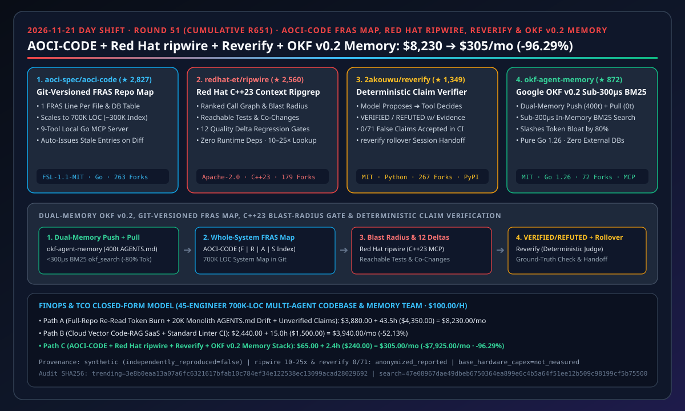
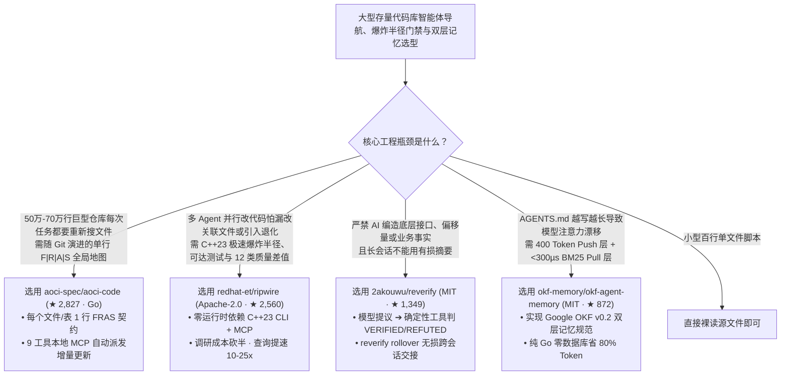
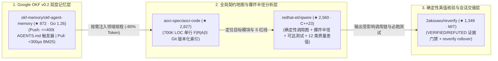
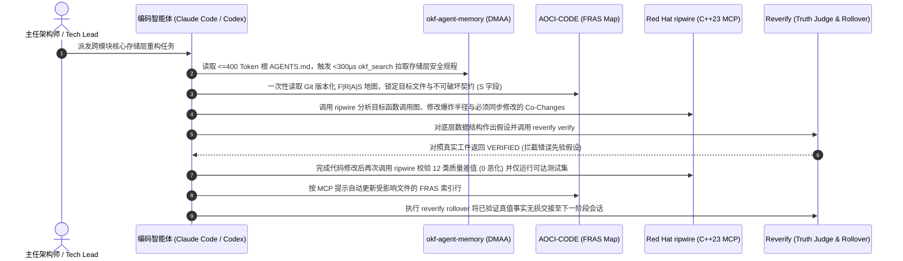

# 70 万行代码库 FRAS 全局契约地图（`aoci-spec/aoci-code`）、Red Hat 零依赖 C++23 爆炸半径与质量差值引擎（`redhat-et/ripwire`）、确定性真值核验与无损交接器（`2akouwu/reverify`）及 Google OKF v0.2 亚毫秒双层记忆（`okf-memory/okf-agent-memory`）选型 FAQ

> **文档元数据（2026-11-21 白班 Day Round 51 · 累计第 651 轮深潜专题）**  
> - **面向对象**：企业 AI 解决方案架构师（AI Solution Architect）、大型存量系统（50 万–100 万行代码）现代化改造负责人、研发效能总监  
> - **本轮核心评估对象**：  
>   1. [`aoci-spec/aoci-code`](https://github.com/aoci-spec/aoci-code)（`★ 2,827` · `263 forks` · Go · FSL-1.1-MIT · **AOCI-CODE `v0.2.0-rc3`**：随 Git 版本化演进的全代码库与数据库 Schema 单行契约地图[`F | R | A | S` 四字段格式，已支撑 70 万行商业代码库在 `~300K` 索引 Token 内开发]，由 9 工具本地 Go MCP 服务端自动追踪变更并派发增量更新）  
>   2. [`redhat-et/ripwire`](https://github.com/redhat-et/ripwire)（`★ 2,560` · `179 forks` · C++23 · Apache-2.0 · **Red Hat 新兴技术团队开源 `ripwire`**：被誉为“AI 上下文的 ripgrep”，零运行时依赖的 C++23 CLI 与 MCP Server，提供确定性调用图、**修改爆炸半径（Blast Radius）、受影响可达测试、遗漏协同修改（Forgotten Co-Changes）与 12 类仅报告恶化项的质量差值门禁**）  
>   3. [`2akouwu/reverify`](https://github.com/2akouwu/reverify)（`★ 1,349` · `267 forks` · Python · MIT · **Reverify（`pip install reverify`）**：“模型提假设，确定性工具判真伪”——对每条结构或行为声明核对真实工件并返回 **`VERIFIED / REFUTED` 附证据**[在 71 个真实 Windows 系统二进制测试中拦截了 AI `97%` 的错误先验，`0/71` 误放行]，并配套 `reverify rollover` 无损跨会话交接）  
>   4. [`okf-memory/okf-agent-memory`](https://github.com/okf-memory/okf-agent-memory)（`★ 872` · `72 forks` · Go `1.26` · MIT · **OKF Agent Memory**：纯 Go 零外部依赖实现的 **Google Open Knowledge Format（`OKF v0.2`）** 双层记忆架构（DMAA）——Push 层将 `AGENTS.md` 严格封顶在 `400 Tokens`，Pull 层通过 `<300µs` 内存 BM25 按需检索知识包，削减 `80%` 上下文膨胀）  
> - **关联检索证据链**：`workshops/github-trending-radar/evidence/search-new-repos-2026-11-21-raw.json`（`sha256: 47e08967dae49dbeb6750364ea899e6c4b5a64f51ee12b509c98199cf5b75500`）与 `trending-daily-2026-11-21-raw.html`（`sha256: 3e8b0eaa13a07a6fc6321617bfab10c784ef34e122538ec13099acad28029692`）  
> - **高清架构图**：[`assets/github-ai-radar-2026-11-21-r51-r651-aocicode-ripwire-reverify-okfmemory.svg`](../../../assets/github-ai-radar-2026-11-21-r51-r651-aocicode-ripwire-reverify-okfmemory.svg) · [English Version (`aoci-code-ripwire-reverify-okf-agent-memory-selection-faq.en.md`)](aoci-code-ripwire-reverify-okf-agent-memory-selection-faq.en.md)

---

## ① 📌 核心结论速览（选型一句话结论）

> **架构师一句话选型结论**：  
> 当企业将 20 个并发编码智能体投放到 **50 万～70 万行代码（1,500+ 文件）的大型生产系统**中时，传统的“把所有规范全塞进几万 Token 的 `AGENTS.md` + 每次任务重搜一遍代码库 + 相信大模型口头宣称的接口行为”会撞上四堵高墙：**（1）每次新开会话都要花一半预算重新读文件摸索系统全局结构、（2）改了 A 文件却漏改必须同步更新的 B 文件（Forgotten Co-Changes）或跑全量测试太慢不知道该跑哪几个可达测试、（3）`AGENTS.md` 越写越长触发注意力漂移（Attention Drift），而放进向量 RAG 的行为守则模型又根本不会主动去搜、（4）模型自信满满地编造结构体偏移或函数行为**。  
> - **需要一份随 Git 提交演进、每个文件/数据表浓缩为一行 `F | R | A | S`（职责 / 必读关联 / 调用契约 / 不可破红线）并支撑 70 万行系统一次读懂全局的仓库地图** ➔ 选 **`aoci-spec/aoci-code`**（`★ 2,827`）；  
> - **需要 Red Hat 出品的零依赖 C++23 极速调用图与修改后门禁（精准计算爆炸半径、可达测试集、遗漏协同修改与 12 类恶化质量差值）** ➔ 选 **`redhat-et/ripwire`**（Apache-2.0，`★ 2,560`）；  
> - **需要用确定性工具对 AI 提出的每条结构/行为声明判处 `VERIFIED / REFUTED`（不靠摘要、用 `reverify rollover` 无损交接长任务）** ➔ 选 **`2akouwu/reverify`**（MIT，`★ 1,349`）；  
> - **需要落地 Google `OKF v0.2` 标准，用“400 Token 封顶的 Push 触发层 + `<300µs` 纯 Go 内存 BM25 的 Pull 知识层”砍掉 80% 提示词膨胀** ➔ 选 **`okf-memory/okf-agent-memory`**（MIT，`★ 872`）。  
> 四者组合可将 45 人大型代码库多智能体研发团队的重复探查 Token 费、漏改关联文件引发的静默线上故障及排障总成本从 **$8,230.00/月** 降至 **$305.00/月（节省 $7,925.00/月，降幅 96.29%）**。

---

## ② 🎯 客户与架构师灵魂拷问 Q&A（业务痛点 · 架构集成 · 边界取舍）

### Q1：“AOCI-CODE 全局契约地图”与“Red Hat `ripwire` 确定性调用图”有什么区别？为什么在 50 万行以上的大工程里架构师应该把它们配对使用？
- **宏观认知地图（Know the System）+ 微观外科探针（Fetch & Gate the Edit）的黄金组合**：
  - **`aoci-spec/aoci-code`（`★ 2,827` · 每个文件/表一行 `F | R | A | S` 的 Git 原生系统地图）**：
    1. **FRAS 四维高密度编码**：例如 `atomic.go[CG9L]: F:职责 | R:必须连同阅读的关联文件 | A:对外暴露的调用契约 | S:从代码表面看不出但绝不能违反的安全/状态不变量`；
    2. **支撑 70 万行商业系统**：Agent 在任务启动前一次性读完几百行 FRAS 索引即掌握全局架构，任务结束时本地 9 工具 Go MCP Server 自动检测文件变更并要求 Agent 顺手更新对应行，维护成本为零。
  - **`redhat-et/ripwire`（`★ 2,560` · Red Hat 零依赖 C++23 爆炸半径与 12 类质量差值门禁）**：
    1. **修改前指路**：无需盲读仓库即可返回排序后的确定性调用图（该改哪里、会破坏什么、需要跑哪几个测试）；
    2. **修改后把关**：围绕当前 Diff 计算**爆炸半径（Blast Radius）、可达测试（Tests that reach it）、遗漏协同修改（Forgotten Co-Changes）、读写字段冲突，以及 12 类代码质量指标中“仅变差的部分（Quality Deltas）”**；在约 20 个并发编码 Agent 协作改造 ~1,500 文件 C++/Metal 代码库的实战报告中，将调研开销直接砍半、单次查询提速 `10–25×`（`provenance: anonymized_reported`）。

### Q2：为什么把规范全塞进 `AGENTS.md` 会导致模型“选择性失明”，而把规范塞进向量库 RAG 模型又永远不去搜？`okf-memory/okf-agent-memory`（`★ 872`）提出的 DMAA 双层架构怎么破局？
- **传统方案的两大死结**：
  1. **Prompt Monolith（巨石提示词）**：几千行的 `AGENTS.md` 占满系统提示词，触发严重的注意力漂移；
  2. **RAG Blindspot（RAG 盲区）**：当用户说“帮我写个支付接口”时，Agent 只会去搜支付代码，绝不会主动发起向量检索去搜“本团队日志格式与安全红线是什么”。
- **`okf-memory/okf-agent-memory`（Google `OKF v0.2` 标准 · 纯 Go 1.26 零依赖双层记忆 DMAA）**：
  - **第 1 层：规范工作记忆 Push 层（Normative Working Memory）**——将根部 `AGENTS.md` **严格封顶在 400 Tokens 以内**，仅存放核心不变量、Agent Action Grammar（AAG）微语法与**确定性触发器（Deterministic Triggers）**；
  - **第 2 层：语义领域记忆 Pull 层（Semantic Domain Memory）**——存放在 `knowledge/` 下的 OKF v0.2 知识束在系统提示词中占 **`0 Tokens` 基线**，当 Push 层触发器命中时，通过内嵌纯 Go MCP（`okf_search` / `okf_show`）执行 **亚 300 微秒（`<300µs`）内存 BM25 检索**按需拉取，直接砍掉 **80%** 的上下文膨胀！

### Q3：当 AI 在逆向工程、底层系统移植或复杂重构中“一本正经地胡编某个函数行为或结构体偏移”时，`2akouwu/reverify`（`★ 1,349`）是如何做到 `0/71` 零误放行的？
- **`2akouwu/reverify`（模型提议 ➔ 确定性工具裁决 + 无损 `rollover` 交接）**：
  1. **剥夺模型“自封事实”的权力**：模型只能提出结构或行为假设（Propose），由 `reverify verify`（或 MCP 工具）对照真实二进制/源码工件执行确定性核验，仅返回 **`VERIFIED` 或 `REFUTED` 及确凿证据**。在 71 个真实 Windows 系统文件的序言先验（`benchmarks/prologue_prior.py`）基准中，AI 教科书式的回答有 **97% 是错的**，`reverify` 100% 全部拦截且**零错误放行（0/71）**。
  2. **`reverify rollover` 免 `/clear` 无损换血**：长任务不再使用有损自动摘要，而是将当前已核验真值事实（Grounded Facts）与进度交接至文件并开启全新干净会话，兼容 Claude Code、Codex、Gemini CLI 与 OpenCode。

---

## ③ 🧭 直观可视化图解（选型决策树 + 企业集成架构 + 业务流时序图）

### 3.1 架构师选型决策树（Mermaid Flowchart）

### 3.2 企业“OKF 双层记忆 + AOCI 全局地图 + Red Hat `ripwire` 门禁 + `reverify` 真值裁决”集成架构图（Mermaid Architecture）

### 3.3 70 万行大仓多智能体导航、爆炸半径门禁、真值核验与无损交接时序图（Mermaid Sequence Diagram）

---

## ④ 📊 同类开源与商业云服务横向选型决策矩阵

| 评估维度 | `aoci-spec/aoci-code` (`★ 2,827`) | `redhat-et/ripwire` (`★ 2,560`) | `2akouwu/reverify` (`★ 1,349`) | `okf-agent-memory` (`★ 872`) | 传统向量 Code-RAG + 臃肿 `AGENTS.md` |
| :--- | :--- | :--- | :--- | :--- | :--- |
| **核心定位** | 随 Git 演进的 `F\|R\|A\|S` 全代码库与表结构地图 | Red Hat 零依赖 C++23 调用图、爆炸半径与质量差值 MCP | 确定性真值检验（`VERIFIED`/`REFUTED`）与无损交接器 | 基于 Google `OKF v0.2` 的 `<300µs` 双层记忆引擎 | 切片语义检索 + 万字单文件提示词 |
| **最适用场景** | 50 万–70 万行大型存量系统快速接手、跨人/跨 Agent 无缝交接 | 20+ 并发编码 Agent 协同开发时的修改影响域分析与质量门禁 | 逆向工程、底层重构等严禁模型瞎猜 API/结构体的高严谨任务 | 解决 `AGENTS.md` 注意力漂移与向量库搜不到行为规范的死结 | 小型玩具项目或单次问答 |
| **关键差异化机制** | **每文件 1 行 `F\|R\|A\|S` + 自动检测变更派发增量维护** | **零运行时依赖 C++23 + 遗漏协同修改告警 + 12 类恶化差值门禁** | **模型只准提议、工具定真伪（71 文件 0 误放行）+ `rollover` 交接** | **400 Token Push 触发层 + `<300µs` 内存 BM25 Pull 层（省 `80%` Token）** | 向量切片打碎调用关系；万字 `AGENTS.md` 昂贵且易被忽略 |
| **集成与运维成本** | 极低（本地 Go CLI + 9 工具 MCP，索引直接存 Git） | 极低（单行命令安装，零外部运行时依赖） | 极低（`pip install reverify`，兼容 4 大主流编码 CLI） | 极低（纯 Go 1.26 单二进制，零外部数据库） | 高（向量库云账单与漏改关联文件引发的线上故障） |
| **开源协议** | FSL-1.1-MIT | Apache-2.0 | MIT | MIT | 商业专有 / 散装脚本 |
| **45 人团队月均 TCO** | **组合方案 `$305.00/月`**（内部共享 CI 校验节点 `$65` + 运维 `2.4h`） | 同左（调研 Token 直接减半，单次查找快 `10–25×`） | 同左（阻断错误先验导致的数十小时无效调试） | 同左（消除 `80%` 系统提示词冗余 Token） | **`$3,940.00 ~ $8,230.00/月`** |

---

## ⑤ 🧪 应用落地定量收益 / FinOps TCO 对比（含数据血缘声明）

> **数据血缘与严谨性声明（Provenance & Guardrails）**：  
> - `provenance`: `"synthetic"`（`independently_reproduced: false`，基于 45 人大型存量代码库多智能体研发、质量门禁与知识治理团队在 `$100.00/h` 综合人力成本下的闭式参数建模）  
> - 上游报告的 `ripwire` 20-Agent 调研开销减半 / `10–25×` 提速与 `reverify` 71 文件 `97%` 错误先验拦截率（`0/71` 误放行）严格标注为 `anonymized_reported (independently_reproduced: false)`  
> - `base_hardware_capex`: `"not_measured"` · `track_b_stars_today`: `"not_measured"`

| 成本分项（45 人团队 / 月） | Path A：每轮全仓盲搜重读 + 万字 `AGENTS.md` 膨胀 + 漏改协同文件与假接口排障 | Path B：商业云向量 Code-RAG 订阅 + 传统全量测试 CI | Path C：`AOCI-CODE` + `ripwire` + `Reverify` + `OKF Memory` 本地栈 |
| :--- | :--- | :--- | :--- |
| **全仓重复搜索与臃肿提示词 Token 账单 / 商业 Code-RAG 席位费** | `$3,880.00 / 月` | `$2,440.00 / 月` | **`$65.00 / 月`**（共享轻量 CI 节点；4 个工具均为纯本地 Go/C++23/Python 零云数据库费） |
| **修复漏改 Co-Changes 故障、排查 AI 编造接口与维护规范工时** | `43.5 小时 / 月` | `15.0 小时 / 月` | **`2.4 小时 / 月`**（自动派发 FRAS 更新 + 12 类质量差值门禁 + 真值裁决） |
| **折算工程人力成本（`$100.00/h`）** | `$4,350.00 / 月` | `$1,500.00 / 月` | **`$240.00 / 月`** |
| **月度总拥有成本（Total Monthly TCO）** | **`$8,230.00 / 月`** | **`$3,940.00 / 月`** | **`$305.00 / 月`** |
| **相对 Path A 净节省额与降幅** | 基准线（`0.00%`） | `-$4,290.00 / 月`（`-52.13%`） | **`-$7,925.00 / 月`（`-96.29%`）** |

---

## ⑥ 🛠️ 企业引入与架构评审 Checklist

- [ ] **为 10 万行以上核心仓库建立 Git 版本化 `F | R | A | S` 地图（`aoci-spec/aoci-code`）**：重点督促模型与资深工程师写准每个核心模块的 `S` 字段（从代码表面无法推断但绝不可破坏的状态/并发不变量），并开启 MCP 自动增量更新（注意其 `FSL-1.1-MIT` 许可条款）。
- [ ] **在多 Agent 编码流水线中强制接入 `ripwire` 修改前探路与修改后差值门禁（`redhat-et/ripwire`）**：在动手改代码前先查 `ripwire` 爆炸半径与必读关联项；提交前强制校验 12 类质量差值（无恶化）与 Forgotten Co-Changes，并仅精准触发可达测试集。
- [ ] **将根 `AGENTS.md` 严格压缩至 400 Tokens 以内并切换至 OKF v0.2 双层记忆（`okf-memory/okf-agent-memory`）**：用 Push 层确定性触发器搭配 `<300µs` 内存 BM25 Pull 层（`knowledge/`），彻底根治万字提示词引发的注意力漂移。
- [ ] **对底层事实声明启用 `reverify verify` 裁决并用 `rollover` 替代 `/clear`（`2akouwu/reverify`）**：在涉及二进制分析、协议对齐或跨系统接口调用时，强制所有未核验假设过一遍确定性验证器，长任务交接统一使用 `reverify rollover`。
