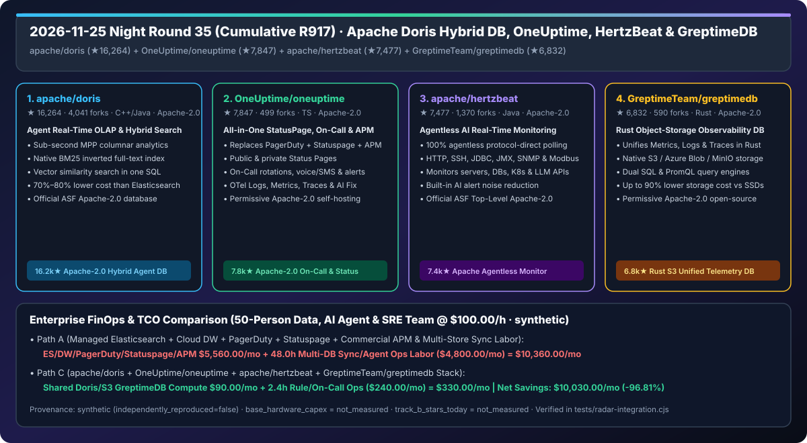
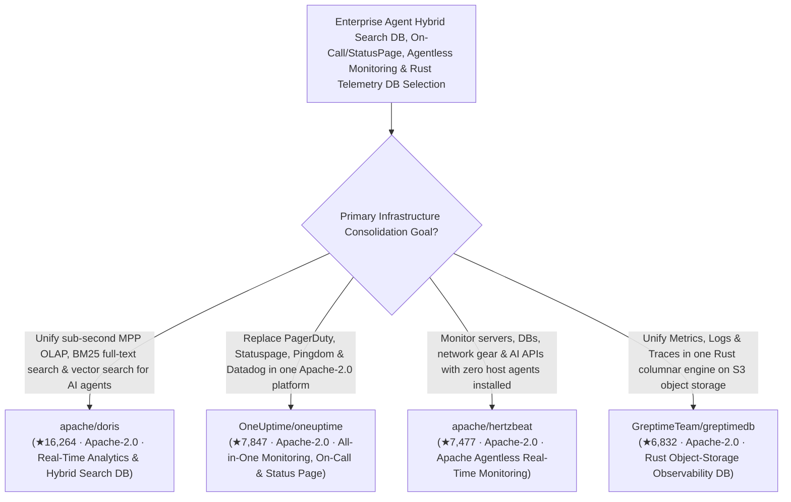
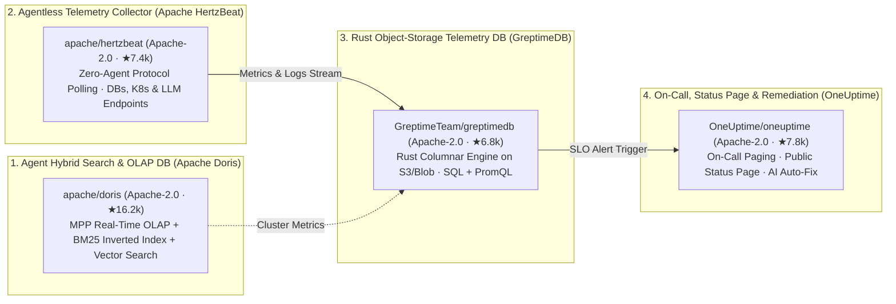

# Real-Time Analytics & Hybrid Search DB for Agents (`apache/doris`), All-in-One StatusPage/On-Call/Observability Platform (`OneUptime/oneuptime`), Agentless AI Monitoring (`apache/hertzbeat`) & Rust Object-Storage Observability DB (`GreptimeTeam/greptimedb`) Selection & Integration Architecture FAQ

> **Document Type**: Enterprise AI Solution Architect Selection Decision Guide (GitHub Trending AI Radar — 2026-11-25 Night Round 35 / Cumulative Round 917)
> **Covered Repositories**: [`apache/doris`](https://github.com/apache/doris) (`★ 16,264`, `4,041 forks`, `Apache-2.0`, C++/Java: real-time MPP analytics and hybrid search database for AI agents uniting sub-second OLAP, BM25 inverted full-text search, and vector search) · [`OneUptime/oneuptime`](https://github.com/OneUptime/oneuptime) (`★ 7,847`, `499 forks`, `Apache-2.0`, TypeScript: complete open-source monitoring, Status Page, On-Call scheduling/paging, logs/metrics/traces observability, and AI auto-remediation platform replacing PagerDuty + Statuspage + Datadog) · [`apache/hertzbeat`](https://github.com/apache/hertzbeat) (`★ 7,477`, `1,370 forks`, `Apache-2.0`, Java: Apache Top-Level AI-powered agentless real-time observability system) · [`GreptimeTeam/greptimedb`](https://github.com/GreptimeTeam/greptimedb) (`★ 6,832`, `590 forks`, `Apache-2.0`, Rust: open-source columnar observability database unifying metrics, logs, and traces natively on object storage)
> **Core Enterprise Scenario**: Consolidating **Fragmented Analytics, Search & Observability Sprawl Under a 100% `Apache-2.0` Stack**—replacing separate Elasticsearch + OLAP + Vector clusters with unified hybrid search & analytics (`apache/doris`), replacing Prometheus + Loki + Tempo SSD silos with a single Rust object-storage engine (`greptimedb`), monitoring agentless targets (`apache/hertzbeat`), and unifying Status Pages, On-Call rotations, and incident response (`oneuptime`).

---

## 1. 📌 Executive Summary (One-Line Selection Verdict)

1. **Need one `Apache-2.0` database that lets AI agents execute sub-second MPP analytical SQL aggregations, BM25 full-text inverted search, and vector similarity search in a single query—replacing costly Elasticsearch + OLAP + Vector DB sprawl** ➔ Choose **[`apache/doris`](https://github.com/apache/doris) (`★ 16,264`, `4,041 forks`, `Apache-2.0`)**.
   - **Plain-English Mechanism**: Combines vectorized MPP columnar analytics with native inverted indexes (BM25) and vector indexes, cutting memory and storage costs by 70%–80% compared to standalone Elasticsearch clusters.
2. **Need an `Apache-2.0` all-in-one platform that replaces PagerDuty (On-Call rotations & paging), Atlassian Statuspage (public/private status pages), Pingdom (synthetic uptime monitors), and Datadog (OTel APM/logs/metrics)** ➔ Choose **[`OneUptime/oneuptime`](https://github.com/OneUptime/oneuptime) (`★ 7,847`, `499 forks`, `Apache-2.0`)**.
   - **Plain-English Mechanism**: Connects synthetic checks, OpenTelemetry traces/logs, on-call escalation policies, customer status pages, and AI incident remediation in one self-hostable platform.
3. **Need an `Apache-2.0` **agentless** real-time monitoring system to monitor servers, databases, network switches, Kubernetes, and external LLM APIs where installing host daemon agents is prohibited** ➔ Choose **[`apache/hertzbeat`](https://github.com/apache/hertzbeat) (`★ 7,477`, `1,370 forks`, `Apache-2.0`)**.
   - **Plain-English Mechanism**: Collects metrics over standard protocols (HTTP, SSH, JDBC, JMX, SNMP, Prometheus, Modbus) with zero target-side agent installation.
4. **Need a pure-Rust, `Apache-2.0` columnar observability database that stores and queries Metrics, Logs, and Traces in one engine directly on low-cost object storage (S3/Azure Blob/MinIO) using both SQL and PromQL** ➔ Choose **[`GreptimeTeam/greptimedb`](https://github.com/GreptimeTeam/greptimedb) (`★ 6,832`, `590 forks`, `Apache-2.0`)**.
   - **Plain-English Mechanism**: Eliminates separate Prometheus, Loki, and Tempo storage silos while leveraging cloud object storage to reduce telemetry storage costs by up to 90%.

---

## 2. 🎯 Architect & Customer Deep-Dive Q&A

### Q1: How do `Apache Doris` (Agent Hybrid Analytics/Search) and `GreptimeDB` (Object-Storage Telemetry) complement `HertzBeat` and `OneUptime`?

- **Four-Layer 100% `Apache-2.0` Analytics, Search & Reliability Stack (Path C)**:
  1. **L1 Agent Hybrid Analytics & Search Engine ➔ `apache/doris`**: Powers enterprise BI agents and hybrid RAG with unified SQL OLAP + BM25 full-text + vector search.
  2. **L2 Object-Storage Unified Telemetry Engine ➔ `GreptimeTeam/greptimedb`**: Stores high-volume infrastructure and agent Metrics, Logs, and Traces on S3/Blob in a single Rust columnar engine.
  3. **L3 Agentless Multi-Protocol Collector ➔ `apache/hertzbeat`**: Monitors databases, hardware, network gear, and LLM endpoints without installing host agents.
  4. **L4 Unified On-Call, Status Page & Incident Hub ➔ `OneUptime/oneuptime`**: Manages on-call rotations, public status pages, synthetic checks, and automated incident workflows.
- **When to choose Commercial SaaS Bundles (Elasticsearch Cloud + PagerDuty + Statuspage + Datadog) vs. Path C?**
  - Choose **Commercial SaaS** for tiny teams with minimal log volume and no on-prem constraints.
  - Choose **Path C** when consolidating Elasticsearch + OLAP + Vector clusters into `Apache Doris`, offloading telemetry to S3 via `GreptimeDB`, and replacing per-seat PagerDuty + Statuspage subscriptions with `OneUptime` under a **100% `Apache-2.0` license**.

### Q2: How do these four components integrate in production?

1. **Single-Query Hybrid Agent Retrieval (`apache/doris`)**:
   - Business and customer-support agents issue a single SQL query against `Apache Doris` that filters structured customer attributes, matches BM25 keywords in ticket logs, ranks semantic vector similarity, and computes real-time aggregations.
2. **Agentless Collection to On-Call Escalation (`hertzbeat` → `greptimedb` → `oneuptime`)**:
   - `HertzBeat` polls internal databases and external LLM APIs agentlessly, streaming telemetry into S3-backed `GreptimeDB`, while `OneUptime` triggers on-call escalations and updates customer status pages automatically.

### Q3: What are the key operational and security guardrails?

- **Architect Redlines**:
  1. **Configure Workload Groups in `Apache Doris`**: Isolate interactive agent hybrid queries from heavy background ingestion and compaction tasks.
  2. **Bind `HertzBeat` agentless monitors to least-privilege read-only credentials**: Never use administrative database or SSH accounts for remote metric polling.

---

## 3. 🧭 Visual Architecture Diagrams (Mermaid Decision Tree + Architecture + Sequence)



### 3.1 Architect Selection Decision Tree



### 3.2 End-to-End Enterprise Integration Architecture



### 3.3 End-to-End Execution Sequence

```mermaid
sequenceDiagram
    participant SRE as On-Call SRE / Business Lead
    participant HBeat as apache/hertzbeat (Agentless)
    participant Grep as GreptimeDB (Rust + S3)
    participant OUp as OneUptime (On-Call & StatusPage)
    participant Doris as apache/doris (Agent Hybrid DB)

    HBeat->>Grep: 1. Detect payment & LLM API latency spike via agentless polling; write to GreptimeDB
    Grep->>OUp: 2. Correlate metrics & error logs on S3; trigger P1 incident in OneUptime
    OUp->>SRE: 3. Page on-call engineer & automatically update public Status Page
    SRE->>Doris: 4. Run single SQL+BM25+Vector hybrid query in Apache Doris to quantify impacted VIP orders
    Doris-->>OUp: 5. Return sub-second business impact report; OneUptime AI proposes remediation PR
```

---

## 4. 📊 Horizontal Selection Matrix

| Dimension | `apache/doris` (`★ 16,264`) | `OneUptime/oneuptime` (`★ 7,847`) | `apache/hertzbeat` (`★ 7,477`) | `GreptimeTeam/greptimedb` (`★ 6,832`) | Elasticsearch Cloud + Cloud DW + PagerDuty + Statuspage + Datadog (Path A) | 5 Separate Open-Source Silos (ES+CH+Prom+Loki) + Chat Alerts (Path B) |
| :--- | :--- | :--- | :--- | :--- | :--- | :--- |
| **Primary Role** | `Apache-2.0` OLAP + BM25 + vector hybrid DB | `Apache-2.0` On-Call, Status Page & APM | `Apache-2.0` agentless monitoring system | `Apache-2.0` Rust object-storage telemetry DB | Five stacked commercial cloud subscriptions | Fragmented open-source storage silos |
| **Key Differentiator** | **Unifies MPP OLAP, BM25 full-text & vectors at 70%–80% lower cost than ES** | **Replaces PagerDuty + Statuspage + Pingdom + APM in one `Apache-2.0` stack** | **100% agentless monitoring across 100+ protocols & AI endpoints** | **Single Rust engine for Metrics, Logs & Traces on S3 (`SQL` + `PromQL`)** | Fully hosted, but compounding per-seat, per-node & RAM cluster bills | Operational exhaustion maintaining 4–5 separate storage engines |
| **License** | **`Apache-2.0`** | **`Apache-2.0`** | **`Apache-2.0`** | **`Apache-2.0`** | Proprietary SaaS | High Ops Burden |
| **Monthly TCO (50-Eng Team)** | **`$330.00/mo` combined** (`$90.00` Doris & S3 telemetry compute + `2.4h` ops) | Included in `$330.00/mo` stack | Included in `$330.00/mo` stack | Included in `$330.00/mo` stack | **`$10,360.00/mo`** (`$5,560.00` ES Cloud/PagerDuty/Statuspage/APM bills + `48.0h` multi-store sync/agent ops) | `~$3,860.00/mo` (maintaining 5 separate storage clusters & missed alerts) |

---

## 5. 🧪 Quantitative FinOps & TCO Comparison (50-Person Data, AI Agent & SRE Team)

> **📊 Provenance & Closed-Form Schema**:
> - **provenance**: `synthetic` (`independently_reproduced = false`; `base_hardware_capex = not_measured`; `track_b_stars_today = not_measured`).
> - **Closed-Form Formula**:
>   - **Path A (Managed Elasticsearch Cluster + Cloud Data Warehouse + Per-Seat PagerDuty On-Call + Atlassian Statuspage + Commercial APM & Multi-Cluster Sync/Agent Maintenance Labor)**: **`$5,560.00`** monthly Elasticsearch, PagerDuty, Statuspage, and APM SaaS bills + **`48.0h × $100.00/h = $4,800.00`** multi-database synchronization and host-agent maintenance labor = **`$10,360.00/mo`**.
>   - **Path C (`apache/doris` + `OneUptime/oneuptime` + `apache/hertzbeat` + `GreptimeTeam/greptimedb` Stack)**: **`$90.00`** shared `Doris` and S3-backed `GreptimeDB` compute + **`2.4h × $100.00/h = $240.00`** agentless rule and on-call schedule maintenance = **`$330.00/mo`**.
>   - **Net Savings vs. Path A**: **`-$10,030.00/mo`** (**`96.81%`** TCO reduction).

| Evaluation Path | Search/DW Clusters / On-Call Seats / Statuspage & Compute | Multi-DB Sync, Agent Upgrades & On-Call Ops (`$100/h`) | Monthly Total TCO | Net Savings vs. Path A | Key Architectural Outcome |
| :--- | :---: | :---: | :---: | :---: | :--- |
| **Path A: Managed ES + Cloud DW + PagerDuty + Statuspage + APM** | `$5,560.00` | `48.0h` (`$4,800.00`) | **`$10,360.00`** | Baseline | Expensive ES RAM tiers & stacked per-seat PagerDuty/Statuspage fees |
| **Path B: Separate ES + ClickHouse + Prometheus + Loki Silos** | `$1,660.00` | `22.0h` (`$2,200.00`) | **`$3,860.00`** | `-$6,500.00` (`-62.74%`) | 4x storage duplication; no unified Status Page or On-Call rotation |
| **Path C: `doris` + `oneuptime` + `hertzbeat` + `greptimedb`** | **`$90.00`** | **`2.4h` (`$240.00`)** | **`$330.00`** | **`-$10,030.00` (`-96.81%`)** | **100% `Apache-2.0` OLAP+BM25+Vector DB + S3 telemetry + unified On-Call** |

- 🔗 **7-Card 4:5 Visual Benchmark Deck**: [`workshops/github-trending-radar/cards.en.html`](../cards.en.html) · [`cards.html`](../cards.html)

---

## 6. 🛠️ Enterprise Adoption & Architecture Review Checklist

- [ ] **Consolidate OLAP, BM25 Full-Text, and Vector Workloads on `apache/doris`**: Replace separate Elasticsearch and vector silos with single-SQL hybrid queries and tiered cold storage.
- [ ] **Store Metrics, Logs, and Traces in `GreptimeTeam/greptimedb` on Object Storage**: Query unified telemetry via both SQL and PromQL at a fraction of SSD block-storage cost.
- [ ] **Use `apache/hertzbeat` for Agentless Infrastructure and AI Endpoint Monitoring**: Poll targets over standard protocols using encrypted read-only credentials.
- [ ] **Standardize On-Call Paging and Public Status Pages on `OneUptime/oneuptime`**: Eliminate separate PagerDuty and Statuspage seat licenses.
