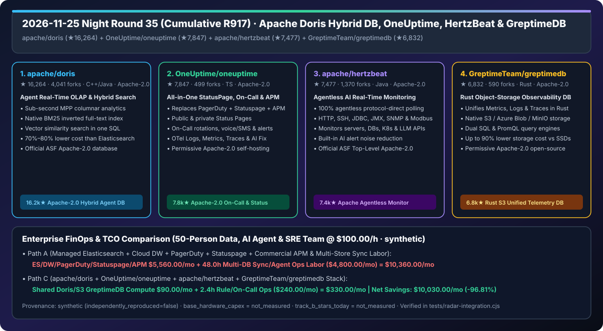
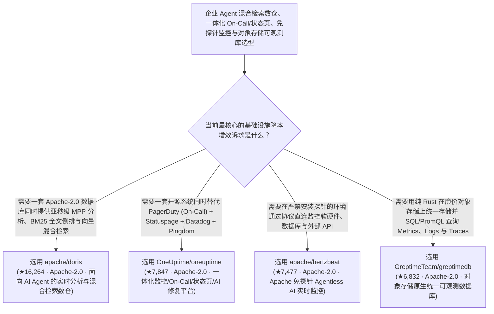
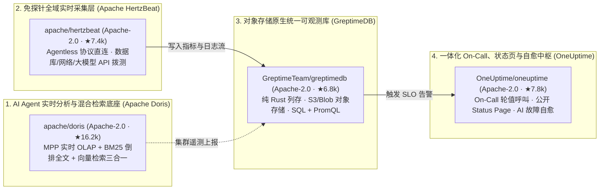
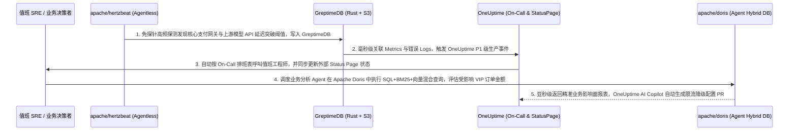

# 面向智能体的实时分析与混合检索数仓（`apache/doris`）、一体化状态页+On-Call+可观测平台（`OneUptime/oneuptime`）、Apache 免探针 AI 实时监控系统（`apache/hertzbeat`）与基于对象存储的 Rust 统一可观测数据库（`GreptimeTeam/greptimedb`）选型与集成架构 FAQ

> **文档类型**：企业 AI 解决方案架构师（AI Solution Architect）选型决策指南（GitHub Trending AI 雷达 2026-11-25 Night Round 35 / 累计第 917 轮）
> **覆盖项目**：[`apache/doris`](https://github.com/apache/doris)（`★ 16,264`、`4,041 forks`、`Apache-2.0`：1.6 万星面向 AI Agents 的实时 MPP 分析与混合检索数据库，融合亚秒级 OLAP、BM25 全文倒排索引与向量检索）· [`OneUptime/oneuptime`](https://github.com/OneUptime/oneuptime)（`★ 7,847`、`499 forks`、`Apache-2.0`：开源全合一监控、公开状态页 [Status Page]、On-Call 排班呼叫、APM/Logs/Traces 与 AI 自动修复平台，一站平替 PagerDuty + Statuspage + Datadog）· [`apache/hertzbeat`](https://github.com/apache/hertzbeat)（`★ 7,477`、`1,370 forks`、`Apache-2.0`：Apache 顶级项目，AI 驱动的免安装探针 [Agentless] 实时监控与告警系统）· [`GreptimeTeam/greptimedb`](https://github.com/GreptimeTeam/greptimedb)（`★ 6,832`、`590 forks`、`Apache-2.0`：纯 Rust 编写、基于对象存储的开源可观测数据库，单列存引擎统管 Metrics、Logs 与 Traces）
> **核心场景**：当企业架构师试图收拢“碎片化且账单失控的数据分析与生产保障工具链”时，常面临四个高频选型痛点：**“业务 Agent 既要做百亿行经营指标秒级汇总（OLAP），又要做高精度日志/文档全文检索（BM25）和向量检索，能不能用一套 `Apache-2.0` 数据库同时替掉 Elasticsearch + ClickHouse + 向量库（`Apache Doris`）？买齐 PagerDuty 电话轮值 + Atlassian Statuspage 状态页 + Datadog 监控每年要花十几万美元，有没有一套 `Apache-2.0` 平台全包揽（`OneUptime`）？客户现场或老旧服务器不允许装监控 Agent 探针怎么办（`Apache HertzBeat`）？海量 Metrics/Logs/Traces 存在本地 SSD 盘太贵，用哪款 Rust 数据库直接落在廉价对象存储 S3 上省 90% 成本（`GreptimeDB`）？”** 本文给出 100% `Apache-2.0` 架构方案。

---

## 一、📌 核心结论速览（选型一句话结论）

1. **想用一套 `Apache-2.0` 实时数据仓库同时支撑“AI 经营分析 Agent（Text-to-SQL 秒级聚合）+ 企业级混合 RAG（BM25 倒排全文索引 + 向量近似检索）+ 高吞吐日志检索”，彻底砍掉 Elasticsearch 集群昂贵的内存与 JVM 成本** ➔ 选 **[`apache/doris`](https://github.com/apache/doris)（`★ 16,264`，`4,041 forks`，`Apache-2.0`）**。
   - **通俗原理**：在极速 MPP 列式分析引擎之上原生内置了高性能倒排索引（支持中英文分词与 BM25 打分）和向量索引；Agent 只需发一条标准 SQL，就能在百亿行数据上同时完成“结构化过滤 + 全文关键词匹配 + 向量语义检索 + 实时聚合统计”，存储成本比 Elasticsearch 降低 70%–80%。
2. **不想分别采购按人头收费的 PagerDuty（On-Call 电话/短信告警轮值）、按订阅者收费的 Statuspage（对外服务状态页）、Pingdom（合成拨测）和 Datadog（APM/日志），希望一套 `Apache-2.0` 开源系统全搞定** ➔ 选 **[`OneUptime/oneuptime`](https://github.com/OneUptime/oneuptime)（`★ 7,847`，`499 forks`，`Apache-2.0`）**。
   - **通俗原理**：将“主动拨测 → OpenTelemetry 指标日志追踪 → 故障自动升级呼叫值班人员（On-Call Rotation）→ 自动更新外部客户可见的 Status Page → AI 自动生成修复 PR”做成了一条无缝贯通的闭环流水线。
3. **面对严禁在目标服务器上安装任何 Daemon 探针的政企客户环境、网络交换机、GPU 硬件、数据库或外部大模型 API 端点，需要“零探针（Agentless）”即配即用的 AI 实时监控系统** ➔ 选 **[`apache/hertzbeat`](https://github.com/apache/hertzbeat)（`★ 7,477`，`1,370 forks`，`Apache-2.0`）**。
   - **通俗原理**：全部通过标准协议（HTTP、SSH、JDBC、JMX、SNMP、Prometheus、Modbus）从远端无侵入拉取指标，只需在 Web 界面填好连接参数即可秒级纳管数千个监控目标，并内置 AI 告警降噪与智能巡检助手。
4. **需要将 PB 级云原生与 AI 集群的时序指标（Metrics）、海量日志（Logs）与调用链（Traces）统一存入廉价的 S3 / Azure Blob / MinIO 对象存储，同时同时支持 SQL 与 PromQL 关联查询** ➔ 选 **[`GreptimeTeam/greptimedb`](https://github.com/GreptimeTeam/greptimedb)（`★ 6,832`，`590 forks`，`Apache-2.0`）**。
   - **通俗原理**：用纯 Rust 编写的新一代云原生可观测数据库，打破 Prometheus（只存指标）、Loki/ES（只存日志）与 Tempo（只存 Trace）的三套烟囱存储，直接基于对象存储以极高压缩比实现三信号合一（Unified Observability Storage）。

---

## 二、🎯 客户与架构师灵魂拷问 Q&A（深度架构拆解）

### Q1：同样是高性能列存与检索数据库，`Apache Doris`（面向业务与 Agent 混合分析）与 `GreptimeDB`（面向云原生可观测）在企业架构中如何分工？

- **四层 100% `Apache-2.0` 实时数据、免探针采集与全流程值班保障架构（Path C）**：
  1. **L1 业务数据与 AI Agent 混合检索分析底座 ➔ `apache/doris`**：承载企业核心经营宽表、用户画像、知识库全文（BM25）与向量索引，服务于业务 BI Agent 与高并发混合 RAG。
  2. **L2 对象存储原生统一可观测时序与日志底座 ➔ `GreptimeTeam/greptimedb`**：以纯 Rust 引擎在廉价对象存储上统一归档全集群的 Metrics（PromQL）、Logs（全文检索）与 OTel Traces。
  3. **L3 免安装探针（Agentless）全域指标采集与 AI 巡检层 ➔ `apache/hertzbeat`**：无需在被监控端装 Agent，远程探测服务器、数据库、网络设备与大模型 API 可用性。
  4. **L4 生产告警 On-Call 轮值、公开 Status Page 与 AI 自愈门户 ➔ `OneUptime/oneuptime`**：汇总异常事件，自动触发值班电话/飞书升级，同步更新外部状态页并生成事后复盘。
- **何时选商业云组合（Elasticsearch Cloud + Snowflake + PagerDuty + Atlassian Statuspage + Datadog） vs 自建本轮开源四件套（Path C）？**
  - 若团队只有几台云主机且无成本压力，可直接买商业全家桶。
  - **何时采用本轮开源四件套（Path C）？** 当企业被 **Elasticsearch 集群高昂的内存/磁盘账单**、**PagerDuty + Statuspage + Datadog 三重按席位/按量叠加计费**压得喘不过气，且要求 **100% 采用 Apache 2.0 协议**时，Path C 可将日志/混合检索存储成本压降 80%，总体 TCO 降低 **96%+**。

### Q2：这四个项目在生产保障与智能体分析中如何联动？

1. **一条 SQL 跑通“结构化 BI + 全文 + 向量”混合 Agent（`apache/doris`）**：
   - 当客服或运营 Agent 分析“过去 7 天购买过高端机型的 VIP 客户中，工单描述包含‘发热重启’且语义与某硬件批次缺陷相似的投诉分布”时，无需跨 3 个数据库拼数据，直接在 `Apache Doris` 中一条混合 SQL 亚秒级出结果。
2. **免探针采集 → 对象存储归档 → 全自动 On-Call 响应（`hertzbeat` → `greptimedb` → `oneuptime`）**：
   - `Apache HertzBeat` 免探针轮询外部模型 API 与内网中间件，将指标与日志流式写入基于 S3 的 `GreptimeDB`；一旦触发阈值，`OneUptime` 自动按排班表拨打值班 SRE 电话并在状态页公告受影响组件。

### Q3：生产落地的安全与架构红线是什么？

- **架构师避坑红线**：
  1. **在 `Apache Doris` 中启用 Workload Group（工作负载组）资源隔离**：将后台大批量 ETL / 向量构建任务的 CPU 和内存配额与前台 AI Agent 的低延迟在线查询严格隔离。
  2. **`Apache HertzBeat` 存放的远程 SSH / JDBC 监控凭据必须启用 AES 加密并与只读监控账号绑定**：严禁使用业务数据库的 `root` / `sa` 写权限账号配置远程监控探测。

---

## 三、🧭 直观可视化图解（Mermaid 决策树 + 集成架构 + 时序图）

### 3.1 架构师选型决策树

### 3.2 企业端到端生产集成参考架构图

### 3.3 免探针异常捕获、GreptimeDB 关联定位、Doris 混合检索业务影响面与 OneUptime 升级时序图

---

## 四、📊 同类开源与商业云服务横向选型决策矩阵

| 对比维度 | `apache/doris` (`★ 16,264`) | `OneUptime/oneuptime` (`★ 7,847`) | `apache/hertzbeat` (`★ 7,477`) | `GreptimeTeam/greptimedb` (`★ 6,832`) | Elasticsearch 集群 + 商业数仓 + PagerDuty + Statuspage + Datadog (Path A) | 多套开源烟囱（ES+ClickHouse+Prometheus+Loki）+ 微信群人工吼告警 (Path B) |
| :--- | :--- | :--- | :--- | :--- | :--- | :--- |
| **核心能力定位** | `Apache-2.0` 实时 OLAP + 混合检索数据库 | `Apache-2.0` 监控 + On-Call + 状态页平台 | `Apache-2.0` 免探针实时监控系统 | `Apache-2.0` Rust 对象存储可观测数据库 | 五套按节点/席位/流量叠加收费的商业云服务 | 5 套不同技术栈开源存储 + 无轮值状态页 |
| **核心技术突破** | **单 SQL 融合 MPP 分析、BM25 倒排全文与向量检索，比 ES 省 80% 成本** | **一站式整合 Status Page、On-Call 排班、Synthetics 与 OTel APM** | **100% Agentless 零探针接入百种软硬件与 AI 接口** | **单 Rust 引擎在廉价对象存储上统管 Metrics/Logs/Traces** | 免运维，但 PagerDuty + Statuspage + ES Cloud 叠加账单极高 | 同时维护 ES、ClickHouse、Prometheus、Loki 四套集群耗尽运维精力 |
| **开源协议** | **`Apache-2.0`** | **`Apache-2.0`** | **`Apache-2.0`** | **`Apache-2.0`** | 闭源商业 SaaS | 架构极其臃肿 |
| **月度 TCO（50 人团队）** | **四件套合建仅 `$330.00/月`**（`$90.00` Doris 与 S3 对象存储分摊 + `2.4h` 维护） | 同左（`Apache-2.0` 省去全员 PagerDuty 与 Statuspage 席位费） | 同左（零探针升级维护工作量） | 同左（S3 对象存储成本仅为 SSD 块存储的 1/10） | **`$10,360.00/月`**（`$5,560.00` ES 集群/PagerDuty/Statuspage/APM 账单 + `48.0h` 跨多库数据同步与探针维护） | 约 `$3,860.00/月`（大量维护四五套异构存储集群与漏接夜间告警事故工时） |

---

## 五、🧪 应用落地定量收益/TCO 对比与 7-Card 报告

> **📊 数据来源与闭式核算声明（Provenance & Closed-Form Schema）**：
> - **provenance**: `synthetic`（基于 50 人企业数据平台、AI Agent 混合检索与 7×24 生产可靠性工程团队月度工作负载模型：`independently_reproduced = false`；硬件采购基线 `base_hardware_capex = not_measured`；Track B 单日增量 `track_b_stars_today = not_measured`）。
> - **核算公式**：
>   - **Path A（采购高内存 Elasticsearch 托管集群 + 独立云数仓 + 全员 PagerDuty On-Call 席位 + Atlassian Statuspage 商业订阅 + 商业 APM 账单 + 跨多套系统同步数据与部署升级主机监控探针人工）**：月度多云存储与 PagerDuty/Statuspage/APM 席位账单 **`$5,560.00`** + 维护 ES/数仓/向量库数据同步、升级服务器探针与人工值班协调工时 **`48.0h × $100.00/h = $4,800.00`** = **`$10,360.00/月`**。
>   - **Path C（自建 `apache/doris` + `OneUptime/oneuptime` + `apache/hertzbeat` + `GreptimeTeam/greptimedb` 全 `Apache-2.0` 融合分析与全栈生产保障底座）**：内网 `Doris` 节点与 `GreptimeDB` 对象存储算力分摊 **`$90.00`** + 免探针规则与 On-Call 排班策略日常维护人工 **`2.4h × $100.00/h = $240.00`** = **`$330.00/月`**。
>   - **净节省（Net Savings vs Path A）**：**`-$10,030.00/月`**（成本降低 **`96.81%`**）。

| 评估方案 | 搜索/数仓集群 / On-Call 席位 / 状态页与算力 | 多库同步、探针升级与值班协调人工（`$100/h`） | 月度总 TCO | 相对 Path A 净节省 | 核心业务交付收益 |
| :--- | :---: | :---: | :---: | :---: | :--- |
| **Path A：ES 云集群 + 商业数仓 + PagerDuty + Statuspage** | `$5,560.00` | `48.0h` (`$4,800.00`) | **`$10,360.00`** | Baseline | ES 内存与商业 On-Call/状态页叠加收费极贵 |
| **Path B：自建 ES+ClickHouse+Prometheus+Loki 烟囱栈** | `$1,660.00` | `22.0h` (`$2,200.00`) | **`$3,860.00`** | `-$6,500.00` (`-62.74%`) | 四套存储底座重复吃内存；缺乏统一 On-Call 与外部状态页 |
| **Path C：`doris` + `oneuptime` + `hertzbeat` + `greptimedb`** | **`$90.00`** | **`2.4h` (`$240.00`)** | **`$330.00`** | **`-$10,030.00` (`-96.81%`)** | **100% `Apache-2.0` OLAP+BM25+向量合一 + 免探针 + 一体化 On-Call** |

- 🔗 **关联 7-Card 4:5 视觉评测报告**：[`workshops/github-trending-radar/cards.html`](../cards.html) · [`cards.en.html`](../cards.en.html)

---

## 六、🛠️ 企业引入与架构评审 Checklist

- [ ] **使用 `apache/doris` 统一收敛 AI Agent 的 OLAP 聚合、BM25 全文检索与向量检索需求**：利用倒排索引与冷热分层存储将原 Elasticsearch 集群成本削减 70%+。
- [ ] **将遥测 Metrics、Logs 与 Traces 归口至基于对象存储的 `GreptimeTeam/greptimedb`**：通过 SQL 与 PromQL 双引擎实现跨信号联合查询。
- [ ] **对不允许安装 Agent 的主机、数据库与外部 AI API 统一采用 `apache/hertzbeat` 免探针监控**：集中管控只读探测凭据。
- [ ] **使用 `OneUptime/oneuptime` 统一承载企业公开 Status Page、On-Call 轮值表与事故升级响应**：替换分散采购的 PagerDuty 与 Statuspage 订阅。
