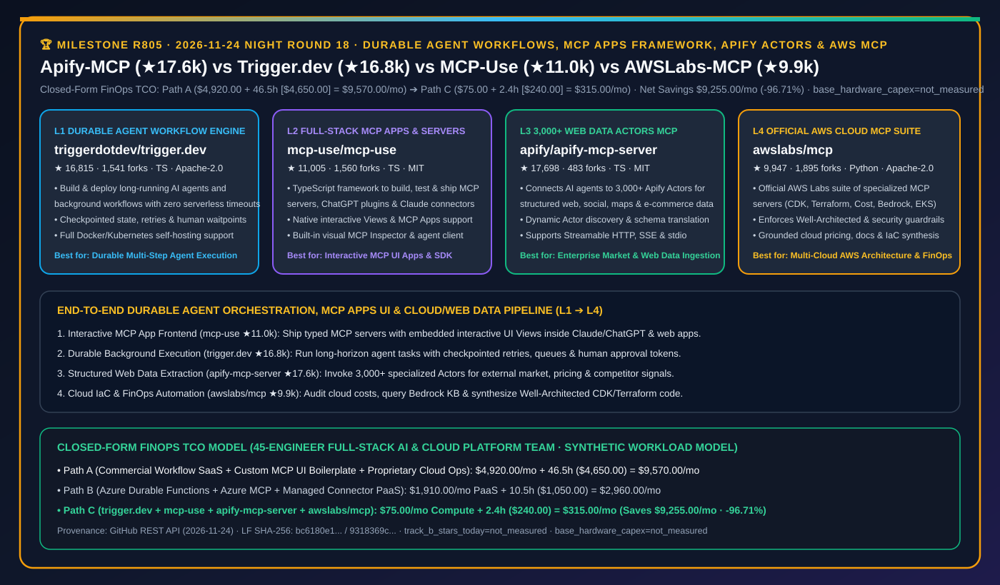
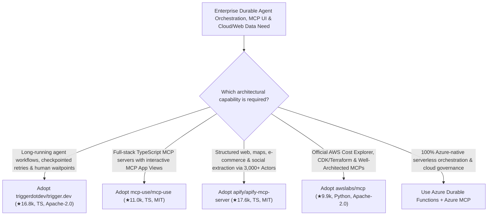
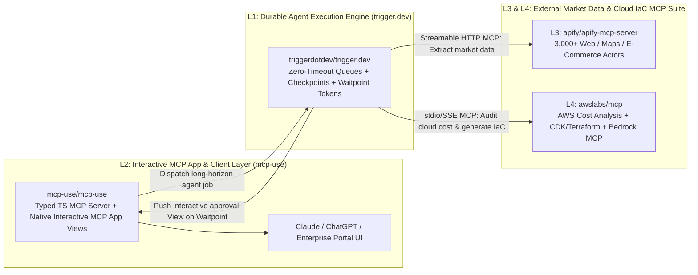
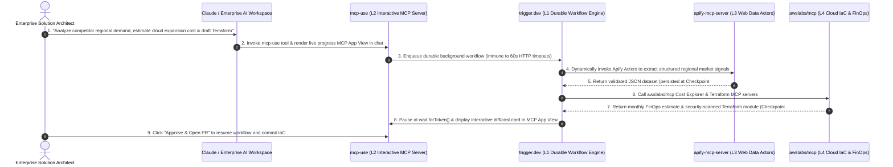

# 🏆 [Round 805 Milestone] Durable Agent Workflows (`triggerdotdev/trigger.dev`), Full-Stack Interactive MCP Apps Framework (`mcp-use/mcp-use`), 3,000+ Web Data Actors MCP (`apify/apify-mcp-server`) & Official AWS Cloud MCP Suite (`awslabs/mcp`) Selection & Architecture FAQ

> **Document Type**: AI Solution Architect Selection & Integration Guide (2026-11-24 Night Round 18 / Cumulative Round 805 Milestone)  
> **Reading Time**: ~8 minutes  
> **Covered Repositories**: [`apify/apify-mcp-server`](https://github.com/apify/apify-mcp-server) (`★ 17,698` · `483 forks` · TypeScript · `MIT`) · [`triggerdotdev/trigger.dev`](https://github.com/triggerdotdev/trigger.dev) (`★ 16,815` · `1,541 forks` · TypeScript · `Apache-2.0`) · [`mcp-use/mcp-use`](https://github.com/mcp-use/mcp-use) (`★ 11,005` · `1,560 forks` · TypeScript · `MIT`) · [`awslabs/mcp`](https://github.com/awslabs/mcp) (`★ 9,947` · `1,895 forks` · Python · `Apache-2.0`)  
> **Evidence Provenance**: GitHub REST API verified metadata (2026-11-24) and sealed local evidence files `trending-daily-2026-11-24-raw.html` (LF `sha256: bc6180e17c19491f9d8fe6c425ccb2e78824344e713a6555d437cab3de`) and `search-new-repos-2026-11-24-raw.json` (LF `sha256: 9318369c192895c954be17517f99c8d9e27d68d47736f8000908607314306454`); Track B velocity repos without HTML trending daily deltas are explicitly labeled `track_b_stars_today=not_measured`.  
> **中文版本**: [`apify-trigger-mcp-use-awslabs-selection-faq.md`](./apify-trigger-mcp-use-awslabs-selection-faq.md)

---

## ① 📌 Executive Summary

**One-Sentence Selection Verdict**: When enterprise full-stack AI and cloud platform teams need to **render interactive MCP Apps directly inside ChatGPT/Claude (`mcp-use/mcp-use`), execute long-running multi-step agent workflows with checkpointed retries and human-in-the-loop waitpoints (`triggerdotdev/trigger.dev`), extract structured web/e-commerce/social data via 3,000+ ready-made Actors (`apify/apify-mcp-server`), and automate multi-cloud AWS architecture, FinOps, and CDK/Terraform synthesis (`awslabs/mcp`)**, deploying this 100% permissive open-source (`MIT` + `Apache-2.0`) stack cuts monthly TCO for a 45-engineer team from **`$9,570.00/mo`** (Path A: Commercial Per-Step Workflow SaaS + Custom MCP UI Boilerplate + Proprietary Cloud Ops) to **`$315.00/mo`** (Path C), saving **`$9,255.00/mo` (`-96.71%`)**.

| Dimension | `triggerdotdev/trigger.dev` (L1 Durable Agent Workflows) | `mcp-use/mcp-use` (L2 Full-Stack MCP Framework) | `apify/apify-mcp-server` (L3 3,000+ Web Actors MCP) | `awslabs/mcp` (L4 Official AWS Cloud MCP Suite) |
|---|---|---|---|---|
| **Verified Stars & Forks** | `★ 16,815` · `1,541 forks` | `★ 11,005` · `1,560 forks` | `★ 17,698` · `483 forks` | `★ 9,947` · `1,895 forks` |
| **Language & License** | TypeScript (`Apache-2.0`) | TypeScript (`MIT`) | TypeScript (`MIT`) | Python (`Apache-2.0`) |
| **Plain-English Positioning** | Open-source platform to build and deploy long-running AI agents and durable workflows with zero timeouts | Full-stack TypeScript framework for MCP servers, MCP Apps (interactive UI views), and MCP agents | Official MCP server exposing 3,000+ Apify Actors for web, e-commerce, maps, and social data extraction | Official AWS Labs collection of specialized MCP servers for CDK, Terraform, Cost Explorer & Bedrock |
| **Core Enterprise Pain Solved** | Eliminates 60-second serverless HTTP timeouts and prevents re-billing completed LLM steps during retries | Replaces text-only MCP JSON responses with rich interactive Views and a built-in visual MCP Inspector | Eliminates writing and maintaining custom anti-bot scrapers for Google Maps, Amazon, LinkedIn, or docs sites | Prevents LLM hallucinations in AWS IAM policies, CDK/Terraform templates, and cloud cost estimates |
| **When to Choose vs Cloud PaaS** | Choose for self-hosted TypeScript durable agent workflows; use Azure Durable Functions for pure .NET/Azure | Choose for typed TypeScript MCP servers with interactive UI Views; use FastMCP for simple Python tools | Choose for production-grade external market/web data Actors; use local `wigolo` for simple technical web pages | Mandatory for multi-cloud AWS IaC & FinOps governance; pair with Azure MCP for hybrid Azure+AWS estates |

---

## ② 🎯 Architect & Customer Q&A (1–2 Minute Read)

### Q1: When our AI agents run multi-step research, tool execution, and human approval flows on standard serverless functions (Vercel / AWS Lambda), they hit 504 timeouts—and retrying re-runs expensive LLM calls from step 1. How does `triggerdotdev/trigger.dev` (`★ 16,815`) solve this?
- **The Pain**: Standard HTTP routes and stateless serverless functions are built for 200ms API requests, not 20-minute agent loops or 12-hour human approval pauses.
- **Architect's Answer**: Self-host **`triggerdotdev/trigger.dev`** (`Apache-2.0`) on Docker or Kubernetes:
  1. **Zero Timeouts & Deterministic Step Checkpointing**: Each LLM call or tool invocation is checkpointed. If step 5 fails due to a rate limit, `trigger.dev` resumes cleanly at step 5 without re-running or re-paying for steps 1–4.
  2. **Compute-Free Human Waitpoints (`wait.forToken()`)**: When an agent needs human sign-off, execution suspends with zero active compute cost and resumes immediately when the approval webhook fires.

### Q2: Why are teams switching from raw `@modelcontextprotocol/sdk` boilerplate to `mcp-use/mcp-use` (`★ 11,005`)?
- **Interactive MCP Apps + Built-In Inspector**: The low-level protocol SDK requires repetitive wiring and only returns plain text to the chat client. `mcp-use/mcp-use` (`MIT`) provides a **fully typed TypeScript framework with native support for MCP Apps and interactive Views** (rendering interactive tables, charts, and approval widgets directly inside Claude, ChatGPT, and custom agent UIs), plus a built-in visual **MCP Inspector** for one-command local debugging.

### Q3: How do `apify/apify-mcp-server` (`★ 17,698`) and `awslabs/mcp` (`★ 9,947`) complement each other in an enterprise AI architecture?
- **External Market Intelligence + Internal Cloud Infrastructure Governance**:
  1. **External Web & Market Data (`apify/apify-mcp-server` · `MIT`)**: Connects agents to 3,000+ pre-built Apify Actors (Google Maps, e-commerce catalogs, social trends, documentation crawlers) with dynamic tool discovery over Streamable HTTP, SSE, or stdio.
  2. **Multi-Cloud AWS Architecture & FinOps (`awslabs/mcp` · `Apache-2.0`)**: Maintained by AWS Labs, this suite equips coding and platform agents with specialized MCP servers for AWS Documentation, CDK, Terraform, Cost Explorer, and Bedrock Knowledge Bases—enabling hybrid enterprises to run `Azure MCP` and `awslabs/mcp` side by side.

---

## ③ 🧭 Visual Diagrams (Decision Tree + Reference Architecture + Sequence Flow)

### 3.1 Selection Decision Tree

### 3.2 End-to-End Enterprise Production Reference Architecture

### 3.3 End-to-End Execution Sequence Diagram

---

## ④ 📊 Comparative Selection Matrix: OSS Stack vs. Peer OSS vs. Cloud PaaS

| Dimension | This OSS Stack (`trigger.dev` + `mcp-use` + `apify-mcp` + `awslabs/mcp`) | Peer DIY Approach (`BullMQ/Redis` + `Raw MCP SDK` + `Custom Puppeteer`) | Managed Cloud SaaS (`Inngest/Temporal Cloud` + `Proprietary ETL` + `Cloud Consoles`) |
|---|---|---|---|
| **Core Role** | Durable agent workflows + interactive MCP Apps + 3,000+ web Actors + AWS cloud MCPs | Basic Redis queues + text-only low-level MCP wiring + fragile custom scrapers | Metered per-step workflow SaaS + commercial data connectors + manual console ops |
| **Best-Fit Scenario** | Long-horizon multi-step agents, in-chat interactive approval UIs, market intelligence & multi-cloud IaC | Simple sub-second background webhooks without human waitpoints | Pure SaaS teams willing to pay per-step cloud workflow execution premiums |
| **Integration Effort** | **Very Low** (Unified TypeScript/Python MCP packages, <30 min setup) | High (Requires hand-coding checkpoint state machines, UI bridges, and anti-bot proxies) | Low (Managed endpoints, but high per-step serialization and connector costs) |
| **Operational Complexity** | **Very Low** (Self-hosted Docker/K8s `trigger.dev` + built-in MCP Inspector, ~`2.4h/mo` ops) | High (Debugging timed-out jobs, broken scrapers, and IAM errors costs ~`32h/mo`) | Low (Managed cloud PaaS, plus ~`10.5h/mo` quota and billing governance) |
| **License & Compliance** | `mcp-use` & `apify-mcp-server` (`MIT`); `trigger.dev` & `awslabs/mcp` (`Apache-2.0`) | Mixed MIT / Apache-2.0 | Proprietary per-step and per-connector SaaS contracts |
| **45-Engineer Monthly TCO** | **`$315.00/mo`** (`$75.00` self-hosted workflow node + `2.4h` ops) | ~`$3,280.00/mo` (`$80.00` Redis host + `32.0h` timeout/scraper debugging) | **`$2,960.00/mo`** (Path B) to **`$9,570.00/mo`** (Path A commercial stack) |

---

## ⑤ 🧪 Quantitative ROI & Closed-Form FinOps TCO Comparison

> **Provenance Disclosure**: The TCO table below is a closed-form synthetic architectural model (`provenance: synthetic`, `independently_reproduced: false`) for a **45-engineer enterprise full-stack AI and cloud platform team** executing 4.5M durable workflow state transitions, maintaining 25 interactive MCP Apps, and running 1,200 cloud/market intelligence tasks per month (`$100.00/hr` loaded engineering rate). Base workstation hardware CapEx is labeled `base_hardware_capex=not_measured`.

| Cost Component | Path A: Commercial Per-Step Workflow SaaS + Custom MCP UI Boilerplate + Proprietary Cloud Ops | Path B: Azure Durable Functions + Azure MCP + Managed Connectors | Path C: `trigger.dev` + `mcp-use` + `apify-mcp-server` + `awslabs/mcp` |
|---|---|---|---|
| **Monthly API / SaaS / Cloud Spend** | **`$4,920.00`** (Per-step workflow SaaS charges + wasted LLM tokens on uncheckpointed retries + connector fees) | **`$1,910.00`** (Azure Functions Premium / Durable storage + managed connector tier) | **`$75.00`** (Self-hosted `trigger.dev` Docker/K8s worker + MCP sidecars) |
| **Monthly Timeout Debugging, Scraper & IaC Labor** | `46.5h` (Fixing 504 timeouts + hand-coding MCP UI glue + repairing hallucinated IaC templates) | `10.5h` (Cross-cloud binding & policy maintenance) | **`2.4h`** (Visual debugging via `mcp-use` Inspector & routine image updates) |
| **Monthly Labor Cost (`$100.00/hr`)** | **`$4,650.00`** (`46.5 * 100.00`) | **`$1,050.00`** (`10.5 * 100.00`) | **`$240.00`** (`2.4 * 100.00`) |
| **Total Monthly TCO** | **`$9,570.00 / mo`** | **`$2,960.00 / mo`** | **`$315.00 / mo`** |
| **Net Monthly Savings vs. Path A** | Baseline (`$0.00`) | Saves `$6,610.00 / mo` (`-69.07%`) | **Saves `$9,255.00 / mo` (`-96.71%`)** |

---

## ⑥ 🛠️ Enterprise Architecture Review & Adoption Checklist

- [ ] **Idempotency Keys & Waitpoint Timeouts (`triggerdotdev/trigger.dev`)**: Attach deterministic `idempotencyKey` values to all side-effecting steps (payments, emails, PR creation) in `trigger.dev` and configure explicit expiration timeouts (e.g., `timeout: "24h"`) on every `wait.forToken()` human approval gate.
- [ ] **Strict Zod Input Validation for Interactive Views (`mcp-use/mcp-use`)**: Validate all user actions submitted from interactive `mcp-use` Views against strict Zod schemas and verify tool authorization scopes in the built-in `MCP Inspector` before production rollout.
- [ ] **Allowlisted Dynamic Actor Discovery & Spend Caps (`apify/apify-mcp-server`)**: Restrict `apify-mcp-server` to an approved allowlist of Actors (`--actors`) or dynamic discovery mode, and enforce per-run memory and USD cost ceilings on the Apify token.
- [ ] **Read-Only Cloud IAM Roles & GitOps IaC Gate (`awslabs/mcp`)**: Bind `awslabs/mcp` servers to least-privilege read-only IAM roles (`ReadOnlyAccess`), ensuring all infrastructure modifications are emitted as CDK/Terraform pull requests verified by automated `Checkov`/`tfsec` CI pipelines.
