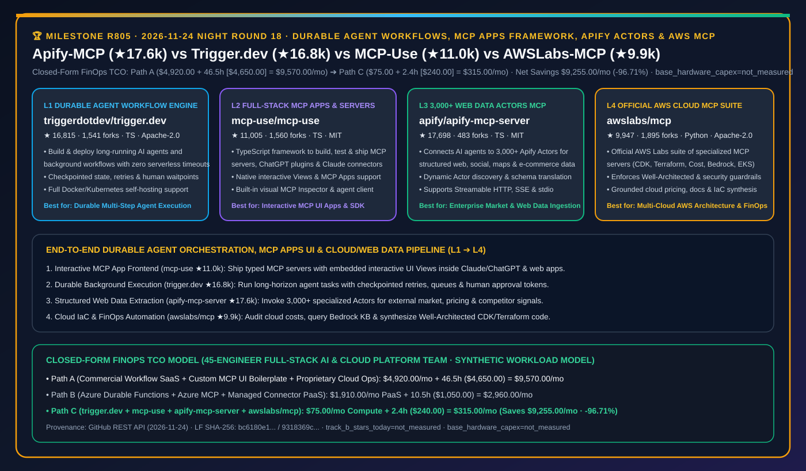
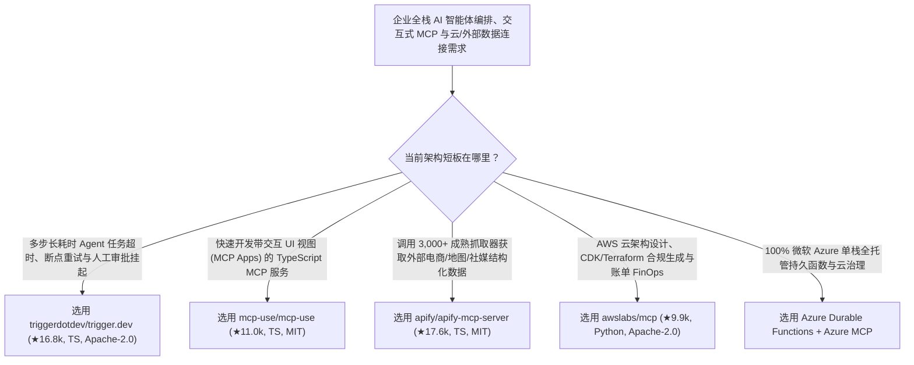
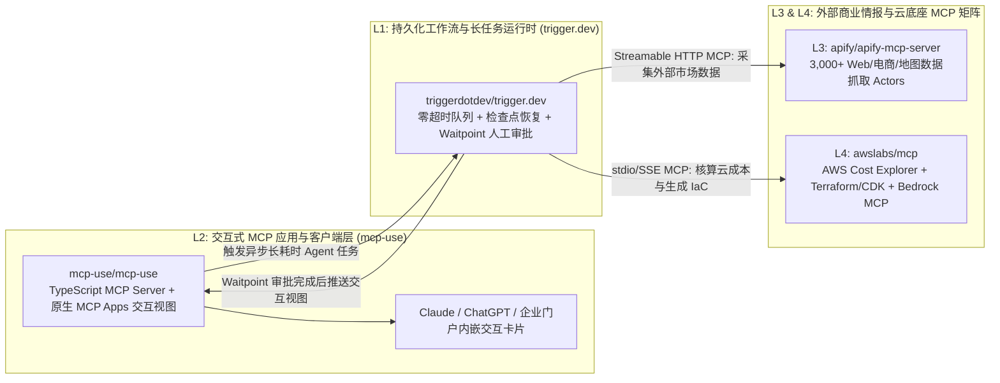
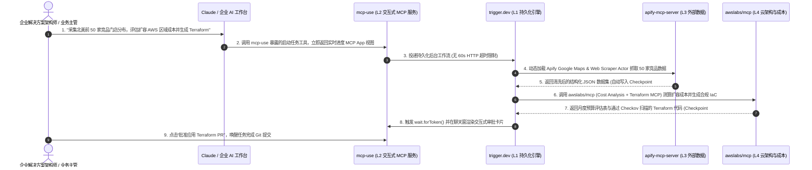

# 🏆【第 805 轮里程碑】持久化智能体工作流引擎（`triggerdotdev/trigger.dev`）、全栈交互式 MCP 应用框架（`mcp-use/mcp-use`）、3,000+ 外部数据抓取 Actor MCP（`apify/apify-mcp-server`）与 AWS 官方云架构 MCP 套件（`awslabs/mcp`）选型与集成 FAQ

> **文档类型**：AI 解决方案架构师（AI Solution Architect）选型决策指南（2026-11-24 Night Round 18 / 累计第 805 轮里程碑）  
> **阅读耗时**：约 8 分钟  
> **覆盖项目**：[`apify/apify-mcp-server`](https://github.com/apify/apify-mcp-server)（`★ 17,698` · `483 forks` · TypeScript · `MIT`） · [`triggerdotdev/trigger.dev`](https://github.com/triggerdotdev/trigger.dev)（`★ 16,815` · `1,541 forks` · TypeScript · `Apache-2.0`） · [`mcp-use/mcp-use`](https://github.com/mcp-use/mcp-use)（`★ 11,005` · `1,560 forks` · TypeScript · `MIT`） · [`awslabs/mcp`](https://github.com/awslabs/mcp)（`★ 9,947` · `1,895 forks` · Python · `Apache-2.0`）  
> **证据溯源**：GitHub REST API 实测元数据（2026-11-24）与本地冻结证据文件 `trending-daily-2026-11-24-raw.html`（LF `sha256: bc6180e17c19491f9d8fe6c425ccb2e78824344e713a6555d437cab3de`）、`search-new-repos-2026-11-24-raw.json`（LF `sha256: 9318369c192895c954be17517f99c8d9e27d68d47736f8000908607314306454`）；Track B 仓库无 HTML 榜单对应的单日增量，统一标记为 `track_b_stars_today=not_measured`。  
> **English Version**: [`apify-trigger-mcp-use-awslabs-selection-faq.en.md`](./apify-trigger-mcp-use-awslabs-selection-faq.en.md)

---

## ① 📌 核心结论速览（Executive Summary）

**选型一句话结论**：当企业全栈 AI 与云平台团队需要构建**“既能在 ChatGPT/Claude 对话框内直接渲染原生交互式视图（`mcp-use/mcp-use`），又能在后台执行跨小时级不超时、支持断点续跑与人工审批挂起的持久化工作流（`triggerdotdev/trigger.dev`），同时无缝调用 3,000+ 外部电商/社交/地图数据抓取器（`apify/apify-mcp-server`）与 AWS 官方云原生架构/成本/IaC 治理工具集（`awslabs/mcp`）”**的生产级系统时，采用这套 100% 宽松开源协议（`MIT` + `Apache-2.0`）的四层技术栈，可将 45 人团队的月度 TCO 从商业按步计费工作流 SaaS + 手写 MCP UI 胶水代码 + 商业数据连接器（Path A）的 **`$9,570.00/月`** 降至 **`$315.00/月`**（净省 **`$9,255.00/月`**，降幅 **`-96.71%`**）。

| 评估维度 | `triggerdotdev/trigger.dev` (L1 持久化 Agent 工作流) | `mcp-use/mcp-use` (L2 全栈交互式 MCP 框架) | `apify/apify-mcp-server` (L3 3,000+ 抓取器 MCP) | `awslabs/mcp` (L4 AWS 官方云架构 MCP 套件) |
|---|---|---|---|---|
| **GitHub 实测热度** | `★ 16,815` · `1,541 forks` | `★ 11,005` · `1,560 forks` | `★ 17,698` · `483 forks` | `★ 9,947` · `1,895 forks` |
| **实现语言与开源协议** | TypeScript (`Apache-2.0`) | TypeScript (`MIT`) | TypeScript (`MIT`) | Python (`Apache-2.0`) |
| **一句话通俗定位** | 无 Serverless 超时限制、支持检查点恢复与人工审批挂起的开源 AI Agent 与后台任务平台 | 支持原生交互视图（MCP Apps）、内置调试器（Inspector）的 TypeScript 全栈 MCP 开发框架 | 连接 3,000+ Apify Actors（电商/社媒/地图/搜索引擎结构化抓取）的官方 MCP 服务 | AWS 官方开源的云架构设计、CDK/Terraform 生成、成本分析与 Bedrock 专用 MCP 矩阵 |
| **解决的核心业务痛点** | 根治多步 Agent 任务在 Vercel/Lambda 上运行超 60 秒即被强制掐断且重试导致重复扣费的痛点 | 解决传统 MCP Server 只能返回干巴巴的纯文本 JSON、无法在聊天窗口内展示交互式表格/表单的局限 | 免去为每个外部网站（LinkedIn、Google Maps、亚马逊）单独编写和维护反爬解析代码的繁重工作 | 消除大模型盲写 AWS IAM 权限、CDK 代码与成本估算时违背 Well-Architected 最佳实践的风险 |
| **何时选它 vs 云托管** | 需自建 TypeScript 优先的持久化 Agent 队列与长任务编排时选它；纯 .NET/Azure 栈选 Azure Durable Functions | 需开发同时适配 Claude/ChatGPT 且带交互 UI 的 MCP Server/Client 时必选；简单 Python 脚本用 FastMCP | 需要按需调用成熟商业级网页/社媒/电商结构化数据 Actor 时选它；简单内网静态页抓取用 `wigolo` | 跨云企业治理 AWS 资源、生成合规 Terraform/CDK 与核算账单时必选；纯 Azure 资源治理用 Azure MCP |

---

## ② 🎯 客户与架构师灵魂拷问 Q&A（1–2 分钟速读）

### Q1：很多团队用 Next.js / Vercel 写 AI Agent，一旦遇到“先爬 20 个竞品页面 ➔ 调 5 次大模型对比 ➔ 等财务总监在飞书点审批 ➔ 写入 ERP”的长链路任务就直接 504 Gateway Timeout，且失败重跑会把前几步的 Token 重新烧一遍。`triggerdotdev/trigger.dev`（`★ 16,815`）怎么解决？
- **痛点**：普通 HTTP 接口与无状态 Serverless 函数不适合运行超过几十秒的 Agent 循环，更无法在等待人工审批的几小时内“免费休眠挂起”。
- **架构师解答**：在企业内网自建 **`triggerdotdev/trigger.dev`**（`Apache-2.0`）：
  1. **零超时限制与检查点持久化（Checkpointed Execution）**：每完成一个子任务（如调用 LLM 或抓取网页），状态自动快照落盘；若第 4 步网络抖动失败，仅从第 4 步精准重试，前 3 步已消耗的 LLM 结果直接复用。
  2. **零成本人工审批等待点（Waitpoint Tokens）**：当 Agent 需要人工确认时，调用 `wait.forToken()` 即可完全冻结容器计费，待审批人点击 Webhook 后毫秒级唤醒继续执行。

### Q2：什么是“MCP Apps（交互式 MCP 应用）”？为什么 `mcp-use/mcp-use`（`★ 11,005`）比直接用官方底层 `@modelcontextprotocol/sdk` 开发效率高得多？
- **核心差异**：官方底层 SDK 只提供基础的 JSON-RPC 传输原语，开发者不仅要手写大量 Schema 绑定代码，而且返回给用户的全是纯文本。`mcp-use/mcp-use`（`MIT`）提供了**端到端强类型的 TypeScript MCP Server + MCP Client 框架**，原生支持最新的 **MCP Apps / Views 标准（允许 MCP 工具直接在 ChatGPT、Claude 或自研工作台中渲染可交互的图表、审批卡片与看板）**，并自带可视化 **MCP Inspector** 调试台，几分钟即可发布生产级连接器。

### Q3：企业架构师如何把 `apify/apify-mcp-server`（`★ 17,698`）与 `awslabs/mcp`（`★ 9,947`）结合进多云与商业情报架构中？
- **一外一内，双向赋能**：
  1. **对外市场与竞品结构化数据采集（`apify/apify-mcp-server`）**：通过标准 MCP 将 Apify 生态中 **3,000+ 个现成 Actor**（涵盖 Google Maps 门店采集、电商价格监控、社媒舆情与文档站点全量抓取）动态暴露给 Agent，支持按需动态发现工具（Dynamic Actor Discovery），避免一次性加载上千个工具撑爆上下文。
  2. **对内多云基础设施与成本治理（`awslabs/mcp`）**：由 AWS 官方团队维护（`Apache-2.0`），包含 AWS Documentation、CDK、Terraform、Cost Analysis、Bedrock Knowledge Base 等数十个专业子 MCP Server。对于采用“Azure + AWS”双云架构的大型跨国企业，架构师可将 `Azure MCP` 与 `awslabs/mcp` 并联挂载，用同一个架构 Agent 完成跨云成本对比与合规 IaC 审计。

---

## ③ 🧭 直观可视化图解（Mermaid 决策树 + 集成架构 + 时序图）

### 3.1 技术选型决策树

### 3.2 企业端到端生产集成参考架构图

### 3.3 业务流全链路时序图

---

## ④ 📊 同类开源与商业云服务横向选型决策矩阵

| 对比维度 | 本轮开源组合 (`trigger.dev` + `mcp-use` + `apify-mcp` + `awslabs/mcp`) | 同赛道裸写方案 (`BullMQ + Redis` + `底层 MCP SDK` + `手写 Puppeteer`) | 商业云托管方案 (`Inngest/Temporal Cloud` + `商业 ETL 连接器` + `AWS Managed Console`) |
|---|---|---|---|
| **功能定位** | 持久化 Agent 工作流 + 交互式 MCP Apps 框架 + 3,000+ 抓取 Actor + 官方云架构 MCP | 基础消息队列 + 无 UI 的底层协议封装 + 自维护无头浏览器脚本 | 按执行步数收费的云端工作流 SaaS + 商业数据采集订阅 + 原生云控制台 |
| **适用场景** | 跨分钟/小时级长链路 Agent、对话内嵌交互式审批 UI、外部竞品采集与多云 IaC/成本治理 | 毫秒级简单异步发邮件通知，无复杂状态恢复需求 | 不愿维护任何容器基础设施且预算充裕的纯 SaaS 团队 |
| **集成成本** | **极低**（TypeScript 全栈同构 + 官方现成 Python/TS MCP 包，30 分钟跑通） | 高（需手写断点状态机、并发限流、反爬代理池与前端 UI 对接） | 低（云端开通即用，但跨步状态序列化会产生高额按步计费账单） |
| **运维复杂度** | **极低**（Docker Compose / Helm 一键自建 `trigger.dev`，月均维护仅 `2.4h`） | 高（处理 Zombie 任务、反爬封禁与 IAM 权限报错耗费约 `32h/月`） | 低（全托管基础设施，月均账单与配额治理约 `10.5h`） |
| **开源协议与合规** | `mcp-use`、`apify-mcp-server` 为 `MIT`；`trigger.dev`、`awslabs/mcp` 为 `Apache-2.0`（100% 企业友好） | MIT / Apache-2.0 | 商业闭源按步数（Per-Step）/ 按吞吐量高额计费 |
| **45 人团队月度 TCO** | **`$315.00/月`**（含 `$75.00` 自建工作流节点 + `2.4h` 运维） | 约 `$3,280.00/月`（含 `$80.00` 队列节点 + `32.0h` 爬虫与重试排障） | **`$2,960.00/月`**（Path B）至 **`$9,570.00/月`**（Path A 商业全栈） |

---

## ⑤ 🧪 应用落地定量收益 / TCO 对比（Closed-Form FinOps 模型）

> **数据性质声明（Provenance Metadata）**：以下 TCO 模型为面向 **45 人企业全栈 AI 工程与云平台团队**（每月运行 450 万步持久化 Agent 状态流转、构建 25 个内部交互式 MCP 应用并执行 1,200 次多云架构/外部数据采集任务，工程师折算时薪 `$100.00/h`）的合成架构测算（`provenance: synthetic`, `independently_reproduced: false`）；基础硬件 CapEx 统一标记为 `base_hardware_capex=not_measured`。

| 成本构成项 | Path A：商业按步计费工作流 SaaS + 手写 MCP UI 胶水工程 + 商业云运维套件 | Path B：Azure Durable Functions + Azure MCP + 托管数据连接器 | Path C：`trigger.dev` + `mcp-use` + `apify-mcp-server` + `awslabs/mcp` |
|---|---|---|---|
| **API / SaaS / 云资源月费** | **`$4,920.00`**（百万步级商业工作流账单 + 超时重跑浪费的 LLM Token + 商业订阅） | **`$1,910.00`**（Azure Functions Premium/Durable 存储执行费 + 托管连接器） | **`$75.00`**（内网自建 `trigger.dev` 容器实例与轻量 MCP 宿主机） |
| **月度超时排障、爬虫维护与手写 IaC 工时** | `46.5h`（排查 Serverless 504 超时重跑 + 手写 MCP 前端交互 + 修复手写云模板报错） | `10.5h`（跨云配置对齐与函数绑定维护） | **`2.4h`**（基于内置 Inspector 调试与容器镜像例行升级） |
| **人工运维成本（`$100.00/h`）** | **`$4,650.00`** (`46.5 * 100.00`) | **`$1,050.00`** (`10.5 * 100.00`) | **`$240.00`** (`2.4 * 100.00`) |
| **月度总拥有成本（Total Monthly TCO）** | **`$9,570.00 / 月`** | **`$2,960.00 / 月`** | **`$315.00 / 月`** |
| **相对 Path A 净节省** | 基准线 (`$0.00`) | 节省 `$6,610.00 / 月` (`-69.07%`) | **净省 `$9,255.00 / 月` (`-96.71%`)** |

---

## ⑥ 🛠️ 企业引入与架构评审 Checklist

- [ ] **持久化工作流幂等键与 Waitpoint 超时兜底（`triggerdotdev/trigger.dev`）**：为所有调用外部扣费 API 或发送通知的 `trigger.dev` 任务强制配置业务级 `idempotencyKey`，并为 `wait.forToken()` 人工审批节点设置超时自动升级（如 `timeout: "24h"`），防止审批单无限期挂起。
- [ ] **MCP Apps 视图沙箱与输入校验（`mcp-use/mcp-use`）**：在使用 `mcp-use` 构建内嵌交互视图（Views）时，严格使用 Zod Schema 校验前端回传的工具调用参数，并在上线前通过内置 `MCP Inspector` 完成权限边界测试。
- [ ] **动态 Actor 按需挂载与单次抓取预算上限（`apify/apify-mcp-server`）**：在配置 `apify-mcp-server` 时，显式指定白名单 Actors 列表（`--actors`）或启用按需搜索加载，并在 Apify 侧配置每个任务的最大内存与美元消费硬上限（Max Cost Per Run）。
- [ ] **云端只读 IAM 角色与 IaC 静态安全扫描（`awslabs/mcp`）**：为 `awslabs/mcp` 挂载最小权限的只读 IAM Role（`ReadOnlyAccess` / `ViewOnlyAccess`），规定所有架构变更有且只能通过生成 CDK/Terraform 代码提交 Git PR，经由 CI 静态扫描（Checkov / tfsec）通过后方可执行部署。
