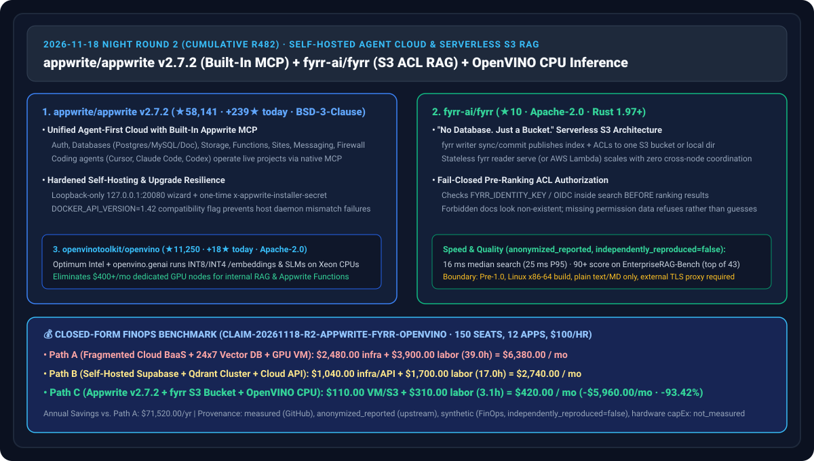
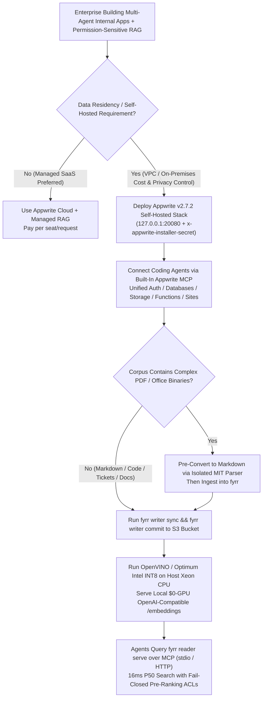

# Agent-First Self-Hosted Backend Cloud (`appwrite/appwrite v2.7.2`), Serverless S3 Permission-Aware Context Layer (`fyrr-ai/fyrr`) & OpenVINO CPU Inference Selection FAQ

> **Document Type**: AI Solution Architect (SA) Practical Selection & Reference Architecture Guide (Round 482 / 2026-11-18 Night R2)  
> **Primary Evaluated Repositories**: [`appwrite/appwrite`](https://github.com/appwrite/appwrite) (`v2.7.2`, `★ 58,141`, GitHub Daily Trending `#13` with `+239 ★ today`, `BSD-3-Clause`) + [`fyrr-ai/fyrr`](https://github.com/fyrr-ai/fyrr) (`★ 10`, serverless S3 permission-aware context layer for AI agents, `Apache-2.0`) + [`openvinotoolkit/openvino`](https://github.com/openvinotoolkit/openvino) (`★ 11,250`, GitHub Daily Trending `#14` with `+18 ★ today`, `Apache-2.0`)  
> **Benchmark Standard**: Strictly aligned with [`ib-vs-ethernet-roce-selection-faq.md`](https://github.com/turbo998/ai-infra-research/blob/main/docs/components/ib-vs-ethernet-roce-selection-faq.md) 6-section architecture format (Executive Summary + First-Principles Q&A + Mermaid Decision Tree + Peer Selection Matrix + 7-Card Quantitative Insights + SA Action Checklist)  
> **Data Provenance**: GitHub Trending velocity and repository metadata are `measured`; upstream benchmark claims (such as `fyrr` `16 ms` median / `25 ms` P95 latency and `EnterpriseRAG-Bench 90+`) are `anonymized_reported (independently_reproduced=false)`; the enterprise FinOps TCO model is `synthetic (independently_reproduced=false)` with base host hardware CapEx `not_measured`.  
> **Language Editions**: [中文版](./appwrite-fyrr-openvino-agent-native-mcp-backend-cloud-serverless-s3-acl-rag-cpu-inference-selection-faq.md) | [English Version (Current)](./appwrite-fyrr-openvino-agent-native-mcp-backend-cloud-serverless-s3-acl-rag-cpu-inference-selection-faq.en.md)

---

## 📌 1. Executive Summary (30-Second Architect Briefing)

1. **Plain-Language First-Principles Definition**:
   - **What is `appwrite/appwrite (v2.7.2)`?** It is an **open-source, MCP- and agent-first full-stack backend cloud platform**. In a single self-hosted Docker stack (or managed cloud), it gives both AI coding agents (Cursor, Claude Code, Codex) and application developers unified access to **Appwrite Auth**, **Databases** (document or managed PostgreSQL/MySQL), **Storage**, **Functions** (isolated serverless runtimes), **Sites** (static/SSR/CSR hosting), **Messaging**, **Firewall**, **Realtime**, and a **built-in `Appwrite MCP` server**.
   - **What is `fyrr-ai/fyrr`?** It is a **serverless, permission-aware context layer for AI agents built on the principle "No Database. Just a Bucket."** Instead of running an always-on vector database cluster, `fyrr writer sync && fyrr writer commit` publishes indexed content and document ACL rules directly into a single S3 bucket (or local folder). Stateless `fyrr reader serve` nodes (or experimental AWS Lambda functions) expose MCP search/fetch over `stdio` or `Streamable HTTP` with **`16 ms` median (`25 ms` P95)** latency while enforcing **fail-closed pre-ranking ACL authorization**.
   - **What is `openvinotoolkit/openvino`?** It is Intel's open-source deep learning inference toolkit (`openvino.genai` + `Optimum Intel`) that compresses (`INT8`/`INT4`) and accelerates Hugging Face embedding models, rerankers, and SLMs directly on standard Xeon CPUs, Core Ultra NPUs, and edge hosts without requiring dedicated GPUs.
2. **Why Enterprise AI Solution Architects Should Combine All Three Tonight**:
   - Enterprise teams building internal AI applications face three recurring infrastructure bottlenecks: ① stitching together separate Auth, DB, Storage, Functions, and MCP adapters for every new agent app; ② paying 24×7 for memory-heavy vector databases that risk leaking restricted documents via post-ranking permission bugs; ③ renting underutilized cloud GPUs just to run `/embeddings`.
   - **Unified Reference Architecture**: Deploy **`Appwrite v2.7.2`** as the MCP-native application backend, **`fyrr`** as the zero-database S3 permission-aware RAG layer, and **`OpenVINO`** on the same CPU host to power the OpenAI-compatible `/embeddings` endpoint at `$0` GPU cost.
3. **Closed-Form FinOps Impact (`CLAIM-20261118-R2-APPWRITE-FYRR-OPENVINO`, `synthetic`)**:
   - For a 150-employee enterprise running **12 internal AI agent micro-apps & permission-gated RAG workspaces** (`$100.00/hr` engineer rate): **Path A (Fragmented Cloud BaaS + Always-On Managed Vector DB + Dedicated GPU Embedding Nodes)** costs **`$6,380.00/mo`** (`$2,480.00` cloud/GPU spend + `39.0 hrs × $100 = $3,900.00` integration/ACL debugging labor); **Path C (`Appwrite v2.7.2` + `fyrr` S3 Bucket + `OpenVINO` CPU Embeddings)** reduces total monthly TCO to **`$420.00/mo`** (`$110.00` VM/S3 spend + `3.1 hrs × $100 = $310.00` ops labor), saving **`$5,960.00/mo` (`93.42%` reduction, `$71,520.00/yr` annualized)**.

---

## ❓ 2. Three First-Principles Architect Questions (Q&A)

### Q1: With Supabase and Firebase widely used, why is `appwrite/appwrite v2.7.2` surging on GitHub Trending for AI agent teams?
- **First-Principles Architectural Differentiators**:
  1. **First-Class Built-In MCP Control Plane (`Appwrite MCP`)**: Coding agents (Cursor, Claude Code, Codex) connect directly to a live Appwrite project via MCP to provision schemas, storage buckets, serverless functions, and auth policies without custom glue scripts.
  2. **Complete Full-Stack Consolidation (`Sites` + `Messaging` + `Firewall`)**: Beyond database and auth, Appwrite bundles Git-driven frontend/SSR hosting (`Appwrite Sites`), unified email/SMS/push delivery (`Appwrite Messaging`), and abuse/traffic rules (`Appwrite Firewall`) under one RBAC model.
  3. **Hardened Loopback Installer & Docker API Compatibility**: The `appwrite/appwrite:2.7.2` installer binds strictly to `127.0.0.1:20080` and requires a one-time STDOUT secret (`x-appwrite-installer-secret`), preventing unauthenticated setup hijacking on remote servers. It also supports `--env DOCKER_API_VERSION=1.42` to eliminate host/container Docker CLI version mismatches during upgrades.

### Q2: How does `fyrr-ai/fyrr` achieve `16 ms` median enterprise search without a database, and how does it prevent unauthorized RAG data leaks?
- **The Vector Database Trap**: Traditional vector databases require expensive 24×7 RAM allocation and frequently evaluate permissions *after* top-K vector retrieval, causing either empty result sets or metadata-drift data leaks.
- **How `fyrr` Solves It (and Its Honest Pre-1.0 Boundaries)**:
  1. **Bucket-Only Storage & Stateless Readers**: `fyrr writer sync && fyrr writer commit` writes all index segments and ACL rules directly to one S3 bucket (or local directory). Stateless `fyrr reader serve` instances read directly from the bucket without cross-node coordination, scaling from a single developer laptop to company-wide servers or experimental AWS Lambda readers (`16 ms` median, `25 ms` P95 latency, `90+` on `EnterpriseRAG-Bench`, `anonymized_reported`).
  2. **Pre-Ranking Fail-Closed Authorization**: `fyrr` evaluates the caller's identity (`FYRR_IDENTITY_KEY` / OIDC) against synced document ACLs *inside* the search before ranking. A forbidden document looks identical to one that does not exist, and **missing permission metadata fails closed (refuses rather than guesses)**.
  3. **Pre-1.0 Operational Boundaries**: Architects must note that `fyrr` is pre-1.0, builds on Linux x86-64 only, indexes plain text/Markdown (requiring an upstream parser such as `OpenDocKit` for PDFs/Office files), requires a TLS-terminating reverse proxy outside loopback, and its cloud connectors (Google Drive/Notion/Slack/Jira) have been tested against synthetic APIs so far.

### Q3: How does `openvinotoolkit/openvino` eliminate the GPU tax for `fyrr` embeddings and `Appwrite Functions` inference?
- **CPU/NPU Co-Location Pattern**: `fyrr` delegates vector generation to any OpenAI-compatible `/embeddings` endpoint. By exporting Hugging Face embedding models (`bge-m3`, `nomic-embed`, `Qwen3-Embedding`) and compact SLMs via **`Optimum Intel` / `openvino.genai`** with `INT8`/`INT4` weight compression, enterprise architects can serve embeddings and lightweight document classification directly on the same Xeon CPU host running Appwrite and fyrr—eliminating dedicated GPU instances.

---

## 🧭 3. Architecture Decision Tree & Reference Topology (Mermaid)

---

## 📊 4. Peer Solution Selection Matrix

| Evaluation Dimension | **Path A: Fragmented Cloud BaaS + Managed Vector DB + GPU** | **Path B: Self-Hosted Supabase + Qdrant Cluster + Cloud API** | **Path C: `Appwrite v2.7.2` + `fyrr` + `OpenVINO` (Recommended)** |
| :--- | :--- | :--- | :--- |
| **Agent & MCP Integration** | ❌ Custom glue code across multiple vendor SDKs | ⚠️ Database-centric; lacks unified Sites/Messaging/Firewall | ✅ **Built-in `Appwrite MCP` + `fyrr` MCP (`stdio`/HTTP)** |
| **RAG Storage Infrastructure** | ❌ Always-on managed vector database cluster | ⚠️ Stateful Qdrant/Milvus cluster ops & memory overhead | ✅ **No database—just one S3 bucket / folder + stateless readers** |
| **Document ACL Enforcement** | ⚠️ Often post-filtered; prone to metadata sync leaks | ⚠️ Manual filter DSL construction per query | ✅ **Pre-ranking ACL check; missing permissions fail closed** |
| **Embedding Compute Hardware** | ❌ Dedicated cloud GPU instance (`$400+/mo`) | ⚠️ Per-token external embedding API charges | ✅ **OpenVINO `INT8/INT4` on existing Xeon CPU (`$0` discrete GPU)** |
| **Search Latency (`anonymized_reported`)** | `40–120 ms` (cross-cloud hops) | `20–50 ms` | ✅ **`16 ms` median / `25 ms` P95 (`EnterpriseRAG-Bench 90+`)** |
| **150-Seat Monthly Total Cost (TCO)** | **`$6,380.00 / mo`** | **`$2,740.00 / mo`** | **`$420.00 / mo` (`-$5,960.00/mo` vs. Path A, `-93.42%`)** |

---

## 📈 5. 7-Card Quantitative Insights & Closed-Form FinOps Model (`CLAIM-20261118-R2-APPWRITE-FYRR-OPENVINO`)

> **Provenance Note**: GitHub stars and daily velocity are `measured` from sealed `2026-11-18` evidence; `fyrr` `16 ms` median / `25 ms` P95 latency and `EnterpriseRAG-Bench 90+` score are `anonymized_reported (independently_reproduced=false)`; the monthly TCO table is a closed-form `synthetic (independently_reproduced=false)` model for **150 employees across 12 internal AI agent apps & permission-gated RAG workspaces** (`$100.00/hr` engineer rate; base server hardware CapEx: `not_measured`).

| Monthly Cost Component (Closed-Form Formula) | Path A: Cloud BaaS + Vector DB + GPU Node | Path B: Self-Hosted Supabase + Qdrant + API | Path C: `Appwrite` + `fyrr` S3 + `OpenVINO` | Path C vs. Path A Delta |
| :--- | :---: | :---: | :---: | :---: |
| **1. Cloud Infra, Storage & Inference Spend** | **`$2,480.00`** *(Multi-vendor BaaS + 24×7 Vector DB + GPU VM)* | **`$1,040.00`** *(Qdrant RAM nodes + external embedding API)* | **`$110.00`** *(Shared CPU VM + S3 bucket + OpenVINO CPU inference)* | **`-$2,370.00 / mo`** (`-95.56%`) |
| **2. Engineering Integration & Ops Labor** (`$100/hr`) | **`$3,900.00`** *(`39.0 hrs` maintaining glue code & debugging ACL leaks)* | **`$1,700.00`** *(`17.0 hrs` managing dual-stack upgrades & shards)* | **`$310.00`** *(`3.1 hrs` one-command Appwrite upgrade & `fyrr writer sync`)* | **`-$3,590.00 / mo`** (`-35.9 hrs`, `-92.05%`) |
| **Total Monthly TCO** | **`$6,380.00`** | **`$2,740.00`** | **`$420.00`** | **`-$5,960.00 / mo` (`-93.42%`)** |
| **Annualized TCO** | **`$76,560.00 / yr`** | **`$32,880.00 / yr`** | **`$5,040.00 / yr`** | **`$71,520.00 / yr` saved (`-93.42%`)** |

---

## ✅ 6. AI Solution Architect Action Checklist

1. **Step 1 — Provision Hardened Self-Hosted `Appwrite v2.7.2` with Built-In MCP**:
   - Run `docker run -it --rm --publish 127.0.0.1:20080:20080 --volume /var/run/docker.sock:/var/run/docker.sock --volume "$(pwd)"/appwrite:/usr/src/code/appwrite:rw --entrypoint="install" appwrite/appwrite:2.7.2` (add `--env DOCKER_API_VERSION=1.42` if host Docker Engine is older).
   - Complete initialization via SSH tunnel to `127.0.0.1:20080` using the one-time `x-appwrite-installer-secret`, and wire `Appwrite MCP` into Cursor / Claude Code.
2. **Step 2 — Stand Up Zero-GPU `OpenVINO` Embedding Service**:
   - Install `openvino` and `optimum-intel` on the Linux x86-64 host, quantize your enterprise embedding model to `INT8`, and expose a local OpenAI-compatible `/embeddings` endpoint.
3. **Step 3 — Publish Permission-Aware `fyrr` Index to S3 & Mount MCP Reader**:
   - Run `fyrr writer namespace create && fyrr writer sync && fyrr writer commit` targeting an internal S3 bucket, place `fyrr reader serve` behind a TLS-terminating reverse proxy, and register it with `claude mcp add fyrr --scope user -e FYRR_IDENTITY_KEY="$FYRR_IDENTITY_KEY"`.
