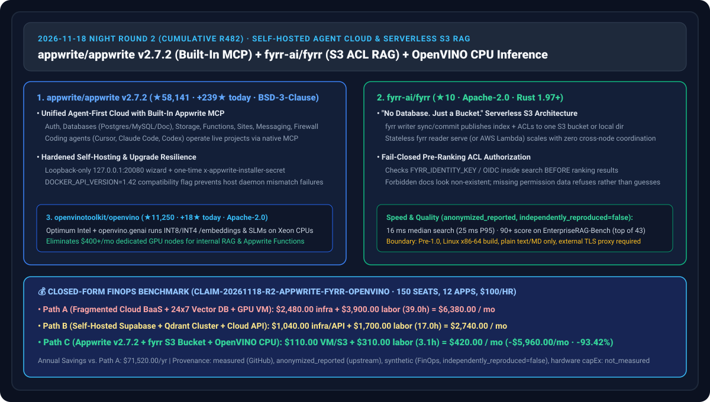
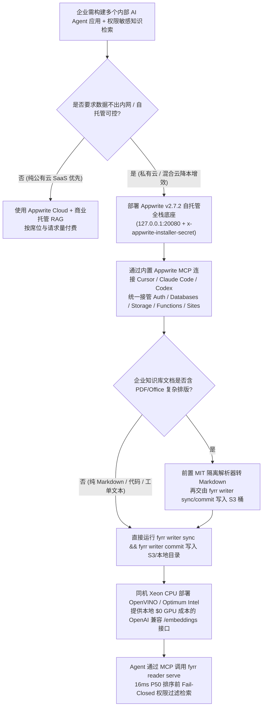

# Agent 原生全栈自托管云底座（`appwrite/appwrite v2.7.2`）、无数据库 S3 权限感知检索层（`fyrr-ai/fyrr`）与 OpenVINO CPU 推理加速选型 FAQ

> **文档类型**：AI Solution Architect (SA) 实战选型与参考架构指南（Round 482 / 2026-11-18 Night R2）  
> **核心评估对象**：[`appwrite/appwrite`](https://github.com/appwrite/appwrite)（`v2.7.2`，`★ 58,141`，今日热榜 `#13` `+239 ★ today`，`BSD-3-Clause`） + [`fyrr-ai/fyrr`](https://github.com/fyrr-ai/fyrr)（`★ 10`，新建 S3 无数据库权限感知 Agent 上下文层，`Apache-2.0`） + [`openvinotoolkit/openvino`](https://github.com/openvinotoolkit/openvino)（`★ 11,250`，今日热榜 `#14` `+18 ★ today`，`Apache-2.0`）  
> **对标范式**：严格遵循 [`ib-vs-ethernet-roce-selection-faq.md`](https://github.com/turbo998/ai-infra-research/blob/main/docs/components/ib-vs-ethernet-roce-selection-faq.md) 六段式结构（核心结论速览 + 三大灵魂拷问 + Mermaid 决策树 + 选型对比矩阵 + 7-Card 定量洞察 + SA 落地 Checklist）  
> **数据溯源分级（Provenance）**：GitHub 热榜增量与仓库树元数据为 `measured`；上游性能声明（如 `fyrr` `16 ms` P50 / `25 ms` P95 延迟与 `EnterpriseRAG-Bench 90+`）标注为 `anonymized_reported (independently_reproduced=false)`；企业 FinOps TCO 测算为 `synthetic (independently_reproduced=false)`，服务器硬件折旧 `not_measured`。  
> **语言版本**：[中文版 (当前)](./appwrite-fyrr-openvino-agent-native-mcp-backend-cloud-serverless-s3-acl-rag-cpu-inference-selection-faq.md) | [English Version](./appwrite-fyrr-openvino-agent-native-mcp-backend-cloud-serverless-s3-acl-rag-cpu-inference-selection-faq.en.md)

---

## 📌 一、核心结论速览（Executive Summary — 30 秒看懂）

1. **大白话本质定义**：
   - **`appwrite/appwrite (v2.7.2)` 是什么？** 它是专为 **AI Agent 与开发者打造的一体化开源后端云底座（BaaS）**。它把鉴权（`Auth`）、数据库（`Databases`，支持原生文档与托管 PostgreSQL/MySQL）、文件存储（`Storage`）、无服务器函数（`Functions`）、前端托管（`Sites`）、消息推送（`Messaging`）、防火墙（`Firewall`）、实时订阅（`Realtime`）以及 **原生内置的 `Appwrite MCP`** 全部打包进一套可单命令自托管的容器栈，让 Cursor、Claude Code、Codex 等编码 Agent 直接通过 MCP 操控线上或内网后端工程。
   - **`fyrr-ai/fyrr` 是什么？** 它是主张 **“No Database. Just a Bucket.（不要常驻向量数据库，只要一个 S3 存储桶）”** 的无服务器权限感知 Agent 检索层。它通过 `fyrr writer sync/commit` 将企业知识库索引连同文档 ACL 权限直接写入单个 S3 存储桶（或本地目录），由无状态 `fyrr reader serve`（甚至实验性 AWS Lambda）通过 MCP（`stdio` / `Streamable HTTP`）提供 **`16 ms` 中位数延迟（P95 `25 ms`）** 的检索，并在排序前执行 **Fail-Closed 权限过滤**。
   - **`openvinotoolkit/openvino` 是什么？** 它是英特尔开源的跨平台深度学习推理加速套件（含 `openvino.genai` 与 `Optimum Intel`），能将 Hugging Face Embedding、Reranker 与中小模型量化压缩（`INT8`/`INT4`）后直接跑在企业现有的至强（Xeon）CPU 或边缘 NPU 上，无需为内部 RAG 专门租用昂贵的独立 GPU。
2. **为什么企业 AI 解决方案架构师（SA）今晚必须把这三者组合来看？**
   - 企业构建内部 AI 助手与业务创新微应用时最怕 **“基础设施三座大山”**：① 每做一个 Agent 应用就要重新拼凑 Auth + Postgres + S3 + Serverless + 防火墙；② 为了做企业级 RAG 被迫维护 7×24 小时烧钱的分布式向量数据库集群，且经常发生“普通员工通过 RAG 搜出高管薪酬文档”的越权事故；③ 为了跑 Embedding 模型被迫长租 GPU 节点。
   - **三剑客闭环**：用 **`Appwrite v2.7.2`** 提供带原生 MCP 的全栈业务后端，用 **`fyrr`** 将知识检索下沉到零数据库的 S3 存储桶并强制排序前 ACL 鉴权，再用 **`OpenVINO`** 在同机 CPU 上免费驱动 `/embeddings` 向量化接口！
3. **闭式 FinOps 量化收益（`CLAIM-20261118-R2-APPWRITE-FYRR-OPENVINO`，`synthetic`）**：
   - 以 150 人企业规模支撑 **12 个内部 AI 业务微应用与权限分级知识库**（工程师时薪 `$100.00/hr`）计：**Path A（云端零散 BaaS + 常驻托管向量数据库 + 独立 GPU Embedding 节点）** 月均总成本 **`$6,380.00`**（云资源/API `$2,480.00` + 运维与权限对齐人工 `39.0h × $100 = $3,900.00`）；**Path C（`Appwrite v2.7.2` + `fyrr` S3 桶 + `OpenVINO` CPU 推理）** 月均总成本降至 **`$420.00`**（S3 与通用虚机 `$110.00` + 运维人工 `3.1h × $100 = $310.00`），**净省 `$5,960.00/月`（降幅 `93.42%`，年化节省 `$71,520.00`）**。

---

## ❓ 二、三大灵魂拷问（First-Principles Q&A）

### Q1：市面上已经有 Supabase 和 Firebase，为什么 `appwrite/appwrite v2.7.2` 在 AI Agent 时代重新冲上热榜？
- **第一性原理差异**：
  1. **原生 Agent-First 与内置 MCP 控制面**：Appwrite 将 `Appwrite MCP` 作为一等公民产品模块，研发人员的 Cursor、Claude Code 或 Codex 可直接通过 MCP 工具操作项目的表结构、权限策略、云函数与站点部署，而无需手写胶水脚本。
  2. **真正大一统的全栈闭环（含 `Sites` + `Messaging` + `Firewall`）**：相比仅聚焦 Postgres 周边的方案，Appwrite 在同一套控制台和 SDK 内同时包揽了前后端托管（`Appwrite Sites` 支持静态、SSR 与 CSR）、邮件/短信/推送网关（`Appwrite Messaging`）与边缘流量风控（`Appwrite Firewall`）。
  3. **安全加固的单命令自托管向导（`127.0.0.1:20080` + 一次性密钥）**：`appwrite/appwrite:2.7.2` 安装器默认仅绑定本地回环 `127.0.0.1:20080` 并在终端输出一次性 `x-appwrite-installer-secret`（远程服务器通过 SSH 隧道完成初始化），彻底杜绝了传统开源面板在公网裸奔初始化页面的抢注风险；遇到宿主机 Docker Engine 版本偏旧时，只需传入 `--env DOCKER_API_VERSION=1.42` 即可平滑兼容。

### Q2：为什么 `fyrr-ai/fyrr` 敢喊出“不要数据库，只要一个 S3 桶（No Database. Just a Bucket）”，它的权限安全是怎么做到不泄密的？
- **传统企业 RAG 的两大死穴**：一是 Milvus/Qdrant/Elasticsearch 集群无论有没有人查询都必须 24 小时占用大内存常驻运行；二是许多 RAG 采取“先按向量相似度捞出 Top-K，再在应用层过滤权限”，极易导致高权限文档挤占名额或因元数据同步延迟而越权泄露。
- **`fyrr` 的架构解法与诚实边界**：
  1. **读写分离 + 纯对象存储无状态扩展**：写入端（`fyrr writer sync && fyrr writer commit`）把文档内容、倒排/向量索引与访问控制规则打包发布为 S3 桶（或本地私有目录）中的不可变文件；读取端（`fyrr reader serve`）完全无状态、互不协调，既可按需水平扩容，也可直接跑在实验性 AWS Lambda 上按次计费，实测中位数检索延迟仅 **`16 ms`（P95 `25 ms`）**。
  2. **排序前内联鉴权 + 缺省拒绝（Fail-Closed ACL）**：`fyrr` 在检索内核排序前直接校验调用者身份（`FYRR_IDENTITY_KEY` / OIDC）与文档 ACL——**无权访问的文档在表现上与“根本不存在”完全一致，且一旦某篇文档缺失权限元数据则直接拒绝返回（Refuses rather than guesses）**。
  3. **架构师必须知晓的 Pre-1.0 适用边界**：`fyrr` 当前处于 `Pre-1.0` 阶段，仅支持纯文本/Markdown（暂不支持 PDF/Office/图片 OCR 解析，需前置配合 `OpenDocKit` 等转换器），云端连接器（Google Drive/Notion/Slack/Jira）目前仅在合成 API 上完成测试，且构建宿主机仅限 Linux x86-64，HTTP 监听需前置 TLS 反向代理。

### Q3：如何用 `openvinotoolkit/openvino` 把这套自托管架构的 Embedding 与轻量推理账单压到趋近于零？
- **端到端协同设计**：`fyrr` 需要一个兼容 OpenAI `/embeddings` 规范的向量化接口，而 `Appwrite Functions` 经常需要调用轻量级分类、命名实体识别或小模型（SLM）摘要。通过 **`OpenVINO` + `Optimum Intel`（或 `openvino.genai`）**，架构师可直接将 Hugging Face 上的主流 Embedding 模型（如 `bge-m3`、`Qwen3-Embedding`）与 `3B–8B` SLM 转换为 `INT8`/`INT4` OpenVINO IR 格式，直接部署在运行 Appwrite 与 fyrr 的同一台 Linux x86-64 至强 CPU 服务器上，省去专门租用云端 GPU 实例或按 Token 缴纳外部 Embedding API 费用的长期开销。

---

## 🧭 三、架构师选型决策树与端到端参考架构（Mermaid）

---

## 📊 四、同类方案横向选型对比矩阵（Peer Selection Matrix）

| 评估维度 | **Path A：零散云端 BaaS + 常驻向量 DB + GPU 节点** | **Path B：自建 Supabase + 独立 Qdrant 集群 + 外部 API** | **Path C：`Appwrite v2.7.2` + `fyrr` + `OpenVINO`（推荐）** |
| :--- | :--- | :--- | :--- |
| **Agent 开发与 MCP 集成度** | ❌ 需手工拼装多套 SDK 与自定义 MCP | ⚠️ 仅覆盖数据库层，缺统一站点/消息/函数管控 | ✅ **原生内置 `Appwrite MCP` + `fyrr` MCP (`stdio`/HTTP)** |
| **知识检索基础设施复杂度** | ❌ 需 24 小时常驻维护高内存向量数据库集群 | ⚠️ 需独立运维 Qdrant/Milvus 节点与主从同步 | ✅ **零数据库（仅 1 个 S3 桶 / 目录 + 无状态 Reader）** |
| **文档级权限隔离安全性** | ⚠️ 常为后置过滤，易出现元数据延迟越权 | ⚠️ 需应用层自行拼写复杂 Filter 表达式 | ✅ **内核级排序前 ACL 校验 + 缺失权限默认拒绝 (Fail-Closed)** |
| **Embedding 与轻量推理硬件成本** | ❌ 需常驻租用 T4/A10G GPU 实例 | ⚠️ 持续支付外部 Embedding API 账单 | ✅ **OpenVINO `INT8/INT4` 复用现有 Xeon CPU 零独立显卡运行** |
| **检索延迟表现 (`anonymized_reported`)** | `40–120 ms`（跨网调用） | `20–50 ms` | ✅ **`16 ms` P50 / `25 ms` P95（`EnterpriseRAG-Bench 90+`）** |
| **150 人团队月均总拥有成本 (TCO)** | **`$6,380.00 / 月`** | **`$2,740.00 / 月`** | **`$420.00 / 月`（较 Path A 净省 `$5,960.00/月`，`-93.42%`）** |

---

## 📈 五、7-Card 定量洞察与闭式 FinOps 算例（`CLAIM-20261118-R2-APPWRITE-FYRR-OPENVINO`）

> **Provenance 声明**：GitHub 星标与热榜数据源自 `2026-11-18` 封存证据（`measured`）；`fyrr` `16 ms` P50 / `25 ms` P95 延迟与 `EnterpriseRAG-Bench 90+` 源自上游基准文档（`anonymized_reported`, `independently_reproduced=false`）；月度 TCO 算例为面向 **150 人企业运行 12 个内部 AI 应用与权限知识库** 的闭式合成模型（`synthetic`, `independently_reproduced=false`；宿主机硬件折旧 CapEx：`not_measured`）。

| 成本构成项（月度闭式公式） | Path A：云端 BaaS + 常驻向量 DB + 独立 GPU | Path B：自建 Supabase + Qdrant + 云端 API | Path C：`Appwrite` + `fyrr` S3 + `OpenVINO` | Path C 对比 Path A 净变化 |
| :--- | :---: | :---: | :---: | :---: |
| **1. 云资源、存储与推理算力支出** | **`$2,480.00`** *(多套 BaaS 订阅 + 常驻向量 DB + GPU 实例)* | **`$1,040.00`** *(Qdrant 内存实例 + 外部 Embedding API)* | **`$110.00`** *(单台通用虚机 + S3 对象存储桶 + CPU 推理)* | **`-$2,370.00 / 月`** (`-95.56%`) |
| **2. 研发集成与运维排障人工成本** (`$100/hr`) | **`$3,900.00`** *(`39.0 hrs`：多平台鉴权胶水代码与 ACL 越权排查)* | **`$1,700.00`** *(`17.0 hrs`：维护双栈升级与向量库分片运维)* | **`$310.00`** *(`3.1 hrs`：单命令升级 Appwrite 与定时 `fyrr writer sync`)* | **`-$3,590.00 / 月`** (`-35.9 hrs`, `-92.05%`) |
| **月度总拥有成本 (Monthly Total TCO)** | **`$6,380.00`** | **`$2,740.00`** | **`$420.00`** | **`-$5,960.00 / 月` (`-93.42%`)** |
| **年化总拥有成本 (Annualized TCO)** | **`$76,560.00 / 年`** | **`$32,880.00 / 年`** | **`$5,040.00 / 年`** | **年省 `$71,520.00` (`-93.42%`)** |

---

## ✅ 六、AI 解决方案架构师（SA）实战落地 Checklist

1. **Step 1 — 安全拉起 `Appwrite v2.7.2` 自托管后端与内置 MCP**：
   - 在 Linux 宿主机运行 `docker run -it --rm --publish 127.0.0.1:20080:20080 --volume /var/run/docker.sock:/var/run/docker.sock --volume "$(pwd)"/appwrite:/usr/src/code/appwrite:rw --entrypoint="install" appwrite/appwrite:2.7.2`（若宿主机 Docker 守护进程较旧，加上 `--env DOCKER_API_VERSION=1.42`）。
   - 通过 SSH 本地端口转发访问 `127.0.0.1:20080` 并填入终端打印的一次性 `x-appwrite-installer-secret` 完成初始化，随后将 `Appwrite MCP` 挂载至团队的 Claude Code / Cursor。
2. **Step 2 — 部署 `OpenVINO` CPU 向量化服务**：
   - 使用 `pip install openvino optimum-intel` 将企业选定的 Embedding 模型导出为 OpenVINO `INT8` 格式，暴露本地兼容 OpenAI 的 `/embeddings` 端点。
3. **Step 3 — 构建 `fyrr` 零数据库 S3 权限感知知识索引**：
   - 在 Linux x86-64 节点执行 `fyrr writer namespace create && fyrr writer sync && fyrr writer commit` 将 Markdown/代码/工单同步至内网 S3 兼容桶（MinIO / AWS S3），前置配置 Nginx/Caddy TLS 代理，并通过 `claude mcp add fyrr --scope user -e FYRR_IDENTITY_KEY="$FYRR_IDENTITY_KEY" -- fyrr --config "$FYRR_CONFIG" reader serve` 为每位员工开启强制 ACL 隔离的 `16 ms` 极速检索。
