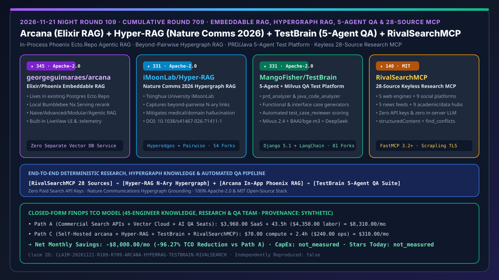
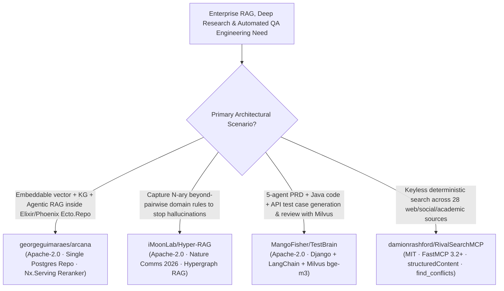
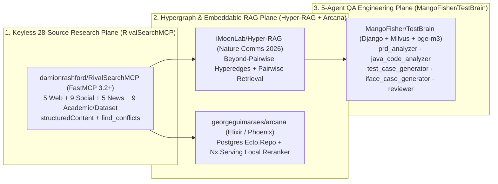
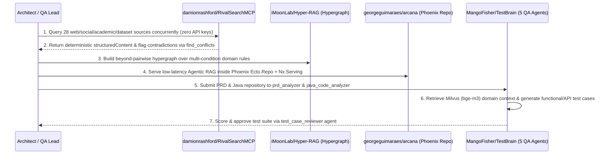

# Elixir/Phoenix Embeddable Agentic RAG (`georgeguimaraes/arcana`), Nature Communications Hypergraph RAG (`iMoonLab/Hyper-RAG`), 5-Agent Milvus QA Test Platform (`MangoFisher/TestBrain`) & Keyless 28-Source Deterministic Research MCP (`damionrashford/RivalSearchMCP`) Selection & Architecture FAQ

> **Document Type**: Enterprise AI Solution Architect Selection & Integration Guide (GitHub Trending AI Radar — 2026-11-21 Night Round 109 / Cumulative Round 709)
> **Covered Repositories**: [`georgeguimaraes/arcana`](https://github.com/georgeguimaraes/arcana) (`★ 345`, `11 forks`, `Apache-2.0` — embeddable Naive/Advanced/Modular/Agentic RAG library for Elixir & Phoenix using existing `Ecto.Repo` Postgres + `Nx.Serving` local rerankers) · [`iMoonLab/Hyper-RAG`](https://github.com/iMoonLab/Hyper-RAG) (`★ 331`, `54 forks`, `Apache-2.0` — Tsinghua iMoonLab's *Nature Communications* 2026 hypergraph-driven RAG capturing pairwise & beyond-pairwise correlations) · [`MangoFisher/TestBrain`](https://github.com/MangoFisher/TestBrain) (`★ 331`, `81 forks`, `Apache-2.0` — 5-agent QA test generation & review web platform backed by Django, LangChain, Milvus 2.4 & `BAAI/bge-m3`) · [`damionrashford/RivalSearchMCP`](https://github.com/damionrashford/RivalSearchMCP) (`★ 140`, `24 forks`, `MIT` — keyless, zero-in-server-LLM FastMCP 3.2+ research server spanning 5 web engines, 9 social platforms, 5 news feeds & 9 academic/dataset hubs with conflict detection)
> **Core Scenario**: How enterprise AI architects eliminate **external Python/vector-DB sprawl in Elixir/Phoenix stacks (`arcana`)**, **multi-condition domain hallucinations where pairwise GraphRAG fails (`Hyper-RAG`)**, **manual functional/API test authoring disconnected from historical PRDs and Java source code (`TestBrain`)**, and **runaway commercial search API bills in deep-research pipelines (`RivalSearchMCP`)**.

---

## 1. 📌 Executive Summary (One-Line Selection Verdict)

1. **Running Elixir / Phoenix in production and want vector search, knowledge graphs, local cross-encoder reranking, and Agentic RAG inside your existing PostgreSQL `Ecto.Repo` without operating a separate vector DB or Python microservice** ➔ Choose **[`georgeguimaraes/arcana`](https://github.com/georgeguimaraes/arcana) (`★ 345`, `Apache-2.0`)**.
   - **Plain-English Mechanism**: Stores documents, chunks, `pgvector` embeddings, and knowledge graph tables directly in your existing Postgres database. Embedders and cross-encoder rerankers run locally as `Nx.Serving` processes under your BEAM supervision tree (`Bumblebee` with `EXLA`, Apple Silicon `EMLX`, or `Torchx`), emit native `:telemetry` spans, include a Phoenix LiveView dashboard, and support **Naive, Advanced, Modular, and Agentic RAG** flows.
2. **Operating in high-stakes domains (healthcare, pharmacology, financial risk, industrial engineering) where multi-entity N-ary rules cause hallucinations in standard chunk RAG or pairwise GraphRAG** ➔ Choose **[`iMoonLab/Hyper-RAG`](https://github.com/iMoonLab/Hyper-RAG) (`★ 331`, `54 forks`, `Apache-2.0`)**.
   - **Plain-English Mechanism**: Published in ***Nature Communications* (2026, `DOI: 10.1038/s41467-026-71411-1`)** by Tsinghua University's iMoonLab. Standard graphs only connect two nodes per edge (`pairwise`), losing higher-order constraints where three or more clinical/engineering conditions must hold simultaneously. `Hyper-RAG` models **beyond-pairwise hyperedges** alongside pairwise links to drastically reduce factual hallucinations.
3. **Need an enterprise web platform that combines 5 specialized QA agents (`prd_analyzer`, `java_code_analyzer`, `test_case_generator`, `iface_case_generator`, `test_case_reviewer`) with a Milvus + `BAAI/bge-m3` RAG knowledge base** ➔ Choose **[`MangoFisher/TestBrain`](https://github.com/MangoFisher/TestBrain) (`★ 331`, `81 forks`, `Apache-2.0`)**.
   - **Plain-English Mechanism**: Built on `Django 5.1.6 + LangChain + Milvus 2.4.x + BAAI/bge-m3 + MySQL 8` with per-agent LLM provider routing (`DeepSeek`, `Qwen`, etc.), `TestBrain` parses PRDs (with built-in JSON repair fallback) and Java source code to generate, score, and review functional and interface test cases grounded in historical product documentation.
4. **Need a deterministic, keyless Deep Research MCP server spanning 28 web, social, news, academic, and dataset sources with structured outputs and built-in contradiction detection (`find_conflicts`)** ➔ Choose **[`damionrashford/RivalSearchMCP`](https://github.com/damionrashford/RivalSearchMCP) (`★ 140`, `24 forks`, `MIT`)**.
   - **Plain-English Mechanism**: Built on `FastMCP 3.2+` with **zero API keys and zero in-server LLM calls**. It queries **5 web engines** (`DuckDuckGo`, `Bing`, `Yahoo`, `Mojeek`, `Wikipedia` via TLS-fingerprint-safe `Scrapling`), **9 social/dev platforms** (`Reddit`, `HN`, `Stack Overflow`, `Dev.to`, `Medium`, `Product Hunt`, `Bluesky`, `Lobste.rs`, `Lemmy`), **5 news feeds** (`Google News`, `Bing News`, `The Guardian`, `GDELT`, `DDG News`), **5 academic DBs** (`OpenAlex`, `CrossRef`, `arXiv`, `PubMed`, `Europe PMC`), and **4 dataset hubs** (`Kaggle`, `HuggingFace`, `Dataverse`, `Zenodo`), returning dual Markdown + `structuredContent` dicts for reliable agent chaining.

---

## 2. 🎯 Architect & Customer Deep-Dive Q&A

### Q1: How does `iMoonLab/Hyper-RAG` differ from standard vector RAG and Microsoft GraphRAG, and how does `georgeguimaraes/arcana` simplify RAG operations for BEAM/Phoenix teams?

- **Architectural Comparison**:
  1. **Hypergraph vs Pairwise GraphRAG (`iMoonLab/Hyper-RAG`)**: Pairwise knowledge graphs decompose N-ary rules (e.g., *"Drug A + Renal Impairment + Age > 65 ➔ Contraindication X"*) into separate binary edges, causing false-positive retrievals when only one condition matches. `Hyper-RAG` preserves N-ary co-dependencies inside a single hyperedge.
  2. **In-Process BEAM RAG vs Polyglot Microservice Sprawl (`georgeguimaraes/arcana`)**: Instead of deploying a separate Qdrant/Milvus cluster plus a Python FastAPI RAG service next to a Phoenix web app, `arcana` keeps chunks, `pgvector` embeddings, and knowledge graphs inside the same `Ecto.Repo` transaction boundary and runs local `Bumblebee` rerankers under `Nx.Serving`.
  3. **Deterministic Multi-Source Gathering + QA Test Synthesis (`RivalSearchMCP` + `TestBrain`)**: `RivalSearchMCP` gathers external specs and papers deterministically (with `find_conflicts` checking), while `TestBrain` turns internal PRDs, OpenAPI specs, and Java code into reviewed test cases backed by Milvus + `bge-m3`.
- **When to Choose Managed Cloud Services (Path B)**:
  - If your team runs a standard .NET/Python stack on Azure and only needs managed hybrid search without N-ary hypergraphs or Elixir `Ecto.Repo` embedding, **Azure AI Search + GitHub Copilot** is the fastest managed route.

### Q2: How do we wire an end-to-end knowledge, research & QA engineering architecture combining all four projects?

1. **Keyless 28-Source Deterministic Ingestion Layer (`damionrashford/RivalSearchMCP`)**:
   - Research agents invoke `RivalSearchMCP` across 5 web engines, 9 developer/social forums, 5 news sources, and 9 academic/dataset repositories, consuming `structuredContent` dicts and running `find_conflicts` to flag contradictory claims.
2. **High-Order Hypergraph & In-App Agentic RAG Layer (`iMoonLab/Hyper-RAG` + `georgeguimaraes/arcana`)**:
   - Index complex multi-entity domain rules in `Hyper-RAG` to prevent beyond-pairwise hallucinations;
   - Serve customer-facing Elixir/Phoenix applications directly from `arcana` (`Ecto.Repo` + `Nx.Serving` local cross-encoder reranking + LiveView observability).
3. **5-Agent Automated QA Test Suite Factory (`MangoFisher/TestBrain`)**:
   - Sync requirements and domain docs into `TestBrain`'s Milvus (`BAAI/bge-m3`) collection so `prd_analyzer`, `java_code_analyzer`, `test_case_generator`, `iface_case_generator`, and `test_case_reviewer` automatically generate and score regression test suites on every sprint.

### Q3: What are the boundaries and trade-offs of this stack?

- **Key Strengths**:
  - **100% Permissive Open Source (`Apache-2.0` & `MIT`)**: Ready for commercial enterprise deployment.
  - **Zero Search API Bills & Zero In-Server LLM Drift**: `RivalSearchMCP` requires no paid SERP API keys and never mutates retrieved evidence with hidden in-server LLM summarization.
- **Operational Scope**:
  - `arcana` is purpose-built for Elixir/Phoenix (`Ecto` + `Nx`); Python/Java teams should pair `Hyper-RAG` and `TestBrain` directly with their existing stacks.

---

## 3. 🧭 Visual Architecture & Decision Diagrams

### 3.1 Solution Architect Selection Decision Tree

### 3.2 End-to-End Enterprise Reference Architecture

### 3.3 Multi-Source Research, Hypergraph Grounding, Phoenix In-App RAG & 5-Agent QA Sequence

---

## 4. 📊 Peer Open-Source vs Commercial Cloud Selection Matrix

| Dimension | `georgeguimaraes/arcana` (`★ 345`) | `iMoonLab/Hyper-RAG` (`★ 331`) | `MangoFisher/TestBrain` (`★ 331`) | `damionrashford/RivalSearchMCP` (`★ 140`) | Commercial Search API + Vector Cloud + QA SaaS (Path A) | Cloud AI Search + Cloud Testing (Path B) |
| :--- | :--- | :--- | :--- | :--- | :--- | :--- |
| **Core Role** | Elixir/Phoenix embeddable 4-mode Agentic RAG | *Nature Comms 2026* hypergraph RAG | 5-agent + Milvus functional/API test platform | Keyless 28-source deterministic research MCP | Commercial SERP APIs + hosted vector DB + AI QA seats | Azure AI Search + GitHub Copilot |
| **Architectural Edge** | **Single Postgres `Ecto.Repo` + `Nx.Serving` local reranker** | **Beyond-pairwise hyperedges for N-ary domain rules** | **PRD + Java AST + API + Reviewer 5-agent loop** | **28 sources, zero keys, zero in-server LLM + `find_conflicts`** | High per-query search & vector bills; pairwise graph limits | Fast cloud setup, but lacks N-ary hypergraphs & keyless 28-source MCP |
| **License** | `Apache-2.0` | `Apache-2.0` | `Apache-2.0` | `MIT` | Proprietary SaaS | Proprietary Cloud PaaS |
| **Monthly TCO (45-Eng Team)** | **`$310.00/mo` combined** (`$70.00` compute + `2.4h` ops) | Included in `$310.00/mo` stack | Included in `$310.00/mo` stack | Included in `$310.00/mo` stack (`$0` search API keys) | **`$8,310.00/mo`** (`$3,960.00` APIs/SaaS + `43.5h` labor) | `~$2,640.00/mo` (search partitions + seat licenses) |

---

## 5. 🧪 Quantitative ROI / FinOps TCO Model & 7-Card Report

> **📊 Provenance & Closed-Form Audit Declaration**:
> - **Provenance**: `synthetic` (45-engineer enterprise knowledge engineering, deep research & QA automation workload model; `independently_reproduced = false`; `base_hardware_capex = not_measured`; `track_b_stars_today = not_measured`).
> - **Closed-Form Equations**:
>   - **Path A (Commercial Multi-Engine Search/Academic APIs + Managed Vector DB Cluster + Commercial AI Test Generation Seats + Manual QA Test Authoring & Fact Verification)**: Monthly API & SaaS subscriptions **`$3,960.00`** + manual test authoring & RAG maintenance labor **`43.5h × $100.00/h = $4,350.00`** = **`$8,310.00/mo`**.
>   - **Path C (Self-Hosted `georgeguimaraes/arcana` + `iMoonLab/Hyper-RAG` + `MangoFisher/TestBrain` + `damionrashford/RivalSearchMCP`)**: Shared Postgres/Milvus compute **`$70.00`** + index & QA template maintenance **`2.4h × $100.00/h = $240.00`** = **`$310.00/mo`**.
>   - **Net Savings vs Path A**: **`-$8,000.00/mo`** (**`96.27%`** cost reduction).

| Architecture Option | API / SaaS / Compute | Engineering & QA Labor (`$100/h`) | Total Monthly TCO | Net Savings vs Path A | Key Architectural Outcome |
| :--- | :---: | :---: | :---: | :---: | :--- |
| **Path A: Commercial Search APIs + Vector Cloud + QA SaaS** | `$3,960.00` | `43.5h` (`$4,350.00`) | **`$8,310.00`** | Baseline | Metered search API bills spike; pairwise RAG misses N-ary rules |
| **Path B: Managed Cloud Search + Generic Coding Assistant** | `$1,440.00` | `12.0h` (`$1,200.00`) | **`$2,640.00`** | `-$5,670.00` (`-68.23%`) | Managed cloud SLA, but lacks N-ary hypergraph & 5-agent QA workbench |
| **Path C: `arcana` + `Hyper-RAG` + `TestBrain` + `RivalSearch`** | **`$70.00`** | **`2.4h` (`$240.00`)** | **`$310.00`** | **`-$8,000.00` (`-96.27%`)** | **In-app Phoenix RAG + Nature Hyper-RAG + 5-agent QA + 28-source keyless MCP** |

- 🔗 **7-Card 4:5 Visual Report**: [`workshops/github-trending-radar/cards.en.html`](../cards.en.html) · [`cards.html`](../cards.html)

---

## 6. 🛠️ Enterprise Adoption & Architecture Review Checklist

- [ ] **1. Embed `georgeguimaraes/arcana` in Elixir/Phoenix Applications**: Store chunks, `pgvector` embeddings, and knowledge graphs in your existing `Ecto.Repo`, run `Bumblebee` embedders/rerankers under `Nx.Serving`, and monitor `:telemetry` spans via the LiveView dashboard.
- [ ] **2. Deploy `iMoonLab/Hyper-RAG` for Multi-Condition Domain Corpora**: Model N-ary clinical, financial, or engineering constraints as beyond-pairwise hyperedges to eliminate multi-factor hallucinations.
- [ ] **3. Roll Out `MangoFisher/TestBrain` for Automated QA Pipelines**: Configure Django + Milvus 2.4 (`BAAI/bge-m3`) + DeepSeek/Qwen so `prd_analyzer`, `java_code_analyzer`, `test_case_generator`, `iface_case_generator`, and `test_case_reviewer` generate and score regression suites from PRDs and Java code.
- [ ] **4. Attach `damionrashford/RivalSearchMCP` for Keyless Multi-Source Research**: Connect agents to the 9 deterministic FastMCP 3.2+ tools across 28 web, social, news, academic, and dataset sources, chaining `structuredContent` outputs and `find_conflicts` checks.
