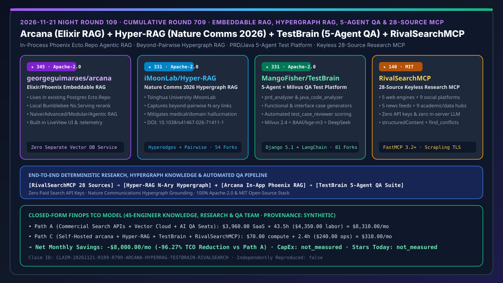
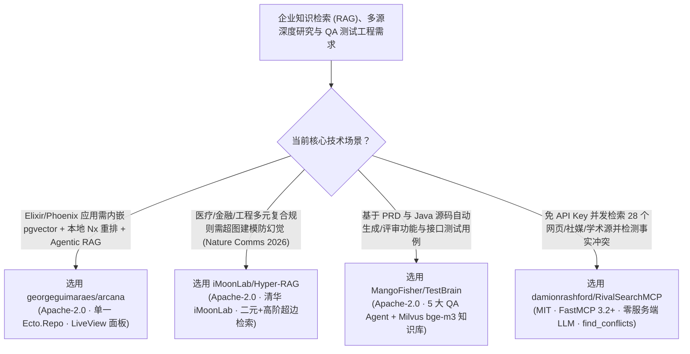
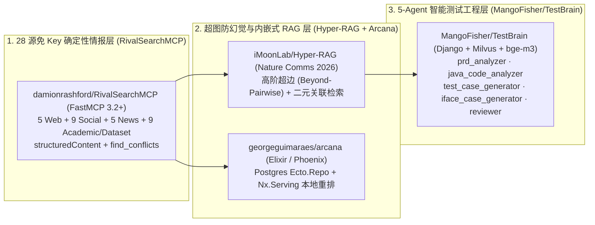
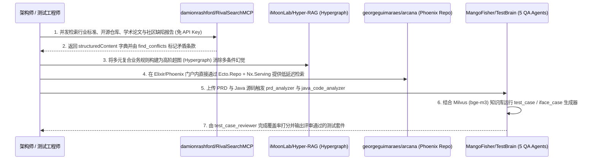

# Elixir/Phoenix 内嵌式 Agentic RAG（`georgeguimaraes/arcana`）、清华《Nature Communications》超图防幻觉 RAG（`iMoonLab/Hyper-RAG`）、5 智能体 + Milvus 测试用例工程平台（`MangoFisher/TestBrain`）与免 Key 28 源确定性检索及冲突检测 MCP（`damionrashford/RivalSearchMCP`）选型与集成架构 FAQ

> **文档类型**：企业 AI 解决方案架构师（AI Solution Architect）选型决策指南（GitHub Trending AI 雷达 2026-11-21 Night Round 109 / 累计第 709 轮）
> **覆盖项目**：[`georgeguimaraes/arcana`](https://github.com/georgeguimaraes/arcana)（`★ 345`、`11 forks`、`Apache-2.0`，直接复用现有 PostgreSQL `Ecto.Repo` 与 `Nx.Serving` 本地重排、内置 LiveView 控制台的 Elixir/Phoenix 四模式 Agentic RAG 库）· [`iMoonLab/Hyper-RAG`](https://github.com/iMoonLab/Hyper-RAG)（`★ 331`、`54 forks`、`Apache-2.0`，发表于《Nature Communications 2026》的清华 iMoonLab 超图驱动多元高阶关联防幻觉 RAG）· [`MangoFisher/TestBrain`](https://github.com/MangoFisher/TestBrain)（`★ 331`、`81 forks`、`Apache-2.0`，集成 PRD 解析、功能/接口用例生成、用例评审、Java 源码分析 5 大 Agent 与 Milvus+`bge-m3` 知识库的智能测试平台）· [`damionrashford/RivalSearchMCP`](https://github.com/damionrashford/RivalSearchMCP)（`★ 140`、`24 forks`、`MIT`，基于 FastMCP 3.2+、免 API Key 并发聚合 5 大搜索引擎 + 9 大技术社区 + 5 大新闻源 + 9 大科研/数据集库且内置 `find_conflicts` 矛盾检测的确定性研究 MCP）
> **核心场景**：当企业架构师面临**为 Elixir/Phoenix 业务系统加装 RAG 时不想额外维护一套 Python 微服务与独立向量库**、**医疗/金融/复杂工程领域的多跳多条件规则在普通双元（Pairwise）GraphRAG 下依然产生严重幻觉**、**QA 测试团队手写功能与接口测试用例耗时且脱离历史项目知识库**，以及**Deep Research 智能体每月向商业搜索 API 支付数千美元且缺乏跨信源事实冲突校验**时，如何选型并组合这四大开源方案？

---

## 一、📌 核心结论速览（选型一句话结论）

1. **核心业务跑在 Elixir / Phoenix (BEAM) 上，想直接复用现有 PostgreSQL (`Ecto.Repo` + `pgvector`) 实现本地 Embedding、Cross-Encoder 重排、知识图谱与 Agentic RAG，且拒绝额外部署 Python 旁路服务** ➔ 选 **[`georgeguimaraes/arcana`](https://github.com/georgeguimaraes/arcana)（`★ 345`，`Apache-2.0`）**。
   - **通俗原理**：把文档分块、向量、知识图谱全部作为普通表装进现有的 Postgres `Ecto.Repo`；Embedding 模型与 Cross-Encoder 重排器直接以 `Nx.Serving` 进程挂在 BEAM 监督树（Supervision Tree）下（支持 EXLA、Apple Silicon `EMLX` 或 Torchx 本地推理），监控指标原生输出为 `:telemetry` Span，并自带 Phoenix LiveView 可视化调试面板，完整覆盖 **Naive ➔ Advanced ➔ Modular ➔ Agentic RAG** 四种演进模式。
2. **在医疗临床路径、复杂药理交互、金融联合风控或工业故障树等“多实体同时共现才成立”的高严谨场景中，普通向量检索和二元图谱（Pairwise GraphRAG）频繁张冠李戴** ➔ 选 **[`iMoonLab/Hyper-RAG`](https://github.com/iMoonLab/Hyper-RAG)（`★ 331`，`54 forks`，`Apache-2.0`）**。
   - **通俗原理**：由清华大学 iMoonLab 研发并正式发表于 **《Nature Communications》(2026, `DOI: 10.1038/s41467-026-71411-1`)**。传统知识图谱的一条边只能连接 2 个节点（Pairwise），无法完整表达“症状 A + 病史 B + 药物 C ➔ 禁忌反应 D”这种多元高阶（Beyond-Pairwise）联合约束。`Hyper-RAG` 引入**超图（Hypergraph，一条超边可同时连接任意多个关联实体）**驱动检索增强，在 `NeurologyCorp` 等专业数据集上显著降低大模型事实性幻觉。
3. **想为研发与 QA 团队搭建一套结合企业历史业务知识库（Milvus + `BAAI/bge-m3`）自动拆解 PRD、分析 Java 源码、生成功能与接口测试用例并自动打分评审的 Web 平台** ➔ 选 **[`MangoFisher/TestBrain`](https://github.com/MangoFisher/TestBrain)（`★ 331`，`81 forks`，`Apache-2.0`）**。
   - **通俗原理**：基于 `Django 5.1.6 + LangChain + Milvus 2.4.x + BAAI/bge-m3 + MySQL 8` 构建的企业级 AI 测试平台（支持 DeepSeek、Qwen 等多模型热切换）。内置 **5 大专职 QA 智能体**：`prd_analyzer`（解析 PRD 提炼测试点，带 JSON 自动修复兜底）、`test_case_generator`（功能用例生成）、`iface_case_generator`（接口用例生成）、`java_code_analyzer`（对接 Java 源码静态分析提炼边界测试点）与 `test_case_reviewer`（自动评审用例覆盖度并打分）。
4. **想让 Deep Research 智能体在不配任何商业搜索 API Key、零服务端 LLM 黑盒改写的前提下，一次并发检索 28 个网页/社媒/新闻/学术/数据集源并自动识别多方信源矛盾（`find_conflicts`）** ➔ 选 **[`damionrashford/RivalSearchMCP`](https://github.com/damionrashford/RivalSearchMCP)（`★ 140`，`24 forks`，`MIT`）**。
   - **通俗原理**：基于 `FastMCP 3.2+` 的**纯确定性（No in-server LLM）**多源研究 MCP Server。免 Key 并发聚合 **5 大搜索引擎**（DuckDuckGo/Bing/Yahoo/Mojeek/Wikipedia，基于防指纹拦截的 `Scrapling`）、**9 大技术与社媒社区**（Reddit/HN/Stack Overflow/Dev.to/Medium/Product Hunt/Bluesky/Lobste.rs/Lemmy）、**5 大新闻源**（含 GDELT/Guardian）、**5 大科研库**（OpenAlex/CrossRef/arXiv/PubMed/Europe PMC）与 **4 大数据集平台**（Kaggle/HuggingFace/Dataverse/Zenodo），同时返回人类可读 Markdown 与强结构化 `structuredContent` 字典，并内置 `find_conflicts` 跨信源事实冲突检测。

---

## 二、🎯 客户与架构师灵魂拷问 Q&A（深度架构拆解）

### Q1：`iMoonLab/Hyper-RAG`（超图 RAG）和常见的 Microsoft GraphRAG / 普通向量 RAG 有什么本质区别？什么时候值得引入超图？

- **二元边（Pairwise Edge）vs 超边（Hyperedge）的架构分野**：
  - **普通向量 RAG**：只看文本块（Chunk）余弦相似度，缺乏跨段落全局结构感知；
  - **传统 GraphRAG（二元图）**：将知识拆成 `(头实体, 关系, 尾实体)` 三元组。一旦遇到“当【温度 > 400℃】且【催化剂为铂】且【压力 < 2MPa】时发生副反应 X”这种四元共现规则，拆成两两三元组后会在检索时丢失“三者必须同时满足”的联合约束；
  - **超图 `Hyper-RAG`**：用一条**超边（Hyperedge）**将多元共现概念作为不可分割的高阶知识单元整体建模与检索，兼顾二元细粒度关系与超边高阶语义，在医疗指南、合规法条与复杂工程排障中防幻觉效果显著。
- **何时直接用云厂商托管方案（Path B）？**
  - 若业务文档仅为常规 FAQ 手册且希望零代码托管，直接使用 **Azure AI Search（语义重排 + 向量混合检索）** 即可。

### Q2：典型企业级“28 源免 Key 确定性采集 (`RivalSearchMCP`) + 超图高阶知识库 (`Hyper-RAG`) + BEAM 内嵌式实时检索 (`arcana`) + 5-Agent 自动化测试平台 (`TestBrain`)”架构怎么搭？

1. **外部情报确定性采集与冲突检测层（`damionrashford/RivalSearchMCP`）**：
   - 研究与需求分析 Agent 通过 `RivalSearchMCP` 并发拉取 5 大搜索引擎、9 大技术社区、5 大新闻源与 9 大学术/数据集库的结构化资料，调用 `find_conflicts` 自动标记不同信源之间的参数或结论冲突。
2. **高阶领域知识建模与防幻觉问答层（`iMoonLab/Hyper-RAG` + `georgeguimaraes/arcana`）**：
   - 针对医疗、金融风控与核心架构规范文档，使用 `Hyper-RAG` 构建高阶超图索引以捕获多元复合规则；
   - 针对高并发 Elixir/Phoenix 在线门户应用，直接在现有 PostgreSQL `Ecto.Repo` 中内嵌 `arcana`，利用 BEAM 监督树下的 `Nx.Serving` 本地运行 Bumblebee Embedding 与 Cross-Encoder 重排。
3. **PRD/Java 源码驱动的 5-Agent 智能测试闭环层（`MangoFisher/TestBrain`）**：
   - 将领域规范同步至 `TestBrain` 的 Milvus（`BAAI/bge-m3`）知识库；每当新需求或代码变更提交时，依次触发 `prd_analyzer` + `java_code_analyzer` ➔ `test_case_generator` / `iface_case_generator` ➔ `test_case_reviewer` 自动完成功能与接口测试用例的生成、评审与入库。

### Q3：这套架构的适用边界是什么？

- **核心优势**：
  - **100% 宽松开源协议（`Apache-2.0` 与 `MIT`）**：无商业闭源限制。
  - **省去外部搜索 API 账单与旁路向量库运维**：`RivalSearchMCP` 免除每月数千美元的商业 Search API 订阅；`arcana` 让 Elixir 团队省去独立运维外部向量库集群的负担。
- **适用边界**：
  - `arcana` 专为 Elixir/Phoenix (`Ecto`) 技术栈设计；非 Elixir 团队应选用 `Hyper-RAG` 或 Python/Go 原生 RAG 组件。

---

## 三、🧭 直观可视化图解（Mermaid 决策树 + 集成架构 + 时序图）

### 3.1 架构师选型决策树

### 3.2 企业端到端生产集成参考架构图

### 3.3 多源确定性检索、超图知识召回与 5-Agent 测试用例自动生成评审时序图

---

## 四、📊 同类开源与商业云服务横向选型决策矩阵

| 对比维度 | `georgeguimaraes/arcana` (`★ 345`) | `iMoonLab/Hyper-RAG` (`★ 331`) | `MangoFisher/TestBrain` (`★ 331`) | `damionrashford/RivalSearchMCP` (`★ 140`) | 商业搜索 API + 商业向量云 + 商业 AI 测试 SaaS (Path A) | 云原生 AI Search + 云测试服务 (Path B) |
| :--- | :--- | :--- | :--- | :--- | :--- | :--- |
| **核心能力定位** | Elixir/Phoenix 内嵌式四模式 Agentic RAG | 《Nature Comms 2026》超图高阶防幻觉 RAG | 5 智能体 + Milvus 知识库功能/接口测试用例平台 | 免 Key 28 源确定性检索与事实冲突检测 MCP | 商业 SERP/学术 API + 托管向量库 + 商业 AI QA 席位 | Azure AI Search + GitHub Copilot |
| **核心技术突破** | **零外部向量库，单 `Ecto.Repo` + `Nx.Serving` 本地重排** | **超边（Hyperedge）捕获多元高阶联合关系** | **PRD + Java 源码 + 接口 + 评审 5-Agent 闭环** | **5 网页+9 社媒+5 新闻+9 科研库免 Key + `find_conflicts`** | 商业搜索按次计费昂贵；二元图谱丢失多条件共现约束 | 云内集成快，但不支持高阶超图与 28 源免 Key 聚合 |
| **开源协议** | `Apache-2.0` | `Apache-2.0` | `Apache-2.0` | `MIT` | 闭源商业 SaaS | 闭源云服务 |
| **月度 TCO（45 人团队）** | **组合仅 `$310.00/月`**（含共享容器算力与 2.4h 运维） | 同左（`$70.00` 算力 + `$240.00` 人工） | 同左（自建 Milvus + DeepSeek/Qwen 极低成本） | 同左（100% 免商业搜索 API Key） | **`$8,310.00/月`**（`$3,960.00` 订阅/API + `43.5h` 人工） | 约 `$2,640.00/月`（按索引分区与席位计费） |

---

## 五、🧪 应用落地定量收益/TCO 对比与 7-Card 报告

> **📊 数据来源与闭式核算声明（Provenance & Closed-Form Schema）**：
> - **provenance**: `synthetic`（基于 45 人企业知识工程、智能投研与 QA 测试团队工作负载模型：`independently_reproduced = false`；硬件采购基线 `base_hardware_capex = not_measured`；Track B 单日增量 `track_b_stars_today = not_measured`）。
> - **核算公式**：
>   - **Path A（商业多引擎搜索/社媒/学术 API 订阅 + 商业托管向量数据库 + 商业 AI 测试用例生成 SaaS 席位 + 人工编写接口测试用例与多源事实核查）**：月度 API 与 SaaS 订阅 **`$3,960.00`** + 手工测试用例编写与检索排障 **`43.5h × $100.00/h = $4,350.00`** = **`$8,310.00/月`**。
>   - **Path C（自建 `georgeguimaraes/arcana` + `iMoonLab/Hyper-RAG` + `MangoFisher/TestBrain` + `damionrashford/RivalSearchMCP` 开源组合）**：共享 Postgres/Milvus 容器算力 **`$70.00`** + 知识库与评测规则维护 **`2.4h × $100.00/h = $240.00`** = **`$310.00/月`**。
>   - **净节省（Net Savings vs Path A）**：**`-$8,000.00/月`**（成本降低 **`96.27%`**）。

| 评估方案 | API / SaaS / 算力成本 | 研发与 QA 运维人工（`$100/h`） | 月度总 TCO | 相对 Path A 净节省 | 关键架构交付指标 |
| :--- | :---: | :---: | :---: | :---: | :--- |
| **Path A：商业搜索 API + 托管向量云 + 商业测试 SaaS** | `$3,960.00` | `43.5h` (`$4,350.00`) | **`$8,310.00`** | Baseline | 搜索 API 账单随 Agent 并发飙升；手写用例耗时 |
| **Path B：云厂商托管 AI Search + 通用编码助手** | `$1,440.00` | `12.0h` (`$1,200.00`) | **`$2,640.00`** | `-$5,670.00` (`-68.23%`) | 缺乏超图多元防幻觉与 PRD/Java 5-Agent 专项测试台 |
| **Path C：`arcana` + `Hyper-RAG` + `TestBrain` + `RivalSearch`** | **`$70.00`** | **`2.4h` (`$240.00`)** | **`$310.00`** | **`-$8,000.00` (`-96.27%`)** | **Elixir 内嵌 RAG + Nature 超图防幻觉 + 5-Agent QA + 28 源免 Key 检索** |

- 🔗 **关联 7-Card 4:5 视觉评测报告**：[`workshops/github-trending-radar/cards.html`](../cards.html) · [`cards.en.html`](../cards.en.html)

---

## 六、🛠️ 企业引入与架构评审 Checklist

- [ ] **1. 在 Elixir/Phoenix 应用中内嵌 `georgeguimaraes/arcana`**：复用现有 PostgreSQL `Ecto.Repo`（开启 `pgvector`），在应用 Supervision Tree 下挂载 `Nx.Serving` 本地 Embedding 与 Cross-Encoder 重排器，并启用内置 LiveView 仪表盘与 `:telemetry` 监控。
- [ ] **2. 对高严谨多条件领域知识部署 `iMoonLab/Hyper-RAG`**：针对医疗、合规、金融风控等存在三元以上复合因果关系的语料，构建高阶超图（Hypergraph）索引，并与基线向量 RAG 对比事实性幻觉率。
- [ ] **3. 搭建 `MangoFisher/TestBrain` 赋能 QA 团队**：配置 MySQL 8 + Milvus 2.4 + `BAAI/bge-m3` 预热单例，接入企业内网 DeepSeek/Qwen 模型，打通 `prd_analyzer`、`java_code_analyzer`、`test_case_generator`、`iface_case_generator` 与 `test_case_reviewer` 五步自动化流水线。
- [ ] **4. 挂载 `damionrashford/RivalSearchMCP` 实现免 Key 确定性研究**：在研究 Agent 中启用 `RivalSearchMCP` 的 9 大工具，直接消费 `structuredContent` 结构化字典并强制调用 `find_conflicts` 校验跨信源冲突。
