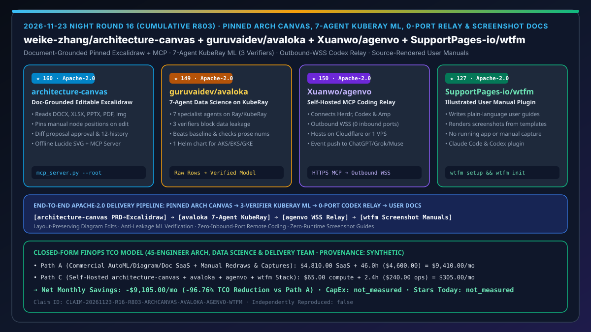
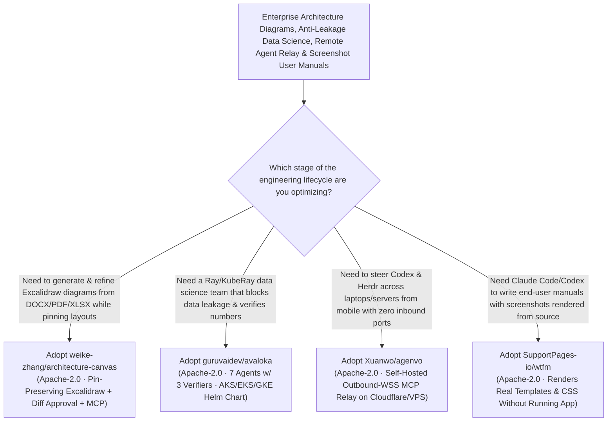
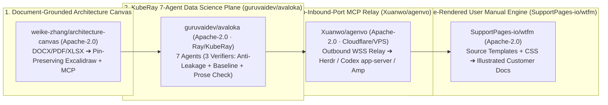

# Document-Grounded Editable Architecture Canvas & MCP (`weike-zhang/architecture-canvas`), Self-Checking 7-Agent Data Science Pipeline on Ray/KubeRay (`guruvaidev/avaloka`), Zero-Inbound-Port MCP Relay for Coding Runtimes (`Xuanwo/agenvo`) & Source-Rendered Screenshot User Manual Plugin (`SupportPages-io/wtfm`) Selection & Architecture FAQ

> **Document Type**: Enterprise AI Solution Architect Selection & Integration Guide (GitHub Trending AI Radar · 2026-11-23 Night Round 16 / Cumulative Round 803)
> **Covered Repositories**: [`weike-zhang/architecture-canvas`](https://github.com/weike-zhang/architecture-canvas) (`★ 160`, `12 forks`, `Apache-2.0`: multimodal document-grounded editable Excalidraw architecture workbench and MCP server `mcp_server.py --root` that ingests DOCX/XLSX/PPTX/PDF/images, **proposes diagram diffs for approval while preserving pinned node positions**, embeds offline Lucide SVG icons, and tracks 12-step version history) · [`guruvaidev/avaloka`](https://github.com/guruvaidev/avaloka) (`★ 149`, `10 forks`, `Apache-2.0`: 7-agent data science and ML pipeline on **Ray / KubeRay** across AKS/EKS/GKE/laptop—`planner`, `profiler`, `coder`, `validator`, `executor`, `trainer`, `visualizer`—where **3 verifier agents exist specifically to block data leakage, enforce beating a trivial baseline, and verify prose claims against computed numbers**) · [`Xuanwo/agenvo`](https://github.com/Xuanwo/agenvo) (`★ 150`, `10 forks`, `Apache-2.0`: self-hosted **outbound-WSS MCP relay** on Cloudflare or a single VPS that lets mobile/web assistants coordinate `Herdr`, `Codex app-server`, and `Amp` coding agents across laptops and servers with **zero inbound ports opened**) · [`SupportPages-io/wtfm`](https://github.com/SupportPages-io/wtfm) (`★ 127`, `12 forks`, `Apache-2.0`: **"Write the F\*\*\*ing Manual"**—a Claude Code and Codex plugin `wtfm init` that reads your source templates and CSS to write plain-language end-user guides with **real UI screenshots rendered without needing a running app**)
> **Core Scenario**: Across the enterprise delivery lifecycle—from architecture design and data science modeling to multi-machine coding and customer documentation—how do you solve **"AI diagram generators scrambling manually arranged layouts on every follow-up edit, single-agent data science scripts training on leaked test features and hallucinating metrics in reports, opening risky inbound firewall ports just to steer server-side Codex runs from your phone, and shipping new UI releases without updated screenshot manuals for end users"** using the all-`Apache-2.0` **`architecture-canvas` + `avaloka` + `agenvo` + `wtfm`** stack?

---

## 1. 📌 Executive Summary (Single-Sentence Selection Verdict)

1. **Need to turn multi-format enterprise requirements (`DOCX`, `XLSX`, `PPTX`, `PDF`, images) into editable Excalidraw architecture diagrams where follow-up AI edits require proposal approval and strictly preserve pinned node coordinates** ➔ Choose **[`weike-zhang/architecture-canvas`](https://github.com/weike-zhang/architecture-canvas) (`★ 160`, `12 forks`, `Apache-2.0`)**.
   - **Plain-Language Mechanism**: Unlike one-shot diagram generators that destroy manual layout tweaks on every prompt, `architecture-canvas` lets architects pin component positions, scope AI edits to selected regions, preview proposed mutations before clicking Apply, embed 32 offline Lucide SVG icons, and expose a stateless Python SDK (`diagram_sdk.render(ir)`) and root-scoped MCP server (`python3 mcp_server.py --root /authorized/docs`).
2. **Need an autonomous data science and ML training team on Ray / KubeRay (AKS, EKS, GKE, or local) where 3 dedicated verifier agents block data leakage, require every model to beat a trivial baseline, and audit written prose against computed numbers** ➔ Choose **[`guruvaidev/avaloka`](https://github.com/guruvaidev/avaloka) (`★ 149`, `10 forks`, `Apache-2.0`)**.
   - **Plain-Language Mechanism**: `Avaloka` coordinates 7 specialist agents (`planner`, `profiler`, `coder`, `validator`, `executor`, `trainer`, `visualizer`) on Ray/KubeRay via a portable Helm chart. Three of those agents act as independent auditors: they reject leaked training features, enforce baseline superiority, and verify every number in the final report against recorded execution artifacts—with zero data leaving your cluster.
3. **Need to monitor, resume, and coordinate coding agents (`Herdr`, `Codex app-server`, `Amp`) across your laptops and servers from ChatGPT, Grok Bot, or Muse on your phone—without opening any inbound firewall ports on your machines** ➔ Choose **[`Xuanwo/agenvo`](https://github.com/Xuanwo/agenvo) (`★ 150`, `10 forks`, `Apache-2.0`, by `@Xuanwo`)**.
   - **Plain-Language Mechanism**: Host the `Agenvo` MCP relay on Cloudflare or a small VPS; lightweight connectors on your laptop and servers dial **outbound over WSS** to the relay. Your assistant sends HTTPS MCP calls to inspect running Herdr panes or Codex threads, receive turn-completion/input-needed events, and survive network drops seamlessly.
4. **Need a plugin for Claude Code and Codex (`wtfm init`) that reads your application's routes, HTML templates, and CSS to write plain-language customer manuals complete with rendered UI screenshots—without spinning up a running app** ➔ Choose **[`SupportPages-io/wtfm`](https://github.com/SupportPages-io/wtfm) (`★ 127`, `12 forks`, `Apache-2.0`)**.
   - **Plain-Language Mechanism**: Instead of manually capturing and cropping screenshots after every UI change, `WTFM` inspects your frontend source code, renders accurate screens directly from your templates and CSS, and writes step-by-step illustrated help articles for non-technical customers and admins.

---

## 2. 🎯 Key Architectural Q&A (Deep-Dive Breakdown)

### Q1: Why adopt `architecture-canvas`, `avaloka`, `agenvo`, and `wtfm` instead of one-shot Mermaid prompts, single-agent notebooks, and manual screenshot documentation?

- **Four Lifecycle Bottlenecks Eliminated**:
  1. **Layout-Preserving Architecture Refinement (`weike-zhang/architecture-canvas`)**: Keeps human-curated Excalidraw node positions intact across 12-version iterative reviews and 120K-character context budgets.
  2. **Calibrated Anti-Leakage Data Science (`guruvaidev/avaloka`)**: Eliminates silent train/test leakage and fabricated summary numbers via 3 independent verifier agents running natively on Ray/KubeRay.
  3. **Zero-Inbound-Port Multi-Host Agent Control (`Xuanwo/agenvo`)**: Steers remote `Codex app-server` and `Herdr` sessions over outbound WSS without exposing developer machines to the public internet.
  4. **Zero-Runtime Illustrated Customer Docs (`SupportPages-io/wtfm`)**: Generates customer-ready manuals with real template-rendered screenshots directly from source code.
- **When to Choose Commercial Cloud Suites (Path B)**:
  - For static cloud-only templates or managed tabular AutoML on Azure, use **Azure Architecture Center + Azure ML AutoML**; for document-grounded pin-preserving Excalidraw canvases, multi-cloud KubeRay 7-agent data science with anti-leakage verifiers, outbound-WSS Codex relays, or source-rendered screenshot manuals, deploy this all-`Apache-2.0` stack (Path C).

### Q2: How do these four Apache-2.0 tools integrate into a unified enterprise delivery pipeline?

1. **Architecture Design & Spec Plane (`weike-zhang/architecture-canvas`)**:
   - Ingest PRDs, spreadsheets, and PDFs to co-design pinned Excalidraw architectures and expose them via `mcp_server.py --root`.
2. **Distributed Data Science & Model Serving Plane (`guruvaidev/avaloka`)**:
   - Run the 7-agent Ray/KubeRay pipeline on AKS/EKS/GKE to profile datasets, validate zero leakage, beat baselines, and serve verified models.
3. **Cross-Machine Coding Relay Plane (`Xuanwo/agenvo`)**:
   - Coordinate `Codex app-server` and `Herdr` agents across servers and laptops via outbound WSS to build the application.
4. **Automated Customer Documentation Plane (`SupportPages-io/wtfm`)**:
   - Trigger `wtfm` from Claude Code or Codex to generate illustrated end-user manuals from the committed templates and CSS.

### Q3: What are the key production guardrails?

- **Architect Guardrails**:
  1. **Scope `architecture-canvas` MCP File Access with `--root`**: Run `mcp_server.py` without `--root` for render-only mode, or pass an explicit `--root` path restricted to approved specification directories.
  2. **Terminate `agenvo` Relay Behind Authenticated HTTPS/WSS**: Keep all `Herdr` and `Codex app-server` listeners bound to localhost and connect exclusively via outbound WSS connectors.

---

## 3. 🧭 Visual Architecture & Decision Diagrams (Mermaid)



### 3.1 Solution Architect Selection Decision Tree



### 3.2 End-to-End Enterprise Production Reference Architecture



### 3.3 PRD-to-Architecture, KubeRay Verified Modeling, Outbound-WSS Coding & Illustrated Manual Sequence

```mermaid
sequenceDiagram
    participant SA as Solution Architect / Tech Lead
    participant Arc as weike-zhang/architecture-canvas
    participant Ava as guruvaidev/avaloka (Ray/KubeRay)
    participant Agn as Xuanwo/agenvo (MCP Relay)
    participant Wtf as SupportPages-io/wtfm

    SA->>Arc: 1. Upload PRD/PDFs; generate Excalidraw diagram, pin core nodes & approve diff
    Arc->>Ava: 2. Launch 7-agent KubeRay job; 3 verifier agents block leakage & validate baseline metrics
    SA->>Agn: 3. Steer server Codex & laptop Herdr via outbound-WSS MCP relay (zero inbound ports)
    Agn->>Wtf: 4. Run wtfm plugin in Claude Code/Codex to render UI screenshots from templates & CSS
    Wtf-->>SA: 5. Deliver SVG architecture, verified ML service & illustrated customer user manual
```

---

## 4. 📊 Comparative Selection Matrix (Open-Source vs. Commercial SaaS)

| Dimension | `weike-zhang/architecture-canvas` (`★ 160`) | `guruvaidev/avaloka` (`★ 149`) | `Xuanwo/agenvo` (`★ 150`) | `SupportPages-io/wtfm` (`★ 127`) | Commercial Whiteboards + Metered Cloud AutoML + Exposed Remote Ports + Manual Doc Teams (Path A) | One-Shot Mermaid Prompts + Single-Agent Notebooks + Manual Screenshot Cropping (Path B) |
| :--- | :--- | :--- | :--- | :--- | :--- | :--- |
| **Core Role** | Document-grounded, pin-preserving Excalidraw workbench & MCP | 7-agent Ray/KubeRay data science pipeline with 3 verifiers | Self-hosted outbound-WSS MCP relay for `Herdr`/`Codex`/`Amp` | Claude Code/Codex plugin rendering screenshot manuals from source | High per-seat whiteboard/doc SaaS, cloud AutoML markup & manual screenshot labor | Layout-destroying redraws, leaked ML models & stale screenshots |
| **Key Differentiator** | **Pinned coordinates + diff approval + DOCX/PDF/XLSX ingestion** | **3 verifier agents block data leakage, weak baselines & prose drift** | **Outbound WSS from laptop/server; survives disconnects; zero inbound ports** | **Renders real screens from templates & CSS with no running app** | Expensive cloud AutoML instance markups; days spent recapturing UI screenshots | Single-agent notebooks leak test features; exposed SSH/agent ports invite attacks |
| **License** | `Apache-2.0` | `Apache-2.0` | `Apache-2.0` | `Apache-2.0` | Proprietary SaaS | Custom scripts |
| **Monthly TCO (45-Eng Team)** | **Combined `$305.00/mo`** (`$65.00` relay/control-plane compute + `2.4h` ops) | Included (runs on existing AKS/EKS/GKE or laptop) | Included (runs on Cloudflare or 1 VPS) | Included (generates manuals inside coding agent) | **`$9,410.00/mo`** (`$4,810.00` commercial AutoML/whiteboard/helpdesk SaaS + `46.0h` redraw, ML rework & screenshot labor) | ~`$3,350.00/mo` (frequent ML leakage rework & manual UI screenshot updating) |

---

## 5. 🧪 Quantitative ROI / TCO Comparison & 7-Card Benchmark Report

> **📊 Data Provenance & Closed-Form Schema Declaration**:
> - **provenance**: `synthetic` (45-person enterprise solution architecture, data science, full-stack engineering, and documentation team monthly workload model: `independently_reproduced = false`; hardware baseline `base_hardware_capex = not_measured`; Track B 24h delta `track_b_stars_today = not_measured`).
> - **Closed-Form Formula**:
>   - **Path A (Commercial collaborative diagramming seats, cloud-marked-up AutoML training hours, and commercial help-center SaaS + manual engineering hours spent fixing scrambled AI diagrams, remediating leaked ML models, and manually capturing/cropping UI screenshots for user manuals)**: Monthly commercial AutoML, diagramming, and documentation SaaS bills **`$4,810.00`** + architecture layout rework, data-leakage debugging, and manual screenshot documentation labor **`46.0h × $100.00/h = $4,600.00`** = **`$9,410.00/mo`**.
>   - **Path C (Self-hosted `weike-zhang/architecture-canvas` + `guruvaidev/avaloka` + `Xuanwo/agenvo` + `SupportPages-io/wtfm` all-Apache-2.0 stack)**: Shared Cloudflare/VPS relay and KubeRay control-plane compute **`$65.00`** + Helm chart and doc pipeline maintenance labor **`2.4h × $100.00/h = $240.00`** = **`$305.00/mo`**.
>   - **Net Monthly Savings vs. Path A**: **`-$9,105.00/mo`** (**`96.76%`** TCO reduction).

| Evaluation Path | AutoML / Diagram / Doc SaaS Cost | Diagram Rework, ML Audit & Screenshot Doc Labor (`$100/h`) | Monthly Total TCO | Net Savings vs. Path A | Key Architectural Delivery Metrics |
| :--- | :---: | :---: | :---: | :---: | :--- |
| **Path A: Commercial AutoML/Doc SaaS + Manual Redraws & Screenshot Manuals** | `$4,810.00` | `46.0h` (`$4,600.00`) | **`$9,410.00`** | Baseline | High AutoML markup; manual UI screenshot capture per release |
| **Path B: One-Shot Mermaid + Unverified Notebooks + Manual Screen Captures** | `$1,450.00` | `19.0h` (`$1,900.00`) | **`$3,350.00`** | `-$6,060.00` (`-64.40%`) | Train/test data leakage risk; scrambled layouts on follow-up edits |
| **Path C: `architecture-canvas` + `avaloka` + `agenvo` + `wtfm`** | **`$65.00`** | **`2.4h` (`$240.00`)** | **`$305.00`** | **`-$9,105.00` (`-96.76%`)** | **Pinned Excalidraw + 3-verifier KubeRay ML + 0-inbound relay + source-rendered docs** |

- 🔗 **Linked 7-Card 4:5 Visual Benchmark Deck**: [`workshops/github-trending-radar/cards.en.html`](../cards.en.html) · [`cards.html`](../cards.html)

---

## 6. 🛠️ Enterprise Adoption & Architecture Review Checklist

- [ ] **1. Deploy `weike-zhang/architecture-canvas` for Document-Grounded Architecture Reviews**: Pin verified component coordinates, require diff approval on iterative edits, and scope `mcp_server.py` with `--root`.
- [ ] **2. Run `guruvaidev/avaloka` on Ray / KubeRay (AKS/EKS/GKE)**: Enforce its 3 verifier agents to block data leakage, verify baseline improvement, and audit written prose against computed metrics.
- [ ] **3. Coordinate Multi-Host Coding Agents via `Xuanwo/agenvo`**: Connect laptop `Herdr` and server `Codex app-server` instances over outbound WSS to a self-hosted Cloudflare/VPS relay with zero inbound firewall ports.
- [ ] **4. Automate Illustrated End-User Manuals with `SupportPages-io/wtfm` (`wtfm init`)**: Render step-by-step UI screenshots directly from application templates and CSS inside Claude Code or Codex before each release.
