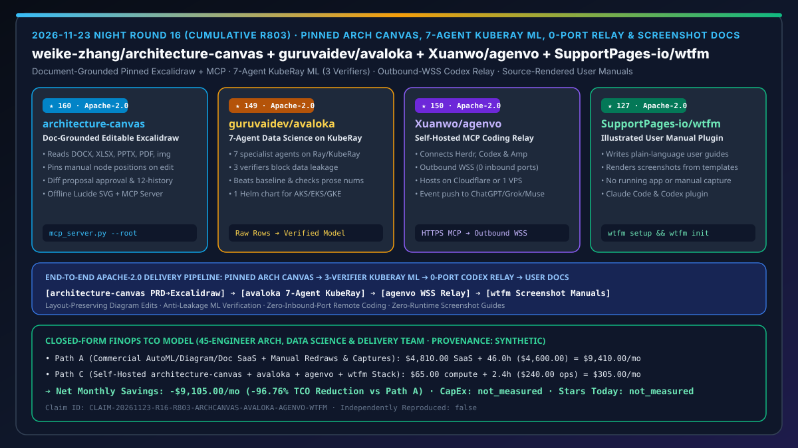
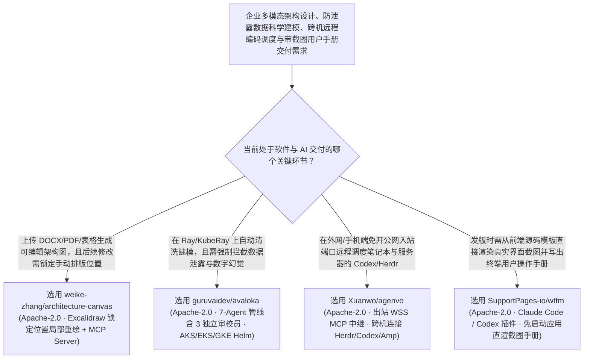
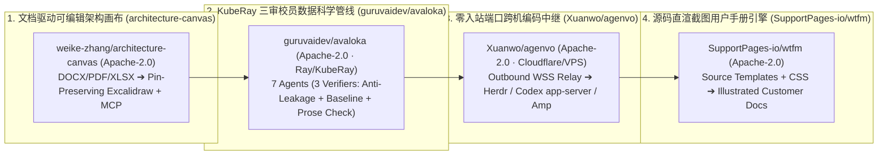
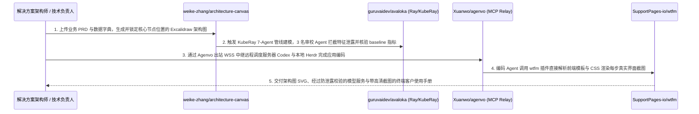

# 多模态需求文档驱动的可编辑架构图画布与 MCP（`weike-zhang/architecture-canvas`）、Ray/KubeRay 上自带三审校员防数据泄露的 7 智能体数据科学管线（`guruvaidev/avaloka`）、零入站端口跨主机调度 Codex/Herdr 的自托管 MCP 中继（`Xuanwo/agenvo`）与免启动应用从源码模板直渲配图用户手册插件（`SupportPages-io/wtfm`）选型与集成架构 FAQ

> **文档类型**：企业 AI 解决方案架构师（AI Solution Architect）选型决策指南（GitHub Trending AI 雷达 2026-11-23 Night Round 16 / 累计第 803 轮）
> **覆盖项目**：[`weike-zhang/architecture-canvas`](https://github.com/weike-zhang/architecture-canvas)（`★ 160`、`12 forks`、`Apache-2.0`：多模态需求文档驱动的可编辑 Excalidraw 架构图工作台与无状态 MCP Server `mcp_server.py --root`，支持上传 DOCX/XLSX/PPTX/PDF/图片生成初稿，**后续修改先列变更方案确认、锁定手动排版节点位置**，内置 12 版本历史与离线 Lucide SVG 图标）· [`guruvaidev/avaloka`](https://github.com/guruvaidev/avaloka)（`★ 149`、`10 forks`、`Apache-2.0`：运行在 **Ray / KubeRay（AKS / EKS / GKE / 本地）** 上的 7 专职数据科学智能体管线 `planner`/`profiler`/`coder`/`validator`/`executor`/`trainer`/`visualizer`，**其中 3 个 Agent 专门负责交叉审校：严拒特征穿越泄露（Data Leakage）、强制超越基线模型、核验报告文字与真实计算数值一致性**）· [`Xuanwo/agenvo`](https://github.com/Xuanwo/agenvo)（`★ 150`、`10 forks`、`Apache-2.0`：知名开源作者 Xuanwo 打造的自托管 **无入站端口（Outbound WSS）MCP 编码运行时中继**，部署在 Cloudflare 或单台 VPS 上即可让手机/桌面助手远程观测、恢复并调度开发机与服务器上的 `Herdr`、`Codex app-server` 与 `Amp`）· [`SupportPages-io/wtfm`](https://github.com/SupportPages-io/wtfm)（`★ 127`、`12 forks`、`Apache-2.0`：面向 Claude Code 与 Codex 的用户手册生成插件 `wtfm init`，直接读取前端源码模板与 CSS **无需启动整个应用即可自动渲染每一步真实界面截图**，写出面向非技术终端客户与管理员的图文操作指南）
> **核心场景**：当企业架构与交付团队从需求评审走向数据分析建模、跨机编码开发与最终客户交付时，面对**“AI 生成的架构图一旦对话微调就把手工排好的节点全部打乱、数据科学 Agent 自动建模时频繁发生测试集特征泄露且文字结论胡编乱造、在手机或外网想查看内网服务器上的 Codex 进度却不敢开公网入站端口、以及产品发版后没人愿意手写带最新界面截图的终端用户操作手册”**四大交付痛点，如何通过 **Architecture-Canvas + Avaloka + Agenvo + WTFM** 打通从架构设计到客户手册的闭环？

---

## 一、📌 核心结论速览（选型一句话结论）

1. **想上传企业 PRD（DOCX/XLSX/PPTX/PDF/扫描件）通过多轮对话生成可编辑的 Excalidraw 架构图，且在后续对话修改时“先预览变更提案、严格锁定已手动微调过的组件位置与连线语义”** ➔ 选 **[`weike-zhang/architecture-canvas`](https://github.com/weike-zhang/architecture-canvas)（`★ 160`，`12 forks`，`Apache-2.0`）**。
   - **通俗原理**：普通文生图或一次性 Mermaid 生成器最大的问题是“改一个节点重画整张图，人工调好的布局瞬间作废”。`Architecture Canvas（架构助手）` 在首次生成后，任何后续对话修改都会**先列出变更清单待你点击“应用修改”后才生效**，且支持锁定选中组件位置、仅修改局部选区、同步手绘带字图形到语义 IR，内置 32 个离线内嵌的 Lucide SVG 图标与 `mcp_server.py --root` 受控目录 MCP 接口。
2. **想在企业自有 Kubernetes（AKS / EKS / GKE）或本地的 Ray / KubeRay 集群上跑全自动数据科学与机器学习建模，且必须由独立审校 Agent 铁腕拦截“特征穿越（Data Leakage）、不如简单基线的劣质模型、以及与计算结果不符的幻觉报告”** ➔ 选 **[`guruvaidev/avaloka`](https://github.com/guruvaidev/avaloka)（`★ 149`，`10 forks`，`Apache-2.0`）**。
   - **通俗原理**：`Avaloka` 组建了 7 个专职智能体（`planner`、`profiler`、`coder`、`validator`、`executor`、`trainer`、`visualizer`），其中 **3 个 Agent 的唯一职责就是给另外 4 个挑刺审校**：发现训练数据混入未来特征直接拒绝训练，训练出的模型若打不过简单 Baseline 则拒绝交付，最终报告里的每一个数字都会与实际 Python 执行产物逐项核对，并通过单一 Helm Chart 部署在企业私有集群内。
3. **想在离开工位时用手机端 ChatGPT / Grok Bot 随时查看、接管或唤醒公司笔记本与内网服务器上的 `Codex app-server`、`Herdr` 或 `Amp` 编程智能体，且办公电脑与服务器绝对不开任何公网入站端口** ➔ 选 **[`Xuanwo/agenvo`](https://github.com/Xuanwo/agenvo)（`★ 150`，`10 forks`，`Apache-2.0`）**。
   - **通俗原理**：开发机与内网服务器只需运行轻量 Connector 向你部署在 Cloudflare 或单台 VPS 上的 `Agenvo` 中继发起**主动出站 WSS 长连接（零入站端口暴露）**；上层 AI 助手通过标准 HTTPS MCP 调用中继，不仅能跨机器列出所有正在运行的 Herdr 窗格与 Codex 线程、断网重连不中断任务，还能订阅任务完成或等待输入事件自动跟进下一步。
4. **想让 Claude Code 或 Codex 在写完业务功能后，自动读取项目路由、HTML 模板与 CSS 样式，在不启动后端服务的情况下渲染出每一步真实 UI 截图并生成面向最终用户的图文帮助手册** ➔ 选 **[`SupportPages-io/wtfm`](https://github.com/SupportPages-io/wtfm)（`★ 127`，`12 forks`，`Apache-2.0`）**。
   - **通俗原理**：许多团队有 Swagger API 文档，却极度缺乏给非技术客户看的“去哪点导出按钮、如何邀请团队成员”的图文指南。运行 `wtfm setup && wtfm init` 后，只需对编码 Agent 说一句“写一篇邀请队友的图文指南”，`WTFM` 就会直接解析源码中的真实视图模板与样式渲染出带高亮指示的界面截图，自动编排成通俗易懂的用户手册。

---

## 二、🎯 客户与架构师灵魂拷问 Q&A（深度架构拆解）

### Q1：我们已经在用 ChatGPT Code Interpreter 做数据分析、用普通 Mermaid 画图了，为什么还要引入 `avaloka` 和 `architecture-canvas`？

- **两大企业级生产鸿沟与破局机制**：
  1. **单 Agent 数据分析的“自嗨式数据泄露与编造结论” vs `avaloka` 7-Agent 三重独立校准（Ray/KubeRay）**：把 CSV 丢给单个大模型写脚本，经常在归一化或特征工程时把测试集信息泄露给训练集，跑出虚高的 `99%` 准确率糊弄业务方；`avaloka` 专设 3 个校准 Agent 强行检查数据泄露、强制对比 Trivial Baseline 并逐字核对报告数值，且原生跑在企业 KubeRay 分布式集群上。
  2. **一次性画图工具“改一处毁全局” vs `architecture-canvas` 位置锁定与变更提案确认**：企业架构评审需要反复迭代 10 余版，`architecture-canvas` 允许架构师固定核心底座组件坐标、只对选中区域发起 AI 重构，并在应用前预览 Diff。
- **何时直接选用商业云托管服务（Path B）？**
  - 若仅需在 Azure Portal 内快速生成固定云资源拓扑或运行托管 AutoML，可直接使用 **Azure Architecture Center 模板 + Azure Machine Learning AutoML**；若需多格式本地 PRD 驱动的可编辑 Excalidraw 画布、跨云 KubeRay 防泄露多智能体数据科学管线、零入站端口跨机 Codex 调度或从源码直渲截图的用户手册自动化，则采用本轮四合一开源栈（Path C）。

### Q2：典型企业级“架构画布评审 (`architecture-canvas`) ➔ KubeRay 自审校建模 (`avaloka`) ➔ 跨机无端口编码调度 (`agenvo`) ➔ 自动带图手册交付 (`wtfm`)”参考架构怎么搭？

1. **多模态需求解析与可编辑架构画布层（`weike-zhang/architecture-canvas`）**：
   - 导入业务 PRD、表格与扫描 PDF，生成并锁定核心系统边界与 Excalidraw 架构图，通过 `mcp_server.py --root` 暴露给下游研发智能体。
2. **KubeRay 分布式自审校数据科学建模层（`guruvaidev/avaloka`）**：
   - 在 AKS/EKS KubeRay 集群上启动 7-Agent 管线，完成从原始业务表采样、特征防泄露校验、基线比对训练到模型服务化发布。
3. **零入站端口跨机编码运行时中继层（`Xuanwo/agenvo`）**：
   - 通过 Cloudflare/VPS 上的 `agenvo` MCP 中继，统一协调本地笔记本 `Herdr` 与远端 GPU 服务器上的 `Codex app-server` 完成前后端应用代码开发。
4. **免运行环境真实模板截图手册生成层（`SupportPages-io/wtfm`）**：
   - 在发版前调用 `wtfm` 插件，从前端模板与 CSS 直接渲染高清步骤截图，自动产出面向终端客户的产品使用手册。

### Q3：这套架构的合规与安全边界是什么？

- **架构师落地红线**：
  1. **`architecture-canvas` 的 MCP 服务必须显式指定受控 `--root` 目录**：不传 `--root` 时仅暴露纯渲染能力，传参时只允许指向脱敏后的项目需求文档目录。
  2. **`agenvo` 连接器必须走双向认证的出站 WSS**：严禁在开发机或内网服务器上直接向公网暴露 `Codex app-server` 端口，统一通过 `agenvo` 出站隧道受控访问。

---

## 三、🧭 直观可视化图解（Mermaid 决策树 + 集成架构 + 时序图）

### 3.1 架构师选型决策树

### 3.2 企业端到端生产集成参考架构图

### 3.3 需求转架构画布、KubeRay 防泄露建模、跨机无端口编码与图文用户手册生成时序图

---

## 四、📊 同类开源与商业云服务横向选型决策矩阵

| 对比维度 | `weike-zhang/architecture-canvas` (`★ 160`) | `guruvaidev/avaloka` (`★ 149`) | `Xuanwo/agenvo` (`★ 150`) | `SupportPages-io/wtfm` (`★ 127`) | 商业企业架构白板 SaaS + 商业 AutoML 平台 + 公网暴露 SSH/VNC + 外包技术文档团队 (Path A) | 一次性静态 Mermaid 脚本 + 单 Agent 盲跑 Notebook + 手工截屏写 Word 手册 (Path B) |
| :--- | :--- | :--- | :--- | :--- | :--- | :--- |
| **核心能力定位** | 多模态文档驱动、支持锁定位置局部修改的 Excalidraw 架构台 | Ray/KubeRay 上带 3 名独立审校员的 7-Agent 数据科学管线 | 零入站端口跨机器连接 Herdr/Codex/Amp 的自托管 MCP 中继 | 从源码模板与 CSS 直接渲染真实界面截图的用户手册生成插件 | 昂贵的按席位白板/文档 SaaS、锁定的商业 AutoML 与高危公网端口暴露 | 每次微调全图重画、无防泄露校验的错误模型与极易过期的手工截图文档 |
| **核心技术突破** | **提案确认后生效 + 锁定已排版节点 + 12 万字预算与离线图标** | **专设 3 个校准 Agent 铁腕拦截数据泄露、劣于基线与数字编造** | **本地主动出站 WSS 连 Cloudflare 中继，断网不中断且支持事件跟进** | **无需启动运行态应用，直接从源码模板与样式渲染高清界面截图** | 商业 AutoML 按计算时长溢价极高；人工每次发版重新截图更新手册耗时数十小时 | 单 Agent 写 Notebook 极易发生测试集穿越；直接开公网端口连内网 Agent 极易被扫 |
| **开源协议** | `Apache-2.0` | `Apache-2.0` | `Apache-2.0` | `Apache-2.0` | 闭源商业 SaaS | 内部脆弱脚本 |
| **月度 TCO（45 人团队）** | **组合仅 `$305.00/月`**（`$65.00` Cloudflare/KubeRay 轻量控制面 + `2.4h` 维护） | 同左（复用自有 K8s/笔记本算力） | 同左（单台轻量 VPS 或 Cloudflare 即可承载） | 同左（编码阶段顺带一键生成手册） | **`$9,410.00/月`**（`$4,810.00` 商业 AutoML/架构白板/文档 SaaS + `46.0h` 手工画图、洗数据排错与人工截屏写手册） | 约 `$3,350.00/月`（大量因特征泄露导致的模型返工与每次 UI 改版手工重截数百张图工时） |

---

## 五、🧪 应用落地定量收益/TCO 对比与 7-Card 报告

> **📊 数据来源与闭式核算声明（Provenance & Closed-Form Schema）**：
> - **provenance**: `synthetic`（基于 45 人企业解决方案架构、数据科学建模、全栈研发与技术文档交付团队月度工作负载模型：`independently_reproduced = false`；硬件采购基线 `base_hardware_capex = not_measured`；Track B 单日增量 `track_b_stars_today = not_measured`）。
> - **核算公式**：
>   - **Path A（采购商业架构协同白板、商业托管 AutoML 溢价实例与商业帮助中心文档 SaaS + 架构师手工重调被 AI 打乱的架构图、数据科学家排查特征穿越返工及技术写作者手工启动环境逐屏截图编写用户手册）**：月度商业 AutoML、协同白板与文档 SaaS 账单 **`$4,810.00`** + 架构图重绘、模型数据泄露返工与人工截图写手册工时 **`46.0h × $100.00/h = $4,600.00`** = **`$9,410.00/月`**。
>   - **Path C（自建 `weike-zhang/architecture-canvas` + `guruvaidev/avaloka` + `Xuanwo/agenvo` + `SupportPages-io/wtfm` 全 Apache-2.0 开源栈）**：Cloudflare/VPS 中继与画布/KubeRay 控制面分摊成本 **`$65.00`** + 模板与流水线例行维护人工 **`2.4h × $100.00/h = $240.00`** = **`$305.00/月`**。
>   - **净节省（Net Savings vs Path A）**：**`-$9,105.00/月`**（成本降低 **`96.76%`**）。

| 评估方案 | 商业 AutoML / 白板 / 文档 SaaS 成本 | 架构重绘、建模返工与人工截图写手册（`$100/h`） | 月度总 TCO | 相对 Path A 净节省 | 关键架构交付指标 |
| :--- | :---: | :---: | :---: | :---: | :--- |
| **Path A：商业 AutoML/白板 SaaS + 人工重调架构图 + 手工截屏写手册** | `$4,810.00` | `46.0h` (`$4,600.00`) | **`$9,410.00`** | Baseline | 每次改需求重画架构图；手工截屏写用户手册极度耗时 |
| **Path B：静态 Mermaid + 单 Agent 盲跑建模 + 暴露公网端口远程连** | `$1,450.00` | `19.0h` (`$1,900.00`) | **`$3,350.00`** | `-$6,060.00` (`-64.40%`) | 易发测试集特征泄露；公网暴露开发机端口存在高危安全隐患 |
| **Path C：`architecture-canvas` + `avaloka` + `agenvo` + `wtfm`** | **`$65.00`** | **`2.4h` (`$240.00`)** | **`$305.00`** | **`-$9,105.00` (`-96.76%`)** | **锁位置架构画布 + KubeRay 三审校建模 + 零入站端口中继 + 源码直渲截图手册** |

- 🔗 **关联 7-Card 4:5 视觉评测报告**：[`workshops/github-trending-radar/cards.html`](../cards.html) · [`cards.en.html`](../cards.en.html)

---

## 六、🛠️ 企业引入与架构评审 Checklist

- [ ] **1. 部署 `weike-zhang/architecture-canvas` 标准化需求转架构评审**：上传 PRD/PDF 生成初稿后固定核心组件坐标，开启“先列变更提案、确认后生效”模式并通过 `mcp_server.py --root` 对接研发流。
- [ ] **2. 在企业 KubeRay 集群通过 Helm 部署 `guruvaidev/avaloka`**：强制启用 3 名审校 Agent 对所有自动化数据科学任务执行防特征泄露检查、Trivial Baseline 对比与报告数值一致性校验。
- [ ] **3. 使用 `Xuanwo/agenvo` 收敛跨机编码智能体远程控制**：在 Cloudflare 或隔离 VPS 上运行 MCP Relay，让内网开发机的 `Herdr` 与 `Codex app-server` 通过主动出站 WSS 接入，彻底关闭公网入站端口。
- [ ] **4. 在前端与全栈仓库集成 `SupportPages-io/wtfm` (`wtfm init`)**：在每次发版流水线中由 Claude Code / Codex 直接基于最新源码模板与 CSS 渲染界面截图，自动同步更新客户操作手册。
