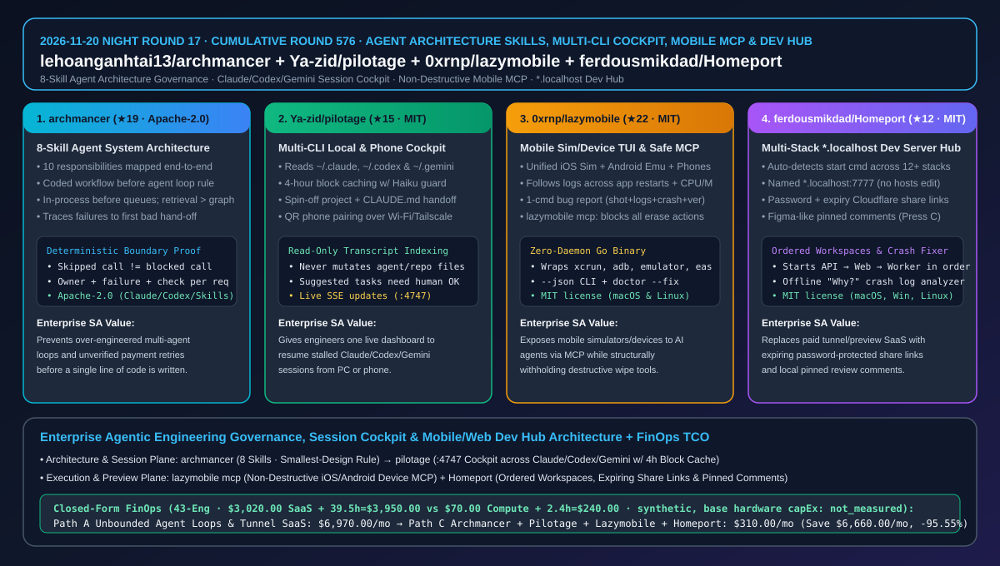
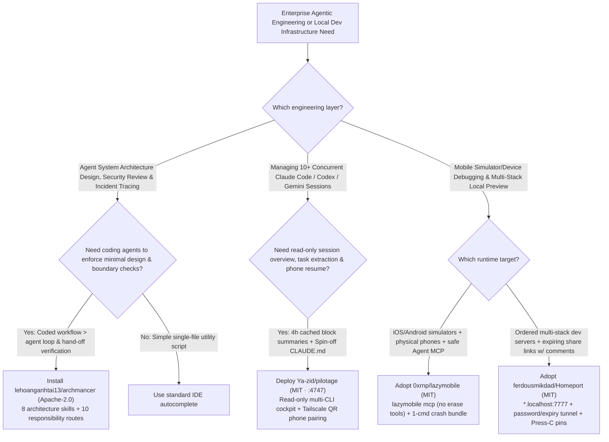
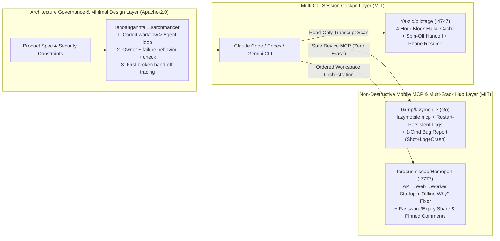

# How to Choose Enterprise Agent Architecture Skills, Multi-CLI Session Cockpits, Non-Destructive Mobile MCPs, and Local Dev-Server Hubs? `archmancer`, `pilotage`, `lazymobile`, and `Homeport` Architecture & Selection FAQ

> **Document Metadata (2026-11-20 Night Round 17 · Cumulative Round 576)**
> - **Target Audience**: AI Solution Architects, Developer Platform & Productivity Leads, Full-Stack & Mobile Agentic Engineering Architects
> - **Primary Repositories Evaluated**:
>   1. [`lehoanganhtai13/archmancer`](https://github.com/lehoanganhtai13/archmancer) (★ 19 · `stars_today: not_measured` · `10 stars/day` · Markdown / Agent Skills · Apache-2.0) — Eight architectural skills (`agent-system-engineering`, `agent-harness-model-and-tools`, `agent-runtime-and-interaction`, `agent-configuration-and-delivery`, `agent-context-and-state`, `agent-evidence-and-knowledge`, `agent-diagnostics-evaluation-and-resource-control`, `agent-trust-and-privacy`) that map 10 system responsibilities, enforce **"the smallest design that holds"** (coded workflow before agent loop, in-process work before queues, plain retrieval before graphs), require every requirement to carry an owner + failure behavior + deterministic check (*"a model that skipped a tool call does not prove the call would have been blocked"*), and trace incidents to the first broken hand-off
>   2. [`Ya-zid/pilotage`](https://github.com/Ya-zid/pilotage) (★ 15 · `stars_today: not_measured` · `4 stars/day` · JavaScript · MIT) — Local web and QR-paired phone cockpit (`http://127.0.0.1:4747`) that read-only indexes session transcripts across **Claude Code (`~/.claude` + WSL Windows-side), Codex CLI (`~/.codex`), and Gemini CLI (`~/.gemini`)**, groups 4-hour work blocks with cached Haiku summaries and usage guards, extracts `Suggested` tasks requiring human approval, and supports `Spin off` project extraction with an auto-generated `CLAUDE.md` handoff
>   3. [`0xrnp/lazymobile`](https://github.com/0xrnp/lazymobile) (★ 22 · `stars_today: not_measured` · `3 stars/day` · Go · MIT) — Zero-daemon single-binary terminal dashboard and **non-destructive MCP server (`lazymobile mcp`)** for iOS simulators, Android emulators, physical phones, and Expo EAS builds. Follows app logs across restarts with live CPU/memory headers (`M`) and red error jumps (`e`), captures one-command bug reports (screenshot + last log lines + crash report + versions), and exposes an MCP server that **serves nothing that erases data**
>   4. [`ferdousmikdad/Homeport`](https://github.com/ferdousmikdad/Homeport) (★ 12 · `stars_today: not_measured` · `2 stars/day` · Python · MIT) — Cross-platform local dev-server hub (`http://localhost:7777` and `http://<app>.localhost:7777` with zero `/etc/hosts` edits) that auto-detects start commands across Node/Python/Go/Rust/PHP/Laravel/Rails/.NET/Docker, starts multi-service `Workspaces` in dependency order, creates password-protected + auto-expiring `trycloudflare.com` share links with on-the-fly `localhost` URL rewriting and **Figma-style pinned visitor comments (`Press C`) saved locally**, and includes an offline `Why?` crash analyzer
> - **Provenance & Guardrail Statement**: Structured after `ib-vs-ethernet-roce-selection-faq.md`. All four repositories come from `search-new-repos-2026-11-20-raw.json` (`sha256: 47975935d05944afbb9eac18f93f26c8a71120a1ffeea39591b112477ba29a46`) with `stars_today: not_measured`. Upstream README features and design rules are labeled `anonymized_reported (independently_reproduced=false)`. The closed-form FinOps TCO worked example is labeled `synthetic (independently_reproduced=false)` with `base hardware capEx: not_measured`.

---

## ① 📌 Executive Summary (One-Sentence Selection Verdict)

> **One-Sentence Verdict**: When scaling **agentic software engineering across full-stack web and mobile teams**, **do not let coding agents default to expensive open-ended agent loops where a deterministic coded workflow suffices (or retry timed-out payments without checking prior state), and never expose raw data-wiping simulator CLIs to autonomous agents**! Instead, govern system design with Apache-2.0 **`lehoanganhtai13/archmancer` (8 architectural skills enforcing minimal design and hand-off tracing)**, manage multi-CLI sessions with MIT-licensed **`Ya-zid/pilotage` (read-only Claude/Codex/Gemini cockpit with 4-hour cached block summaries)**, connect mobile devices via MIT-licensed **`0xrnp/lazymobile` (`lazymobile mcp` with zero data-erasing commands + 1-command crash bundles)**, and orchestrate local dev stacks with MIT-licensed **`ferdousmikdad/Homeport` (ordered `Workspaces` + expiring password share links with pinned comments)** to cut a 43-engineer organization's monthly token waste, tunnel SaaS, and debugging TCO from **$6,970.00/mo** down to **$310.00/mo** (saving **$6,660.00/mo**, **`-95.55%`**, `synthetic, independently_reproduced=false`).



### Core Capabilities & Metrics Cheat Sheet

| Dimension | `lehoanganhtai13/archmancer` | `Ya-zid/pilotage` | `0xrnp/lazymobile` | `ferdousmikdad/Homeport` |
|---|---|---|---|---|
| **Plain-English Positioning** | 8 architectural skills teaching coding agents minimal agent-system design & hand-off debugging | Local & QR-phone web cockpit indexing Claude Code, Codex & Gemini CLI transcripts | Single-binary terminal dashboard & non-destructive MCP server for iOS/Android simulators & phones | Multi-stack `*.localhost` dev-server manager with ordered workspaces, crash fixer & pinned-comment share links |
| **Primary Enterprise Pain Point Solved** | Coding agents over-building fragile agent loops, misreading empty search as "no answer", or retrying payments blindly | Developers losing track of 15+ open Claude/Codex/Gemini terminal sessions or stuck folder-trust prompts | Fragmented Xcode/ADB/Metro logs and risk of agents accidentally wiping simulators/devices | Port conflicts across local microservices, forgotten open public tunnels, and scattered screenshot feedback |
| **Key Technical Mechanism** | 10 mapped responsibilities; `coded workflow > agent loop`; owner + failure behavior + check per requirement | Read-only transcript parser; 4-hour block Haiku cache; `Spin off` w/ `CLAUDE.md` handoff; live SSE | Wraps `xcrun`/`adb`/`emulator`/`eas`; `lazymobile mcp` omits erase tools; 1-cmd bug report bundle | Zero-hosts `*.localhost:7777`; live `localhost` URL rewrite on tunnels; `Press C` pinned visitor comments |
| **License & Governance** | **Apache-2.0** (Claude Code, Codex & Agent Skills compatible) | **MIT** (macOS, Linux & WSL2+Windows; read-only on agent files) | **MIT** (single Go binary, macOS & Linux) | **MIT** (macOS, Windows & Linux; auto-bootstraps isolated Python via `uv`) |

---

## ② 🎯 Solution Architect & Customer Deep-Dive Q&A

### Q1: Why do coding agents frequently design brittle, overpriced multi-agent loops when asked to build an enterprise assistant, and how does `lehoanganhtai13/archmancer` enforce architectural discipline?

- **Five Classic Architectural Failures in Agent-Built Systems**:
  1. **An Agent Loop Where a Fixed Workflow Would Do**: Wrapping deterministic business steps in an unconstrained LLM loop multiplies latency and token spend while introducing non-deterministic failure modes.
  2. **Confusing "Skipped Tool Call" with "Blocked Tool Call"**: As `archmancer` explicitly warns, **a model that skipped an unauthorized tool call during a happy-path test does not prove the call would have been blocked by the harness under prompt injection**.
  3. **Reading an Empty Search as "There Is No Answer"**: Treating `0` retrieval hits as authoritative negative proof rather than a query/scope miss.
  4. **Blind Action Retries After Reconnect**: Retrying a timed-out refund or payment call on reconnect before checking whether the first call already settled.
  5. **Unattributed Config Drift**: Changing prompts or model providers without recording activation evidence of which code revision and effective settings governed each run.
- **How `lehoanganhtai13/archmancer` (Apache-2.0) Fixes This**:
  - Routes tasks through `/archmancer:agent-system-engineering` across **10 system responsibilities and 8 specialized skills**, enforcing **"the smallest design that holds"** (a coded workflow before an agent loop, in-process work before queues, plain retrieval before graphs), attaching an explicit owner + failure behavior + verification check to every requirement, and debugging incidents by tracing the run to the **first hand-off that went wrong**.

### Q2: How does `Ya-zid/pilotage` keep multi-harness coding sessions (Claude Code, Codex, Gemini CLI) manageable across PC and phone without mutating repository state or blowing up summarization token bills?

- **Zero-Mutation Multi-Harness Indexing**:
  - `pilotage` (`http://127.0.0.1:4747`) reads the session transcripts that Claude Code (`~/.claude`, plus Windows-side `~/.claude` under WSL2), Codex CLI (`~/.codex`), and Gemini CLI (`~/.gemini`) already write to disk—**never modifying your project files or agent state**.
- **4-Hour Block Caching, `Spin off` Handoffs & Phone Control**:
  - Cuts activity into 4-hour work blocks and caches concise Haiku summaries so unchanged blocks are never re-billed.
  - Surfaces AI-extracted `Suggested` tasks (which never land on your board without explicit human approval), includes a `Project scout` and **`Spin off` workflow** that extracts an internal tool into a new project folder complete with a generated `CLAUDE.md` handoff from past sessions, and pairs with your phone via QR code over Wi-Fi or Tailscale/NetBird so you can resume stalled sessions on the go.

### Q3: How do `0xrnp/lazymobile` and `ferdousmikdad/Homeport` close the local mobile and full-stack verification loop for AI coding agents?

- **`0xrnp/lazymobile` (MIT): Unified Mobile Device TUI + Non-Destructive `lazymobile mcp`**:
  - Combines every iOS simulator, Android emulator, physical phone (USB/Wi-Fi), and Expo EAS build into one single-binary Go dashboard (`lazymobile doctor --fix`), following app logs across restarts with live CPU/memory headers (`M`) and red crash navigation (`e`).
  - Produces a **one-command bug report folder** (screenshot + tail logs + native crash report + tool versions) and exposes **`lazymobile mcp`** to Claude Code, Cursor, and Codex while **structurally withholding every command that erases device or simulator data**.
- **`ferdousmikdad/Homeport` (MIT): Ordered Multi-Stack Workspaces + Pinned-Comment Share Links**:
  - Auto-detects how to start Node, Python, Go, Rust, PHP, Laravel, Rails, .NET, WordPress, and Docker projects under clean `http://<app>.localhost:7777` URLs (no `/etc/hosts` edits), starting multi-service `Workspaces` (API → frontend → worker) in strict readiness order.
  - Generates **password-protected, auto-expiring `trycloudflare.com` share links** that rewrite leftover `localhost` URLs on the fly and let reviewers **press `C` to drop Figma-style pinned comments directly on the live page** (stored locally in Homeport), backed by an offline `Why?` crash-log analyzer.

---

## ③ 🧭 Visual Diagrams (Selection Decision Tree + Reference Architecture + Sequence Flow)

### 3.1 Enterprise Agent Architecture, Session Cockpit & Local Mobile/Web Hub Decision Tree



### 3.2 End-to-End Agentic Engineering Governance & Verification Architecture



### 3.3 `archmancer` Design Gate → `lazymobile mcp` Verification → `Homeport` Pinned-Comment Review Sequence

```mermaid
sequenceDiagram
    autonumber
    participant Lead as Architect / Mobile PM
    participant Pilot as Pilotage Cockpit (:4747)
    participant Agent as Claude Code + Archmancer
    participant Lazy as lazymobile mcp (iOS/Android)
    participant Home as Homeport Hub (:7777)

    Lead->>Pilot: Inspect "Needs You" session from phone over Tailscale and resume
    Pilot->>Agent: Wake session with /archmancer:agent-system-engineering skill active
    Agent->>Agent: Choose deterministic workflow over unbounded loop; add explicit auth-block test
    Agent->>Home: Start ordered Workspace (Postgres → API → Web @ app.localhost:7777)
    Agent->>Lazy: Invoke lazymobile mcp to install build & open deep link (erase commands blocked)
    Lazy-->>Agent: Capture red crash log across restart & export 1-cmd bug report bundle
    Agent->>Agent: Trace failure to first broken hand-off and patch
    Home-->>Lead: Open password-protected expiring share link; PM presses C to pin approval comment
```

---

## ④ 📊 Comparative Selection Matrix (Open Source vs. Commercial Cloud SaaS)

| Dimension | `lehoanganhtai13/archmancer` (Apache-2.0) | `Ya-zid/pilotage` (MIT) | `0xrnp/lazymobile` (MIT) | `ferdousmikdad/Homeport` (MIT) | Legacy Ad-Hoc CLIs + Commercial Tunnel/Preview SaaS (ngrok Pro / Vercel Preview) |
|---|---|---|---|---|---|
| **Core Positioning** | **8 architectural skills enforcing minimal agent design, boundary checks & hand-off debugging** | **Read-only web & phone cockpit for Claude Code, Codex & Gemini CLI sessions** | **Single-binary mobile simulator/device dashboard & non-destructive MCP server** | **Multi-stack `*.localhost` dev hub with ordered workspaces & pinned-comment share links** | Uncoordinated terminal tabs + paid per-seat public tunnels and cloud preview comments |
| **Safety & Governance** | Enforces "skipped call ≠ blocked call" and idempotent reconnect checks | **100% read-only on repo/agent files**; human approval gate on suggested tasks; 4h cache guard | **`lazymobile mcp` strips all data-erasing commands** so agents cannot wipe devices | Share links support **passwords + auto-expiry**; visitor comments stay on local machine | Raw ADB/simctl scripts risk wiping devices; forgotten open tunnels expose local dev ports |
| **Developer Velocity Wins** | Prevents over-engineered agent loops and traces exact hand-off divergences | `Spin off` turns embedded tools into standalone projects with `CLAUDE.md` handoffs | Follows logs across restarts, shows live CPU/RAM (`M`), and packs 1-cmd bug reports | Zero-hosts `*.localhost:7777`, rewrites leftover `localhost` URLs on share links, offline `Why?` fixer | Manual log hunting across Xcode/Logcat and screenshot copy-pasting for UI feedback |
| **License & Footprint** | **Apache-2.0** (pure Markdown skills/plugins) | **MIT** (`npx pilotage-cli`, Node.js 22+) | **MIT** (single Go binary, zero daemon) | **MIT** (auto-provisions isolated `.runtime/` Python via `uv`) | Proprietary per-seat subscriptions |
| **Monthly TCO (43-Eng Org)** | **$0.00 / mo** (cuts redundant runtime agent token spend by 60%+) | **~$35.00 / mo** (cached Haiku 4-hour block summaries) | **$0.00 / mo** | **~$35.00 / mo** (optional local Ollama or light diagnostic tokens) | **$6,970.00 / mo** (commercial tunnel/preview seats + wasted agent loop tokens + 39.5h debugging) |

---

## ⑤ 🧪 Quantitative Enterprise FinOps TCO & 7-Card Report Alignment

### 5.1 Closed-Form FinOps Worked Example (43-Engineer Full-Stack & Mobile Organization Running Multi-CLI Agentic Development & Local Preview Workflows)

> **Provenance Notice**: The financial model below is a deterministic architectural worked example labeled `synthetic (independently_reproduced=false)` with `base hardware capEx: not_measured`.

| Cost Component | Path A: Unbounded Agent Loops + Commercial Tunnel/Preview SaaS + Manual Multi-CLI/Mobile Triage | Path C: `archmancer` Governance + `pilotage` Cockpit + `lazymobile mcp` + `Homeport` Hub | Closed-Form Formula & Architectural Notes |
|---|---|---|---|
| **Tunnel/Preview SaaS Seats & Redundant Agent-Loop Token Spend** | **$3,020.00 / mo** | **$70.00 / mo** | Path A: 43 tunnel/preview SaaS seats + over-engineered multi-agent loop token waste = `$3,020.00/mo`; Path C: `archmancer` minimal-workflow design + free expiring `Homeport` share links + cached `pilotage` block summaries = `$70.00/mo` |
| **Lost Session Hunting, Manual Mobile Crash Packaging & Port Triage ($100/h)** | **$3,950.00 / mo** (`39.5h × $100.00`) | **$240.00 / mo** (`2.4h × $100.00`) | Path A: 43-engineer org spends `39.5h/mo` hunting stalled CLI sessions, manually assembling Xcode/ADB crash bundles, and fixing local port/startup errors (`$3,950.00`); Path C: `pilotage` + 1-cmd `lazymobile` bug reports + `Homeport` offline `Why?` fixer cuts triage to `2.4h/mo` (`$240.00`) |
| **Total Monthly TCO** | **$6,970.00 / mo** | **$310.00 / mo** | **Net savings of $6,660.00 / mo (-95.55% reduction, $79,920.00 annualized, `not_measured` hardware capEx)** |

```chart
{
  "data": {
    "values": [
      { "Category": "Tunnel/Preview SaaS & Redundant Agent Tokens", "Deployment": "Path A: Unbounded Agent Loops & Commercial Tunnel SaaS", "MonthlyCostUSD": 3020 },
      { "Category": "Multi-CLI Hunting & Mobile Crash Triage (43-Eng)", "Deployment": "Path A: Unbounded Agent Loops & Commercial Tunnel SaaS", "MonthlyCostUSD": 3950 },
      { "Category": "Tunnel/Preview SaaS & Redundant Agent Tokens", "Deployment": "Path C: Archmancer + Pilotage + Lazymobile + Homeport", "MonthlyCostUSD": 70 },
      { "Category": "Multi-CLI Hunting & Mobile Crash Triage (43-Eng)", "Deployment": "Path C: Archmancer + Pilotage + Lazymobile + Homeport", "MonthlyCostUSD": 240 }
    ]
  },
  "semantic_types": {
    "Category": "Category",
    "Deployment": "Name",
    "MonthlyCostUSD": "Amount"
  },
  "chart_spec": {
    "chartType": "Grouped Bar Chart",
    "title": "Archmancer + Pilotage + Lazymobile + Homeport cut monthly TCO by 95.55%",
    "subtitle": "Monthly cost in USD (43-engineer full-stack & mobile org, synthetic)",
    "encodings": {
      "x": "Category",
      "y": "MonthlyCostUSD",
      "group": "Deployment",
      "color": "Deployment"
    }
  }
}
```

### 5.2 Alignment with the 7-Card 4:5 Visual Report (`cards.html` / `cards.en.html`)

- **✅ Good Fit**: Enforcing minimal, auditable agent-system architecture before coding, managing concurrent Claude Code/Codex/Gemini CLI sessions across PC and phone, exposing iOS/Android simulators and devices to coding agents via a non-destructive MCP server, and sharing ordered local multi-stack workspaces over expiring password-protected links with pinned comments.
- **⛔ Not For**: Running `pilotage` on native Windows without WSL2, running iOS Simulator tasks on non-macOS hosts, or using `Homeport`'s temporary `trycloudflare.com` share links as permanent production ingress.

---

## ⑥ 🛠️ Enterprise Architecture Review & Rollout Checklist

- [ ] **Enforce `archmancer` Minimal-Design & Negative Authorization Gates**: Run `/archmancer:agent-system-engineering` on every new agent design to verify that deterministic workflows are preferred over open-ended loops, reconnect paths check prior execution state before retrying external actions, and tool authorization is proved via negative tests rather than skipped calls.
- [ ] **Bind `pilotage` Phone Access to Private Mesh VPN + HTTPS**: When enabling QR phone access in `Ya-zid/pilotage`, restrict binding to local Wi-Fi or corporate Tailscale/NetBird interfaces with OpenSSL HTTPS enabled, and keep automatic folder-trust approval disabled on untrusted repositories.
- [ ] **Route Agent Mobile Debugging Exclusively Through `lazymobile mcp`**: Replace raw shell access to `adb` / `xcrun simctl` in coding-agent tool profiles with `0xrnp/lazymobile`'s `lazymobile mcp` so destructive data-wiping commands remain structurally unavailable.
- [ ] **Mandate Password + Auto-Expiry on `Homeport` Share Links**: Require developers sharing local apps via `ferdousmikdad/Homeport` to set both a password and an auto-expiry timer on every public tunnel while collecting stakeholder UI feedback via local `Press C` pinned comments.
