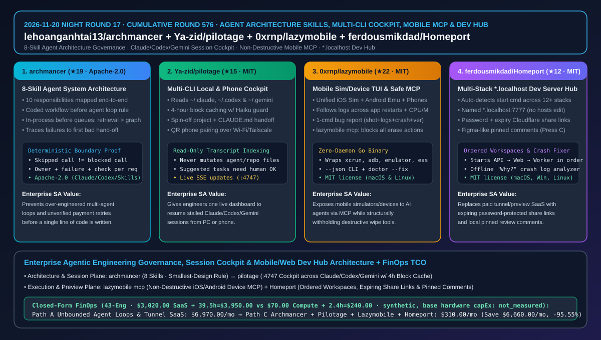
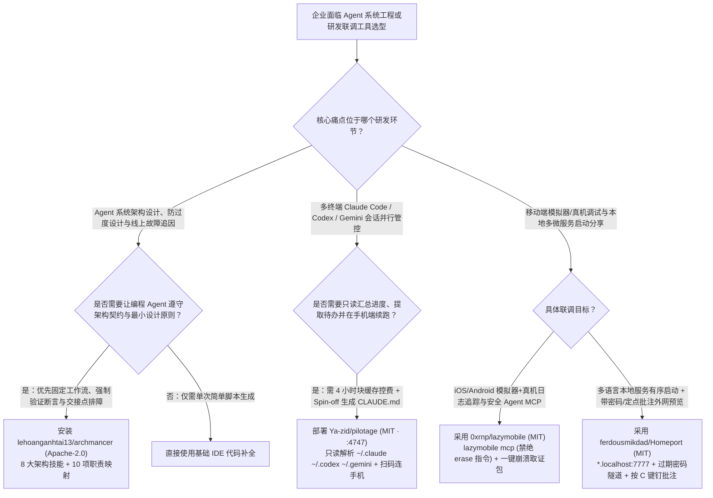
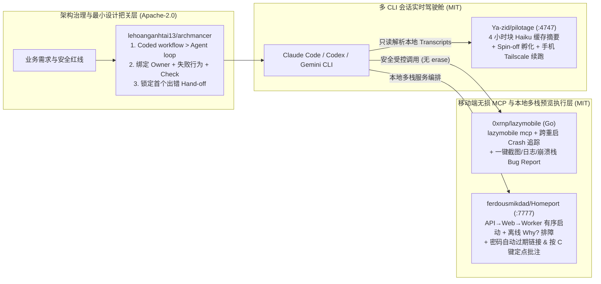
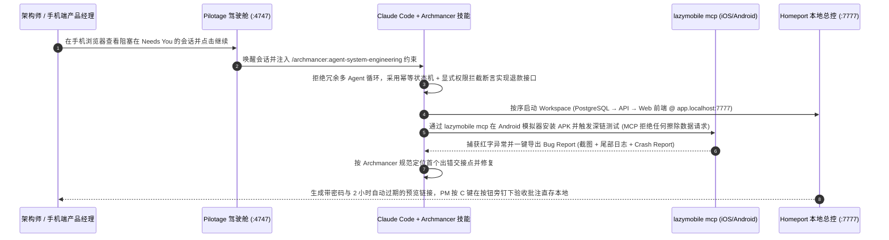

# 企业 Agent 系统架构治理技能、多 CLI 会话驾驶舱、无损移动调试 MCP 与多栈本地开发中心怎么选？`archmancer`、`pilotage`、`lazymobile` 与 `Homeport` 架构与选型 FAQ

> **文档元数据（2026-11-20 夜间第 17 轮 · 累计第 576 轮 / Round 576）**
> - **适用读者**：AI Solution Architect（解决方案架构师）、研发效能平台负责人、全栈与移动端 Agentic Engineering 架构师
> - **本轮核心对比项目**：
>   1. [`lehoanganhtai13/archmancer`](https://github.com/lehoanganhtai13/archmancer)（★ 19 · `stars_today: not_measured` · `10 stars/day` · Markdown / Agent Skills · Apache-2.0）——赋予编程 Agent（Claude Code、Codex、Cursor、GitHub Copilot）**解决方案架构师视角**的 8 大系统工程技能包（涵盖 10 项核心职责映射），强制执行**“够用的最小设计（Smallest Design That Holds：能用确定性工作流就别上自由 Agent 循环、能进程内调就别上消息队列、能普通检索就别上复杂图数据库）”**与**“模型没调某个工具 ≠ 该工具已被权限拦截”**等硬核工程铁律
>   2. [`Ya-zid/pilotage`](https://github.com/Ya-zid/pilotage)（★ 15 · `stars_today: not_measured` · `4 stars/day` · JavaScript · MIT）——纯本地只读索引 **Claude Code（`~/.claude` 及 WSL Windows 侧目录）、Codex CLI（`~/.codex`）与 Gemini CLI（`~/.gemini`）** 历史与在途会话的 Web 驾驶舱（`http://127.0.0.1:4747`，支持扫码通过局域网或 Tailscale/NetBird 在手机端操控），按 4 小时连续工作块做增量缓存摘要（默认 Haiku 控费守卫），支持从老项目一键拆出新项目并自动生成 `CLAUDE.md` 交接文档（`Spin off`）
>   3. [`0xrnp/lazymobile`](https://github.com/0xrnp/lazymobile)（★ 22 · `stars_today: not_measured` · `3 stars/day` · Go · MIT）——单二进制零后台守护进程的移动开发终端仪表盘与 **非破坏性 MCP 服务（`lazymobile mcp`）**，统一纳管 iOS Simulator、Android Emulator、真机与 Expo EAS 构建；支持跨应用重启持续追踪崩溃日志、一键打包 Bug Report（截图+尾部日志+崩溃栈+版本号），且其向 AI Agent 暴露的 MCP 接口**在架构层面物理剔除一切抹除数据的破坏性指令**
>   4. [`ferdousmikdad/Homeport`](https://github.com/ferdousmikdad/Homeport)（★ 12 · `stars_today: not_measured` · `2 stars/day` · Python · MIT）——跨 macOS/Windows/Linux 的本地全栈开发服务总控台（`http://localhost:7777`），自动推断 Node/Python/Go/Rust/PHP/Laravel/Rails/.NET/Docker 启动命令，免改 `/etc/hosts` 提供 `http://<app>.localhost:7777` 具名访问，支持按依赖顺序启动多服务 `Workspaces`（API → 前端 → Worker），并可生成**带密码、自动过期且内置 Figma 式定点评论（按 `C` 键留批注回存本地）**的安全外网预览链接
> - **口径与溯源声明**：本篇遵循 `ib-vs-ethernet-roce-selection-faq.md` 通俗问答与选型对比规范。四款项目均来自 `search-new-repos-2026-11-20-raw.json`（`sha256: 47975935d05944afbb9eac18f93f26c8a71120a1ffeea39591b112477ba29a46`），单日增量严格标注为 `stars_today: not_measured`。项目 README 自报特性与架构规范标注为 `anonymized_reported (independently_reproduced=false)`；架构师 TCO 闭式算例标注为 `synthetic (independently_reproduced=false)`，硬件购置折旧 `base hardware capEx: not_measured`。

---

## ① 📌 核心结论速览（选型一句话结论）

> **一句话选型结论**：在推进**企业级全栈/移动端 AI 辅助研发（Agentic Engineering）**时，**切勿让编程 Agent 一上来就把简单业务逻辑写成昂贵且不可控的自由 Agent Loop（还常在断线重连后重复执行扣款动作），也切勿给 Agent 开放包含 `erase/wipe` 权限的原生模拟器命令行**！最佳实践是：架构设计阶段用 Apache-2.0 的 **`lehoanganhtai13/archmancer`（8 大架构技能强制最小化设计与交接点排障）** 把关，日常多 CLI 会话管理用 MIT 的 **`Ya-zid/pilotage`（只读聚合 Claude/Codex/Gemini 会话 + 4 小时块增量缓存控费）**，移动端联调接入 MIT 的 **`0xrnp/lazymobile`（`lazymobile mcp` 零擦除风险设备 MCP + 一键崩溃取证包）**，本地多微服务联调与客户预览采用 MIT 的 **`ferdousmikdad/Homeport`（有序启动 Workspaces + 带密码过期与定点批注的预览链接）**，可将 43 人研发团队月度 Token 浪费、内网穿透 SaaS 与联调排障总成本（TCO）从 **$6,970.00/月** 压降至 **$310.00/月**（净省 **$6,660.00/月**，降幅 **-95.55%**，`synthetic, independently_reproduced=false`）。



### 核心指标与能力速查表

| 评估维度 | `lehoanganhtai13/archmancer` | `Ya-zid/pilotage` | `0xrnp/lazymobile` | `ferdousmikdad/Homeport` |
|---|---|---|---|---|
| **一句话通俗定位** | 教编程 Agent 用解决方案架构师思维做减法与追查故障交接点的 8 大技能包 | 本地只读汇总 Claude Code / Codex / Gemini 会话并支持手机扫码续跑的驾驶舱 | 统一管理 iOS/Android 模拟器与真机、并提供零擦除风险 MCP 的 Go 终端仪表盘 | 自动识别 12+ 技术栈、有序拉起微服务并带 Figma 式批注预览链接的本地总控台 |
| **解决的核心业务痛点** | 写代码的 Agent 动辄滥用多 Agent 循环、把空检索当“没答案”、断线重连重复扣款 | 工程师同时开十几个 Claude/Codex 终端窗口找不到昨天做到哪，离开工位无法批复授权 | 移动开发同时盯 Xcode/ADB/Metro 极其割裂，直接把 ADB 给 Agent 怕它误删模拟器或手机数据 | 本地跑前后端+数据库经常端口冲突，发外网临时链接忘关导致泄漏，客户提意见只能截屏发微信 |
| **关键技术参数与机制** | 10 大系统职责路由；`Coded workflow > Agent loop`；每项需求绑定 Owner+失败行为+验证断言 | 4 小时工作块 Haiku 增量缓存；`Spin off` 自动生成 `CLAUDE.md`；SSE 实时刷新 | 单二进制封装 `xcrun/adb/emulator/eas`；`lazymobile mcp` 屏蔽擦除指令；一键 Bug Report | 免改 hosts `*.localhost:7777`；自动改写页面残留 `localhost` 链接；按 `C` 键留定点批注 |
| **开源协议与合规状态** | **Apache-2.0**（同时提供 Claude Code / Codex 插件与通用 Agent Skills） | **MIT**（纯本地只读扫描转录文件，绝不篡改原仓库） | **MIT**（Go 单二进制，支持 macOS & Linux） | **MIT**（支持 macOS / Windows / Linux，缺 Python 自动通过 `uv` 装私有运行时） |

---

## ② 🎯 客户与架构师灵魂拷问 Q&A（直击业务落地痛点）

### Q1：为什么让 Claude Code 或 Codex 直接“帮我写一个客服退款或文档问答 Agent”时，写出来的代码往往在生产环境里酿成事故？`lehoanganhtai13/archmancer` 的 8 大架构技能是怎么给编程 Agent 装上“架构师大脑”的？

- **无架构约束的编程 Agent 最常犯的五大生产级错误**：
  1. **过度设计（Agent Loop Abuse）**：本来用 30 行确定性 `if/else` 状态机就能搞定的固定流程，非要套一个多轮 ReAct Agent Loop，导致延迟翻 5 倍、Token 账单翻 10 倍。
  2. **把“一次测试中模型没调危险工具”当成“权限已防住”**：在安全测试中，看到模型乖乖回答“我不能执行删除”就以为安全了——殊不知**“模型自己决定跳过某次工具调用，根本不能证明当它被 Prompt Injection 诱导时系统能拦住该调用（A model that skipped a tool call does not prove the call would have been blocked）”**！
  3. **把空检索结果等同于事实不存在**：向量库或全文检索因为过滤条件太严返回 `0` 条记录，Agent 直接向客户保证“公司没有这项规定”。
  4. **断线重连后的非幂等重复扣款**：网络闪断重连后，Agent 没有先查询上一笔外部支付状态就直接重发扣款请求。
  5. **配置漂移无据可查**：线上行为突变时，根本查不清那次运行到底加载了哪个 Git Commit 的 Prompt 和哪版环境变量。
- **`lehoanganhtai13/archmancer`（Apache-2.0）的三大架构治理法宝**：
  1. **最小可行架构优先律（The Smallest Design That Holds）**：通过入口技能 `archmancer:agent-system-engineering` 审视需求，强制按**“固定代码工作流优先于 Agent 循环（Coded workflow before agent loop）→ 进程内调用优先于异步消息队列（In-process before queues）→ 普通受控检索优先于复杂知识图谱（Plain retrieval before graphs）”**做减法。
  2. **八大专业组件技能各司其职**：将 Agent 系统拆解为 10 项职责并映射到 8 个子技能（模型与工具契约 `harness-model-and-tools`、任务准入与重连恢复 `runtime-and-interaction`、版本激活证据与回滚 `configuration-and-delivery`、上下文压缩与前缀缓存 `context-and-state`、带权限检索与鲜度校验 `evidence-and-knowledge`、成本归因与评测 `diagnostics-evaluation`、以及授权隔离与防注入 `trust-and-privacy`）。
  3. **按“首个出错交接点（First Broken Hand-off）”排障**：排障时严禁盲目改 Prompt，必须先锁定 `run_id`、代码版本与生效配置，顺着数据流定位第一个偏离契约的模块交接点。

### Q2：当团队主力研发每天在电脑上同时跑十几个 Claude Code、Codex CLI 和 Gemini CLI 会话时，为什么上下文管理会彻底失控？`Ya-zid/pilotage` 如何做到“零侵入接管 + 手机远程续命”？

- **多终端 Agent 并行开发的日常痛点**：
  - 早上同时给 4 个仓库开了 Claude Code 和 Codex 跑重构，下午开完会回来面对十几个终端 Tab，根本想不起哪个还在等人工确认（`Needs you`）、哪个昨天跑了一半还没收尾；更尴尬的是下班在地铁上突然想起有个长任务卡在 Claude Code 的 `"Trust this folder?"` 弹窗上。
- **`Ya-zid/pilotage`（MIT）的四项贴心设计**：
  1. **纯只读解析多框架原生落盘日志**：直接读取 `~/.claude`（含 WSL 下自动穿透读取 Windows 宿主机侧的 `~/.claude`）、`~/.codex` 与 `~/.gemini` 已经写在磁盘上的会话记录，**绝不修改你的项目代码或 Agent 内部状态文件**。
  2. **4 小时工作块增量缓存与 Haiku 成本守卫**：将间隔不超过 4 小时的连续提问切为一个工作块（Block），默认用极低成本的 Haiku 模型生成一句话进度摘要与今日待办建议（`Suggested` 任务必须经你点击确认才会进入看板），且**结果全部本地缓存，仅在底层会话文件发生变更时才重算**。
  3. **Project Scout 与一键 `Spin off` 孵化子项目**：当你在一个大仓库里顺手写了一个好用的内部小工具时，`Spin off` 功能可将该部分独立剥离为新文件夹，并自动从历史会话上下文中提炼生成一份交接好的 `CLAUDE.md`！
  4. **手机扫码配对与远程代答目录信任**：通过二维码在家庭 Wi-Fi 或企业 Tailscale/NetBird 组网下配对手机，在手机浏览器上即可查看实时 SSE 状态、恢复昨日会话，甚至可选自动代答 `"trust this folder?"` 阻塞项。

### Q3：移动 App 与多微服务本地联调时，为什么用 `0xrnp/lazymobile` + `ferdousmikdad/Homeport` 能大幅缩短 AI Agent 闭环验证时间？

- **`0xrnp/lazymobile`（MIT）：给 Agent 戴上“防删库手铐”的移动设备总控台与 MCP**：
  - **一个界面统管所有模拟器与真机**：单 Go 二进制直接调用系统已有的 `xcrun`、`adb`、`emulator` 与 `eas`，左边列出所有 iOS 模拟器、Android 模拟器与 Wi-Fi/USB 真机（含每个模拟器占用的磁盘空间，一键清理 Xcode 已淘汰的旧模拟器），右边并排实时追踪多个 App 日志（App 崩溃重启后自动续接日志流，按 `e` 跳到下一个红字报错，按 `M` 实时显示该 App 的 CPU 与内存占用）。
  - **一键生成完整 Bug 取证包 + 非破坏性 `lazymobile mcp`**：按 `Ctrl+P` 或执行一条命令即可在独立文件夹内自动打包**“当前屏幕截图 + 最后 N 行日志 + 系统崩溃栈报告（Crash Report）+ 环境版本号”**直接喂给 AI 排障；更重要的是，当开启 `lazymobile mcp` 让 Claude Code / Cursor 直接操控移动设备时，**MCP 服务端在代码层面过滤掉了所有擦除设备数据（erase/wipe）的接口**，彻底杜绝 Agent 误清空测试机！
- **`ferdousmikdad/Homeport`（MIT）：免配环境、带定点批注外网分享的本地开发港**：
  - **指个目录就能跑 + 免改 hosts 的 `*.localhost:7777`**：指向 `~/Projects`，自动识别 12+ 种语言/框架、包管理器、虚拟环境与空闲端口，通过 `http://blog.localhost:7777` 直接访问；支持将 `API + Frontend + Worker` 编组为 `Workspace` 按先后就绪顺序依次拉起。
  - **带密码、自动过期且支持“像 Figma 一样在网页上钉评论”的外网预览**：一键生成 `trycloudflare.com` 预览链接（自动将页面里写死的残留 `localhost` 链接动态重写为公网地址），支持设置**访问密码与自动过期时间**（防止下班忘关隧道）；外部测试人员或产品经理打开链接后**只需按 `C` 键点击页面任意位置即可留下跟随滚动的定点批注（Pinned Comments）**，所有反馈直接保存在你本机的 Homeport 中！此外，当本地服务崩溃退出时，点击离线版 **`Why?`** 按钮即可直接用大白话诊断端口占用、缺 `.env` 或数据库未启动并提供一键修复。

---

## ③ 🧭 直观可视化图解（选型决策树 + 企业集成架构 + 业务流时序图）

### 3.1 企业 Agent 架构设计、多 CLI 管控与移动/全栈联调选型决策树



### 3.2 企业全栈与移动端 Agentic Engineering 端到端集成架构



### 3.3 `archmancer` 架构把关 → `lazymobile mcp` 无损真机验证 → `Homeport` 定点批注闭环时序图



---

## ④ 📊 同类开源与商业云服务横向选型决策矩阵

| 对比维度 | `lehoanganhtai13/archmancer` (Apache-2.0) | `Ya-zid/pilotage` (MIT) | `0xrnp/lazymobile` (MIT) | `ferdousmikdad/Homeport` (MIT) | 传统散装命令行 + 商业隧道/预览 SaaS（ngrok Pro / Vercel Preview / 云真机） |
|---|---|---|---|---|---|
| **核心能力定位** | **教编程 Agent 做架构减法、补齐权限验证断言与追查交接点故障的 8 大技能** | **只读聚合 Claude/Codex/Gemini 本地会话、支持手机续跑与项目拆分的驾驶舱** | **统一管控 iOS/Android 模拟器与真机、提供非破坏性 MCP 与一键取证的 Go 工具** | **免配环境拉起 12+ 技术栈、自带离线崩溃诊断与 Figma 式批注预览链接的总控台** | 零散终端窗口 + 按月按席位收费的公网隧道与云端 PR 预览评论服务 |
| **安全与防失控设计** | 强调“未调用工具 ≠ 工具已被阻断”，拒绝无幂等校验的断线重连重试 | **100% 只读读取会话文件**；AI 提议的待办任务必须经人工确认才上墙；4h 块缓存限流 | **`lazymobile mcp` 彻底移除数据擦除接口**，防止 Agent 误抹除模拟器或测试真机 | 分享链接支持**密码保护 + 自动到期关闭**，定点评论直接落盘本机不留第三方云 | 原生 ADB/xcrun 暴露给 Agent 极易误删环境；免费公网隧道常因忘关暴露本地后台 |
| **研发体验提效亮点** | 10 项系统职责清晰路由，一眼识别何时该用普通代码替代 Agent Loop | 一键 `Spin off` 将老会话中的副产物提取为带 `CLAUDE.md` 的独立新工程 | 跨应用重启紧跟日志，实时显示 App CPU/内存（`M`），一条命令收齐完整崩溃现场 | 免改 hosts 跑 `*.localhost:7777`；自动修复外网链接里的残留 `localhost`；离线 `Why?` 排障 | 每次崩溃需手动去 Xcode/Logcat 翻几千行日志再截图拼凑上下文 |
| **开源协议与部署门槛** | **Apache-2.0**（一行命令装入 Claude/Codex/Skills） | **MIT**（`npx pilotage-cli` 即开即用，支持 macOS/Linux/WSL2） | **MIT**（Go 单二进制，零后台驻留进程） | **MIT**（双击脚本自动通过 `uv` 建私有 Python 环境，无需管理员权限） | 商业闭源按席位/带宽收费 |
| **43 人团队月度 TCO** | **$0.00/月**（直接降低 60%+ 线上冗余 Agent Token 消耗） | **~$35.00/月**（Haiku 4 小时块增量缓存摘要） | **$0.00/月** | **~$35.00/月**（可选本地 Ollama 或少量排障 Token） | **$6,970.00/月**（商业隧道/预览 SaaS 席位 + 冗余 Agent Loop 账单 + 39.5h 联调排障） |

---

## ⑤ 🧪 应用落地定量收益/TCO 对比与 7-Card 报告映射

### 5.1 架构师闭式 TCO 算例（43 人全栈与移动研发团队月度 Agentic Engineering 与联调预览成本）

> **溯源标识**：以下成本模型为面向企业架构评审的闭式定量算例，标注为 `synthetic (independently_reproduced=false)`，底层服务器与开发机硬件采购折旧标注为 `base hardware capEx: not_measured`。

| 成本构成项 | 方案 A：无约束自由 Agent 循环 + 商业内网穿透/预览评论 SaaS + 手动翻日志联调 | 方案 C：`archmancer` 最小架构把关 + `pilotage` 驾驶舱 + `lazymobile mcp` + `Homeport` | 计算公式与架构说明 |
|---|---|---|---|
| **冗余 Agent Token 消耗、商业公网隧道与预览评论 SaaS 席位** | **$3,020.00 / 月** | **$70.00 / 月** | 方案 A：43 席商业隧道/预览批注 SaaS + 滥用多轮 Agent Loop 造成的线上/测试 Token 浪费 = `$3,020.00/月`；方案 C：`archmancer` 砍掉冗余循环 + `Homeport` 免费加密过期隧道 + `pilotage` 4 小时块缓存摘要 = `$70.00/月` |
| **跨 CLI 找会话、手动收集移动端崩溃现场与端口冲突排障（$100/h）** | **$3,950.00 / 月**（`39.5h × $100.00`） | **$240.00 / 月**（`2.4h × $100.00`） | 方案 A：团队每月耗费 `39.5 小时` 在十几个 CLI 窗口间找上下文、手动拼凑 Xcode/ADB 崩溃截图日志及排查本地微服务启动失败（`$3,950.00`）；方案 C：`pilotage` 统一面板 + `lazymobile` 一键取证包 + `Homeport` 离线 `Why?` 修复将人工降至 `2.4 小时`（`$240.00`） |
| **月度总拥有成本（Monthly TCO）** | **$6,970.00 / 月** | **$310.00 / 月** | **月度净节省 $6,660.00 / 月（成本降低 -95.55%，年化节省 $79,920.00，`not_measured` 硬件折旧）** |

```chart
{
  "data": {
    "values": [
      { "Category": "Tunnel/Preview SaaS & Redundant Agent Tokens", "Deployment": "Path A: Unbounded Agent Loops & Commercial Tunnel SaaS", "MonthlyCostUSD": 3020 },
      { "Category": "Multi-CLI Hunting & Mobile Crash Triage (43-Eng)", "Deployment": "Path A: Unbounded Agent Loops & Commercial Tunnel SaaS", "MonthlyCostUSD": 3950 },
      { "Category": "Tunnel/Preview SaaS & Redundant Agent Tokens", "Deployment": "Path C: Archmancer + Pilotage + Lazymobile + Homeport", "MonthlyCostUSD": 70 },
      { "Category": "Multi-CLI Hunting & Mobile Crash Triage (43-Eng)", "Deployment": "Path C: Archmancer + Pilotage + Lazymobile + Homeport", "MonthlyCostUSD": 240 }
    ]
  },
  "semantic_types": {
    "Category": "Category",
    "Deployment": "Name",
    "MonthlyCostUSD": "Amount"
  },
  "chart_spec": {
    "chartType": "Grouped Bar Chart",
    "title": "Archmancer + Pilotage + Lazymobile + Homeport cut monthly TCO by 95.55%",
    "subtitle": "Monthly cost in USD (43-engineer full-stack & mobile org, synthetic)",
    "encodings": {
      "x": "Category",
      "y": "MonthlyCostUSD",
      "group": "Deployment",
      "color": "Deployment"
    }
  }
}
```

### 5.2 与本轮 7-Card 4:5 视觉报告（`cards.html` / `cards.en.html`）的联动

- **适用场景（✅ Good Fit）**：企业 Agent 系统的架构设计与防过度工程评审、同时重度使用 Claude Code / Codex / Gemini CLI 的研发会话可视化续跑、iOS/Android 模拟器与真机的非破坏性 Agent 自动化调试、以及本地多微服务一键拉起与带密码/定点批注的临时预览分享。
- **不适用场景（⛔ Not For）**：不带 WSL2 的纯原生 Windows 环境运行 `pilotage`（`pilotage` 目前依赖 macOS/Linux/WSL2）、在 Windows 主机上直接跑 iOS Simulator（`lazymobile` 的 iOS 能力需 macOS + Xcode）、或将 `Homeport` 的临时开发预览隧道当成高并发生产 CDN 网关。

---

## ⑥ 🛠️ 企业引入与架构评审 Checklist（可直接复制进架构评审单）

- [ ] **Agent 架构评审强制执行 `archmancer` 最小设计三问**：在立项任何新 Agent 模块前，调用 `/archmancer:agent-system-engineering` 逐项核验：① 能否用确定性代码工作流替代自由 Agent Loop？② 外部写操作（如退款、发单）在断线重连时是否具备幂等状态查询？③ 权限阻断是否经过主动越权负例测试（而非仅看模型正常情况下未调用该工具）？
- [ ] **多 CLI 会话驾驶舱网络安全与手机访问加固**：在开发机部署 `Ya-zid/pilotage`（MIT）并开启手机访问时，强制仅在受控内网 Wi-Fi 或企业 Tailscale / NetBird 虚拟专网下结合 OpenSSL HTTPS 配对，严禁将 `:4747` 端口直接暴露在公网路由器上。
- [ ] **移动端 Agent 调试接入 `lazymobile mcp` 非破坏性沙盒**：禁止将原始 `adb` / `xcrun simctl erase` 直接无过滤交给自主编码 Agent；统一通过 `0xrnp/lazymobile` 的 `lazymobile mcp` 暴露设备操控与一键 Bug Report 采集能力，确保数据抹除指令物理不可达。
- [ ] **本地预览隧道强制开启密码与自动过期策略**：研发人员使用 `ferdousmikdad/Homeport`（MIT）向外部分享本地运行实例并收集按 `C` 键定点批注时，必须在分享面板勾选访问密码（Password）与自动过期时长（Auto-Expiry），并在下载未签名桌面安装包时优先走终端脚本安装或由企业内部证书统一签名。
