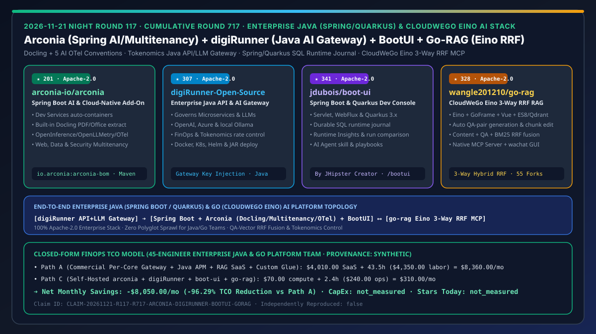
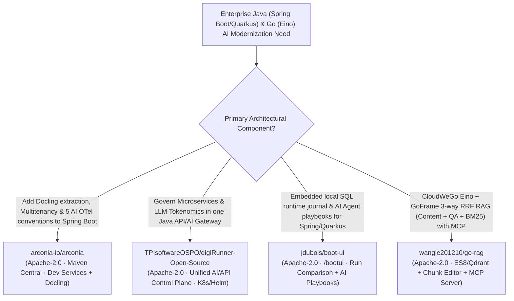
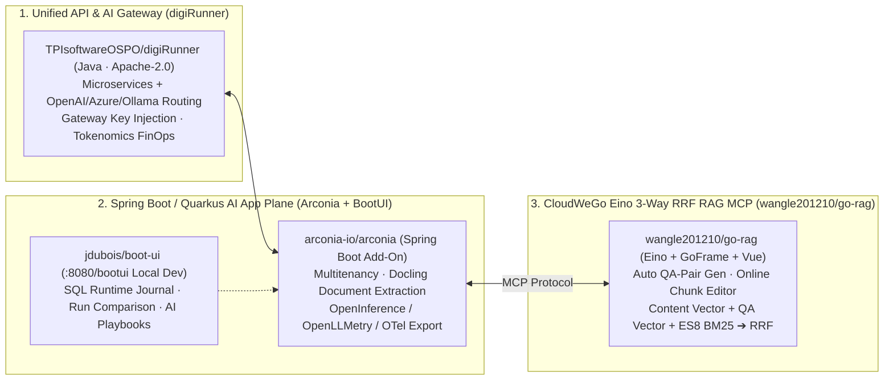
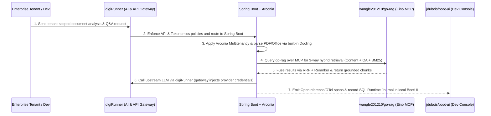

# Spring Boot AI & Multitenancy Add-On (`arconia-io/arconia`), Enterprise Java Microservice & AI Gateway (`TPIsoftwareOSPO/digiRunner-Open-Source`), Spring Boot/Quarkus Developer Console (`jdubois/boot-ui`) & CloudWeGo Eino 3-Way RRF RAG MCP (`wangle201210/go-rag`) Selection & Architecture FAQ

> **Document Type**: Enterprise AI Solution Architect Selection & Integration Guide (GitHub Trending AI Radar — 2026-11-21 Night Round 117 / Cumulative Round 717)
> **Covered Repositories**: [`arconia-io/arconia`](https://github.com/arconia-io/arconia) (`★ 201`, `25 forks`, `Apache-2.0` — Spring Boot add-on framework on Maven Central providing Dev Services, Docling document extraction, 5 AI observability semantic conventions & full-stack multitenancy) · [`TPIsoftwareOSPO/digiRunner-Open-Source`](https://github.com/TPIsoftwareOSPO/digiRunner-Open-Source) (`★ 307`, `15 forks`, `Apache-2.0` — enterprise Java API & AI Gateway governing microservices and OpenAI/Azure/Ollama LLMs with Tokenomics FinOps controls) · [`jdubois/boot-ui`](https://github.com/jdubois/boot-ui) (`★ 341`, `40 forks`, `Apache-2.0` — embedded local developer console for Spring Boot Servlet/WebFlux & Quarkus with durable SQL runtime journal, run comparison & AI Agent playbooks by JHipster creator Julien Dubois) · [`wangle201210/go-rag`](https://github.com/wangle201210/go-rag) (`★ 328`, `55 forks`, `Apache-2.0` — CloudWeGo `Eino` + `GoFrame` + `Vue` knowledge base with automated QA-pair generation, 3-way `Content Vector + QA Vector + ES8 BM25` RRF fusion & native MCP server)
> **Core Scenario**: How enterprise architects in Java (`Spring Boot`, `Quarkus`) and Go (`CloudWeGo Eino`, `GoFrame`) organizations modernize existing backends with **built-in Docling document parsing, multitenancy, and OpenInference/OpenLLMetry tracing (`arconia`)**, **SQL runtime journaling and AI agent investigation playbooks (`boot-ui`)**, **unified Java microservice and Tokenomics AI gateway governance (`digiRunner`)**, and **3-way RRF hybrid RAG exposed over MCP (`go-rag`)**—all under `Apache-2.0`.

---

## 1. 📌 Executive Summary (One-Line Selection Verdict)

1. **Need a Maven Central add-on (`io.arconia:arconia-bom`) that equips existing Spring Boot apps with Dev Services, Docling PDF/Office extraction, pluggable AI observability (`OpenTelemetry`, `OpenInference`, `OpenLIT`, `OpenLLMetry`, `LangSmith`), and full-stack multitenancy** ➔ Choose **[`arconia-io/arconia`](https://github.com/arconia-io/arconia) (`★ 201`, `Apache-2.0`)**.
   - **Plain-English Mechanism**: Enhances Spring Boot without changing your programming model: **Dev Services** auto-provisions test/dev containers, **Docling** extracts structured content from PDFs, Office files, and HTML for AI pipelines, **AI Observability** exports standardized semantic conventions to Arize Phoenix, Grafana LGTM, or OpenLIT, and **Multitenancy** isolates web, data, security, and configuration per tenant.
2. **Need an enterprise-grade Java API & AI Gateway (`Docker`, `Kubernetes`, `Helm`, or standalone JAR) that governs both microservices and LLMs (`OpenAI`, `Azure`, `Ollama`) with gateway credential injection and Tokenomics FinOps controls** ➔ Choose **[`TPIsoftwareOSPO/digiRunner-Open-Source`](https://github.com/TPIsoftwareOSPO/digiRunner-Open-Source) (`★ 307`, `Apache-2.0`)**.
   - **Plain-English Mechanism**: Open-sourced by TPIsoftware OSPO, `digiRunner` abstracts AI providers behind a unified endpoint so backend models can be switched without code changes, keeps provider keys strictly at the gateway boundary, and replaces naive RPM throttling with **FinOps & Tokenomics token-level rate controls**.
3. **Need an embedded local developer console (`/bootui`) for Spring Boot (`Servlet` / `WebFlux`) and Quarkus with a durable SQL runtime journal, run comparison, and built-in AI Agent investigation playbooks** ➔ Choose **[`jdubois/boot-ui`](https://github.com/jdubois/boot-ui) (`★ 341`, `40 forks`, `Apache-2.0`)**.
   - **Plain-English Mechanism**: Created by Microsoft Java Champion and JHipster founder **Julien Dubois** (published on Maven Central). Activating only in local development, `BootUI` records an exact-correlated **SQL runtime journal**, historical profiles, Runtime Insights, and run comparisons, and ships an **agent skill & investigation playbooks (`docs/AI-AGENTS.md`)** so coding agents can inspect live JVM/SQL behavior directly.
4. **Need a high-performance Go knowledge base (`CloudWeGo Eino + GoFrame + Vue`) with online chunk editing, automatic QA-pair synthesis, 3-way RRF hybrid retrieval (`Content Vector + QA Vector + ES8 BM25`), and native MCP server exposure** ➔ Choose **[`wangle201210/go-rag`](https://github.com/wangle201210/go-rag) (`★ 328`, `55 forks`, `Apache-2.0`)**.
   - **Plain-English Mechanism**: Built on ByteDance CloudWeGo's **Eino** framework with **Elasticsearch 8 or Qdrant** plus MySQL 8. During ingestion of Markdown, PDF, HTML, or web pages, `go-rag` lets operators edit chunks and **auto-generates QA pairs**; at query time it fuses **Content Vectors + QA Vectors + ES8 BM25 via Reciprocal Rank Fusion (RRF) and Reranking**, exposing both a Web UI (`:8000` / desktop `wachat`) and an **MCP server** (with optional You.com `web_search`).

---

## 2. 🎯 Architect & Customer Deep-Dive Q&A

### Q1: Why do enterprise Java and Go platform teams prefer this `Apache-2.0` stack over bolting ad-hoc Python microservices onto Spring Boot and Quarkus?

- **Three Enterprise Platform Advantages**:
  1. **First-Class JVM AI Primitives (`arconia` + `boot-ui`)**: Instead of maintaining separate Python microservices just to parse PDFs or emit OpenInference spans, `arconia` brings **Docling**, **5 AI observability conventions**, and **Multitenancy** directly into Spring Boot; meanwhile, `boot-ui` gives both human developers and coding agents (`docs/AI-AGENTS.md`) a durable SQL runtime journal across Spring Boot 4.x and Quarkus 3.x.
  2. **Unified Microservice & LLM Governance in Java (`digiRunner`)**: Platform teams already running JVM gateways can govern traditional REST microservices and LLM Tokenomics in one Kubernetes/Helm control plane.
  3. **QA-Augmented 3-Way RRF Retrieval in Go (`go-rag`)**: Standard chunk-only vector search struggles when user questions phrase concepts differently from policy prose. By indexing auto-generated QA vectors alongside content vectors and ES8 BM25 keywords with RRF fusion on CloudWeGo `Eino`, `go-rag` boosts retrieval recall and exposes everything via MCP.
- **When to Choose Managed Cloud Services (Path B)**:
  - Organizations running 100% on **Azure Spring Apps + Azure API Management + Azure AI Search** can use managed cloud PaaS for zero-infrastructure operations.

### Q2: How do we wire an end-to-end Java & Go enterprise AI architecture combining all four projects?

1. **Unified API & AI Gateway Layer (`TPIsoftwareOSPO/digiRunner-Open-Source`)**:
   - Deploy `digiRunner` via Helm/Kubernetes to govern north-south microservice APIs and east-west LLM calls (`OpenAI`, `Azure`, `Ollama`) with gateway credential injection and Tokenomics quotas.
2. **Spring Boot / Quarkus Multitenant Application Layer (`arconia-io/arconia` + `jdubois/boot-ui`)**:
   - In production: use `arconia` for tenant isolation, **Docling** PDF/Office ingestion, and OpenInference/OpenLLMetry export to Grafana LGTM or Arize Phoenix;
   - In local development: enable `boot-ui` (`/bootui`) so developers and coding agents verify SQL runtime journals and run comparisons before opening PRs.
3. **CloudWeGo Eino 3-Way RRF Knowledge Base MCP Layer (`wangle201210/go-rag`)**:
   - Run `go-rag` backed by Elasticsearch 8 / Qdrant to index documents, generate QA pairs, and expose 3-way RRF hybrid search (`Content Vector + QA Vector + BM25`) to Spring Boot and desktop agents over MCP.

### Q3: What are the boundaries and trade-offs of this stack?

- **Key Strengths**:
  - **100% `Apache-2.0` Licensing**: Every repository in Round 117 (R717) is licensed under `Apache-2.0`.
  - **Native JVM & Go Performance**: Avoids Python GIL bottlenecks on high-concurrency enterprise gateways and RAG pipelines.
- **Security Scope**:
  - `boot-ui` is strictly a local-development console (`127.0.0.1:8080/bootui`) and should remain disabled in production profiles.

---

## 3. 🧭 Visual Architecture & Decision Diagrams

### 3.1 Solution Architect Selection Decision Tree

### 3.2 End-to-End Enterprise Reference Architecture

### 3.3 Multitenant Docling Ingestion, 3-Way RRF MCP Retrieval, Tokenomics Routing & BootUI SQL Audit Sequence

---

## 4. 📊 Peer Open-Source vs Commercial Cloud Selection Matrix

| Dimension | `arconia-io/arconia` (`★ 201`) | `digiRunner-Open-Source` (`★ 307`) | `jdubois/boot-ui` (`★ 341`) | `wangle201210/go-rag` (`★ 328`) | Commercial Java APM + Enterprise Gateway + RAG SaaS (Path A) | Single-Cloud Managed PaaS (Path B) |
| :--- | :--- | :--- | :--- | :--- | :--- | :--- |
| **Core Role** | Spring Boot Multitenancy, Docling & AI OTel add-on | Java microservice & LLM Tokenomics gateway | Spring Boot / Quarkus SQL journal & AI debug UI | CloudWeGo Eino 3-way RRF RAG & MCP platform | Commercial APM agents + per-core API gateway + RAG SaaS | Azure Spring Apps + APIM + AI Search |
| **Architectural Edge** | **Docling + 5 AI OTel conventions + Multitenancy** | **Unified Java control plane for APIs & LLM tokens** | **Durable SQL runtime journal + `docs/AI-AGENTS.md`** | **Auto QA-pair vectors + Content + BM25 RRF fusion** | High per-core licensing & separate Python RAG sprawl | Cloud lock-in; lacks QA-vector RRF & local `/bootui` |
| **License** | `Apache-2.0` | `Apache-2.0` | `Apache-2.0` | `Apache-2.0` | Proprietary SaaS | Proprietary Cloud PaaS |
| **Monthly TCO (45-Eng Team)** | **`$310.00/mo` combined** (`$70.00` compute + `2.4h` ops) | Included in `$310.00/mo` stack | Included in `$310.00/mo` stack | Included in `$310.00/mo` stack | **`$8,360.00/mo`** (`$4,010.00` licenses/SaaS + `43.5h` labor) | `~$2,680.00/mo` (managed instances + search units) |

---

## 5. 🧪 Quantitative ROI / FinOps TCO Model & 7-Card Report

> **📊 Provenance & Closed-Form Audit Declaration**:
> - **Provenance**: `synthetic` (45-engineer enterprise Java Spring Boot / Quarkus & Go backend platform workload model; `independently_reproduced = false`; `base_hardware_capex = not_measured`; `track_b_stars_today = not_measured`).
> - **Closed-Form Equations**:
>   - **Path A (Commercial Per-Core Enterprise API Gateway + Commercial Java AI Observability Seats + Commercial Knowledge Base SaaS + Custom Spring Multitenancy/Docling Glue & SQL Debugging)**: Monthly licensing & SaaS spend **`$4,010.00`** + integration & troubleshooting labor **`43.5h × $100.00/h = $4,350.00`** = **`$8,360.00/mo`**.
>   - **Path C (Self-Hosted `arconia-io/arconia` + `TPIsoftwareOSPO/digiRunner-Open-Source` + `jdubois/boot-ui` + `wangle201210/go-rag`)**: Shared container & ES8/Qdrant compute **`$70.00`** + gateway & RAG config maintenance **`2.4h × $100.00/h = $240.00`** = **`$310.00/mo`**.
>   - **Net Savings vs Path A**: **`-$8,050.00/mo`** (**`96.29%`** cost reduction).

| Architecture Option | API / SaaS / Compute | Java/Go Engineering Labor (`$100/h`) | Total Monthly TCO | Net Savings vs Path A | Key Architectural Outcome |
| :--- | :---: | :---: | :---: | :---: | :--- |
| **Path A: Commercial Per-Core Gateway + APM + RAG SaaS** | `$4,010.00` | `43.5h` (`$4,350.00`) | **`$8,360.00`** | Baseline | Expensive per-core gateway fees; custom multitenancy boilerplate |
| **Path B: Managed Cloud Spring PaaS + Cloud Search** | `$1,480.00` | `12.0h` (`$1,200.00`) | **`$2,680.00`** | `-$5,680.00` (`-67.94%`) | Turnkey cloud SLA, but lacks 3-way QA-vector RRF & local `/bootui` |
| **Path C: `arconia` + `digiRunner` + `boot-ui` + `go-rag`** | **`$70.00`** | **`2.4h` (`$240.00`)** | **`$310.00`** | **`-$8,050.00` (`-96.29%`)** | **Spring Multitenancy/Docling + Java AI Gateway + BootUI + Eino RRF** |

- 🔗 **7-Card 4:5 Visual Report**: [`workshops/github-trending-radar/cards.en.html`](../cards.en.html) · [`cards.html`](../cards.html)

---

## 6. 🛠️ Enterprise Adoption & Architecture Review Checklist

- [ ] **1. Add `arconia-io/arconia` (`io.arconia:arconia-bom`) to Spring Boot Services**: Enable Dev Services for local container provisioning, Docling for PDF/Office extraction, full-stack Multitenancy, and OpenInference/OpenLLMetry export to Grafana LGTM or Arize Phoenix.
- [ ] **2. Enable `jdubois/boot-ui` in Local Spring Boot & Quarkus Profiles**: Attach the starter/extension to inspect `/bootui` SQL runtime journals and run comparisons locally, and point coding agents at `docs/AI-AGENTS.md`.
- [ ] **3. Govern Microservices & LLMs with `TPIsoftwareOSPO/digiRunner-Open-Source`**: Centralize OpenAI, Azure, and Ollama credentials at the gateway layer and enforce Tokenomics quotas.
- [ ] **4. Deploy `wangle201210/go-rag` for 3-Way RRF Hybrid Retrieval over MCP**: Configure CloudWeGo `Eino` + ES8/Qdrant to auto-generate QA pairs on chunk ingestion, fuse `Content Vector + QA Vector + BM25` via RRF, and expose knowledge bases via MCP.
