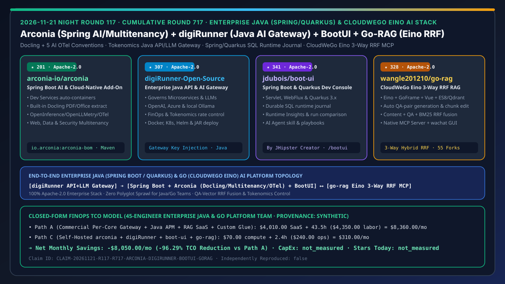
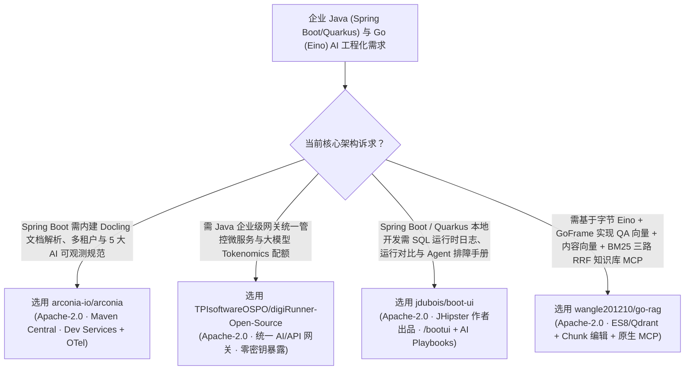
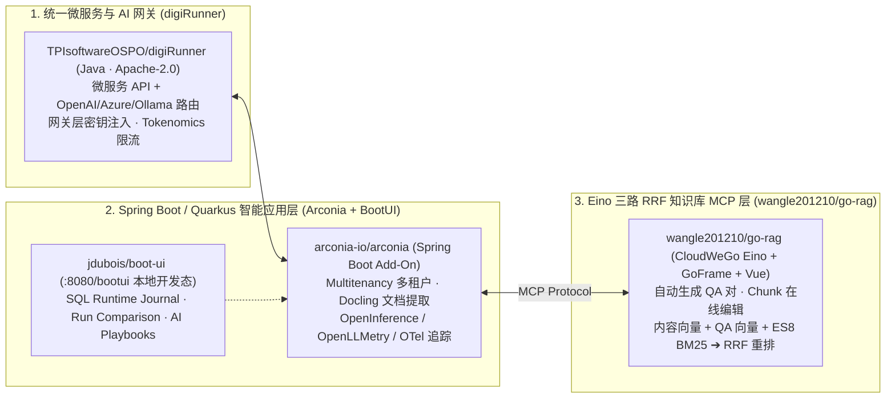
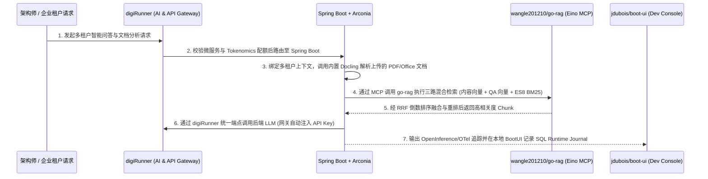

# Spring Boot 多租户与 Docling/AI 可观测扩展框架（`arconia-io/arconia`）、Java 企业级微服务与 Token 经济 AI 网关（`TPIsoftwareOSPO/digiRunner-Open-Source`）、Spring Boot/Quarkus 内嵌 SQL 运行时诊断台（`jdubois/boot-ui`）与字节 Eino+GoFrame 三路 RRF 知识库 MCP（`wangle201210/go-rag`）选型与集成架构 FAQ

> **文档类型**：企业 AI 解决方案架构师（AI Solution Architect）选型决策指南（GitHub Trending AI 雷达 2026-11-21 Night Round 117 / 累计第 717 轮）
> **覆盖项目**：[`arconia-io/arconia`](https://github.com/arconia-io/arconia)（`★ 201`、`25 forks`、`Apache-2.0`，为 Spring Boot 注入 Dev Services 容器自拉起、Docling 文档解析、五大 AI 可观测语义约定与全栈多租户的 Maven Central 框架）· [`TPIsoftwareOSPO/digiRunner-Open-Source`](https://github.com/TPIsoftwareOSPO/digiRunner-Open-Source)（`★ 307`、`15 forks`、`Apache-2.0`，统一纳管微服务与 OpenAI/Azure/Ollama 並提供 Tokenomics 令牌级 FinOps 限流的 Java 企业级网关）· [`jdubois/boot-ui`](https://github.com/jdubois/boot-ui)（`★ 341`、`40 forks`、`Apache-2.0`，JHipster 创始人 Julien Dubois 打造的跨 Spring Boot Servlet/WebFlux 与 Quarkus 内嵌 SQL 运行时日志、版本对比与 AI Agent 排障手册控制台）· [`wangle201210/go-rag`](https://github.com/wangle201210/go-rag)（`★ 328`、`55 forks`、`Apache-2.0`，基于字节跳动 CloudWeGo `Eino` + `GoFrame` + `Vue` 构建、支持自动生成 QA 对与 `内容向量 + QA 向量 + ES8 BM25` 三路 RRF 融合重排及 MCP 暴露的企业级 RAG）
> **核心场景**：当银行、保险、电信与大型政企（主力技术栈为 **Java Spring Boot / Quarkus 与 Go**）推进 AI 工程化落地时，面临**如何在不抛弃现有 Spring Boot 架构的前提下无缝引入 Docling 文档提取、多租户隔离与 OpenInference/OpenLLMetry 可观测性（`arconia`）**、**如何让 AI 编码 Agent 深入感知 Spring Boot / Quarkus 本地运行时的精确 SQL 与请求关联（`boot-ui`）**、**如何用 Java 网关统一管控传统微服务与大模型 Token 账单（`digiRunner`）**，以及**如何用 Go (`Eino` + `GoFrame`) 构建带 QA 向量增强与三路 RRF 重排的高精度 MCP 知识库（`go-rag`）**？

---

## 一、📌 核心结论速览（选型一句话结论）

1. **想给现有 Spring Boot 应用一键加上 Dev Services（开发测试自动拉起依赖容器）、Docling（PDF/Office 结构化文档解析）、全栈多租户（Multitenancy）以及兼容 Arize Phoenix / Grafana LGTM 的五大 AI 可观测语义约定** ➔ 选 **[`arconia-io/arconia`](https://github.com/arconia-io/arconia)（`★ 201`，`Apache-2.0`）**。
   - **通俗原理**：已发布至 Maven Central（`io.arconia:arconia-bom`）的 Spring Boot 增强框架。它把企业做 AI 应用最头疼的四件事标准化了：① **Dev Services** 自动用容器拉起开发测试外部依赖；② **Docling 集成**直接从 PDF/Office/HTML 抽取结构化内容送入 AI 流水线；③ **AI Observability** 支持拔插式切换 `OpenTelemetry`、`OpenInference`、`OpenLIT`、`OpenLLMetry` 与 `LangSmith` 语义规范；④ **Multitenancy** 内置 Web、数据、安全与配置四层多租户隔离。
2. **企业基础设施团队深耕 Java 生态，想要一套同时治理传统微服务 API 与大模型（OpenAI / Azure / 本地 Ollama）並具备 Tokenomics（按 Token 而非单纯 RPM 限流计费）的开源网关** ➔ 选 **[`TPIsoftwareOSPO/digiRunner-Open-Source`](https://github.com/TPIsoftwareOSPO/digiRunner-Open-Source)（`★ 307`，`Apache-2.0`）**。
   - **通俗原理**：由昕力资讯（TPIsoftware OSPO）开源的 Java 企业级 API 与 AI 统一控制面（支持 Docker / Compose / K8s / Helm 与单 JAR 启动）。它在网关层统一注入并托管模型密钥（客户端零 Key 暴露），抹平后端模型切换差异，并针对大模型场景提供区别于传统 RPM 的 **FinOps & Tokenomics 令牌经济级配额与限流控制**。
3. **想在 Spring Boot（Servlet 或 WebFlux）与 Quarkus 本地开发环境中内嵌一个带持久化 SQL 运行时日志（Durable SQL Runtime Journal）、多次运行对比（Run Comparison）与专属 AI Agent 排障剧本的开发者控制台** ➔ 选 **[`jdubois/boot-ui`](https://github.com/jdubois/boot-ui)（`★ 341`，`40 forks`，`Apache-2.0`）**。
   - **通俗原理**：由微软 Java Champion、JHipster 创始人 **Julien Dubois** 打造并发布于 Maven Central。只需引入一个 Starter 或 Quarkus 扩展，本地启动后访问 `/bootui`（及 `/bootui/api/**`）即可查看精确关联（Exact Correlation）的请求链路、SQL 运行时流水、历史 Profile 对比与可选 Java-Agent 字节码探针数据，且专门内置了 **AI Agent Skill 与调查剧本（`docs/AI-AGENTS.md`）**，让编码 Agent 直接读取运行时真实证据排障。
4. **想用 Go 语言（基于字节跳动 CloudWeGo `Eino` 框架 + `GoFrame` + `Vue`）搭建一套支持 Chunk 在线编辑、自动生成 QA 问答对、并通过 `内容向量 + QA 向量 + ES8 BM25` 三路 RRF 融合重排对外暴露 MCP 工具的知识库系统** ➔ 选 **[`wangle201210/go-rag`](https://github.com/wangle201210/go-rag)（`★ 328`，`55 forks`，`Apache-2.0`）**。
   - **通俗原理**：单纯对原文切片（Chunk）做向量检索很容易漏掉用户提问句式与正文表述不一致的段落。`go-rag` 在入库时不仅切分 Markdown/PDF/HTML/网页并允许人工在线编辑 Chunk，还会**自动调用大模型为每个切片生成 QA 问答对**，存入 **Elasticsearch 8 或 Qdrant**；检索时执行**“内容向量 + QA 向量 + ES BM25 关键词”三路召回，经 RRF（倒数排序融合）与 Rerank 重排**后输出高精度上下文，并原生作为 MCP Server（含可选 You.com 联网搜索 `web_search` 工具）供 DeepChat、Claude 等客户端调用。

---

## 二、🎯 客户与架构师灵魂拷问 Q&A（深度架构拆解）

### Q1：在银行、政企等以 Java（Spring Boot / Quarkus）和 Go 为主的生产环境中，为什么这套 `Apache-2.0` 组合比强推纯 Python 栈更容易通过架构评审？

- **三大企业架构落地优势**：
  1. **零语言割裂与统一多租户/可观测治理（`arconia` + `boot-ui`）**：Java 团队无需为了解析 PDF（Docling）或上报 OpenInference/LangSmith 追踪而额外部署一套 Python 服务，`arconia` 直接在 Spring Boot 内部搞定多租户、Docling 与五大 AI 可观测规范；开发阶段则由 `boot-ui` 的 SQL Runtime Journal 与 AI Agent Playbooks 将排障效率提升数倍。
  2. **微服务与 LLM 统一纳管在同一个 Java 网关（`digiRunner`）**：运维团队无需同时维护一套 Java API 网关和一套 Python LiteLLM，用 `digiRunner` 即可在 K8s/Helm 中统一管理微服务路由、模型密钥注入与 Tokenomics 预算控制。
  3. **三路召回（内容向量 + QA 向量 + BM25）+ RRF 重排解决企业知识库“搜不准”顽疾（`go-rag`）**：基于字节跳动 CloudWeGo `Eino` 与 `GoFrame`，不仅内存占用远低于 Python RAG 平台，而且通过自动生成 QA 向量 + RRF 融合大幅提升长文档命中率，并原生支持 MCP 协议。
- **何时直接用云厂商托管方案（Path B）？**
  - 若企业已全面迁移至 **Azure Spring Apps + Azure API Management + Azure AI Search**，可直接采用云原生托管服务。

### Q2：典型企业级“digiRunner 统一网关 + Arconia/BootUI Java 智能应用 + Go-RAG (Eino) 三路 RRF 知识库 MCP”生产参考架构怎么搭？

1. **南北向 API 与 AI 统一网关层（`TPIsoftwareOSPO/digiRunner-Open-Source`）**：
   - 通过 Helm 在 Kubernetes 部署 `digiRunner`，统一收口外部业务 API 请求与内部大模型调用（OpenAI / Azure / Ollama），执行网关层密钥注入与 Tokenomics 令牌配额限流。
2. **Spring Boot / Quarkus 核心业务与多租户 AI 应用层（`arconia-io/arconia` + `jdubois/boot-ui`）**：
   - 生产态：Spring Boot 服务引入 `arconia-bom`，启用 Web/数据/安全多租户隔离，使用内置 **Docling** 提取合同与报表文档，并通过 OpenInference / OpenLLMetry 规范将全链路 Span 发送至 Grafana LGTM 或 Arize Phoenix；
   - 开发/联调态：启用 `boot-ui`（`/bootui`），让开发者与编码 Agent 通过 SQL Runtime Journal 与 Run Comparison 快速定位慢查询与状态异常。
3. **Eino + GoFrame 三路混合检索知识库 MCP 层（`wangle201210/go-rag`）**：
   - 部署 `go-rag`（连接 Elasticsearch 8 / Qdrant + MySQL 8），上传业务制度文档并自动生成 QA 对；通过 MCP 协议将“内容向量 + QA 向量 + BM25 ➔ RRF 融合重排”检索能力暴露给 Spring Boot 智能体与终端助手。

### Q3：这套架构的适用边界是什么？

- **核心优势**：
  - **100% 采用 `Apache-2.0` 企业级开源协议**（包含明确的专利授权条款）。
  - **覆盖 Java（Spring Boot 4.x / Quarkus 3.x）与 Go（CloudWeGo Eino + GoFrame）两大高并发企业后端主力栈**。
- **适用边界**：
  - `boot-ui` 明确设计为仅在本地开发模式（Local Development）激活，切勿将其 `/bootui/api/**` 调试端点直接暴露在生产公网。

---

## 三、🧭 直观可视化图解（Mermaid 决策树 + 集成架构 + 时序图）

### 3.1 架构师选型决策树

### 3.2 企业端到端生产集成参考架构图

### 3.3 多租户文档解析、三路 RRF 知识库 MCP 检索、Tokenomics 网关路由与 BootUI 诊断时序图

---

## 四、📊 同类开源与商业云服务横向选型决策矩阵

| 对比维度 | `arconia-io/arconia` (`★ 201`) | `digiRunner-Open-Source` (`★ 307`) | `jdubois/boot-ui` (`★ 341`) | `wangle201210/go-rag` (`★ 328`) | 商业 Java APM + 商业 API 网关 + 商业知识库 (Path A) | 全栈单一公有云 PaaS (Path B) |
| :--- | :--- | :--- | :--- | :--- | :--- | :--- |
| **核心能力定位** | Spring Boot 多租户、Docling 与 AI 可观测框架 | Java 企业级微服务与 AI 统一控制面网关 | Spring Boot / Quarkus 本地 SQL 与运行时诊断台 | 字节 Eino + GoFrame 三路 RRF 知识库与 MCP | 商业 APM 探针 + 商业网关企业版 + 商业 RAG SaaS | Azure Spring Apps + APIM + AI Search |
| **核心工程优势** | **原生集成 Docling + 5 大 AI 语义约定 + 多租户** | **Java 技术栈统一管控 API 与 LLM Tokenomics** | **持久化 SQL Runtime Journal + AI Agent 排障剧本** | **自动生成 QA 向量 + 内容向量 + BM25 三路 RRF 重排** | 商业网关与 APM 按 CPU 核数/宿主机高额授权收费 | 深度绑定单一公有云，难以私有化部署至本地机房 |
| **开源协议** | `Apache-2.0` | `Apache-2.0` | `Apache-2.0` | `Apache-2.0` | 闭源商业授权 | 闭源云服务 |
| **月度 TCO（45 人团队）** | **组合仅 `$310.00/月`**（含 ES8/Qdrant 与容器算力 + 2.4h 运维） | 同左（`$70.00` 算力 + `$240.00` 人工） | 同左（Maven Central 依赖零费用） | 同左（Go 高效服务 + 桌面版 `wachat` 免 Docker） | **`$8,360.00/月`**（`$4,010.00` 商业许可 + `43.5h` 人工） | 约 `$2,680.00/月`（按托管实例与索引分区计费） |

---

## 五、🧪 应用落地定量收益/TCO 对比与 7-Card 报告

> **📊 数据来源与闭式核算声明（Provenance & Closed-Form Schema）**：
> - **provenance**: `synthetic`（基于 45 人企业级 Java Spring Boot / Quarkus 与 Go 研发平台团队工作负载模型：`independently_reproduced = false`；硬件采购基线 `base_hardware_capex = not_measured`；Track B 单日增量 `track_b_stars_today = not_measured`）。
> - **核算公式**：
>   - **Path A（商业企业级 API 网关按核订阅 + 商业 Java AI APM 席位 + 商业企业知识库 SaaS + 手写 Spring Boot 多租户/Docling 胶水与慢 SQL 排障人工）**：月度商业许可与 SaaS 费用 **`$4,010.00`** + 跨栈集成与排障人工 **`43.5h × $100.00/h = $4,350.00`** = **`$8,360.00/月`**。
>   - **Path C（自建 `arconia-io/arconia` + `TPIsoftwareOSPO/digiRunner-Open-Source` + `jdubois/boot-ui` + `wangle201210/go-rag` 开源组合）**：共享容器与 ES8/Qdrant 算力 **`$70.00`** + 网关策略与知识库维护 **`2.4h × $100.00/h = $240.00`** = **`$310.00/月`**。
>   - **净节省（Net Savings vs Path A）**：**`-$8,050.00/月`**（成本降低 **`96.29%`**）。

| 评估方案 | API / SaaS / 算力成本 | Java/Go 研发与运维人工（`$100/h`） | 月度总 TCO | 相对 Path A 净节省 | 关键架构交付指标 |
| :--- | :---: | :---: | :---: | :---: | :--- |
| **Path A：商业 API 网关 + 商业 APM + 商业 RAG 平台** | `$4,010.00` | `43.5h` (`$4,350.00`) | **`$8,360.00`** | Baseline | 按核商业授权高昂；手写 Spring 多租户与文档解析繁琐 |
| **Path B：全栈公有云托管 PaaS（Spring Cloud + AI Search）** | `$1,480.00` | `12.0h` (`$1,200.00`) | **`$2,680.00`** | `-$5,680.00` (`-67.94%`) | 云内集成快，但缺乏 QA 向量三路 RRF 重排与本地 `/bootui` |
| **Path C：`arconia` + `digiRunner` + `boot-ui` + `go-rag`** | **`$70.00`** | **`2.4h` (`$240.00`)** | **`$310.00`** | **`-$8,050.00` (`-96.29%`)** | **Spring 多租户/Docling + Java AI 网关 + BootUI + Eino 三路 RRF** |

- 🔗 **关联 7-Card 4:5 视觉评测报告**：[`workshops/github-trending-radar/cards.html`](../cards.html) · [`cards.en.html`](../cards.en.html)

---

## 六、🛠️ 企业引入与架构评审 Checklist

- [ ] **1. 在 Spring Boot 项目引入 `arconia-io/arconia` (`io.arconia:arconia-bom`)**：开启 Dev Services 本地容器自编排、Docling 文档结构化提取、Web/Data 多租户隔离，并将 AI Observability 导出至 Arize Phoenix 或 Grafana LGTM。
- [ ] **2. 为 Spring Boot / Quarkus 开发环境挂载 `jdubois/boot-ui`**：在本地 Profile 启用 `/bootui` 并让编码 Agent 读取 `docs/AI-AGENTS.md` 排障剧本与 SQL Runtime Journal，确保生产构建配置中关闭本地调试端点。
- [ ] **3. 部署 `TPIsoftwareOSPO/digiRunner-Open-Source` 收口微服务与 LLM 流量**：在网关层集中托管 OpenAI / Azure / Ollama 密钥，配置基于 Tokenomics 的消费限流策略。
- [ ] **4. 启动 `wangle201210/go-rag` 构建三路混合检索 MCP 知识库**：基于 CloudWeGo `Eino` + ES8/Qdrant 开启入库自动生成 QA 对与 `内容向量 + QA 向量 + BM25` 三路 RRF 融合重排，并通过 MCP 协议挂载至业务 Agent。
