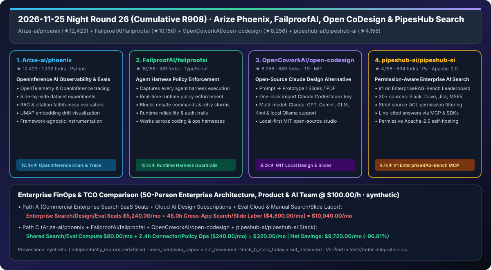
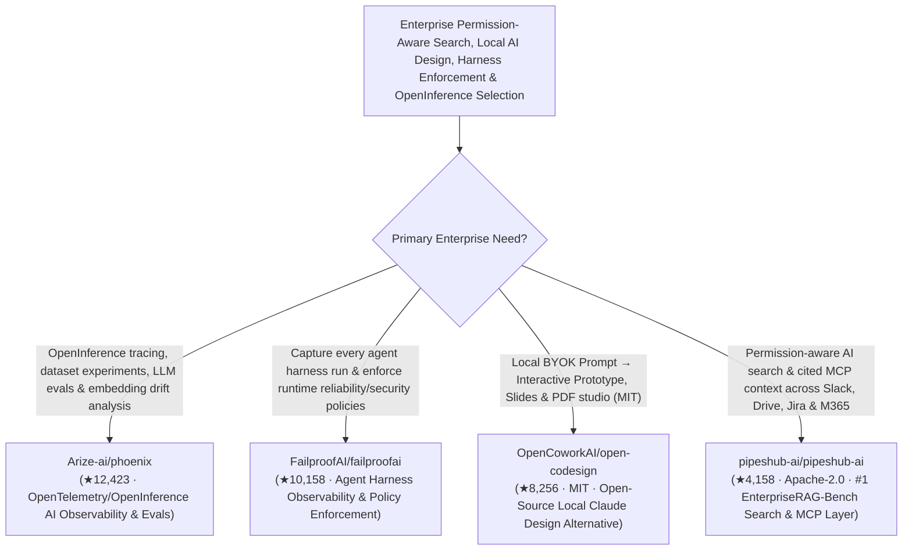
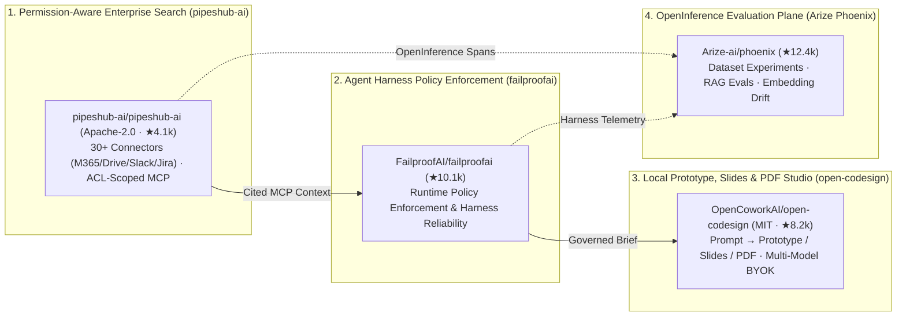
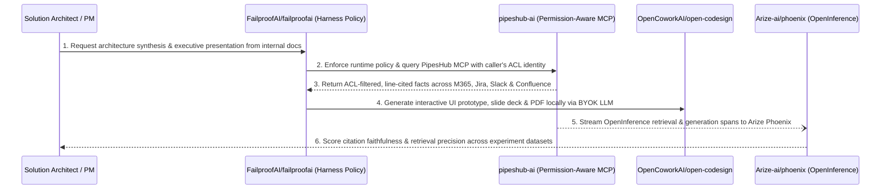

# OpenInference AI Observability & Evaluation (`Arize-ai/phoenix`), Agent Harness Policy Enforcement (`FailproofAI/failproofai`), Local-First Prompt-to-Prototype/Slides Studio (`OpenCoworkAI/open-codesign`) & Permission-Aware Enterprise AI Search (`pipeshub-ai/pipeshub-ai`) Selection & Integration Architecture FAQ

> **Document Type**: Enterprise AI Solution Architect Selection Decision Guide (GitHub Trending AI Radar — 2026-11-25 Night Round 26 / Cumulative Round 908)
> **Covered Repositories**: [`Arize-ai/phoenix`](https://github.com/Arize-ai/phoenix) (`★ 12,423`, `1,339 forks`, Python: open-source AI observability, OpenInference tracing, dataset experimentation, and LLM evaluation platform) · [`FailproofAI/failproofai`](https://github.com/FailproofAI/failproofai) (`★ 10,158`, `581 forks`, TypeScript: observability and runtime policy enforcement for AI agent harnesses) · [`OpenCoworkAI/open-codesign`](https://github.com/OpenCoworkAI/open-codesign) (`★ 8,256`, `880 forks`, `MIT`, TypeScript: open-source local-first Claude Design alternative with BYOK support across Claude, GPT, Gemini, Kimi, GLM, and Ollama to turn prompts into interactive prototypes, slides, and PDFs) · [`pipeshub-ai/pipeshub-ai`](https://github.com/pipeshub-ai/pipeshub-ai) (`★ 4,158`, `694 forks`, `Apache-2.0`, Python: `#1` ranked system on EnterpriseRAG-Bench providing permission-aware enterprise AI search and MCP context across 30+ sources including Slack, Google Drive, Jira, Confluence, GitHub, and Microsoft 365)
> **Core Enterprise Scenario**: Building an **Open-Source Enterprise Knowledge Search (Glean Alternative), Artifact Design & Agent Governance Stack**—uniting permission-aware search across 30+ enterprise apps (`pipeshub-ai`), local BYOK prompt-to-prototype/slides/PDF generation (`open-codesign`), runtime agent harness policy enforcement (`failproofai`), and OpenInference evaluation & drift diagnostics (`phoenix`).

---

## 1. 📌 Executive Summary (One-Line Selection Verdict)

1. **Need an `Apache-2.0` self-hostable enterprise AI search and MCP context layer (open-source Glean alternative) that connects Slack, Google Drive, Jira, Confluence, GitHub, and Microsoft 365 with strict source-ACL permission enforcement and line-level citations** ➔ Choose **[`pipeshub-ai/pipeshub-ai`](https://github.com/pipeshub-ai/pipeshub-ai) (`★ 4,158`, `694 forks`, `Apache-2.0`, `#1` on EnterpriseRAG-Bench)**.
   - **Plain-English Mechanism**: Synchronizes documents and access-control lists (ACLs) across 30+ SaaS apps so both employees and MCP-connected agents retrieve only authorized records with verifiable citations.
2. **Need an `MIT`-licensed, local-first alternative to Claude Design that uses your existing Claude Code, Codex, Gemini, Kimi, GLM, or Ollama keys to turn prompts into interactive UI prototypes, presentation slides, and PDFs** ➔ Choose **[`OpenCoworkAI/open-codesign`](https://github.com/OpenCoworkAI/open-codesign) (`★ 8,256`, `880 forks`, `MIT`)**.
   - **Plain-English Mechanism**: Runs locally on developer and architect laptops with multi-model BYOK support, transforming grounded product/architecture notes into interactive prototypes and polished slide decks without cloud lock-in.
3. **Need runtime observability and deterministic policy enforcement across autonomous AI agent harnesses to capture every run and block unsafe tool invocations** ➔ Choose **[`FailproofAI/failproofai`](https://github.com/FailproofAI/failproofai) (`★ 10,158`, `581 forks`)**.
   - **Plain-English Mechanism**: Wraps agent harnesses with runtime telemetry and policy guardrails so unauthorized commands, runaway retries, and policy violations are intercepted before execution.
4. **Need an OpenTelemetry and OpenInference-based platform for LLM tracing, dataset experiments, RAG evaluations, and embedding drift visualization** ➔ Choose **[`Arize-ai/phoenix`](https://github.com/Arize-ai/phoenix) (`★ 12,423`, `1,339 forks`)**.
   - **Plain-English Mechanism**: Provides vendor-neutral OpenInference instrumentation, side-by-side prompt/RAG experiment tracking, and UMAP embedding cluster diagnostics.

---

## 2. 🎯 Architect & Customer Deep-Dive Q&A

### Q1: How does this four-project stack replace high-cost enterprise search SaaS (e.g., Glean), proprietary AI design seats, and commercial observability clouds?

- **Four-Layer Enterprise Search, Design & Governance Architecture (Path C)**:
  1. **L1 Permission-Aware Enterprise Search & MCP Layer ➔ `pipeshub-ai/pipeshub-ai`**: Indexes 30+ workplace apps with strict ACL inheritance and cited answers.
  2. **L2 Runtime Agent Harness Policy Enforcement ➔ `FailproofAI/failproofai`**: Monitors agent runs and enforces security/reliability policies in real time.
  3. **L3 Local Multi-Model Prototype, Slides & PDF Studio ➔ `OpenCoworkAI/open-codesign`**: Generates interactive prototypes, slide decks, and PDFs locally using BYOK models.
  4. **L4 OpenInference Experimentation & Evaluation Plane ➔ `Arize-ai/phoenix`**: Evaluates retrieval precision, citation faithfulness, and embedding drift.
- **When to choose Commercial SaaS (Glean + Cloud Design/Eval SaaS) vs. Path C?**
  - Choose **Commercial SaaS** when a large enterprise has budget for annual six-figure enterprise search contracts and no local data-residency requirements.
  - Choose **Path C** when deploying self-hosted `Apache-2.0` permission-aware search (`pipeshub-ai`), generating prototypes/slides locally under an `MIT` license (`open-codesign`), and enforcing runtime agent policies (`failproofai`) + OpenInference evaluations (`phoenix`) at **96%+ lower monthly TCO**.

### Q2: How do these four tools integrate in daily enterprise workflows?

1. **Permission-Scoped Search to Local Slide/Prototype Generation (`pipeshub-ai` → `open-codesign`)**:
   - An architect queries `pipeshub-ai` via MCP to gather cited requirements across Jira, Confluence, Slack, and SharePoint, then feeds the grounded brief into `open-codesign` to produce an interactive prototype and executive slide deck locally.
2. **Runtime Enforcement + Continuous RAG Evaluation (`failproofai` + `phoenix`)**:
   - `failproofai` enforces tool-use policies on the agent harness while `Arize Phoenix` ingests OpenInference spans to score citation grounding and retrieval relevance.

### Q3: What are the key security and compliance guardrails?

- **Architect Redlines**:
  1. **Enforce strict user-level ACLs in `pipeshub-ai`**: Never flatten permissions across Slack channels, Google Drive folders, or SharePoint sites when exposing search via MCP.
  2. **Configure deny-by-default rules in `failproofai` for destructive agent commands**: Block unapproved shell commands, credential reads, and external network mutations at runtime.

---

## 3. 🧭 Visual Architecture Diagrams (Mermaid Decision Tree + Architecture + Sequence)

### 3.1 Architect Selection Decision Tree

### 3.2 End-to-End Enterprise Integration Architecture

### 3.3 End-to-End Execution Sequence

---

## 4. 📊 Horizontal Selection Matrix

| Dimension | `Arize-ai/phoenix` (`★ 12,423`) | `FailproofAI/failproofai` (`★ 10,158`) | `OpenCoworkAI/open-codesign` (`★ 8,256`) | `pipeshub-ai/pipeshub-ai` (`★ 4,158`) | Commercial Enterprise Search (Glean) + Cloud AI Design Seats + Eval Cloud (Path A) | Manual Search Across 10+ Apps + Manual Slide Decks (Path B) |
| :--- | :--- | :--- | :--- | :--- | :--- | :--- |
| **Primary Role** | OpenInference AI tracing, experiments & evals | Agent harness runtime policy enforcement | `MIT` local prompt-to-prototype/slides/PDF app | `Apache-2.0` permission-aware enterprise AI search | Per-seat commercial enterprise search & design SaaS | Manual multi-app search & manual slide formatting |
| **Key Differentiator** | **OpenInference standard + dataset experiments + embedding drift** | **Real-time runtime policy enforcement for agent harnesses** | **Local BYOK multi-model studio for prototypes, slides & PDFs** | **`#1` on EnterpriseRAG-Bench + 30+ ACL-synced connectors & MCP** | Turnkey SaaS, but steep annual seat minimums & cloud data exposure | Hours lost hunting across Slack/Jira/Drive; unguarded agent runs |
| **License** | Open-Source Self-Hostable | Open-Source Self-Hostable | **`MIT`** | **`Apache-2.0`** | Proprietary SaaS | Unstandardized |
| **Monthly TCO (50-Eng Team)** | **`$320.00/mo` combined** (`$80.00` search/eval compute + `2.4h` ops) | Included in `$320.00/mo` stack | Included in `$320.00/mo` stack | Included in `$320.00/mo` stack | **`$10,040.00/mo`** (`$5,240.00` enterprise search/design/eval SaaS seats + `48.0h` manual search & slide creation) | `~$3,700.00/mo` (manual cross-app document hunting & manual slide building) |

---

## 5. 🧪 Quantitative FinOps & TCO Comparison (50-Person Enterprise Architecture, Product & AI Team)

> **📊 Provenance & Closed-Form Schema**:
> - **provenance**: `synthetic` (`independently_reproduced = false`; `base_hardware_capex = not_measured`; `track_b_stars_today = not_measured`).
> - **Closed-Form Formula**:
>   - **Path A (Commercial Enterprise Search SaaS Seats + Cloud AI Design Subscriptions + Commercial Observability Cloud & Manual Cross-App Search/Slide Labor)**: **`$5,240.00`** monthly enterprise search, design, and observability SaaS fees + **`48.0h × $100.00/h = $4,800.00`** cross-app document gathering and manual presentation/prototype labor = **`$10,040.00/mo`**.
>   - **Path C (`Arize-ai/phoenix` + `FailproofAI/failproofai` + `OpenCoworkAI/open-codesign` + `pipeshub-ai/pipeshub-ai` Stack)**: **`$80.00`** shared `PipesHub` and `Phoenix` container compute + **`2.4h × $100.00/h = $240.00`** connector and policy maintenance = **`$320.00/mo`**.
>   - **Net Savings vs. Path A**: **`-$9,720.00/mo`** (**`96.81%`** TCO reduction).

| Evaluation Path | Enterprise Search / Design Seats / Eval Cloud & Compute | Cross-App Search, Slide Design & Governance (`$100/h`) | Monthly Total TCO | Net Savings vs. Path A | Key Architectural Outcome |
| :--- | :---: | :---: | :---: | :---: | :--- |
| **Path A: Commercial Enterprise Search SaaS + Cloud Design Seats + Eval Cloud** | `$5,240.00` | `48.0h` (`$4,800.00`) | **`$10,040.00`** | Baseline | High per-seat minimums; internal docs & designs uploaded to external clouds |
| **Path B: Manual Multi-App Hunting + Manual Prototype/Slide Creation** | `$1,500.00` | `22.0h` (`$2,200.00`) | **`$3,700.00`** | `-$6,340.00` (`-63.15%`) | Fragmented knowledge silos; zero runtime agent policy enforcement |
| **Path C: `phoenix` + `failproofai` + `open-codesign` + `pipeshub`** | **`$80.00`** | **`2.4h` (`$240.00`)** | **`$320.00`** | **`-$9,720.00` (`-96.81%`)** | **`Apache-2.0` ACL search + `MIT` local design studio + harness guardrails + evals** |

- 🔗 **7-Card 4:5 Visual Benchmark Deck**: [`workshops/github-trending-radar/cards.en.html`](../cards.en.html) · [`cards.html`](../cards.html)

---

## 6. 🛠️ Enterprise Adoption & Architecture Review Checklist

- [ ] **Sync Source ACLs in `pipeshub-ai/pipeshub-ai`**: Enforce user-level permissions across Microsoft 365, Google Drive, Slack, Jira, and Confluence for all human and MCP queries.
- [ ] **Deploy `OpenCoworkAI/open-codesign` Locally with Internal API Keys**: Generate interactive prototypes, slide decks, and PDFs without uploading confidential briefs to third-party design clouds.
- [ ] **Enforce Runtime Harness Policies with `FailproofAI/failproofai`**: Capture every agent execution and block unauthorized commands or infinite retry loops.
- [ ] **Standardize OpenInference Tracing & Experiments in `Arize Phoenix`**: Evaluate retrieval precision and citation faithfulness before rolling out index or model updates.
