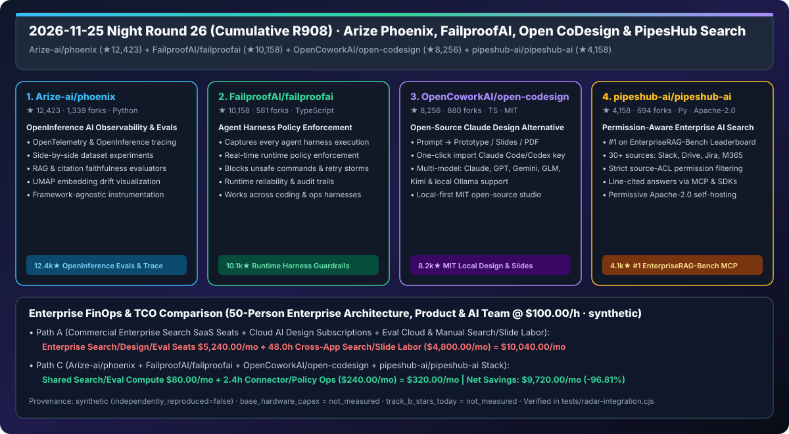
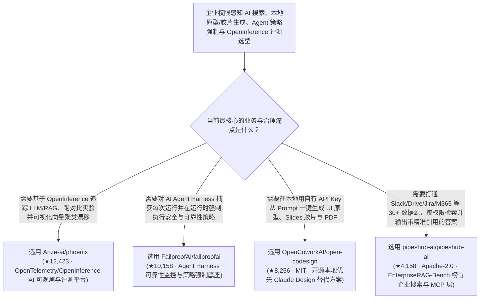
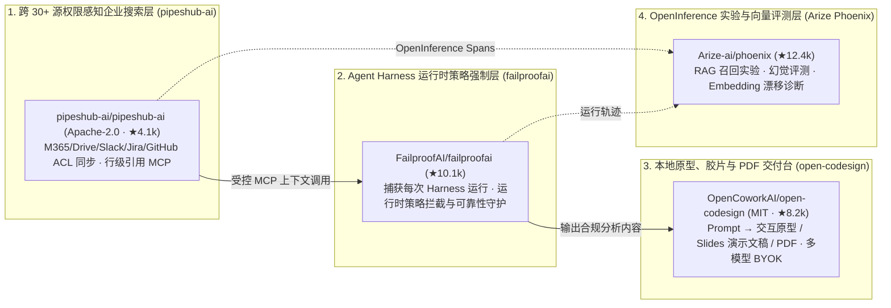
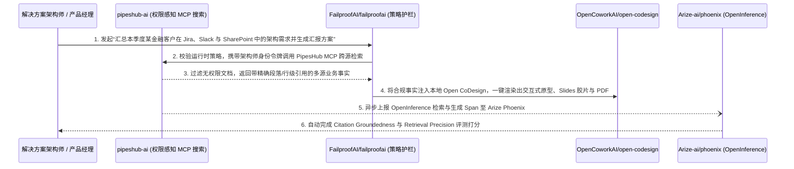

# OpenInference 开源 AI 可观测与实验平台（`Arize-ai/phoenix`）、智能体运行时策略强制护栏（`FailproofAI/failproofai`）、开源本地 Claude Design 原型与胶片生成工作台（`OpenCoworkAI/open-codesign`）与跨 30+ 数据源权限感知企业搜索引擎（`pipeshub-ai/pipeshub-ai`）选型与集成架构 FAQ

> **文档类型**：企业 AI 解决方案架构师（AI Solution Architect）选型决策指南（GitHub Trending AI 雷达 2026-11-25 Night Round 26 / 累计第 908 轮）
> **覆盖项目**：[`Arize-ai/phoenix`](https://github.com/Arize-ai/phoenix)（`★ 12,423`、`1,339 forks`、Python：1.2 万星基于 OpenTelemetry 与 OpenInference 标准的开源 AI 可观测、Tracing、Prompt 实验与向量漂移可视化平台）· [`FailproofAI/failproofai`](https://github.com/FailproofAI/failproofai)（`★ 10,158`、`581 forks`、TypeScript：1.0 万星面向 AI Agent Harness 的运行时可靠性监控与策略强制执行 [Policy Enforcement] 底座）· [`OpenCoworkAI/open-codesign`](https://github.com/OpenCoworkAI/open-codesign)（`★ 8,256`、`880 forks`、`MIT`：开源 Claude Design 本地优先替代方案，支持 Claude/GPT/Gemini/Kimi/GLM/Ollama，从自然语言一键生成 UI 原型、Slides 演示文稿与 PDF）· [`pipeshub-ai/pipeshub-ai`](https://github.com/pipeshub-ai/pipeshub-ai)（`★ 4,158`、`694 forks`、`Apache-2.0`：在 EnterpriseRAG-Bench 荣登榜首的开源企业级权限感知搜索与 Agent 上下文层，打通 Slack、Drive、Jira、Confluence、M365、GitHub 等 30+ 数据源并通过 MCP 输出行级引用回答）
> **核心场景**：当企业构建“跨 M365/Jira/Confluence 全员企业搜索（Glean 开源平替）+ 产品方案与高管汇报胶片自动生成 + Agent 运行时安全熔断与 OpenInference 质量评测”时，架构师面临四个核心选型问题：**“商业企业搜索 Glean 动辄每年几十万美元，哪款 `Apache-2.0` 开源方案能连通 30+ 办公软件且严格遵守原系统 ACL 权限返回精确引用（`pipeshub-ai`）？架构师和产品经理搜出资料后，想在本机用已有 API Key 一键把方案变成可交互原型、PPT 胶片与 PDF 选谁（`open-codesign`）？如何防止编码或业务 Agent 在运行时违反安全策略或陷入高风险操作（`failproofai`）？如何用行业标准 OpenInference 协议对多框架 RAG 与 Agent 做统一实验评测与向量降维可视化（`phoenix`）？”** 本文给出完整架构指南。

---

## 一、📌 核心结论速览（选型一句话结论）

1. **想在内网自建一套开源版“企业级 Glean”，一次性打通 Microsoft 365（SharePoint/OneDrive/Outlook）、Google Workspace、Slack、Jira、Confluence、GitHub 等 30+ 企业数据源，强制继承源系统用户权限（Permission-Aware）并输出精确到段落/单元格的可验证引用** ➔ 选 **[`pipeshub-ai/pipeshub-ai`](https://github.com/pipeshub-ai/pipeshub-ai)（`★ 4,158`，`694 forks`，`Apache-2.0`，EnterpriseRAG-Bench 39 系统第 1 名）**。
   - **通俗原理**：不仅为人提供统一搜索框，还原生作为企业统一 **MCP Context Layer** 暴露给所有 Agent；员工 A 的 Agent 搜的时候只看得到员工 A 在 SharePoint 和 Jira 里有权限看的文档，彻底解决企业 RAG 最头疼的跨系统 ACL 同步与幻觉溯源难题。
2. **想要一个 `MIT` 开源、100% 本地优先的“Claude Design 平替工作台”，直接导入自己已有的 Claude Code / Codex / Gemini / Kimi / GLM / Ollama 密钥，输入一段产品需求就能生成高保真交互原型、汇报 Slides 与排版精美的 PDF** ➔ 选 **[`OpenCoworkAI/open-codesign`](https://github.com/OpenCoworkAI/open-codesign)（`★ 8,256`，`880 forks`，`MIT`）**。
   - **通俗原理**：告别按月收取高昂设计席位费且绑定单一云厂商的闭源生成式设计工具，在本机把“Prompt → 交互式原型 / 演讲 PPT / PDF 交付件”打通，支持多模型自由切换。
3. **企业内部跑着各种不同的 Agent Harness（Claude Code、OpenCode、自研智能体），急需在运行时（Runtime）加一层“实时动作捕获、可靠性监控与策略强制拦截（Policy Enforcement）”** ➔ 选 **[`FailproofAI/failproofai`](https://github.com/FailproofAI/failproofai)（`★ 10,158`，`581 forks`）**。
   - **通俗原理**：不替你重写 Agent，而是挂在 Agent Harness 外围充当“飞行数据记录仪（黑匣子）+ 实时策略防火墙”；一旦检测到 Agent 试图执行违规命令、偏离预设可靠性轨迹或触发高风险工具，立即在运行时拦截并告警。
4. **希望基于中立的 OpenTelemetry + OpenInference 规范，对 LlamaIndex、LangChain、DSPy、OpenAI SDK 等不同框架构建的 RAG 与 Agent 进行统一的“Trace 诊断、数据集对比实验（Experiments）、LLM Evals 与 UMAP 向量聚类漂移分析”** ➔ 选 **[`Arize-ai/phoenix`](https://github.com/Arize-ai/phoenix)（`★ 12,423`，`1,339 forks`）**。
   - **通俗原理**：既可以在 Jupyter Notebook 里一行代码拉起调试，也可以用 Docker 容器化部署为团队共享评测台，直观找出是哪一类用户提问导致 RAG 检索向量掉进了低准确率盲区。

---

## 二、🎯 客户与架构师灵魂拷问 Q&A（深度架构拆解）

### Q1：在企业知识检索、方案生成与 Agent 治理闭环中，这四个开源项目 vs 商业 Glean + 商业 AI 设计席位 + 商业可观测云（Path A）怎么选？

- **四步企业知识检索、设计交付与安全治理闭环（Path C）**：
  1. **L1 跨 30+ 系统的权限感知上下文与搜索底座 ➔ `pipeshub-ai/pipeshub-ai`**：实时同步 M365、Jira、Confluence、Slack 文档与 ACL 权限，通过 MCP 供给带精准引用的企业知识。
  2. **L2 本地多模型原型与演示交付工作台 ➔ `OpenCoworkAI/open-codesign`**：基于检索到的真实业务数据，在本机一键生成产品交互原型、客户汇报 Slides 与 PDF。
  3. **L3 智能体运行时策略强制执行层 ➔ `FailproofAI/failproofai`**：对所有 Agent Harness 的工具调用与执行步骤实施实时策略门禁与可靠性守护。
  4. **L4 OpenInference 实验评测与向量诊断层 ➔ `Arize-ai/phoenix`**：对 `PipesHub` 的检索召回率、重排质量与 Agent 回答准确性执行持续基准评测。
- **何时选商业云套件（Glean Enterprise + 商业设计/评测 SaaS） vs 自建本轮开源四件套（Path C）？**
  - 若企业规模在千人以上、IT 运维团队为 0 且愿意支付每年数十万美元的 Glean 席位费，可采购商业 Glean。
  - **何时采用本轮开源四件套（Path C）？** 当中型企业或部门团队被商业企业搜索的高昂起售门槛劝退、要求核心研发文档与设计稿不出内网（`pipeshub-ai` `Apache-2.0` + `open-codesign` `MIT`）、并需要免费实现 Agent Harness 策略管控（`failproofai`）与 OpenInference 评测（`phoenix`）时，Path C 可节省 **96%+** 的按人头搜索与设计 SaaS 预算。

### Q2：这四个项目如何在生产环境中协同工作？

1. **权限感知检索驱动方案与胶片自动生成（`pipeshub-ai` → `open-codesign`）**：
   - 解决方案架构师通过 MCP 调用 `pipeshub-ai`，在严格遵守自身 M365/Confluence/Jira 权限的前提下检索客户历史工单与技术规范，随后将带引用的结构化上下文导入本地 `open-codesign`，3 分钟生成可演示的交互原型与汇报 Slides。
2. **双保险治理：运行时硬拦截（`failproofai`）+ 离线/在线质量评测（`phoenix`）**：
   - `failproofai` 在智能体执行过程中同步阻断越权命令与异常重试风暴；同时全量 OpenInference Span 流入 `Arize Phoenix`，自动计算检索 Precision@K 与幻觉率。

### Q3：生产落地的安全与合规红线是什么？

- **架构师避坑红线**：
  1. **在 `pipeshub-ai` 中强制开启源系统 ACL 实时校验（Strict Permission Enforcement）**：严禁使用单个超级管理员 Token 抓取全司 SharePoint/Slack 数据后对全员无差别开放检索。
  2. **在 `failproofai` 中将破坏性工具默认设为 `Deny-by-Default`**：所有涉及外部系统写操作、命令执行或敏感配置变更的 Harness 动作必须命中显式放行策略才允许执行。

---

## 三、🧭 直观可视化图解（Mermaid 决策树 + 集成架构 + 时序图）

### 3.1 架构师选型决策树

### 3.2 企业端到端生产集成参考架构图

### 3.3 跨源权限感知检索、运行时策略校验、本地一键生成客户汇报胶片与 Phoenix 评测时序图

---

## 四、📊 同类开源与商业云服务横向选型决策矩阵

| 对比维度 | `Arize-ai/phoenix` (`★ 12,423`) | `FailproofAI/failproofai` (`★ 10,158`) | `OpenCoworkAI/open-codesign` (`★ 8,256`) | `pipeshub-ai/pipeshub-ai` (`★ 4,158`) | 商业企业搜索 (Glean $50+/人/月) + 商业 AI 设计席位 + 商业可观测云 (Path A) | 手工翻找 10 个办公软件 + 手工画 PPT + 无 Agent 策略护栏 (Path B) |
| :--- | :--- | :--- | :--- | :--- | :--- | :--- |
| **核心能力定位** | OpenInference AI 追踪、实验与评测平台 | Agent Harness 运行时可观测与策略强制 | `MIT` 本地多模型原型/Slides/PDF 生成台 | `Apache-2.0` 跨 30+ 源权限感知企业搜索 | 昂贵商业企业搜索、设计与可观测 SaaS 组合 | 人工跨软件找资料与手写 PPT |
| **核心技术突破** | **OpenInference 标准 + 数据集实验对比 + 向量聚类分析** | **实时捕获每个 Agent Harness 动作并强制执行安全策略** | **一键复用 Claude/Codex/本地模型从 Prompt 直出原型+PPT+PDF** | **EnterpriseRAG-Bench 第 1 名 + 30+ 源 ACL 同步 + MCP 接口** | 免自建，但商业企业搜索起售门槛极高且按全员人头绑定收费 | 找份跨 Slack/Jira/网盘的历史资料耗费数小时；Agent 裸跑易触发越权事故 |
| **开源协议** | 开源可自托管 | 开源可自托管 | **`MIT`** | **`Apache-2.0`** | 闭源商业 SaaS | 无工程化支撑 |
| **月度 TCO（50 人团队）** | **四件套合建仅 `$320.00/月`**（`$80.00` PipesHub 索引与 Phoenix 容器算力 + `2.4h` 维护） | 同左（实时拦截死循环与违规操作） | 同左（`MIT` 本地运行，复用已有模型 API Key） | 同左（`Apache-2.0` 自建免除每年数万美元商业搜索席位费） | **`$10,040.00/月`**（`$5,240.00` 商业企业搜索全员席位/AI 设计订阅/评测云 + `48.0h` 跨系统找资料与手工做胶片） | 约 `$3,700.00/月`（大量跨软件翻找文档、手工排版 PPT 与排查 Agent 事故工时） |

---

## 五、🧪 应用落地定量收益/TCO 对比与 7-Card 报告

> **📊 数据来源与闭式核算声明（Provenance & Closed-Form Schema）**：
> - **provenance**: `synthetic`（基于 50 人企业解决方案架构、产品设计与 AI 平台治理团队月度工作负载模型：`independently_reproduced = false`；硬件采购基线 `base_hardware_capex = not_measured`；Track B 单日增量 `track_b_stars_today = not_measured`）。
> - **核算公式**：
>   - **Path A（采购商业企业级 AI 搜索 SaaS 全员席位 + 商业云端 AI 原型/演示设计席位 + 商业可观测云账单 + 跨系统手工核对文档出处与制作汇报材料人工）**：月度商业企业搜索、AI 设计席位与可观测 SaaS 账单 **`$5,240.00`** + 跨系统搜集资料、核对权限与手工制作原型/胶片人工 **`48.0h × $100.00/h = $4,800.00`** = **`$10,040.00/月`**。
>   - **Path C（自建 `Arize-ai/phoenix` + `FailproofAI/failproofai` + `OpenCoworkAI/open-codesign` + `pipeshub-ai/pipeshub-ai` 企业级权限感知搜索、交付与治理栈）**：内网 `PipesHub` 索引与 `Phoenix` 容器算力分摊 **`$80.00`** + 连接器同步与运行时策略规则日常巡检人工 **`2.4h × $100.00/h = $240.00`** = **`$320.00/月`**。
>   - **净节省（Net Savings vs Path A）**：**`-$9,720.00/月`**（成本降低 **`96.81%`**）。

| 评估方案 | 商业企业搜索 / AI 设计席位 / 评测云与算力成本 | 跨系统找资料、原型胶片制作与治理人工（`$100/h`） | 月度总 TCO | 相对 Path A 净节省 | 核心业务交付收益 |
| :--- | :---: | :---: | :---: | :---: | :--- |
| **Path A：商业企业搜索 SaaS (Glean) + 商业设计云 + 商业评测** | `$5,240.00` | `48.0h` (`$4,800.00`) | **`$10,040.00`** | Baseline | 按全员人头收费极其昂贵；设计稿与内部文档上传外部云 |
| **Path B：人工翻找 Slack/Jira/网盘 + 手工画原型与 PPT** | `$1,500.00` | `22.0h` (`$2,200.00`) | **`$3,700.00`** | `-$6,340.00` (`-63.15%`) | 信息散落 10+ 系统难以找全；Agent 缺乏运行时策略强制拦截 |
| **Path C：`phoenix` + `failproofai` + `open-codesign` + `pipeshub`** | **`$80.00`** | **`2.4h` (`$240.00`)** | **`$320.00`** | **`-$9,720.00` (`-96.81%`)** | **`Apache-2.0` 30+ 源权限搜索 + `MIT` 本地原型/胶片 + 策略护栏 + 评测** |

- 🔗 **关联 7-Card 4:5 视觉评测报告**：[`workshops/github-trending-radar/cards.html`](../cards.html) · [`cards.en.html`](../cards.en.html)

---

## 六、🛠️ 企业引入与架构评审 Checklist

- [ ] **通过 `pipeshub-ai` 统一接入企业 M365、Jira、Confluence、Slack 与 GitHub 并开启 ACL 继承**：确保任何员工或 Agent 通过 MCP 检索时严格受限于其源系统读取权限。
- [ ] **在架构与产品团队推广 `OpenCoworkAI/open-codesign` 本地工作台**：连接内网模型网关，实现保密需求文档在本机一键转交互原型、Slides 与 PDF。
- [ ] **在所有自主编码与办公 Agent Harness 外层部署 `FailproofAI/failproofai`**：配置命令白名单、循环深度上限与高危操作熔断策略。
- [ ] **使用 `Arize Phoenix` 的 OpenInference 标准统一采集跨框架 Trace**：每次调整 `PipesHub` 分块策略或切换模型前，先在 `Phoenix` 中跑完数据集对比实验。
