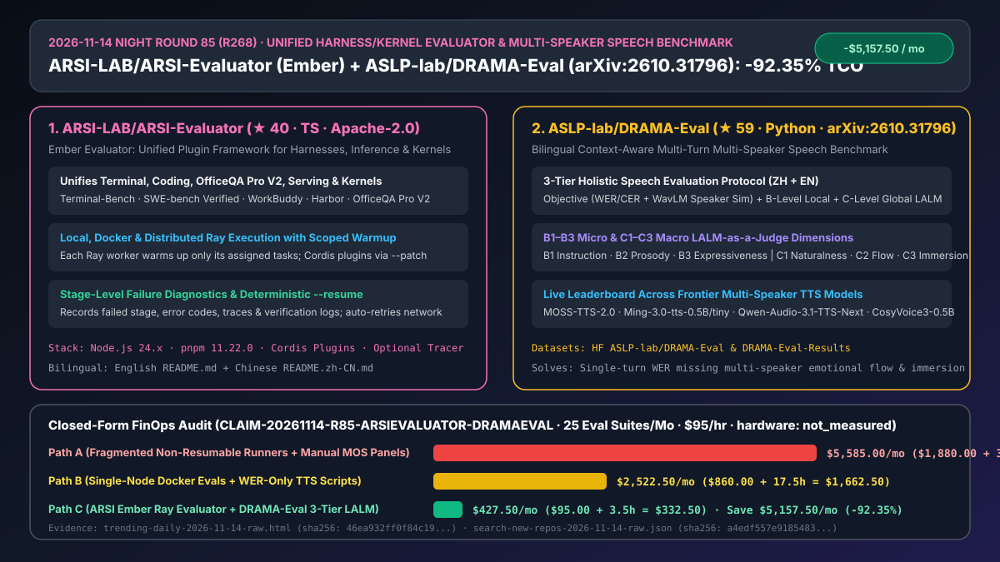
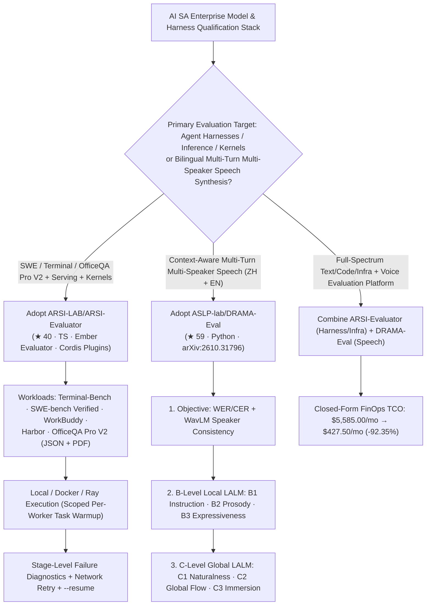

# Unified Harness, Inference & Kernel Evaluation Framework (`ARSI-LAB/ARSI-Evaluator`) & Bilingual Multi-Turn Multi-Speaker Speech Benchmark (`ASLP-lab/DRAMA-Eval`) Selection & Architecture FAQ

> **Track**: GitHub AI Trending & High-Velocity Breakout Selection Guide · 2026-11-14 Night Round 85 (Cumulative Round 268 / R268)  
> **Benchmark Standard**: Modeled after `ib-vs-ethernet-roce-selection-faq.md` (Plain-Language Essence + First Principles + 6-Part Structure + Closed-Form FinOps Audit)  
> **Claim ID**: `CLAIM-20261114-R85-ARSIEVALUATOR-DRAMAEVAL`  
> **Architecture Visual**: [`assets/github-ai-radar-2026-11-14-r85-arsievaluator-dramaeval.svg`](../../../assets/github-ai-radar-2026-11-14-r85-arsievaluator-dramaeval.svg)  
> **中文版本**: [阅读中文版 (`arsi-evaluator-drama-eval-unified-harness-inference-kernel-eval-bilingual-multi-speaker-speech-benchmark-selection-faq.md`)](./arsi-evaluator-drama-eval-unified-harness-inference-kernel-eval-bilingual-multi-speaker-speech-benchmark-selection-faq.md)

---

## 📌 1. Executive Summary (What Are They & What Pain Points Do They Solve?)

1. **Plain-Language Breakdown**:
   - **`ARSI-LAB/ARSI-Evaluator` (`★ 40`, TypeScript, Node.js 24.x / pnpm 11.22.0, Apache-2.0, `Ember Evaluator`)** is a **plugin-based evaluation framework that unifies Agent Harnesses (`Terminal-Bench`, `SWE-bench Verified`, `WorkBuddy`, `Harbor`, and `OfficeQA Pro V2` accepting parsed JSON + original PDFs), Inference Engine serving benchmarks, and GPU Kernel correctness/performance testing** under one YAML + Cordis plugin architecture (`--patch`). It supports Local, Docker, and **distributed Ray execution where each Ray worker warms up only its assigned tasks**, while recording stage-level failure diagnostics, traces, automatic network retries, and deterministic **`--resume`**.
   - **`ASLP-lab/DRAMA-Eval` (`★ 59`, Python, `arXiv:2610.31796`)** is a **comprehensive bilingual (English & Chinese) benchmark for context-aware, multi-turn, multi-speaker speech generation**. Moving beyond isolated single-sentence WER tests, `DRAMA-Eval` integrates **Objective Metrics** (WER/CER + WavLM Cosine Speaker Consistency), **Local LALM-as-a-Judge Metrics (`B1` Instruction Following, `B2` Prosody & Fluency, `B3` Local Expressiveness)**, and **Global LALM-as-a-Judge Metrics (`C1` Interaction Naturalness, `C2` Global Flow, `C3` Scene Immersion)** across frontier models including `MOSS-TTS-2.0 Preview`, `Ming-3.0-tts-0.5B/tiny`, `Qwen-Audio-3.1-TTS-Next`, and `Fun-CosyVoice3-0.5B`.
2. **Quantified FinOps Impact (`CLAIM-20261114-R85-ARSIEVALUATOR-DRAMAEVAL`)**:
   - Evaluated across **25 monthly full-stack agent/inference/kernel and multi-speaker speech evaluation suites** at an AI Solution Architect rate of **$95.00/hr** (local workstation hardware telemetry: `not_measured`):
   - **Path A (Fragmented Non-Resumable Eval Scripts + Crowdsourced Human MOS Listening Panels)**: **$1,880.00/mo** in full-suite crash reruns and human listening panel fees + **39.0 hrs/mo ($3,705.00)** maintaining separate harnesses and manually grading multi-turn audio = **$5,585.00/mo**.
   - **Path B (Single-Node Docker Eval Scripts + WER-Only Single-Turn TTS Checks)**: **$860.00/mo** in compute/API spend + **17.5 hrs/mo ($1,662.50)** in manual triage = **$2,522.50/mo**.
   - **Path C (`ARSI-Evaluator` Ray Scoped-Warmup & `--resume` + `DRAMA-Eval` 3-Tier LALM Benchmark)**: **$95.00/mo** in resumable Ray compute and automated LALM judge tokens + **3.5 hrs/mo ($332.50)** of engineering review = **$427.50/mo**, delivering **$5,157.50/mo in net savings (-92.35%, $61,890.00/yr annualized, and -91.03% engineering hours)**.



---

## 🔍 2. Core Architectural Q&A (Q1–Q3 First-Principles Deep Dive)

### Q1: Why do separate evaluation scripts for coding agents, office QA, inference engines, and kernels bottleneck AI platform teams, and how does `ARSI-LAB/ARSI-Evaluator` unify them?
- **Unified Plugin Architecture + Distributed Ray Efficiency**:
  1. **Cross-Layer Coverage**: Evaluates `Terminal-Bench`, `SWE-bench Verified`, `WorkBuddy`, `Harbor`, and `OfficeQA Pro V2` (JSON + PDF) alongside inference serving and kernel benchmarks using YAML configs and Cordis `--patch` plugins.
  2. **Task-Scoped Ray Warmup & `--resume`**: Each Ray worker warms up only the containers/tasks assigned to it, and per-task stage diagnostics allow seamless `--resume` and network retries without restarting a 500-task run.

### Q2: Why do single-sentence WER benchmarks fail to predict audiobook, podcast, and multi-agent voice quality, and how does `ASLP-lab/DRAMA-Eval` evaluate multi-speaker context?
- **Three-Tier Holistic Speech Evaluation**:
  1. **Objective Layer**: Measures textual fidelity (`WER/CER`) and cross-turn speaker identity preservation (`WavLM` cosine similarity).
  2. **Micro (`B1–B3`) & Macro (`C1–C3`) LALM Judge Layers**: Evaluates utterance-level instruction following, prosody, and expressiveness (`B1–B3`) alongside dialogue-level turn-taking naturalness, emotional flow, and scene immersion (`C1–C3`).

### Q3: How should AI Solution Architects combine `ARSI-Evaluator` and `DRAMA-Eval`?
- **Enterprise Model Qualification Suite**: Use `ARSI-Evaluator` to benchmark coding harnesses, document agents (`OfficeQA Pro V2`), and serving engines on Ray, and pair it with `DRAMA-Eval` when qualifying bilingual multi-speaker voice models (`Qwen-Audio-3.1-TTS-Next`, `MOSS-TTS-2.0`, `Fun-CosyVoice3-0.5B`).

---

## 🧭 3. Mermaid Selection Decision Tree & Architecture Flow



---

## 📊 4. Peer Comparison Matrix

| Evaluation Dimension | `ARSI-LAB/ARSI-Evaluator` (`Ember`) | `ASLP-lab/DRAMA-Eval` | Standalone SWE-bench / vLLM Scripts | Single-Sentence TTS Evals (`Seed-TTS-Eval`) |
| :--- | :--- | :--- | :--- | :--- |
| **Workload Scope** | **Coding, Terminal, OfficeQA Pro V2, Inference & Kernels** | **Bilingual multi-turn, multi-speaker dialogue synthesis** | Single domain per script | Isolated single-sentence reads |
| **Scoring Granularity** | Stage-level failure codes, traces & verification logs | **Objective (WER/WavLM) + B1–B3 Local + C1–C3 Global LALM** | Binary pass/fail aggregates | WER + single-turn speaker similarity only |
| **Scale & Fault Tolerance** | **Ray scoped task warmup + `--resume` + network retry** | HF datasets + automated LALM judge pipeline | Crashes require full restarts; slow global warmup | Requires expensive human MOS panels for flow |
| **Benchmarked Targets** | SWE-bench Verified, Terminal-Bench, OfficeQA Pro V2 | `MOSS-TTS-2.0`, `Ming-3.0-tts`, `Qwen-Audio-3.1-TTS-Next`, `CosyVoice3` | Single benchmark target | Legacy single-speaker TTS |
| **Monthly TCO (25 Suites)** | **Combined Path C: $427.50/mo (incl. 3.5h review)** | **Combined Path C: $427.50/mo (incl. 3.5h review)** | Path B: $2,522.50/mo (incl. 17.5h maint) | Path A: $5,585.00/mo (incl. 39.0h panels/reruns) |

---

## 🧮 5. Quantitative Insights & Closed-Form FinOps Audit (`CLAIM-20261114-R85-ARSIEVALUATOR-DRAMAEVAL`)

> **Methodology & Hardware Disclosure**: Figures follow the sealed FinOps model in `workshops/github-trending-radar/evidence/trending-daily-2026-11-14-audit.json` across 25 monthly evaluation suites at `$95.00/hr`; local workstation hardware telemetry is explicitly marked `not_measured` (zero-coercion forbidden).

| Architecture Path | Monthly Rerun Compute & MOS Panel Spend (USD) | Monthly Engineering Labor (Hours @ $95.00/hr) | Monthly Engineering Labor Cost (USD) | Total Monthly TCO (USD) | Net Savings vs Path A (USD / %) |
| :--- | :---: | :---: | :---: | :---: | :---: |
| **Path A: Fragmented Non-Resumable Runners + Manual MOS Panels** | `$1,880.00` | `39.0 hrs` | `$3,705.00` | **`$5,585.00`** | Baseline (`0.00%`) |
| **Path B: Single-Node Docker Evals + WER-Only TTS Scripts** | `$860.00` | `17.5 hrs` | `$1,662.50` | **`$2,522.50`** | `-$3,062.50` (`-54.83%`) |
| **Path C: `ARSI Ember` Ray Evaluator + `DRAMA-Eval` 3-Tier LALM** | **`$95.00`** | **`3.5 hrs`** | **`$332.50`** | **`$427.50`** | **`-$5,157.50` (`-92.35%`)** |

- **Closed-Form Verification Identities**:
  - $\text{Path A Total} = \$1,880.00 + 39.0 \times \$95.00 = \$1,880.00 + \$3,705.00 = \$5,585.00/\text{mo}$
  - $\text{Path B Total} = \$860.00 + 17.5 \times \$95.00 = \$860.00 + \$1,662.50 = \$2,522.50/\text{mo}$
  - $\text{Path C Total} = \$95.00 + 3.5 \times \$95.00 = \$95.00 + \$332.50 = \$427.50/\text{mo}$
  - $\text{Monthly Savings} = \$5,585.00 - \$427.50 = \$5,157.50/\text{mo}\ (-92.35\%)$, $\text{Annualized Savings} = \$61,890.00/\text{yr}$

---

## 🛠️ 6. 15-Minute AI SA Actionable Adoption Checklist

1. **Install `ARSI-LAB/ARSI-Evaluator` and Test YAML Selection & `--resume`**:
   ```bash
   git clone https://github.com/ARSI-LAB/ARSI-Evaluator.git
   cd ARSI-Evaluator && pnpm install
   ```
   - **Verification Gate**: Run a subset of `Terminal-Bench` or `OfficeQA Pro V2`, simulate an interruption, and verify `--resume` continues from the exact unfinished task with full stage-level diagnostics.
2. **Clone `ASLP-lab/DRAMA-Eval` and Run the 3-Tier Speech Evaluation Pipeline**:
   ```bash
   git clone https://github.com/ASLP-lab/DRAMA-Eval.git
   cd DRAMA-Eval && pip install -r requirements.txt
   ```
   - **Verification Gate**: Pull `ASLP-lab/DRAMA-Eval` from HuggingFace and verify Objective (`WER/CER`, `WavLM`), B-Level (`B1–B3`), and C-Level (`C1–C3`) scoring across multi-speaker dialogue scripts.
3. **Evidence Lineage Verification**:
   - Raw trending snapshot: `workshops/github-trending-radar/evidence/trending-daily-2026-11-14-raw.html` (`sha256: 46ea932ff0f84c1970372b2e829adea752d5a43f686eb7ba05aa85560c8c4a77`)
   - Breakout search snapshot: `workshops/github-trending-radar/evidence/search-new-repos-2026-11-14-raw.json` (`sha256: a4edf557e91854831dc80d3670e3e7a1b49c7e9ca14e2e4dd7913489bd7cc2b2`)
