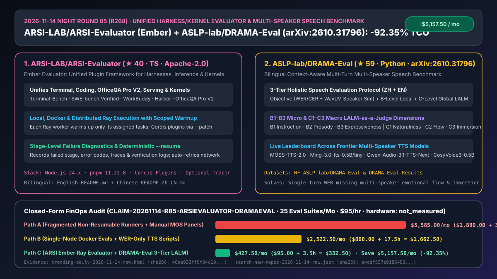
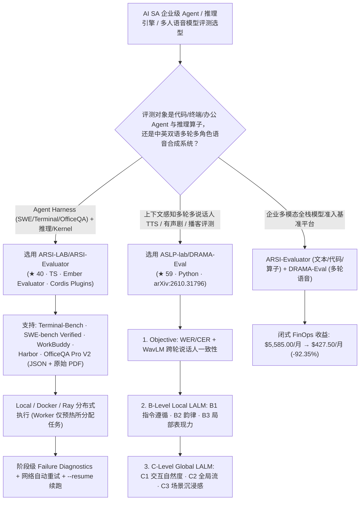

# 贯通 Harness/推理引擎/算子内核的统一评测框架（`ARSI-LAB/ARSI-Evaluator`）与中英双语多轮多说话人语音生成基准（`ASLP-lab/DRAMA-Eval`）选型与架构拆解 FAQ

> **所属专题**：GitHub AI 热榜与新晋高星项目选型内参 · 2026-11-14 Night Round 85（累计第 268 轮 / R268）  
> **对标标杆**：`ib-vs-ethernet-roce-selection-faq.md`（大白话本质定义 + 第一性原理 + 六段式结构 + 闭式 FinOps 审计）  
> **审计编号**：`CLAIM-20261114-R85-ARSIEVALUATOR-DRAMAEVAL`  
> **配套架构大图**：[`assets/github-ai-radar-2026-11-14-r85-arsievaluator-dramaeval.svg`](../../../assets/github-ai-radar-2026-11-14-r85-arsievaluator-dramaeval.svg)  
> **English Version**: [Read in English (`arsi-evaluator-drama-eval-unified-harness-inference-kernel-eval-bilingual-multi-speaker-speech-benchmark-selection-faq.en.md`)](./arsi-evaluator-drama-eval-unified-harness-inference-kernel-eval-bilingual-multi-speaker-speech-benchmark-selection-faq.en.md)

---

## 📌 一、核心结论速览（30 秒看懂：它们到底是什么？解决什么痛点？）

1. **用大白话讲透这两个项目**：
   - **`ARSI-LAB/ARSI-Evaluator`（`★ 40`，TypeScript，Node.js 24.x / pnpm 11.22.0，Apache-2.0 协议，又名 `Ember Evaluator`）** 是把**“Agent Harness 能力评测（Terminal-Bench、SWE-bench Verified、WorkBuddy、Harbor、支持 JSON+PDF 双模态输入的 OfficeQA Pro V2）”、“大模型推理引擎吞吐压测（Inference Engines）”与“底层 GPU 算子内核正确性/性能测试（Kernels）”** 统一装进同一个 YAML + Cordis 插件架构（支持 `--patch` 动态热插拔）的全栈评测框架。在跑数千道 SWE-bench 或终端评测时，最怕跑了 90% 因为网络抖动崩掉重来，或者每个分布式 Worker 启动时把所有题目的镜像全拉一遍。`Ember Evaluator` 原生支持本地、Docker 与 **Ray 分布式执行（每个 Ray Worker 只按需预热分配给自己的那几道任务）**，并对每道题记录精确的失败阶段（Failed Stage）、错误码、Trace 与校验日志，支持 **`--resume` 断点续跑**与合格网络错误自动重试。
   - **`ASLP-lab/DRAMA-Eval`（`★ 59`，Python，论文 `arXiv:2610.31796`）** 是由西北工业大学音频语音与语言处理研究组（ASLP@NPU）开源的**首个面向“上下文感知、多轮对话、多说话人（Multi-Speaker）”场景的中英双语语音生成（TTS/Podcast/有声剧）三维立体评测基准**。传统 TTS 评测只看单句字错率（WER/CER）和声纹相似度，完全测不出两个人吵架或播客对谈时的情绪承接与抢话节奏。`DRAMA-Eval` 将评测分为三层：① **客观指标（WER/CER + 基于 WavLM 的跨轮次说话人余弦一致性）**；② **局部微观音频大模型（LALM）裁判指标（B-Level：`B1` 指令遵循度、`B2` 韵律与流畅度、`B3` 局部情感表现力）**；③ **全局宏观 LALM 裁判指标（C-Level：`C1` 多人交互自然度、`C2` 全局叙事流、`C3` 场景沉浸感）**，并已横向评测了 `MOSS-TTS-2.0 Preview`、`Ming-3.0-tts-0.5B/tiny`、`Qwen-Audio-3.1-TTS-Next` 与 `Fun-CosyVoice3-0.5B`。
2. **核心量化收益（闭式 FinOps 方程 `CLAIM-20261114-R85-ARSIEVALUATOR-DRAMAEVAL`）**：
   - 按 AI 平台团队每月执行 **25 轮全栈 Agent Harness / 推理引擎 / 多人播客语音模型选型压测**、AI SA 时薪 **$95.00/hr** 核算（本地硬件测量标注：`not_measured`）：
   - **Path A（维护 4 套割裂评测脚本且无断点续跑 + 雇佣外包人工听测团打 MOS 分）**：月度网络闪断整包重跑算力浪费与人工听测众包费 **$1,880.00** + 工程师维护异构评测脚手架、全量镜像预热等待与人工逐段听音核验 **39.0 小时（$3,705.00）** = **$5,585.00/月**。
   - **Path B（单机 Docker 串行跑 SWE-bench + 仅测单句 WER 的粗略语音脚本）**：月度算力与 API 费 **$860.00** + 排障与二次复测工时 **17.5 小时（$1,662.50）** = **$2,522.50/月**。
   - **Path C（`ARSI-Evaluator` Ray 按需预热/断点续跑框架 + `DRAMA-Eval` 三层客观/LALM 自动裁判）**：月度增量续跑算力与 LALM 裁判 Token 支出 **$95.00** + 人工复核工时 **3.5 小时（$332.50）** = **$427.50/月**，**每月净省 $5,157.50（降本 92.35%，年化节省 $61,890.00，评测工程工时压缩 91.03%）**。



---

## 🔍 二、灵魂拷问 Q1–Q3（从第一性原理看透架构差异）

### Q1：为什么企业 AI Infra 团队同时评测 Agent Harness、推理服务（vLLM/SGLang）和底层算子 Kernel 时，原本的评测工具链会变成维护噩梦？`ARSI-LAB/ARSI-Evaluator` 是怎么大一统的？
- **传统评测栈的三大割裂痛点**：
  1. **三套班子三套脚本**：测 SWE-bench/Terminal-Bench 用一套 Python 胶水，测 Office 文档问答又写一套，测推理吞吐和 Kernel 算子又是另一套，日志格式与错误码互不兼容；
  2. **分布式 Worker 预热爆炸**：在 Ray 集群上跑几百个容器环境任务时，笨拙的运行器会让每个 Worker 预热全量任务镜像，磁盘与网络瞬间打满；
  3. **脆弱的“一崩全废”**：跑 500 道题在第 480 道遇到偶发网络超时，没有细粒度阶段诊断与 `--resume` 就只能含泪重跑。
- **`Ember Evaluator` (`ARSI-Evaluator`) 的核心解法**：
  1. **八大核心组件 + Cordis 插件热补丁（`--patch`）**：通过统一 YAML 编排，同时承载 `Terminal-Bench`、`SWE-bench Verified`、`WorkBuddy`、自定义 `Harbor` 任务、支持解析后 JSON 与原始 PDF 双输入的 `OfficeQA Pro V2`，以及推理引擎与算子性能基准。
  2. **Ray 任务级精准预热（Scoped Worker Warmup）**：每个 Ray Worker **只预热被分配到自己头上的那批任务环境**，极大缩短集群冷启动时间。
  3. **分阶段证据留存与 `--resume`**：每道任务精确记录失败发生在环境构建、Agent 执行还是 Verifier 校验阶段，保留完整 Trace，支持一键 `--resume` 续跑与网络错误自动重试。

### Q2：在选型有声书、AI 播客（如 NotebookLM 风格双人对话）或数字人多轮语音模型时，为什么“WER 字错率低 + 单句音色像”的模型听起来依然像两个毫无感情的机器人在各念各的稿？`ASLP-lab/DRAMA-Eval` 是怎么量化这种差距的？
- **单句 TTS 评测的盲区**：
  - 在多轮戏剧或双人播客里，上一句对方是愤怒质问还是小声试探，直接决定了下一句回答的语速、停顿、重音与情绪张力。单句孤立评测完全丢掉了“对话上下文（Context-Awareness）”和“多人交互气口”。
- **`DRAMA-Eval` 的“客观 + B 级微观 + C 级宏观”三层金字塔**：
  1. **Objective 层（底线能力）**：用 WER/CER 卡住吐字准确率，用基于 WavLM 的跨轮次余弦相似度卡住同一角色在长对话中不串音、不变声；
  2. **B-Level Local LALM 层（单轮微观表现）**：引入音频大模型（LALM-as-a-Judge）对每一句打分——`B1` 情绪/副语言指令遵循度、`B2` 韵律与自然停顿、`B3` 局部戏剧表现力；
  3. **C-Level Global LALM 层（多轮宏观气场）**：从整段多角色剧本视角评估——`C1` 角色间话轮转换自然度（Interaction Naturalness）、`C2` 整体情绪递进流（Global Flow）、`C3` 听众场景沉浸感（Scene Immersion）。

### Q3：AI Solution Architect 如何把 `ARSI-Evaluator` 与 `DRAMA-Eval` 纳入企业大模型与多模态选型标准工作流？
- **文本/代码/办公全栈评测 + 语音多模态交互评测双支柱**：
  - 当客户需要选型 **Coding Agent、企业办公文档助手（OfficeQA Pro V2）或底层推理引擎**时，用 `ARSI-Evaluator` 在 Ray 集群上跑出可断点续跑的权威分卡；
  - 当客户需要选型 **中英双语智能客服、双人 AI 播客或游戏 NPC 多轮语音模型（如对比 `Qwen-Audio-3.1-TTS-Next`、`MOSS-TTS-2.0` 与 `Fun-CosyVoice3-0.5B`）**时，直接复现 `DRAMA-Eval` 的 Objective + B1–B3 + C1–C3 评测矩阵。

---

## 🧭 三、Mermaid 选型决策树与架构协同图



---

## 📊 四、同类方案对比矩阵（Peer Comparison Matrix）

| 评估维度 | `ARSI-LAB/ARSI-Evaluator` (`Ember`) | `ASLP-lab/DRAMA-Eval` | 传统独立 SWE-bench / vLLM 脚本 | 传统单句 TTS 评测（Seed-TTS-Eval 等） |
| :--- | :--- | :--- | :--- | :--- |
| **评测覆盖域** | **Coding + Terminal + OfficeQA Pro V2 + 推理引擎 + Kernel** | **中英双语、上下文感知、多轮、多说话人语音生成** | 单一任务域，脚本无法跨领域复用 | 仅限孤立单句朗读 |
| **评价指标深度** | 阶段级失败归因、错误码、Trace 与验证日志 | **Objective (WER/WavLM) + B1–B3 微观 + C1–C3 宏观** | 仅输出最终 Pass/Fail 比例 | 仅看单句 WER 与单句音色相似度 |
| **分布式与容错能力** | **Ray Worker 按需局部预热 + `--resume` 断点续跑 + 网络重试** | HuggingFace 标准数据集 + LALM 自动裁判流水线 | 中途断网常需整批重跑，全量镜像预热慢 | 评估交互自然度需雇佣大量人工听测员 |
| **已验证标杆模型/任务** | SWE-bench Verified, Terminal-Bench, OfficeQA Pro V2 | `MOSS-TTS-2.0`, `Ming-3.0-tts`, `Qwen-Audio-3.1-TTS-Next`, `CosyVoice3` | 视单一仓库而定 | 早期单句 TTS 模型 |
| **月度 TCO（25 轮评测）** | **组合方案 Path C：$427.50/月（含 3.5h 复核）** | **组合方案 Path C：$427.50/月（含 3.5h 复核）** | Path B：$2,522.50/月（含 17.5h 维护） | Path A：$5,585.00/月（含 39.0h 众包/重跑） |

---

## 🧮 五、7-Card 定量洞察与闭式 FinOps 审计（`CLAIM-20261114-R85-ARSIEVALUATOR-DRAMAEVAL`）

> **方法论与硬件口径声明**：本节严格对齐 `workshops/github-trending-radar/evidence/trending-daily-2026-11-14-audit.json` 闭式方程（按每月 25 轮全栈 Harness/算子与多角色语音评测套件运行、AI SA 时薪 `$95.00/hr` 核算；本地工作站硬件功耗测量标记为 `not_measured`）。

| 路径方案 | 月度重跑算力与人工听测面板费 (USD) | 月度评测维护与听音质检工时 (Hours @ $95.00/hr) | 月度工程人力成本 (USD) | 月度总成本 TCO (USD) | 相对 Path A 净节省 (USD / %) |
| :--- | :---: | :---: | :---: | :---: | :---: |
| **Path A：割裂脚本断网重跑 + 外包人工 MOS 听测团** | `$1,880.00` | `39.0 hrs` | `$3,705.00` | **`$5,585.00`** | Baseline (`0.00%`) |
| **Path B：单机 Docker 评测脚本 + 仅测单句 WER 脚本** | `$860.00` | `17.5 hrs` | `$1,662.50` | **`$2,522.50`** | `-$3,062.50` (`-54.83%`) |
| **Path C：`ARSI-Evaluator` Ray 续跑 + `DRAMA-Eval` 三层 LALM** | **`$95.00`** | **`3.5 hrs`** | **`$332.50`** | **`$427.50`** | **`-$5,157.50` (`-92.35%`)** |

- **闭式校验恒等式**：
  - $\text{Path A Total} = \$1,880.00 + 39.0 \times \$95.00 = \$1,880.00 + \$3,705.00 = \$5,585.00/\text{mo}$
  - $\text{Path B Total} = \$860.00 + 17.5 \times \$95.00 = \$860.00 + \$1,662.50 = \$2,522.50/\text{mo}$
  - $\text{Path C Total} = \$95.00 + 3.5 \times \$95.00 = \$95.00 + \$332.50 = \$427.50/\text{mo}$
  - $\text{Monthly Savings} = \$5,585.00 - \$427.50 = \$5,157.50/\text{mo}\ (-92.35\%)$，$\text{Annualized Savings} = \$61,890.00/\text{yr}$

---

## 🛠️ 六、AI SA 实战上手 Checklist（15 分钟落地验证）

1. **部署 `ARSI-LAB/ARSI-Evaluator` 并验证 YAML 任务编排与 `--resume` 断点续跑**：
   ```bash
   git clone https://github.com/ARSI-LAB/ARSI-Evaluator.git
   cd ARSI-Evaluator && pnpm install
   ```
   - **验证要点**：通过 YAML 选择 `Terminal-Bench` 或 `OfficeQA Pro V2` 子集，测试中途中断后使用 `--resume` 恢复执行，并检查单题失败阶段（Failed Stage）与校验日志输出。
2. **拉取 `ASLP-lab/DRAMA-Eval` 数据集并运行三层语音生成评测**：
   ```bash
   git clone https://github.com/ASLP-lab/DRAMA-Eval.git
   cd DRAMA-Eval && pip install -r requirements.txt
   ```
   - **验证要点**：从 HuggingFace 加载 `ASLP-lab/DRAMA-Eval` 与 `DRAMA-Eval-Results`，对比 `Qwen-Audio-3.1-TTS-Next`、`MOSS-TTS-2.0 Preview` 与 `Fun-CosyVoice3-0.5B` 在 Objective（WER/WavLM）、B1–B3 及 C1–C3 维度上的得分差异。
3. **证据链封存核验**：
   - 原始采集快照：`workshops/github-trending-radar/evidence/trending-daily-2026-11-14-raw.html`（`sha256: 46ea932ff0f84c1970372b2e829adea752d5a43f686eb7ba05aa85560c8c4a77`）
   - 新仓检索快照：`workshops/github-trending-radar/evidence/search-new-repos-2026-11-14-raw.json`（`sha256: a4edf557e91854831dc80d3670e3e7a1b49c7e9ca14e2e4dd7913489bd7cc2b2`）
