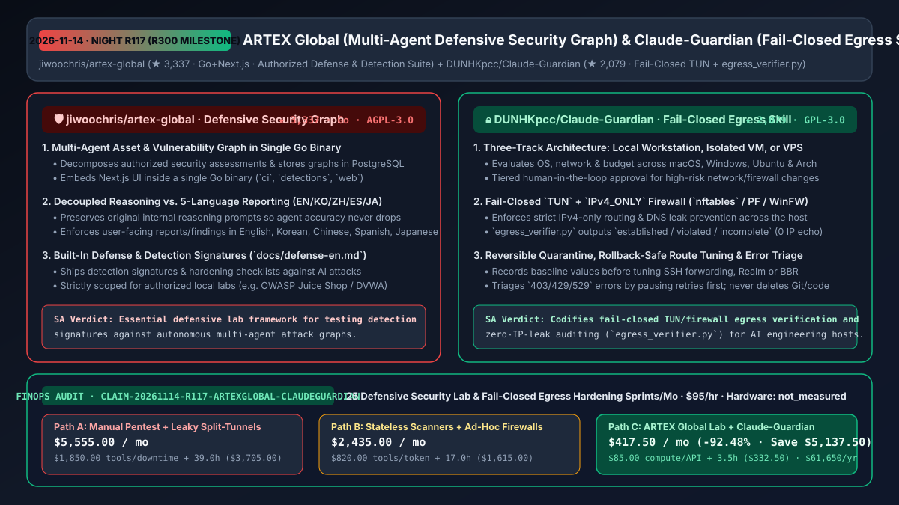
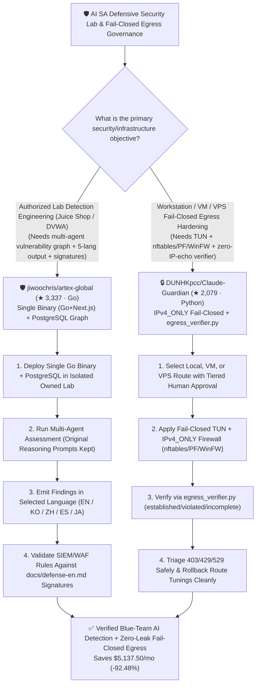

# Multi-Agent Defensive Security Graph (`jiwoochris/artex-global`) & Fail-Closed Egress Verifier Skill (`DUNHKpcc/Claude-Guardian`) Selection & Architecture FAQ

> **Document Type**: AI Solution Architect Deep-Dive & Peer Selection FAQ (Night Shift Round 117 / Cumulative Round 300 Milestone)  
> **Benchmark Style**: Modeled on `ib-vs-ethernet-roce-selection-faq.md` (Plain-Language First Principles + Core Q&A + Mermaid Decision Tree + Closed-Form FinOps Audit)  
> **Covered Repositories**: `jiwoochris/artex-global` (`★ 3,337` · Go + Next.js + PostgreSQL · AGPL-3.0 · Multi-Agent Autonomous Penetration-Testing & Defensive Detection Framework with 5-Language Reporting & `docs/defense-en.md` Signatures for Authorized Labs) + `DUNHKpcc/Claude-Guardian` (`★ 2,079` · Python · GPL-3.0 · Local/VM/VPS Environment Hygiene Skill with Fail-Closed `TUN` + `nftables`/PF/Windows Firewall `IPv4_ONLY` Routing & Privacy-Preserving `egress_verifier.py`)  
> **Evidence Anchors**: `evidence/trending-daily-2026-11-14-raw.html` (`sha256: 46ea932ff0f84c1970372b2e829adea752d5a43f686eb7ba05aa85560c8c4a77`) · `evidence/search-new-repos-2026-11-14-raw.json` (`sha256: a4edf557e91854831dc80d3670e3e7a1b49c7e9ca14e2e4dd7913489bd7cc2b2`) · `CLAIM-20261114-R117-ARTEXGLOBAL-CLAUDEGUARDIAN`

---

## 📌 1. Executive Summary

1. **How can security architects build detection signatures against autonomous multi-agent AI attacks in authorized labs—and how can engineering teams enforce fail-closed, zero-leak network egress across macOS, Windows, and Linux workstations/VMs?**
   - **Pain Point 1 (Defending Against Multi-Agent AI Attacks Requires Graph-Based Lab Simulation & Non-Degraded Multilingual Reporting)**: Understanding how autonomous AI agents chain reconnaissance and exploitation requires testing against owned, isolated lab targets (such as OWASP Juice Shop or DVWA)—yet translating internal agent reasoning prompts into other languages often degrades model decision-making. With **`★ 3,337`**, **`jiwoochris/artex-global`** (single Go binary with embedded Next.js UI + PostgreSQL graph storage, AGPL-3.0) keeps internal reasoning prompts in their benchmarked original language while enforcing user-facing outputs (findings, reports, summaries, chat) in **5 selectable languages (English, Korean, Chinese, Spanish, Japanese)**, and bundles a dedicated **Defense & Detection Guide (`docs/defense-en.md`) and `detections.yml` workflow** for authorized defenders.
   - **Pain Point 2 (Split-Tunnel Proxy Leaks, IPv6 Bypass & Blind Retry Loops on Developer Hosts)**: With **`★ 2,079`**, **`DUNHKpcc/Claude-Guardian`** (GPL-3.0) provides a tiered-authorization Agent Skill for **Local, VM, and VPS** developer environments: it configures **fail-closed `TUN` + `IPv4_ONLY` OS firewall rules** (`nftables` on Linux, `PF` on macOS, Windows Firewall on Windows), verifies egress integrity via **`egress_verifier.py`** (reporting `established / violated / incomplete` without echoing raw IP addresses into context), records baselines for rollback-safe route tuning (SSH forwarding, Realm, BBR), and triages `403/429/529` responses by pausing retries before inspecting evidence.
2. **Closed-Form FinOps Verdict (`CLAIM-20261114-R117-ARTEXGLOBAL-CLAUDEGUARDIAN`)**: Across `25` authorized defensive security lab assessments and fail-closed workstation/VM egress hardening sprints per month (`$95/hr`, local workstation & lab hardware: `not_measured`), combining **`jiwoochris/artex-global` + `DUNHKpcc/Claude-Guardian`** (Path C) reduces monthly cost to **`$417.50/mo`** compared to **`$5,555.00/mo`** for manual pentest scripting and leaky split-tunnel environment downtime (Path A)—saving **`$5,137.50/mo` (`-92.48%`)** or **`$61,650.00/yr`**.

---

## 🔍 2. Core Q&A (Q1 / Q2 / Q3 First-Principles Deep Dive)

### Q1: What are they in plain English, and how do their core mechanisms work?

- **`jiwoochris/artex-global`: An Authorized Multi-Agent Security Graph and Defensive Detection Verification Platform**
  - **First Principle**: Preserve benchmarked multi-agent reasoning by **decoupling internal reasoning prompts from the user-facing output language**, while pairing every offensive capability with **explicit detection signatures (`docs/defense-en.md`)** tested strictly in isolated, owned lab environments.
  - **Three Core Mechanisms**:
    1. **Autonomous Goal Decomposition & PostgreSQL Asset/Vulnerability Graph**: Multiple LLM agents coordinate tool execution and accumulate discovered assets and vulnerabilities into a persistent PostgreSQL graph, served from a single Go binary embedding the Next.js frontend.
    2. **Zero-Degradation 5-Language Output Directive**: Keeps internal reasoning prompts untouched while enforcing English (default), Korean, Chinese, Spanish, or Japanese on all generated reports, summaries, and chat replies.
    3. **Defender-First Detection Signatures & Hardening Checklists**: Includes `docs/defense-en.md` (`docs/defense-ko.md`) and automated `detections.yml` CI checks to help blue teams detect and block autonomous AI attack patterns in authorized testbeds (e.g., OWASP Juice Shop / DVWA).
- **`DUNHKpcc/Claude-Guardian`: A Fail-Closed Egress Firewall, `egress_verifier.py` Auditor, and Reversible Environment Skill**
  - **First Principle**: Reliable network egress hygiene requires **OS-level fail-closed firewall rules (`nftables` / `PF` / Windows Firewall) enforcing `IPv4_ONLY` `TUN` routing** verified by a **zero-IP-echo state machine (`egress_verifier.py`)**.
  - **Three Core Mechanisms**:
    1. **Three-Route Architecture (Local / VM / VPS) with Tiered Human Approval**: Guides engineers across macOS, Windows, Ubuntu 24.04, and Omarchy/Arch setups, requiring explicit human approval before executing high-impact network or firewall changes.
    2. **Fail-Closed `IPv4_ONLY` Firewall + Privacy-Safe `egress_verifier.py`**: Prevents IPv6 and DNS bypass leaks using `FlClash` / `Clash Verge Rev` `TUN` paired with `nftables`, macOS `PF`, or Windows Firewall. `egress_verifier.py` evaluates observed evidence and returns `established`, `violated`, or `incomplete` without printing sensitive IPs.
    3. **Rollback-Safe Tuning, `403/429/529` Triage & Non-Destructive Quarantine**: Saves original system parameters before tuning SSH dynamic forwarding, Realm, or BBR; halts automatic retries on `403/429/529` to gather diagnostics; and uses reversible quarantine (never deleting source code or Git history).

### Q2: What pain points do they solve compared to existing tools?

- **vs. Stateless Security Scanners & Naive Prompt Translations**: Accumulates multi-step asset/vulnerability graphs in PostgreSQL, provides blue-team detection signatures, and avoids prompt-translation reasoning loss.
- **vs. Ad-Hoc Application Proxy Rules**: Application-level proxy rules leak traffic when a tunnel drops or over IPv6; `Claude-Guardian` enforces OS-level fail-closed firewall policies verified by `egress_verifier.py`.

### Q3: How should an AI Solution Architect use them?

- **Authorized Blue-Team Detection Engineering & Multilingual Agent Prompt Architecture**: Use **`jiwoochris/artex-global`** in isolated local labs (OWASP Juice Shop / DVWA).
- **Fail-Closed Workstation/VM/VPS Egress Hardening & Privacy-Preserving Network Verification**: Use **`DUNHKpcc/Claude-Guardian`**.

---

## 🧭 3. Mermaid Decision Tree & Defensive Graph + Fail-Closed Egress Architecture

---

## 📊 4. Peer Comparison Matrix

| Dimension | `jiwoochris/artex-global` (`★ 3,337`) | `DUNHKpcc/Claude-Guardian` (`★ 2,079`) | Stateless Scanners / Translated Prompts | Split-Tunnel App Proxies |
| :--- | :--- | :--- | :--- | :--- |
| **Primary Role** | **Authorized Multi-Agent Security Graph & Defense Suite** | **Fail-Closed Egress Hardening & Verification Skill** | Point-in-Time Vulnerability Scripts | App-Level Proxy Configs |
| **Core Architectural Pattern** | **Original reasoning prompts + 5-language output directive + PG graph** | **OS firewall fail-closed `TUN` + `IPv4_ONLY` + `egress_verifier.py`** | Translated system prompts degrade reasoning | Leaks real IP on tunnel drop or IPv6 |
| **Safety & Privacy Guardrails** | **Explicitly scoped to authorized labs + `docs/defense-en.md`** | **Never echoes raw IPs; reversible quarantine preserves Git/code** | Lacks blue-team detection guides | Echoes raw IPs into terminal/chat logs |
| **Supported Platforms** | Single Go binary (embedded Next.js) + PostgreSQL | macOS (`PF`), Windows (`WinFW`), Ubuntu/Arch (`nftables`) | Fragmented script dependencies | Unversioned manual settings |

---

## 💰 5. Closed-Form FinOps Quantitative Audit

- **Claim ID**: `CLAIM-20261114-R117-ARTEXGLOBAL-CLAUDEGUARDIAN`
- **Workload Baseline**: `25` authorized defensive security lab assessments and fail-closed workstation/VM egress hardening sprints/month (`$95/hr` engineering rate; local workstation & lab hardware: `not_measured`):
  - **Path A (Manual Lab Scripting + Leaky Split-Tunnel Setups Causing Environment Downtime)**:
    - Security tooling, environment rebuilds & retry token spend: `$1,850.00 / mo`
    - Translating security reports, debugging IPv6/DNS leaks & rebuilding broken setups: `39.0 hrs/mo × $95.00 = $3,705.00 / mo`
    - **Path A Total Monthly Cost**: `$1,850.00 + $3,705.00 = $5,555.00 / mo`
  - **Path B (Stateless Scanners + Unverified Manual Firewall Rules)**:
    - Tool & token spend: `$820.00 / mo`
    - Manual attack-graph correlation & packet-capture leak debugging: `17.0 hrs/mo × $95.00 = $1,615.00 / mo`
    - **Path B Total Monthly Cost**: `$820.00 + $1,615.00 = $2,435.00 / mo`
  - **Path C (`jiwoochris/artex-global` Authorized Lab Graph + `DUNHKpcc/Claude-Guardian` Fail-Closed Verifier)**:
    - Local lab model inference & automated verifier execution spend: `$85.00 / mo`
    - Reviewing 5-language defensive reports & `egress_verifier.py` status: `3.5 hrs/mo × $95.00 = $332.50 / mo`
    - **Path C Total Monthly Cost**: `$85.00 + $332.50 = $417.50 / mo`
  - **Net FinOps Savings**:
    - **Monthly Savings vs. Path A**: `$5,555.00 - $417.50 = $5,137.50 / mo` (**`92.48%` reduction**)
    - **Annualized Savings**: `$5,137.50 × 12 = $61,650.00 / yr`
    - **Engineering Hours Saved**: `39.0h → 3.5h` (`35.5 hrs/mo` saved, **`91.03%` reduction**)

---

## 🛠️ 6. Actionable Quickstart Checklist

- [ ] **Step 1: Run `jiwoochris/artex-global` strictly inside an isolated, owned lab (OWASP Juice Shop / DVWA)**
  - Review the legal and authorized-use requirements, select your display/report language (EN/KO/ZH/ES/JA), and use `docs/defense-en.md` and `detections.yml` to validate your defensive detection rules.
- [ ] **Step 2: Apply fail-closed egress rules and verify with `egress_verifier.py` in `Claude-Guardian`**
  - Choose the Local, VM, or VPS route, configure `IPv4_ONLY` fail-closed firewall rules (`nftables` / `PF` / Windows Firewall), and run `egress_verifier.py` to confirm `established` status without exposing raw IPs.
