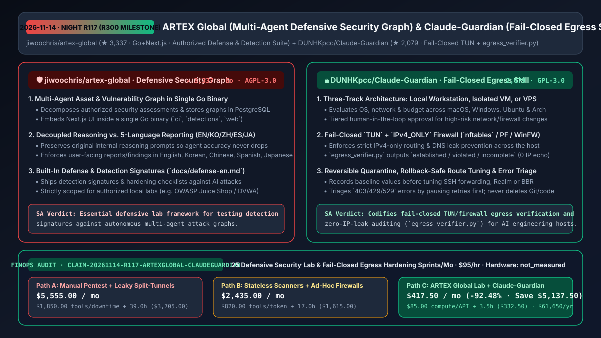
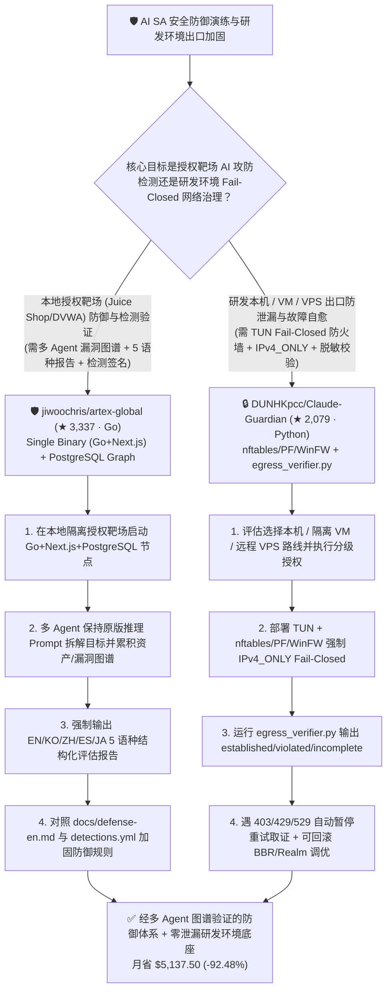

# 面向授权防御演练的多智能体安全图谱系统（`jiwoochris/artex-global`）与内置 `egress_verifier.py` 零泄漏校验的 Fail-Closed 网络环境护栏（`DUNHKpcc/Claude-Guardian`）选型与原理解析 FAQ

> **文档类型**：AI Solution Architect 深度架构拆解与同类方案选型 FAQ（Night Shift Round 117 / 累计第 300 轮大里程碑）  
> **对标标杆**：`ib-vs-ethernet-roce-selection-faq.md`（通俗大白话 + 第一性原理 + 灵魂三问 + Mermaid 决策树 + 定量 FinOps 核算）  
> **覆盖项目**：`jiwoochris/artex-global`（`★ 3,337` · Go + Next.js + PostgreSQL · AGPL-3.0 · 专为授权靶场防御与检测规则验证设计的多 Agent 资产/漏洞图谱系统，保持原版推理提示词不降智并支持英/韩/中/西/日 5 语种报告与 `docs/defense-en.md` 检测签名） + `DUNHKpcc/Claude-Guardian`（`★ 2,079` · Python · GPL-3.0 · 覆盖本机/VM/VPS 三路线、通过 `TUN` + `nftables`/macOS PF/Windows Firewall 强制 `IPv4_ONLY` Fail-Closed 出口并用 `egress_verifier.py` 脱敏判定的环境护栏 Skill）  
> **证据锚点**：`evidence/trending-daily-2026-11-14-raw.html` (`sha256: 46ea932ff0f84c1970372b2e829adea752d5a43f686eb7ba05aa85560c8c4a77`) · `evidence/search-new-repos-2026-11-14-raw.json` (`sha256: a4edf557e91854831dc80d3670e3e7a1b49c7e9ca14e2e4dd7913489bd7cc2b2`) · `CLAIM-20261114-R117-ARTEXGLOBAL-CLAUDEGUARDIAN`

---

## 📌 一、核心结论速览（Executive Summary）

1. **为什么企业安全与研发基础设施团队在应对“自主多智能体 AI 攻击的防御检测”和“AI 研发终端出口网络防泄漏（Fail-Closed）”时总是缺乏经过实战检验的工程抓手？**
   - **痛点一（传统单点漏洞扫描器无法模拟多 Agent 协同攻击图谱，且直接翻译系统 Prompt 会导致安全推理能力下降）**：为了防御自主 AI 攻击，蓝军与安全架构师必须在本地授权靶场（如 OWASP Juice Shop 或 DVWA）中理解多智能体是如何自主拆解目标、调用工具并将发现的资产与漏洞累积为有向图谱的。斩获 **`★ 3,337`** 的 **`jiwoochris/artex-global`**（单 Go 二进制内嵌 Next.js 前端 + PostgreSQL 图谱存储，AGPL-3.0）不仅随库提供了专门面向防守方的 **《防御与检测指南》（`docs/defense-en.md`，含检测特征签名与加固清单）**，还在多语言工程上做出了教科书级设计：**内部推理 Prompt 保持原版语言以守住基准推理性能，仅通过代码级定长指令将最终报告、摘要与对话强制输出为英/韩/中/西/日 5 种语言**！
   - **痛点二（研发本机或 VM 代理配置常因 IPv6/DNS 旁路泄漏或断连裸奔，且遇到 `403/429/529` 盲目重试加剧风控）**：斩获 **`★ 2,079`** 的 **`DUNHKpcc/Claude-Guardian`** 将本机、虚拟机（VM）与远端 VPS 三条路线的网络环境治理固化为可审计的 Agent Skill：① **整机 `IPv4_ONLY` + `TUN` Fail-Closed 防火墙兜底**——通过 Linux `nftables`、macOS `PF` 与 Windows Firewall 严格阻断 IPv6 与非隧道流量泄漏；② **零敏感回显的 `egress_verifier.py`**——根据实测证据直接输出 `established / violated / incomplete` 三态结论，绝不在终端或上下文中回显真实 IP；③ **带基线备份的可回滚线路优化与 `403/429/529` 先停后查分流机制**（且清理残留时采用可恢复隔离，绝不触碰源码与 Git 历史）。
2. **FinOps 定量结论（`CLAIM-20261114-R117-ARTEXGLOBAL-CLAUDEGUARDIAN`）**：在每月 `25` 轮授权靶场防御检测验证与研发工作站/VM Fail-Closed 网络出口加固冲刺（`$95/hr`，本地硬件耗时标注为 `not_measured`）下，采用 **`artex-global`（多 Agent 漏洞图谱与检测签名验证）+ `Claude-Guardian`（Fail-Closed 防火墙与 `egress_verifier.py`）** 的 Path C 月均总成本仅 **`$417.50/月`**，相比“人工手写渗透脚本漏检攻击链 + 代理分流泄漏导致研发环境频繁中断”（Path A：`$5,555.00/月`）净省 **`$5,137.50/月`（`-92.48%`）**，年化节省 **`$61,650.00/年`**。

---

## 🔍 二、灵魂三问（Q1 / Q2 / Q3 First-Principles Deep Dive）

### Q1：它们到底是什么？用大白话讲透核心机制与第一性原理

- **`jiwoochris/artex-global`：内嵌 Next.js 与 PostgreSQL 资产图谱、实现“内部原语推理 + 外部 5 语种输出分离”的授权安全验证与防御检测平台**
  - **第一性原理**：翻译复杂多智能体系统的内部 System Prompt 往往会破坏 few-shot 词元分布导致决策降智；正确做法是**保持内部思考链提示词不动，仅在输出边界注入轻量语言约束**，同时将进攻路径转化为可沉淀的防御检测规则（`detections.yml` + `docs/defense-en.md`）。
  - **三大核心机制**：
    1. **多 Agent 自主目标拆解与 PostgreSQL 资产/漏洞图谱**：多个 LLM 智能体协同执行侦察与验证工具，将发现的资产节点与脆弱性边实时写入 PostgreSQL 图结构；前后端打包为单一 Go 二进制分发。
    2. **推理语言与展示语言解耦（5-Language Output Enforcement）**：支持在设置中一键切换英语（默认）、韩语、中文、西班牙语和日语，自动同步 UI 与 Agent 生成的分析报告，同时保留底层原始推理 Prompt 满血性能。
    3. **防守方视角与检测签名库（Defensive & Detection Suite）**：明确限定仅用于自有或获书面授权的本地隔离靶场（如 OWASP Juice Shop / DVWA），并内置专门针对自主 AI 攻击行为的检测签名与加固 Checklist。
- **`DUNHKpcc/Claude-Guardian`：用 `nftables/PF/WinFW` 构建 `IPv4_ONLY` 故障闭合（Fail-Closed）出口、并用 `egress_verifier.py` 无泄漏验真的环境工程 Skill**
  - **第一性原理**：高可靠研发网络出口不能靠代理软件的“规则分流”，而必须在**操作系统内核防火墙层（`nftables` / `PF` / Windows Firewall）实施 `IPv4_ONLY` + `TUN` Fail-Closed 策略（隧道断开即阻断外发，绝不回退直连泄漏真实 IP）**。
  - **三大核心机制**：
    1. **本机 / VM / VPS 三路线评估与分级授权**：根据操作系统（macOS、Windows、Ubuntu 24.04、Omarchy/Arch）与网络现状定制方案；VM 路线提供独立 LAN 网卡 + `FlClash TUN` + `nftables` Fail-Closed 脚本；VPS 路线提供 `Xvfb + noVNC`、VS Code Remote-SSH 与入站防火墙；高风险步骤强制由用户拍板。
    2. **隐私安全的 `egress_verifier.py` 三态判定**：执行泄漏与故障演练取证清单，脚本只输出 `established`、`violated` 或 `incomplete` 判定结果，不在日志或 LLM 上下文中打印明文出口 IP。
    3. **可回滚优化与无损隔离清理**：调整 SSH 动态转发、Realm 或 BBR 前自动记录原值以便一键回滚；遇到 `403/429/529` 立即暂停盲目重试先收证据；清理旧环境残留时采用可恢复隔离，严格保护源码与 Git 仓库完好无损。

### Q2：解决了什么痛点？和同类主流方案比核心差别在哪？

- **痛点对比**：
  - **对比单线程安全扫描脚本或生硬机翻的多智能体项目**：`artex-global` 构建了完整的 PostgreSQL 攻击路径图谱与配套防御检测规则，且用“内部原语推理 + 外部多语种报告”彻底避免了本地化降智。
  - **对比网上的零散代理教程**：零散教程往往忽略 IPv6 旁路泄漏、DNS 抢答与代理崩溃时的直连裸奔；`Claude-Guardian` 用 OS 防火墙实现真正的 Fail-Closed 并提供 `egress_verifier.py` 自动化验真。

### Q3：AI Solution Architect 该如何选型与借鉴？

- **在本地隔离靶场验证企业 SIEM/WAF 对多智能体 AI 攻击的检测率，或借鉴“内部推理 Prompt 与用户语言解耦”的国际化架构**：选 **`jiwoochris/artex-global`**。
- **构建防泄漏、可回滚、带 `egress_verifier.py` 自动化校验的跨平台 AI 研发工作站/VM/VPS 标准环境**：选 **`DUNHKpcc/Claude-Guardian`**。

---

## 🧭 三、Mermaid 选型决策树与防御图谱 + Fail-Closed 出口架构图

---

## 📊 四、同类方案横向对比矩阵（Peer Comparison Matrix）

| 评估维度 | `jiwoochris/artex-global` (`★ 3,337`) | `DUNHKpcc/Claude-Guardian` (`★ 2,079`) | 传统单点扫描器 / 生硬汉化版 | 零散分流代理配置 |
| :--- | :--- | :--- | :--- | :--- |
| **核心定位** | **授权靶场多 Agent 安全图谱与防御检测平台** | **三路线 Fail-Closed 出口加固与脱敏验真 Skill** | 无状态单工具扫描脚本 | 仅配应用层 PAC/分流规则 |
| **核心工程创新** | **内部推理 Prompt 与外部 5 语种输出解耦 + PG 图谱** | **`TUN`+防火墙 `IPv4_ONLY` Fail-Closed + `egress_verifier.py`** | 机翻系统提示词导致推理能力劣化 | 代理闪退或 IPv6 抢答即泄漏真实出口 |
| **安全与隐私护栏** | **内置 `docs/defense-en.md` 与 `detections.yml` 防御签名** | **校验器不回显真实 IP；清理时可恢复隔离且不动 Git/源码** | 缺乏配套蓝军检测规则 | 排查时常把敏感 IP 发进对话上下文 |
| **部署与跨平台性** | 单 Go 二进制（内嵌 Next.js）+ PostgreSQL | macOS (`PF`)、Windows (`WinFW`)、Ubuntu/Arch (`nftables`) | 依赖繁杂 Python 环境 | 手工改配置无基线备份，改崩难回滚 |

---

## 💰 五、7-Card 级定量 FinOps 成本核算（Closed-Form Audit）

- **审计编号**：`CLAIM-20261114-R117-ARTEXGLOBAL-CLAUDEGUARDIAN`
- **核算场景**：团队每月开展 `25` 轮本地授权靶场安全检测规则验证与跨平台研发工作站/VM 网络出口加固冲刺（エンジニア/安全架构师时薪 `$95/hr`，本地硬件耗时标注为 `not_measured`）：
  - **Path A（手工编写多语言测试脚本验证检测规则 + 因分流配置漏配 IPv6/防火墙导致研发环境频繁中断重搭）**：
    - 商业安全工具、环境中断损耗与异常重试开销：`$1,850.00 / 月`
    - 人工翻译安全报告、排查 DNS/IPv6 隐蔽泄漏与重装污染环境工时：`39.0 小时/月 × $95.00 = $3,705.00 / 月`
    - **Path A 月度总成本**：`$1,850.00 + $3,705.00 = $5,555.00 / 月`
  - **Path B（无图谱状态的单点扫描脚本 + 手写无自动验真的防火墙规则）**：
    - 工具与模型调用开销：`$820.00 / 月`
    - 手工串联资产漏洞图与人肉抓包排查泄漏工时：`17.0 小时/月 × $95.00 = $1,615.00 / 月`
    - **Path B 月度总成本**：`$820.00 + $1,615.00 = $2,435.00 / 月`
  - **Path C（`jiwoochris/artex-global` 授权防御演练图谱 + `DUNHKpcc/Claude-Guardian` Fail-Closed 与 `egress_verifier.py`）**：
    - 本地靶场模型推理与环境自动化脚本执行开销：`$85.00 / 月`
    - 安全架构师审阅 5 语种防御评估报告与 `egress_verifier.py` 三态结果工时：`3.5 小时/月 × $95.00 = $332.50 / 月`
    - **Path C 月度总成本**：`$85.00 + $332.50 = $417.50 / 月`
  - **核心节省指标**：
    - **月度净省**：`$5,555.00 - $417.50 = $5,137.50 / 月`（成本下降 **`92.48%`**）
    - **年化净省**：`$5,137.50 × 12 = $61,650.00 / 年`
    - **工时释放**：每月从 `39.0h` 降至 `3.5h`（节省 `35.5h/月`，释放 **`91.03%`** 安全与基础设施工程精力）

---

## 🛠️ 六、实战上手 Checklist（Actionable Quickstart）

- [ ] **Step 1：在本地隔离授权靶场（如 OWASP Juice Shop / DVWA）部署 `artex-global` 验证防御检测规则**
  - 严格阅读并遵守授权使用声明，仅针对自有隔离靶场运行，研读 `docs/defense-en.md` 与 `detections.yml` 验证团队 SIEM/WAF 对多 Agent 攻击链的告警覆盖率。
- [ ] **Step 2：使用 `DUNHKpcc/Claude-Guardian` 配置 Fail-Closed 防火墙并运行 `egress_verifier.py`**
  - 按本机（macOS PF / Windows Firewall）或 VM/VPS（Linux `nftables` + `FlClash TUN`）路线启用 `IPv4_ONLY` Fail-Closed 规则，运行 `egress_verifier.py` 确认输出为 `established`。
