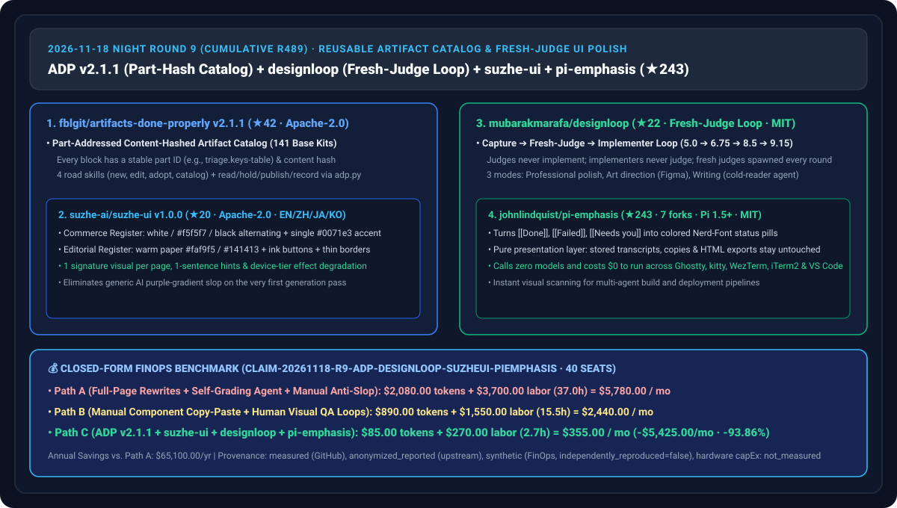
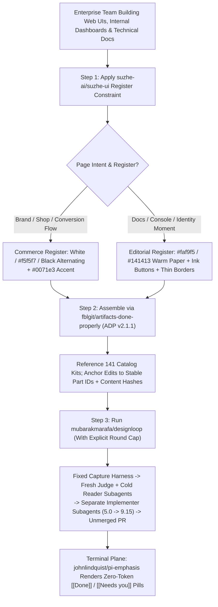

# Part-Addressed Reusable Artifacts (`fblgit/artifacts-done-properly`), Role-Separated UI/Copy Polish Loop (`mubarakmarafa/designloop`), Two-Register Design Skill (`suzhe-ai/suzhe-ui`) & Zero-Token Terminal Pills (`johnlindquist/pi-emphasis`) Selection FAQ

> **Document Type**: AI Solution Architect (SA) Practical Selection & Reference Architecture Guide (Round 489 / 2026-11-18 Night R9)  
> **Primary Evaluated Repositories**: [`fblgit/artifacts-done-properly`](https://github.com/fblgit/artifacts-done-properly) (`ADP v2.1.1`, `★ 42`, `2 forks`, 141-kit part-addressed reusable artifact framework, `Apache-2.0`) + [`mubarakmarafa/designloop`](https://github.com/mubarakmarafa/designloop) (`★ 22`, capture → fresh-judge → implementer UI/writing polish loop, `MIT`) + [`suzhe-ai/suzhe-ui`](https://github.com/suzhe-ai/suzhe-ui) (`v1.0.0`, `★ 20`, two-register restrained web design skill, `Apache-2.0`) + [`johnlindquist/pi-emphasis`](https://github.com/johnlindquist/pi-emphasis) (`★ 243`, `7 forks`, zero-model render-only terminal status pill extension, `MIT`)  
> **Benchmark Standard**: Strictly aligned with [`ib-vs-ethernet-roce-selection-faq.md`](https://github.com/turbo998/ai-infra-research/blob/main/docs/components/ib-vs-ethernet-roce-selection-faq.md) 6-section architecture format (Executive Summary + First-Principles Q&A + Mermaid Decision Tree + Peer Selection Matrix + 7-Card Quantitative Insights + SA Action Checklist)  
> **Data Provenance**: GitHub stars and repository metadata are `measured` from sealed `2026-11-18` evidence; upstream metrics (`ADP v2.1.1` `141` base catalog entries and `designloop` `5.0 → 6.75 → 8.5 → 9.15` multi-round score progression) are `anonymized_reported (independently_reproduced=false)`; the enterprise FinOps TCO model is `synthetic (independently_reproduced=false)` with workstation hardware CapEx `not_measured`.  
> **Language Editions**: [中文版](./artifacts-done-properly-designloop-suzhe-ui-pi-emphasis-reusable-part-hash-artifacts-fresh-judge-ui-loop-two-register-design-selection-faq.md) | [English Version (Current)](./artifacts-done-properly-designloop-suzhe-ui-pi-emphasis-reusable-part-hash-artifacts-fresh-judge-ui-loop-two-register-design-selection-faq.en.md)

---

## 📌 1. Executive Summary (30-Second Architect Briefing)

1. **Plain-Language First-Principles Definition**:
   - **What is `fblgit/artifacts-done-properly (ADP v2.1.1)`?** It is a **part-addressed, content-hashed framework and 141-entry shared catalog for reusable AI Artifacts**. Instead of treating a generated UI artifact as a disposable chat blob that gets overwritten from top to bottom on every edit, ADP assigns every component a stable part ID (e.g., `triage.keys-table`) and content hash under a `read → hold → publish → record` protocol driven by `adp.py` across 4 road skills (`new`, `edit`, `adopt`, `catalog`) and 3 templates (`starter`, `assistant`, `default`).
   - **What is `mubarakmarafa/designloop`?** It is a **role-separated `Capture → Fresh-Judge → Implementer` iterative polish skill** across 3 modes (`Professional polish`, `Art direction` / Figma alignment, and `Writing` with a cold-reader subagent). Its core invariant is strict separation of powers: **judges never implement, implementers never judge, judges are freshly spawned every round, and the capture set never changes**—driving measurable progression (e.g., `5.0 → 6.75 → 8.5 → 9.15`) and delivering an unmerged PR.
   - **What is `suzhe-ai/suzhe-ui (v1.0.0)`?** It is an **anti-slop, two-register web design method skill** (available in EN, zh-CN, JA, KO). It classifies every page into either the **Commerce Register** (strictly 3 alternating backgrounds: white, `#f5f5f7`, black; system fonts; single `#0071e3` accent; pill buttons) or the **Editorial Register** (warm paper `#faf9f5` or warm black `#141413`; one serif statement; ink buttons; thin borders; no heavy shadows), enforces one signature visual per page, and automatically degrades heavy effects on low-tier devices.
   - **What is `johnlindquist/pi-emphasis`?** It is a **zero-token, presentation-only terminal extension for Pi 1.5+** (`★ 243`) that renders `[[Done]]`, `[[Failed]]`, and `[[Needs you]]` as colored Nerd-Font pills with semantic icons while keeping stored messages, clipboard copies, and HTML exports 100% pure Markdown.
2. **Why Enterprise AI Solution Architects Should Combine All Four Tonight**:
   - Together they form an end-to-end frontend & artifact engineering pipeline: **`suzhe-ui`** prevents generic AI visual slop on the first draft, **`ADP v2.1.1`** makes every generated component addressable and reusable by reference across projects, **`designloop`** polishes UI and copy with independent fresh-judge subagents under a hard round cap, and **`pi-emphasis`** makes terminal agent status scannable at `$0` token cost.
3. **Closed-Form FinOps Impact (`CLAIM-20261118-R9-ADP-DESIGNLOOP-SUZHEUI-PIEMPHASIS`, `synthetic`)**:
   - For a **40-person enterprise frontend, internal-tooling & design team** (`24` pages/artifacts shipped per month, `$100.00/hr` rate): **Path A (Full-Page Artifact Re-Generation + Self-Grading Single-Agent Loops + Manual Anti-Slop Rework)** costs **`$5,780.00/mo`** (`$2,080.00` token waste + `37.0 hrs × $100 = $3,700.00` manual rework); **Path C (`ADP` + `suzhe-ui` + `designloop` + `pi-emphasis`)** reduces total monthly TCO to **`$355.00/mo`** (`$85.00` round-capped subagent tokens + `2.7 hrs × $100 = $270.00` PR review labor), saving **`$5,425.00/mo` (`93.86%` reduction, `$65,100.00/yr` annualized)**.

---

## ❓ 2. Three First-Principles Architect Questions (Q&A)

### Q1: Why do chat-generated UI artifacts break down in real team workflows, and how does `fblgit/artifacts-done-properly (ADP v2.1.1)` make them composable?
- **Stable Part IDs + Content Hashes vs. Whole-File Replacement**:
  1. **Part-Level Addressing (`triage.keys-table`)**: Every block on an ADP page carries an immutable ID and content hash. Review comments and edits anchor to the part ID rather than screen coordinates, and updates propagate cleanly to containing parts without regenerating the entire page.
  2. **141-Entry Reusable Catalog & Deterministic `adp.py` Calls**: The `adopt` and `catalog` skills extract working components from existing chats or websites into versioned kits with declared interfaces and dependencies, while `adp.py` prints exact `Artifact` and `ArtifactData` calls under a `read → hold → publish → record` ledger.

### Q2: Why does asking the same coding agent to "critique and polish its own UI" plateau at mediocre quality, and how do `suzhe-ui` and `designloop` fix it?
- **Pre-Generation Register Discipline + Post-Generation Fresh-Judge Separation**:
  1. **First-Draft Restraint (`suzhe-ui` Two-Register Rule)**: Before generating markup, `suzhe-ui` locks the page register—**Commerce** (`#ffffff` / `#f5f5f7` / `#000000` alternating sections + `#0071e3`) vs. **Editorial** (`#faf9f5` / `#141413` + ink buttons + thin borders)—banning decorative bloat and enforcing device-tier effect degradation.
  2. **Role-Separated Evaluation (`designloop`)**: Across each round, `designloop` captures identical light/dark stills and motion clips, spawns **fresh Judge subagents** (plus a cold-reader subagent in `Writing` mode) that never wrote the code to grade against a weighted rubric, dispatches separate Implementer subagents, and halts at the user's score target or round cap (`5.0 → 6.75 → 8.5 → 9.15`).

### Q3: How does `johnlindquist/pi-emphasis` make multi-agent terminal streams scannable without polluting saved Markdown transcripts?
- **Render-Time Decoration Only**:
  - `pi-emphasis` intercepts terminal rendering in Pi 1.5+ to draw `[[Done]]`, `[[Failed]]`, and `[[Needs you]]` as colored Nerd-Font pills and iconized headings—calling zero models, adding zero prompt tokens, and leaving stored transcripts and clipboard copies as clean plain Markdown.

---

## 🧭 3. Architecture Decision Tree & Reference Topology (Mermaid)

---

## 📊 4. Peer Solution Selection Matrix

| Evaluation Dimension | **Path A: Ephemeral Chat Artifacts + Self-Grading Agent** | **Path B: Manual Copy-Paste + Human Visual QA Loops** | **Path C: `ADP` + `designloop` + `suzhe-ui` + `pi-emphasis` (Recommended)** |
| :--- | :--- | :--- | :--- |
| **Artifact Reusability & Granular Edits** | ❌ Whole-file overwrites; buried in chat threads | ⚠️ Manual component extraction without hash tracking | ✅ **Stable Part IDs + 141 catalog kits + `read/hold/publish/record`** |
| **First-Draft Visual Restraint** | ❌ Generic purple-gradient AI slop & heavy shadows | ⚠️ Requires manual CSS cleanup on every page | ✅ **Two-register discipline + 1 signature visual + device-tier degradation** |
| **Iterative UI & Copy QA Rigor** | ❌ Same agent grades its own work with confirmation bias | ⚠️ Slow multi-day human review ping-pong | ✅ **Fresh Judge + Cold Reader subagents + fixed capture rubric** |
| **Terminal Status Scannability** | ❌ Wall of monochrome Markdown text | ⚠️ Inline ANSI/HTML pollutes copied logs | ✅ **Render-only Nerd-Font pills (`[[Done]]`/`[[Needs you]]`), `$0` cost** |
| **40-Person Monthly TCO** | **`$5,780.00 / mo`** | **`$2,440.00 / mo`** | **`$355.00 / mo` (`-$5,425.00/mo` vs. Path A, `-93.86%`)** |

---

## 📈 5. 7-Card Quantitative Insights & Closed-Form FinOps Model (`CLAIM-20261118-R9-ADP-DESIGNLOOP-SUZHEUI-PIEMPHASIS`)

> **Provenance Note**: GitHub stars and repository metadata are `measured` from sealed `2026-11-18` evidence; `ADP v2.1.1` `141` base catalog entries and `designloop` `5.0 → 6.75 → 8.5 → 9.15` progression are `anonymized_reported (independently_reproduced=false)`; the monthly TCO table is a closed-form `synthetic (independently_reproduced=false)` model for **40 engineers and designers shipping 24 pages/artifacts per month** (`$100.00/hr` rate; base hardware CapEx: `not_measured`).

| Monthly Cost Component (Closed-Form Formula) | Path A: Full-Page Rewrites + Self-Grading Loops | Path B: Manual Extraction + Human QA Rounds | Path C: `ADP` + `designloop` + `suzhe-ui` + `pi-emphasis` | Path C vs. Path A Delta |
| :--- | :---: | :---: | :---: | :---: |
| **1. UI Generation & Iterative Polish Token Spend** | **`$2,080.00`** *(Full-page re-generations + unguided retry loops)* | **`$890.00`** *(Repeated component scaffolding tokens)* | **`$85.00`** *(Part-ID delta updates + round-capped judge loop + `$0` pills)* | **`-$1,995.00 / mo`** (`-95.91%`) |
| **2. Anti-Slop Rework & Visual QA Labor** (`$100/hr`) | **`$3,700.00`** *(`37.0 hrs` fixing AI CSS slop & rebuilding lost artifacts)* | **`$1,550.00`** *(`15.5 hrs` manual dark/light & copy review cycles)* | **`$270.00`** *(`2.7 hrs` reviewing unmerged PRs after target score hit)* | **`-$3,430.00 / mo`** (`-34.3 hrs`, `-92.70%`) |
| **Total Monthly TCO** | **`$5,780.00`** | **`$2,440.00`** | **`$355.00`** | **`-$5,425.00 / mo` (`-93.86%`)** |
| **Annualized TCO** | **`$69,360.00 / yr`** | **`$29,280.00 / yr`** | **`$4,260.00 / yr`** | **`$65,100.00 / yr` saved (`-93.86%`)** |

---

## ✅ 6. AI Solution Architect Action Checklist

1. **Step 1 — Establish Register Standards (`suzhe-ui`) & Reusable Part Catalogs (`ADP v2.1.1`)**:
   - Install `suzhe-ui` to enforce Commerce vs. Editorial registers on all generated pages, and run `/adp setup` to store reusable dashboard and triage parts under stable Part IDs and content hashes.
2. **Step 2 — Run Role-Separated UI & Copy Polish Loops (`mubarakmarafa/designloop`)**:
   - Trigger `/designloop` with an explicit round cap (e.g., `max 3 rounds`, target score `8.5+`) so fresh Judge and Cold Reader subagents verify light/dark parity, spacing scales, and copy clarity before opening an unmerged PR.
3. **Step 3 — Enable Zero-Token Status Pills in Terminal Sessions (`johnlindquist/pi-emphasis`)**:
   - Verify Nerd Font glyphs (`printf '\ue0b6\uf00c \uf128 \uf007\ue0b4\n'`) and run `pi install git:github.com/johnlindquist/pi-emphasis` for instant visual status scanning.
