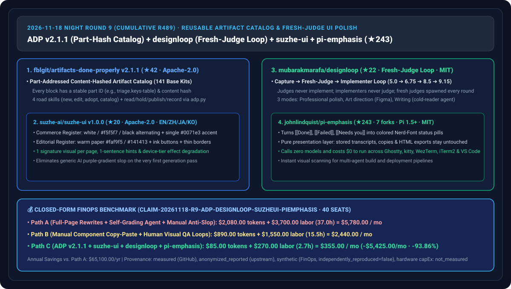
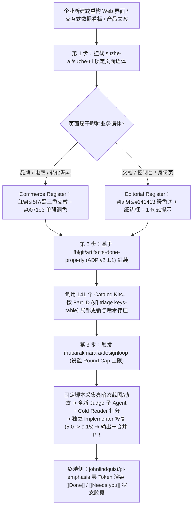

# 部件级哈希复用制品库（`fblgit/artifacts-done-properly`）、评改分离 UI/文案打磨闭环（`mubarakmarafa/designloop`）、双语体克制派设计技能（`suzhe-ai/suzhe-ui`）与零 Token 终端语义胶囊（`johnlindquist/pi-emphasis`）选型 FAQ

> **文档类型**：AI Solution Architect (SA) 实战选型与参考架构指南（Round 489 / 2026-11-18 Night R9）  
> **核心评估对象**：[`fblgit/artifacts-done-properly`](https://github.com/fblgit/artifacts-done-properly)（`ADP v2.1.1`，`★ 42`，`2 forks`，141 组件部件级 ID 与哈希复用制品框架，`Apache-2.0`） + [`mubarakmarafa/designloop`](https://github.com/mubarakmarafa/designloop)（`★ 22`，评改分离与固定截图集 UI/文案评分进化环，`MIT`） + [`suzhe-ai/suzhe-ui`](https://github.com/suzhe-ai/suzhe-ui)（`v1.0.0`，`★ 20`，商业/社论双语体克制派前端设计技能，`Apache-2.0`） + [`johnlindquist/pi-emphasis`](https://github.com/johnlindquist/pi-emphasis)（`★ 243`，`7 forks`，零模型调用不改原文的终端状态胶囊渲染扩展，`MIT`）  
> **对标范式**：严格遵循 [`ib-vs-ethernet-roce-selection-faq.md`](https://github.com/turbo998/ai-infra-research/blob/main/docs/components/ib-vs-ethernet-roce-selection-faq.md) 六段式结构（核心结论速览 + 三大灵魂拷问 + Mermaid 决策树 + 选型对比矩阵 + 7-Card 定量洞察 + SA 落地 Checklist）  
> **数据溯源分级（Provenance）**：GitHub 星标与目录元数据为 `measured`；上游基准参数（如 `ADP v2.1.1` `141` 个基础目录套件、`designloop` `5.0 → 6.75 → 8.5 → 9.15` 轮次演进分）标注为 `anonymized_reported (independently_reproduced=false)`；企业 FinOps 成本算例为 `synthetic (independently_reproduced=false)`，硬件折旧 `not_measured`。  
> **语言版本**：[中文版 (当前)](./artifacts-done-properly-designloop-suzhe-ui-pi-emphasis-reusable-part-hash-artifacts-fresh-judge-ui-loop-two-register-design-selection-faq.md) | [English Version](./artifacts-done-properly-designloop-suzhe-ui-pi-emphasis-reusable-part-hash-artifacts-fresh-judge-ui-loop-two-register-design-selection-faq.en.md)

---

## 📌 一、核心结论速览（Executive Summary — 30 秒看懂）

1. **大白话本质定义**：
   - **`fblgit/artifacts-done-properly (ADP v2.1.1)` 是什么？** 它是 **终结“AI 聊天框生成的 Artifact 一次性用完即废、改一行重刷整页”的部件级寻址与跨项目复用框架**。它内置 **141 个基础组件套件（Kits）**、3 套模板（`starter / assistant / default`）与 4 大技能（`new / edit / adopt / catalog`）：页面上的每个区域都是带稳定 ID（如 `triage.keys-table`）和内容哈希的独立部件（Part），批注与增量修改精准锚定在 Part ID 上，并通过 `adp.py` 按 `read → hold → publish → record` 协议生成精确调用。
   - **`mubarakmarafa/designloop` 是什么？** 它是 **把界面与文案从“6 分合格线”自动打磨到“9 分精品线（如 `5.0 → 6.75 → 8.5 → 9.15`）”的评改分离多子智能体技能**。它包含三大模式（`Professional polish` 专业细节打磨、`Art direction` 视觉风格/Figma 对齐、`Writing` 界面文案与文档润色），核心铁律是：**裁判（Judge）绝不写代码，施工员（Implementer）绝不打分，每轮更换全新无偏见的裁判子 Agent（文案模式额外引入冷启动 Reader Agent 挑出费解段落），且全程锁定同一套截图/录屏采样集**。
   - **`suzhe-ai/suzhe-ui (v1.0.0)` 是什么？** 它是 **从源头根治“AI 廉价紫蓝渐变味（AI Slop）”的双语体克制派前端设计规范技能**。它强制大模型在动工前先区分页面语体：**商业语体（Commerce Register）** 严格只用白、`#f5f5f7`、黑三色交替背景 + 单一 `#0071e3` 强调色 + 胶囊按钮；**社论/身份语体（Editorial Register）** 采用暖纸色 `#faf9f5` 或暖黑 `#141413` + 衬线主标题 + 墨色细边框按钮（零厚重阴影），且每页只允许 1 个专属主视觉并按终端设备性能档位自动降级重特效。
   - **`johnlindquist/pi-emphasis` 是什么？** 它是 **纯渲染层零 Token 消耗的终端输出高信噪比着色器**，自动将 Agent 回复中的 `[[Done]]`、`[[Failed]]`、`[[Needs you]]` 渲染为带 Nerd Font 图标的彩色状态胶囊，同时保持底层存储、复制粘贴与导出 Markdown 100% 纯净无污染。
2. **为什么企业 AI 解决方案架构师（SA）今晚要把这四者组合成“企业前端与交互交付流水线”？**
   - **`suzhe-ui` 定骨架（首轮生成即达到 Apple 级克制质感） ➔ `ADP v2.1.1` 管资产（按 Part ID 局部演进并沉淀为可复用 Kit） ➔ `designloop` 抓品控（独立裁判子 Agent 多轮闭环验收提 PR） ➔ `pi-emphasis` 提效率（终端一眼扫清多 Agent 状态胶囊）**！
3. **闭式 FinOps 量化收益（`CLAIM-20261118-R9-ADP-DESIGNLOOP-SUZHEUI-PIEMPHASIS`，`synthetic`）**：
   - 以 **40 人企业前端、内部工具与产品设计团队**（月均交付 24 个业务页面与交互式工具看板，时薪 `$100.00/hr`）计：**Path A（每次从零全页重刷 Artifact + 单 Agent 自写自评 + 人工返工去 AI 塑料感）** 月均总成本 **`$5,780.00`**（全页重复生成 Token 浪费 `$2,080.00` + 人工重调样式与重写散落组件 `37.0h × $100 = $3,700.00`）；**Path C（`ADP` + `suzhe-ui` + `designloop` + `pi-emphasis` 闭环）** 月均总成本降至 **`$355.00`**（设轮次上限的评审子 Agent Token `$85.00` + 最终合并审查 `2.7h × $100 = $270.00`），**净省 `$5,425.00/月`（降幅 `93.86%`，年化节省 `$65,100.00`）**。

---

## ❓ 二、三大灵魂拷问（First-Principles Q&A）

### Q1：为什么用 Claude Artifacts 或普通网页生成工具做出来的东西“演示很惊艳、接进项目就报废”？`fblgit/artifacts-done-properly (ADP v2.1.1)` 是怎么解决的？
- **整文件覆写 vs 部件级寻址（Part-Addressed Architecture）**：
  1. **每个局部组件拥有永久地址与内容哈希**：普通 Artifact 是一坨几千行的单文件，改一个表格就会冲掉其它区域的微调。在 `ADP v2.1.1` 中，页面由稳定 ID（如 `triage.keys-table`）的 Part 组装而成；评审意见直接锚定在 Part ID 上，修改只触发目标 Part 及其父容器的哈希更新。
  2. **141 个基础套件与 `read → hold → publish → record` 确定性账本**：`adp.py` 自动生成精确的 `Artifact` 与 `ArtifactData` 操作指令，通过 `adopt` 技能可将现有网页或散落在聊天记录里的优秀组件收编进团队私有目录（Catalog），下一个项目直接按引用挂载。

### Q2：为什么让同一个 Agent “自己检查自己画的 UI / 写的文档”几乎毫无效果？`mubarakmarafa/designloop` 与 `suzhe-ai/suzhe-ui` 是如何联手破局的？
- **认知盲区与审美基线双管齐下**：
  1. **事前审美基线（`suzhe-ui` 双语体约束）**：在写第一行 CSS 前，先按页面职责锁定语体——营销与商城走 **Commerce Register**（白/`#f5f5f7`/黑三色严禁相邻同色、单 `#0071e3` 蓝），登录/关于/文档走 **Editorial Register**（`#faf9f5` 暖纸底、墨色按钮、零浮夸阴影），且每页限 1 个核心视觉、提示语限 1 句话、低端手机自动降级动效。
  2. **事后评改分离闭环（`designloop` 四铁律）**：① 固定截图/录屏采样脚本（涵盖亮暗主题、空状态与交互动效）；② **每轮拉起全新的 Judge 子 Agent** 按固定加权量表苛刻打分（出现退步直接扣分）；③ 独立的 Implementer 子 Agent 根据扣分项修改代码；④ 文案模式专门拉起从未看过上下文的 **Cold Reader Agent** 指出哪里读不懂，直至达到目标分（如 `9.15`）或触发预设轮次上限（Round Cap），最终提交未合并 PR 交由人类合入。

### Q3：为什么在终端里想让 Agent 输出好看的彩色徽章，往往会污染剪贴板和 Markdown 存档？`johnlindquist/pi-emphasis` 是怎么做到的？
- **存储层与视图层彻底解耦**：
  - 如果让大模型直接在输出里拼 ANSI 转义码或 HTML 标签，不仅浪费输出 Token，复制粘贴到文档或 Git Issue 时还会变成乱码。`pi-emphasis` 仅在终端绘制阶段将纯文本 `[[Done]]`、`[[Failed]]`、`[[Needs you]]` 实时替换为带 Nerd Font 圆角与图标的彩色胶囊，**0 模型调用、0 Token 成本、0 原始 Markdown 污染**。

---

## 🧭 三、架构师选型决策树与端到端参考架构（Mermaid）

---

## 📊 四、同类方案横向选型对比矩阵（Peer Selection Matrix）

| 评估维度 | **Path A：全页重刷 Artifact + 单 Agent 自评 + 裸 Markdown** | **Path B：手工复制组件 + 纯人工多轮走查** | **Path C：`ADP` + `designloop` + `suzhe-ui` + `pi-emphasis`（推荐）** |
| :--- | :--- | :--- | :--- |
| **生成式制品跨项目复用与局部修改** | ❌ 散落在聊天记录里，改一处重生成整页 | ⚠️ 手工拆组件耗时且缺版本哈希记录 | ✅ **Part ID 稳定寻址 + 141 基础套件 + `adp.py` 确定性账本** |
| **首轮前端生成审美水准** | ❌ 充斥 AI 紫蓝渐变、乱序字号与廉价大阴影 | ⚠️ 依赖前端工程师逐行手写覆写样式 | ✅ **双语体（商业/社论）硬约束 + 单主视觉 + 低端机自动降级** |
| **UI 与文案迭代打磨客观性** | ❌ 单 Agent 自我感觉良好，越改越乱 | ⚠️ 设计师与开发反复拉锯数天 | ✅ **评改分离 + 每轮全新 Judge / Cold Reader + 固定截图集量化爬坡** |
| **终端多任务状态可读性** | ❌ 纯黑白长文本极易漏看关键阻塞项 | ⚠️ 拼 ANSI 码污染复制粘贴与日志归档 | ✅ **纯绘制层渲染 `[[Done]]`/`[[Needs you]]` 彩色胶囊，0 原文污染** |
| **40 人团队月均总拥有成本 (TCO)** | **`$5,780.00 / 月`** | **`$2,440.00 / 月`** | **`$355.00 / 月`（较 Path A 净省 `$5,425.00/月`，`-93.86%`）** |

---

## 📈 五、7-Card 定量洞察与闭式 FinOps 算例（`CLAIM-20261118-R9-ADP-DESIGNLOOP-SUZHEUI-PIEMPHASIS`）

> **Provenance 声明**：GitHub 星标与目录元数据源自 `2026-11-18` 封存证据（`measured`）；`ADP v2.1.1` `141` 个目录条目与 `designloop` `5.0 → 6.75 → 8.5 → 9.15` 演进曲线源自上游文档（`anonymized_reported`, `independently_reproduced=false`）；月度 TCO 为面向 **40 人前端与产品工具团队（月均交付 24 个页面/制品）** 的闭式合成模型（`synthetic`, `independently_reproduced=false`；宿主机硬件折旧 CapEx：`not_measured`）。

| 成本构成项（月度闭式公式） | Path A：全页重刷 + 单 Agent 自评 + 人工返工 | Path B：手工拆组件 + 纯人工视觉走查 | Path C：`ADP` + `designloop` + `suzhe-ui` + `pi-emphasis` | Path C 对比 Path A 净变化 |
| :--- | :---: | :---: | :---: | :---: |
| **1. 页面生成、重刷与多轮打磨 Token 支出** | **`$2,080.00`** *(每次微调重刷几千行全页代码 + 无效自评)* | **`$890.00`** *(重复编写基础组件 Token)* | **`$85.00`** *(Part ID 局部更新 + Round Cap 受控评审 + `$0` 胶囊)* | **`-$1,995.00 / 月`** (`-95.91%`) |
| **2. 去 AI 塑料感返工与走查人工成本** (`$100/hr`) | **`$3,700.00`** *(`37.0 hrs`：重写散落 Artifact 与修补乱码样式)* | **`$1,550.00`** *(`15.5 hrs`：人工逐页截图对比亮暗态与文案)* | **`$270.00`** *(`2.7 hrs`：仅审查 `designloop` 达标后的未合并 PR)* | **`-$3,430.00 / 月`** (`-34.3 hrs`, `-92.70%`) |
| **月度总拥有成本 (Monthly Total TCO)** | **`$5,780.00`** | **`$2,440.00`** | **`$355.00`** | **`-$5,425.00 / 月` (`-93.86%`)** |
| **年化总拥有成本 (Annualized TCO)** | **`$69,360.00 / 年`** | **`$29,280.00 / 年`** | **`$4,260.00 / 年`** | **年省 `$65,100.00` (`-93.86%`)** |

---

## ✅ 六、AI 解决方案架构师（SA）实战落地 Checklist

1. **Step 1 — 安装 `suzhe-ai/suzhe-ui` 与 `fblgit/artifacts-done-properly` 建立组件资产库**：
   - 将 `suzhe-ui` 技能装入团队 Claude Code / Codex，统一商业页与社论/工具页双语体标准；运行 `/adp setup` 建立团队私有 Catalog，将高频表格、分诊面板与状态卡沉淀为带稳定 Part ID 的可复用 Kit。
2. **Step 2 — 用 `mubarakmarafa/designloop` 执行发版前自动化视觉与文案升维**：
   - 对存量粗糙界面或文档运行 `/designloop`（务必设定明确的目标分数如 `8.5` 与最大轮次上限 `Round Cap = 3` 以严控子 Agent 成本），由全新 Judge 与 Cold Reader 自动挑刺修复并生成待审 PR。
3. **Step 3 — 在终端挂载 `johnlindquist/pi-emphasis` 提升多 Agent 巡检可读性**：
   - 配置 Nerd Font 终端字体并运行 `pi install git:github.com/johnlindquist/pi-emphasis`，让所有自动化流水线的 `[[Done]]`、`[[Failed]]`、`[[Needs you]]` 呈现零 Token 彩色胶囊。
