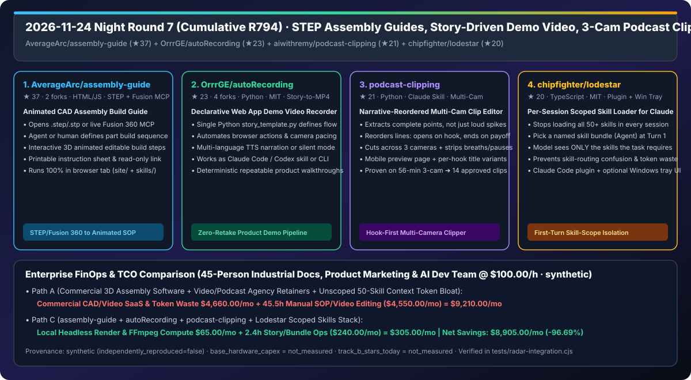
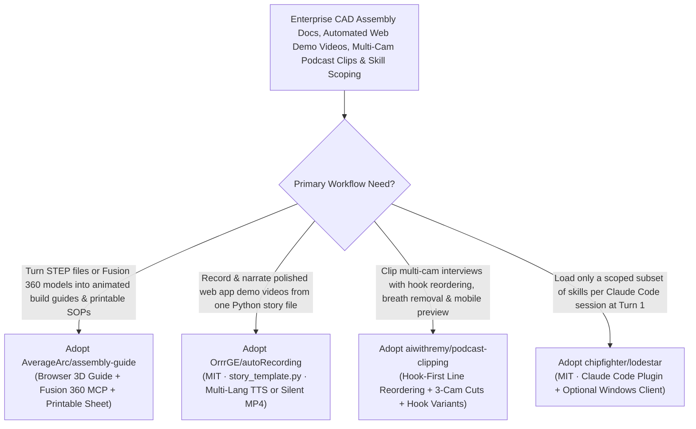
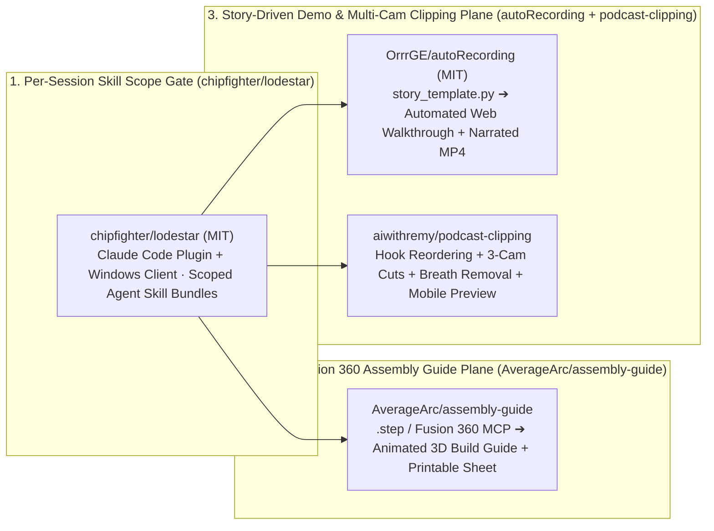
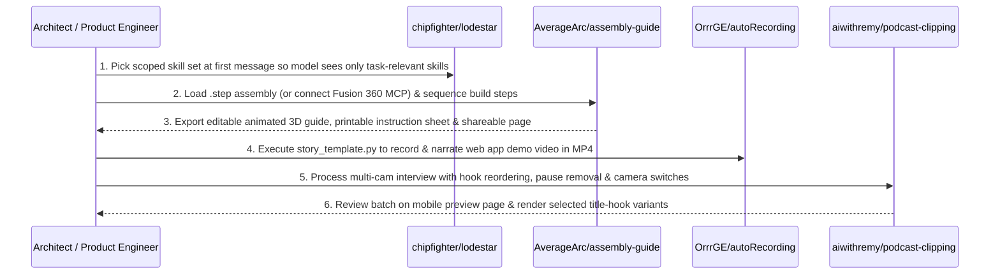

# STEP/Fusion 360 Animated Assembly Guide (`AverageArc/assembly-guide`), Story-Driven Web Demo Video Pipeline (`OrrrGE/autoRecording`), Narrative-Reordered Multi-Cam Podcast Clipper (`aiwithremy/podcast-clipping`) & Per-Session Scoped Skill Loader (`chipfighter/lodestar`) Selection & Architecture FAQ

> **Document Type**: Enterprise AI Solution Architect Decision & Selection Guide (GitHub Trending AI Radar · 2026-11-24 Night Round 7 / Cumulative Round 794)
> **Covered Repositories**: [`AverageArc/assembly-guide`](https://github.com/AverageArc/assembly-guide) (`★ 37`, `2 forks`, HTML/JS: opens a `.step`/`.stp` 3D CAD assembly in the browser or connects to Autodesk Fusion 360 via MCP tools so an LLM agent or engineer can establish the part build order, outputting an animated editable build guide, printable instruction sheet, and shareable read-only page) · [`OrrrGE/autoRecording`](https://github.com/OrrrGE/autoRecording) (`★ 23`, `4 forks`, Python, `MIT`: Claude Code and Codex skill + standalone Python pipeline that records, renders, and narrates polished web app demo videos from a single Python `story_template.py` file) · [`aiwithremy/podcast-clipping`](https://github.com/aiwithremy/podcast-clipping) (`★ 21`, `1 fork`, Python: Claude skill built from a 56-minute 3-camera podcast workflow that extracts single-point segments, reorders speaker lines so each clip opens on a hook and ends on a landing conclusion, cuts across multiple cameras, removes pauses/breaths, and builds a mobile preview page with title-hook variants) · [`chipfighter/lodestar`](https://github.com/chipfighter/lodestar) (`★ 20`, TypeScript, `MIT`: Claude Code plugin and optional Windows tray client that lets developers pick a scoped skill set — "Agent" — at a session's first message so the model sees only the skills the work needs)
> **Core Enterprise Scenario**: How should industrial hardware teams, product marketing/DevRel teams, and heavy Claude Code users combine **STEP-to-animated assembly guides (`assembly-guide`)**, **declarative story-to-MP4 web app recording (`autoRecording`)**, **hook-reordered multi-camera clipping (`podcast-clipping`)**, and **per-session skill scope isolation (`lodestar`)**?

---

## 1. 📌 Executive Summary (One-Line Selection Verdicts)

1. **Need to turn a `.step`/`.stp` 3D CAD assembly (or live Fusion 360 model) into an animated, editable build guide, printable shop-floor instruction sheet, and shareable read-only web page** ➔ Choose **[`AverageArc/assembly-guide`](https://github.com/AverageArc/assembly-guide) (`★ 37`, `2 forks`)**.
   - **Plain-Language Mechanism**: A STEP file defines part geometry and positions, not build sequence. `assembly-guide` lets either an LLM agent (via browser model summary or Fusion 360 MCP tools) or a human engineer specify the assembly order, rendering an interactive 3D step-by-step guide in the browser tab.
2. **Need repeatable, narrated (or silent) product demo videos of web applications generated automatically from a single Python story script whenever the UI changes** ➔ Choose **[`OrrrGE/autoRecording`](https://github.com/OrrrGE/autoRecording) (`★ 23`, `4 forks`, `MIT`)**.
   - **Plain-Language Mechanism**: Treats product walkthroughs as code (`story_template.py`): specify what to show and say, and the pipeline drives the live web app, records smooth transitions, and synthesizes narration in your chosen language and TTS engine.
3. **Need to turn long podcasts, executive interviews, or webinars into vertical short clips that open on a strong hook, cut across multiple camera angles, strip breaths/pauses, and end on a clear takeaway** ➔ Choose **[`aiwithremy/podcast-clipping`](https://github.com/aiwithremy/podcast-clipping) (`★ 21`, `1 fork`)**.
   - **Plain-Language Mechanism**: Unlike naive loudness clippers, it analyzes the full transcript for coherent single-point moments, reorders the speaker's own lines so the hook comes first and the payoff lands last, cuts across 3 camera feeds, strips dead air, and generates a mobile preview page with per-hook title renders.
4. **Need to prevent Claude Code from loading all 50+ installed skills into every session's context window—saving tokens and eliminating cross-domain skill confusion** ➔ Choose **[`chipfighter/lodestar`](https://github.com/chipfighter/lodestar) (`★ 20`, `MIT`)**.
   - **Plain-Language Mechanism**: Provides a `.claude-plugin` and optional Windows client (`client/`) so you select a named skill bundle (**Agent**) at the first message of a session, exposing only those scoped skills to the model.

---

## 2. 🎯 Architect & Customer Q&A (Deep Technical Breakdown)

### Q1: When should enterprises choose these four open-source tools over commercial SaaS (SolidWorks Composer, Loom/Synthesia, OpusClip)?

- **Selection Breakdown**:
  1. **Hardware Assembly Guides (`assembly-guide` vs. Proprietary 3D Authoring Suites)**: Eliminates expensive per-seat CAD authoring licenses for rapid prototyping and field-service manuals by running directly in the browser on standard `.step` files or Fusion 360 MCP.
  2. **Story-as-Code Demo Videos (`autoRecording` vs. Manual Screen Recording)**: Manual screen recordings become obsolete every time a web UI changes; re-running `story_template.py` regenerates localized MP4 walkthroughs in minutes.

### Q2: How do they integrate into an end-to-end enterprise workflow?

1. **First-Turn Skill Scope Gate (`chipfighter/lodestar`)**:
   - Select the target role bundle in `Lodestar` at session start so the coding/media agent loads only the 3–5 relevant skills.
2. **CAD-to-SOP Assembly Plane (`AverageArc/assembly-guide`)**:
   - Ingest `.step` assemblies or live Fusion 360 MCP state, sequence the build order, and publish animated web guides + printable PDF sheets.
3. **Automated Product & Executive Video Plane (`OrrrGE/autoRecording` + `aiwithremy/podcast-clipping`)**:
   - Run `autoRecording` on staging web apps to produce narrated feature walkthroughs, and run `podcast-clipping` on multi-cam executive recordings to output hook-first social clips via the mobile preview page.

### Q3: What are the key operational guardrails?

- **Key Guardrails**:
  1. **Engineer Sign-Off on AI-Inferred CAD Build Order**: Always review AI-proposed assembly sequences in `assembly-guide` for physical tool clearance and fastener order before printing shop-floor sheets.
  2. **Editorial Review on Reordered Transcript Hooks**: Verify on `podcast-clipping`'s mobile preview page that reordered hook lines preserve the speaker's factual meaning.

---

## 3. 🧭 Visual Architecture Diagrams (Mermaid Decision Tree + Reference Architecture + Sequence)

### 3.1 Solution Architect Selection Decision Tree

### 3.2 End-to-End Enterprise Reference Architecture

### 3.3 End-to-End Skill Scoping, CAD SOP & Video Production Sequence

---

## 4. 📊 Comparative Selection Matrix (OSS vs. Commercial Suites & Manual Production)

| Dimension | `AverageArc/assembly-guide` (`★ 37`) | `OrrrGE/autoRecording` (`★ 23`) | `aiwithremy/podcast-clipping` (`★ 21`) | `chipfighter/lodestar` (`★ 20`) | Commercial 3D Authoring + Video Agencies + Unscoped 50-Skill Context (Path A) | Manual Screenshots + Manual Loom Retakes + Loudness Clippers (Path B) |
| :--- | :--- | :--- | :--- | :--- | :--- | :--- |
| **Primary Role** | STEP / Fusion 360 animated build guide generator | Declarative Python story-to-MP4 web app recorder | Narrative-reordered multi-camera podcast clipper | Per-session scoped skill loader for Claude Code | Expensive 3D authoring seats, video agencies & bloated context windows | Static screenshot SOPs, manual retakes & naive loudness cuts |
| **Key Differentiator** | **Browser-native 3D animated guide + printable sheet + Fusion MCP** | **Single `story_template.py` re-renders narrated demos on UI updates** | **Reorders speaker lines for hook-first opening + 3-cam cuts** | **Exposes only the selected skill set per session at Turn 1** | High SaaS/agency bills and per-turn skill-catalog token waste | Static screenshots hide 3D assembly order; loudness clips lack hooks |
| **License** | Open Source | `MIT` | Open Source Skill | `MIT` | Proprietary SaaS | Manual Workflow |
| **Monthly TCO (45-Person Team)** | **Combined `$305.00/mo`** (`$65.00` local render/FFmpeg compute + `2.4h` ops) | Included (automated re-recording) | Included (local multi-cam batching) | Included (cuts per-session skill token bloat) | **`$9,210.00/mo`** (`$4,660.00` SaaS/agency/token waste + `45.5h` manual SOP/video labor) | `~$3,190.00/mo` (high manual screen-recording retake & editing hours) |

---

## 5. 🧪 Quantitative Enterprise ROI / TCO Model & 7-Card Report

> **📊 Provenance & Closed-Form Declaration**:
> - **provenance**: `synthetic` (45-person industrial hardware documentation, product marketing, developer advocacy, and AI coding team workload at `$100.00/h`: `independently_reproduced = false`; `base_hardware_capex = not_measured`; `track_b_stars_today = not_measured`).
> - **Closed-Form Equations**:
>   - **Path A (Commercial 3D Assembly Software + External Video/Podcast Editing SaaS + Unscoped 50-Skill Context Token Bloat)**: Monthly software, SaaS & wasted skill-context token spend **`$4,660.00`** + manual STEP exploded-view authoring, web demo re-recording & multi-cam editing labor **`45.5h × $100.00/h = $4,550.00`** = **`$9,210.00/mo`**.
>   - **Path C (Self-Hosted `AverageArc/assembly-guide` + `OrrrGE/autoRecording` + `aiwithremy/podcast-clipping` + `chipfighter/lodestar` Stack)**: Local headless browser & FFmpeg rendering compute **`$65.00`** + story-script & skill-bundle maintenance **`2.4h × $100.00/h = $240.00`** = **`$305.00/mo`**.
>   - **Net Savings vs. Path A**: **`-$8,905.00/mo`** (**`96.69%`** cost reduction).

| Option | Software / Video SaaS / Token Spend | SOP, Demo Retake & Video Editing Labor (`$100/h`) | Monthly Total TCO | Net Savings vs. Path A | Key Architectural Outcome |
| :--- | :---: | :---: | :---: | :---: | :--- |
| **Path A: Commercial 3D Suite + Video SaaS + Unscoped 50-Skill Context** | `$4,660.00` | `45.5h` (`$4,550.00`) | **`$9,210.00`** | Baseline | Expensive manual video retakes; 50+ skills pollute every session prompt |
| **Path B: Manual Screenshot SOPs + Manual Loom + Loudness Clipper** | `$1,440.00` | `17.5h` (`$1,750.00`) | **`$3,190.00`** | `-$6,020.00` (`-65.36%`) | Lacks interactive 3D STEP animations, code-driven demos & hook reordering |
| **Path C: `assembly-guide` + `autoRecording` + `podcast-clipping` + `lodestar`** | **`$65.00`** | **`2.4h` (`$240.00`)** | **`$305.00`** | **`-$8,905.00` (`-96.69%`)** | **STEP 3D build guides + story-to-MP4 demos + 3-cam hook clips + scoped skills** |

- 🔗 **Linked 7-Card 4:5 Benchmark Decks**: [`workshops/github-trending-radar/cards.en.html`](../cards.en.html) · [`cards.html`](../cards.html)

---

## 6. 🛠️ Enterprise Adoption & Architecture Review Checklist

- [ ] **Verify STEP Build Sequence Clearance**: Have a hardware engineer review AI-ordered assembly steps in `AverageArc/assembly-guide` before publishing printable shop-floor sheets.
- [ ] **Version-Control `story_template.py` Demo Scripts**: Store `OrrrGE/autoRecording` story scripts alongside frontend E2E tests so product demo videos regenerate automatically after UI releases.
- [ ] **Mobile Preview Sign-Off for Reordered Clips**: Use `aiwithremy/podcast-clipping`'s mobile preview page to approve reordered hook lines and multi-camera cuts before publishing.
- [ ] **Configure Role-Scoped Bundles in `Lodestar`**: Group installed Claude Code skills into focused 3–6 skill bundles in `chipfighter/lodestar` to eliminate prompt bloat and cross-skill interference.
