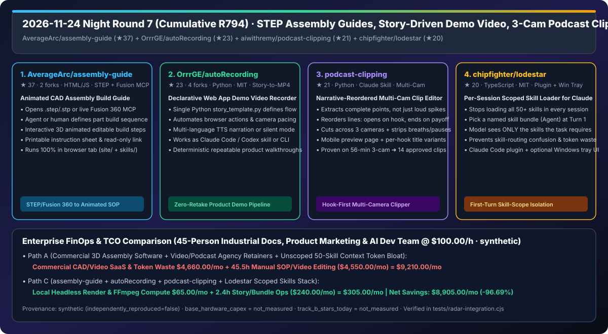
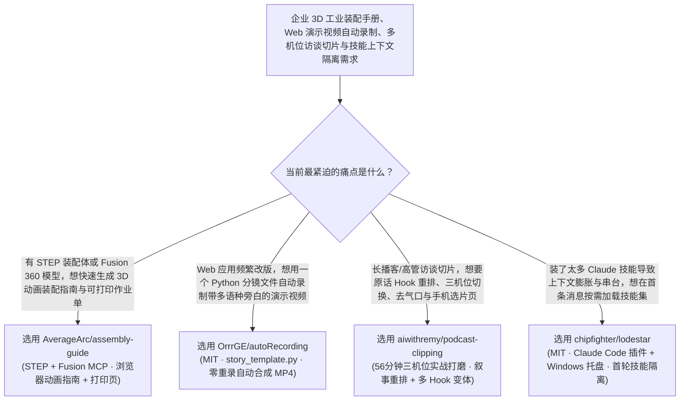
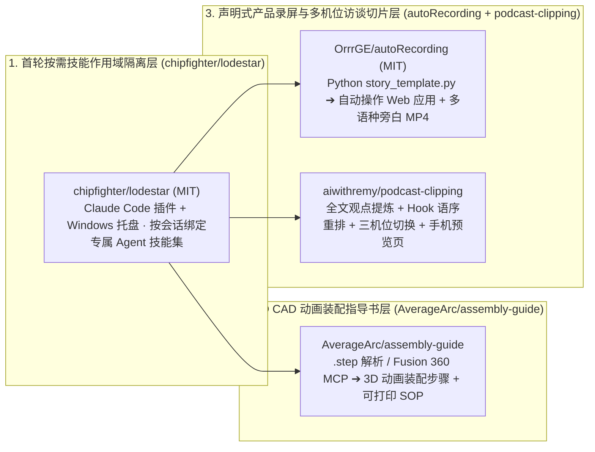
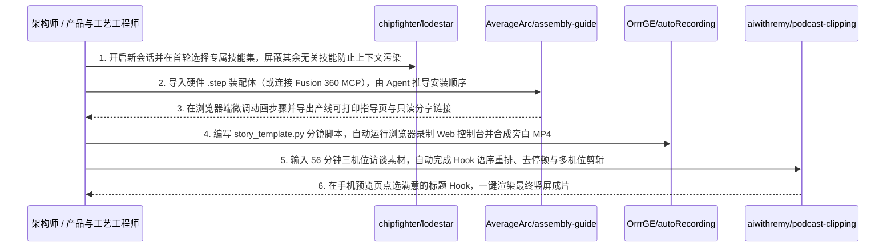

# STEP/Fusion 360 动画装配作业指导书生成器（`AverageArc/assembly-guide`）、单 Python 分镜脚本 Web 应用演示录屏流水线（`OrrrGE/autoRecording`）、叙事重排三机位高管访谈竖屏切片技能（`aiwithremy/podcast-clipping`）与按会话首轮按需加载技能集的 Claude 插件（`chipfighter/lodestar`）选型与集成架构 FAQ

> **文档类型**：企业 AI 解决方案架构师（AI Solution Architect）选型决策指南（GitHub Trending AI 雷达 2026-11-24 Night Round 7 / 累计第 794 轮）
> **覆盖项目**：[`AverageArc/assembly-guide`](https://github.com/AverageArc/assembly-guide)（`★ 37`、`2 forks`，打开 `.step`/`.stp` 3D 装配体文件或通过 MCP 直连 Autodesk Fusion 360，由 AI Agent 或工程师自动推导装配顺序，在浏览器端一键生成**可编辑的 3D 动画装配指南、可打印纸质 SOP 作业指导书与只读分享页**）· [`OrrrGE/autoRecording`](https://github.com/OrrrGE/autoRecording)（`★ 23`、`4 forks`、`MIT`，只需编写一个声明式 Python 分镜文件 `story_template.py`，即可自动驱动 Web 应用交互、录制高清画面并合成多语种旁白解说 MP4 的 Claude Code / Codex 技能与独立流水线）· [`aiwithremy/podcast-clipping`](https://github.com/aiwithremy/podcast-clipping)（`★ 21`、`1 fork`，源自真实 56 分钟三机位播客产出 14 条过审成片经验的专业剪辑技能：不靠音量峰值盲切，而是通读全文提炼独立观点、**重排原话语序确保每条切片以 Hook 开场并以金句收尾**、三机位动态切换、剔除呼吸停顿并生成手机预览页与多版本标题）· [`chipfighter/lodestar`](https://github.com/chipfighter/lodestar)（`★ 20`、`MIT`，带可选 Windows 托盘客户端的 Claude Code 插件，允许在每个会话的第一条消息时按角色选择专属技能子集 `Agent`，让大模型**只看见当前任务所需的技能**）
> **核心场景**：当企业工业制造部门、售前产品营销团队与重度 AI 研发团队面临**“从 CAD STEP 模型制作车间动画装配 SOP 依赖高价专业软件且耗时数周、每次 Web 产品改版都要人工重新录屏配音几十遍、长视频高管访谈被普通切片工具按大嗓门截成无头无尾的废片、以及电脑里装了 50+ 个 `SKILL.md` 后每次新开会话都塞满系统提示词导致串台和浪费 Token”**四大痛点时，如何用这四个创新项目完成自动化升级？

---

## 一、📌 核心结论速览（选型一句话结论）

1. **想把机械硬件的 `.step`/`.stp` 装配体文件（或 Fusion 360 实时模型）直接变成产线工人可交互查看的 3D 爆炸动画装配手册与可打印 PDF/纸质作业指导书（SOP）** ➔ 选 **[`AverageArc/assembly-guide`](https://github.com/AverageArc/assembly-guide)（`★ 37`，`2 forks`）**。
   - **通俗原理**：标准 STEP 文件只记录了“有哪些零件、各自在什么三维坐标”，却没有记录“先后组装顺序”。`assembly-guide` 提供双模式输入：既能在纯浏览器端（`site/`）拖入 `.step` 文件生成零件结构摘要交由 LLM 推导合理装配顺序，也能通过 `skills/` 直接读取正在运行的 Fusion 360 MCP 工具；最终在浏览器标签页内直接渲染出可编辑的动画分步装配指南、可打印作业单与只读分享页。
2. **想在每次 Web 应用 UI 迭代或发版后，免人工操作鼠标、免录音棚重录，直接从一个 Python 分镜脚本自动生成带多语种 TTS 解说旁白的高清产品演示 MP4** ➔ 选 **[`OrrrGE/autoRecording`](https://github.com/OrrrGE/autoRecording)（`★ 23`，`4 forks`，`MIT`）**。
   - **通俗原理**：把产品演示视频变成“代码即分镜（Story-as-Code）”。你只需在 `story_template.py` 里写明每一步要展示的页面动作与解说词，流水线（支持作为 Claude Code / Codex Skill 调用或独立 Python 运行）自动驱动浏览器完成丝滑交互、控制镜头停留节奏，并按所选语言和语音引擎合成音画同步的成品 MP4（同样支持纯静音演示模式）。
3. **想把 1 小时的高管访谈、技术圆桌或客户案例长视频切成 10–15 条真正能发社交媒体的竖屏短片，且要求像人类金牌剪辑师一样“把金句提上来当片头 Hook、三机位画面交替不呆板、自动剪掉气口停顿并提供手机端选片页”** ➔ 选 **[`aiwithremy/podcast-clipping`](https://github.com/aiwithremy/podcast-clipping)（`★ 21`，`1 fork`）**。
   - **通俗原理**：市面上 90% 的切片工具只会找“声音最大的一段”居中裁切，导致开头没重点、结尾没落点。`podcast-clipping` 沉淀自真实 56 分钟三机位播客（一次产出 14 条通过审核的成片）：它先读完整篇转录稿，找出表达完整单一观点的段落，**对说话者自己的原话句子做叙事重排（确保第一句就是抓人 Hook、最后一句有力收尾）**，在多个机位间切换以保留听众反应镜头，自动切除每一次停顿与换气声，叠加上字幕与轻背景乐，最后生成手机端可滑动预览页并为你选中的每个标题 Hook 各渲染一个专属版本。
4. **当你的 `~/.claude/skills` 里已经装了三四十个不同领域的技能（餐饮、CAD、视频、安全、数据库），想避免 Claude Code 在每个会话里把所有技能全塞进上下文导致模型选错工具或白烧固定底座 Token** ➔ 选 **[`chipfighter/lodestar`](https://github.com/chipfighter/lodestar)（`★ 20`，`MIT`）**。
   - **通俗原理**：默认情况下 Claude Code 会在每个会话里向模型展示你安装的每一个技能。`Lodestar`（提供 `.claude-plugin` 与可选 Windows 系统托盘客户端）允许你预先定义若干个按职责划分的技能组合（称为 **Agent**，如“3D 工业文档 Agent”、“全栈压测 Agent”、“视频营销 Agent”）；在每个会话发出第一条消息时选定对应组合，模型在该会话中**就只能看见被选中的那几个技能**，既省下每轮数千 Token，又彻底杜绝跨领域技能串台。

---

## 二、🎯 客户与架构师灵魂拷问 Q&A（深度架构拆解）

### Q1：在企业产品交付、工业文档与数字内容生产流水线中，何时选这四个开源项目 vs 商业 SaaS（如 SolidWorks Composer、Loom/Synthesia、OpusClip）？

- **选型边界拆解**：
  1. **工业装配指导书（`assembly-guide` vs SolidWorks Composer / Cortona3D）**：传统商业 3D 技术插图软件单席位动辄数万元且需专职工艺工程师手工K帧；对于中小型硬件团队、创客教育与敏捷样机试制，`assembly-guide` 直接在浏览器内结合 Fusion 360 MCP / STEP 解析生成可编辑动画与打印单，成本为零。
  2. **产品演示与访谈切片（`autoRecording` + `podcast-clipping` vs 手工录屏与商业按分钟计费 SaaS）**：UI 改个按钮颜色就会让手工录制的 Loom 视频作废，而 `autoRecording` 只需重跑一次 Python 分镜脚本即可更新中英双语演示片；`podcast-clipping` 的叙事句子重排与三机位切换则远超按音量盲切的云端 SaaS。

### Q2：典型企业级“首轮技能按需加载 (`lodestar`) + CAD 动画装配指南 (`assembly-guide`) + 声明式产品录屏 (`autoRecording`) + 多机位叙事切片 (`podcast-clipping`)”架构怎么搭？

1. **会话级技能作用域隔离层（`chipfighter/lodestar`）**：
   - 工程师或内容制作人在启动 Claude Code 会话时，通过 `Lodestar` 插件或 Windows 托盘选择当前任务对应的技能包（仅加载本次所需的 3–4 个技能，屏蔽其余 40+ 个无关技能）。
2. **硬件装配 SOP 自动生成层（`AverageArc/assembly-guide`）**：
   - 针对硬件产品，Agent 读取 `.step` 文件模型摘要或直连 Fusion 360 MCP，自动规划零件安装顺序并导出浏览器端 3D 动画手册与车间打印页。
3. **软件演示与高管访谈视频自动化层（`OrrrGE/autoRecording` + `aiwithremy/podcast-clipping`）**：
   - 针对软件控制台，运行 `autoRecording` 的 `story_template.py` 生成多语种产品操作演示 MP4；针对发布会与高管圆桌，运行 `podcast-clipping` 完成句子级 Hook 重排、多机位切换与手机预览页签收。

### Q3：这套架构的局限性与生产落地红线是什么？

- **架构师落地红线**：
  1. **工业装配顺序的物理干涉人工复核**：LLM 根据 STEP 零件名称与位置推断的装配顺序（Build Order）能省去 80% 的从零排布时间，但对于存在精密公差配合或隐藏卡扣的工业组件，必须在 `assembly-guide` 编辑器中由工艺工程师人工复核确认后再打印下发产线。
  2. **访谈原话重排的语义诚实性红线**：`podcast-clipping` 会重排受访者自己的句子以把 Hook 提至片头，在生成手机预览页后，必须由人工快速核验重排未扭曲受访者原意（Out-of-context misrepresentation）。

---

## 三、🧭 直观可视化图解（Mermaid 决策树 + 集成架构 + 时序图）

### 3.1 架构师选型决策树

### 3.2 企业端到端生产集成参考架构图

### 3.3 `Lodestar` 技能隔离、STEP 动画 SOP 生成、Web 自动录屏与三机位访谈切片时序图

---

## 四、📊 同类开源与商业云服务横向选型决策矩阵

| 对比维度 | `AverageArc/assembly-guide` (`★ 37`) | `OrrrGE/autoRecording` (`★ 23`) | `aiwithremy/podcast-clipping` (`★ 21`) | `chipfighter/lodestar` (`★ 20`) | 商业 3D 工艺软件 + 外包视频剪辑 + 全量技能裸挂 (Path A) | 手工截图写 Word SOP + 人工 Loom 录屏 + 音量峰值盲切 (Path B) |
| :--- | :--- | :--- | :--- | :--- | :--- | :--- |
| **核心能力定位** | STEP / Fusion 360 3D 动画装配指南与打印单生成器 | 单 Python 分镜脚本驱动的 Web 演示视频自动录制 | 叙事重排、三机位切换与去气口的播客/访谈切片技能 | 按会话首轮隔离技能可见范围的 Claude Code 插件 | 高价工业软件席位、按分钟计费的视频 SaaS 与无节制上下文消耗 | 静态图文手册、每次改 UI 重录视频与断章取义的音量切片 |
| **核心技术突破** | **为无顺序的 STEP 赋予 AI/人工装配序列并直出动画与打印页** | **Story-as-Code 声明式分镜，UI 改版后一键重跑出片** | **重排原话确保 Hook 开场与有力结尾，含手机选片页** | **每个会话只暴露匹配任务的技能子集，杜绝串台与浪费** | 商业 3D Composer 席位极贵；全量挂载 50+ 技能每轮白烧 Token | 静态截图看不清三维装配方向；普通切片开头拖沓无重点 |
| **开源协议** | 开源（浏览器本地运行） | `MIT` | 开源技能 | `MIT` | 闭源商业软件/服务 | 人工流程 |
| **月度 TCO（45 人团队）** | **组合仅 `$305.00/月`**（`$65.00` 本地渲染/FFmpeg 算力 + `2.4h` 维护） | 同左（自动重录零人工配音费） | 同左（本地剪辑免按分钟扣费） | 同左（立省全量技能底座 Token） | **`$9,210.00/月`**（`$4,660.00` 软件席位/视频外包/冗余 Token + `45.5h` 手工编排与重录） | 约 `$3,190.00/月`（大量人工重录演示视频与手工粗剪工时） |

---

## 五、🧪 应用落地定量收益/TCO 对比与 7-Card 报告

> **📊 数据来源与闭式核算声明（Provenance & Closed-Form Schema）**：
> - **provenance**: `synthetic`（基于 45 人企业工业硬件文档、产品市场营销、开发者布道与 AI 研发团队月度工作负载模型：`independently_reproduced = false`；硬件采购基线 `base_hardware_capex = not_measured`；Track B 单日增量 `track_b_stars_today = not_measured`）。
> - **核算公式**：
>   - **Path A（采购商业 3D 装配说明书软件席位 + 外包产品演示与访谈视频剪辑 / 商业按分钟切片 SaaS + 研发全员会话无隔离挂载 50+ 技能造成的上下文 Token 浪费）**：月度商业软件、视频 SaaS 与冗余上下文 Token 账单 **`$4,660.00`** + 手工制作装配分解图、Web 改版反复重录演示与长视频粗剪人工 **`45.5h × $100.00/h = $4,550.00`** = **`$9,210.00/月`**。
>   - **Path C（自建 `AverageArc/assembly-guide` + `OrrrGE/autoRecording` + `aiwithremy/podcast-clipping` + `chipfighter/lodestar` 开源栈）**：本地无头浏览器与 FFmpeg 渲染容器分摊开销 **`$65.00`** + 分镜脚本与 Lodestar 角色包维护人工 **`2.4h × $100.00/h = $240.00`** = **`$305.00/月`**。
>   - **净节省（Net Savings vs Path A）**：**`-$8,905.00/月`**（成本降低 **`96.69%`**）。

| 评估方案 | 软件席位 / 视频 SaaS / Token 成本 | 装配手册、演示重录与视频剪辑人工（`$100/h`） | 月度总 TCO | 相对 Path A 净节省 | 关键架构交付指标 |
| :--- | :---: | :---: | :---: | :---: | :--- |
| **Path A：商业 3D 说明书软件 + 视频外包/SaaS + 全量技能裸挂** | `$4,660.00` | `45.5h` (`$4,550.00`) | **`$9,210.00`** | Baseline | 每次 UI 改版均需人工重录；50+ 技能常驻污染上下文 |
| **Path B：手工截图写 SOP + 人工 Loom 录屏 + 音量峰值盲切** | `$1,440.00` | `17.5h` (`$1,750.00`) | **`$3,190.00`** | `-$6,020.00` (`-65.36%`) | 缺少 3D 交互动画、代码分镜重跑与 Hook 叙事重排 |
| **Path C：`assembly-guide` + `autoRecording` + `podcast-clipping` + `lodestar`** | **`$65.00`** | **`2.4h` (`$240.00`)** | **`$305.00`** | **`-$8,905.00` (`-96.69%`)** | **STEP 动画 SOP + 单文件自动录屏 + 三机位 Hook 切片 + 首轮技能隔离** |

- 🔗 **关联 7-Card 4:5 视觉评测报告**：[`workshops/github-trending-radar/cards.html`](../cards.html) · [`cards.en.html`](../cards.en.html)

---

## 六、🛠️ 企业引入与架构评审 Checklist

- [ ] **STEP 装配顺序工艺签收**：使用 `AverageArc/assembly-guide` 由 AI Agent 生成初版装配序列后，由硬件工程师在浏览器端拖动核对无物理干涉，再导出车间打印版与只读分享页。
- [ ] **Web 演示视频纳入 CI 自动重生成**：将核心产品流程编写为 `OrrrGE/autoRecording` 的 `story_template.py`，在重大前端发版后自动重跑生成最新中英文 MP4 演示资产。
- [ ] **多机位访谈切片手机预览审核**：使用 `aiwithremy/podcast-clipping` 生成候选短片后，通过内置手机预览页核对原话重排后的上下文准确性并选定最佳标题 Hook。
- [ ] **按岗位职责配置 `Lodestar` 技能包**：通过 `chipfighter/lodestar` 将团队超过 15 个以上的技能划分为高内聚的角色包（每包控制在 3–6 个核心技能），消除会话首轮无关技能干扰。
